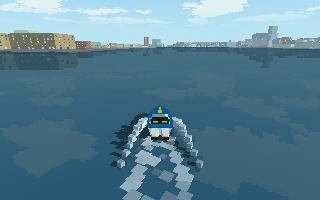
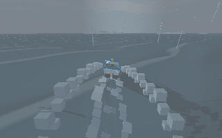

# Wake Velocity

Navigate Gothenburg’s waterways by boat. Wake Velocity is a low-fi indie game featuring responsive
boat handling, chunky low-resolution scenery, and an original tracker soundtrack.

**[Play in your browser](https://doomdavve.github.io/proteus/)** ·
**[Download for macOS or Windows](https://github.com/doomdavve/proteus/releases/latest)**



*An afternoon on the river, heading towards Lindholmen.*

## Pick your kind of boating

- **Explore.** Cruise past quays, bridges and ferries, or take the longer voyage to
  Långedrag. Ride your own wake, find shelter, and try to stay upright in rough water.
- **Race.** Chase your best time and ghost in the basin, or race friends through river
  gates, ferry wakes and a moving storm.
- **Make waves together.** Join or host a room for up to four players. Go free boating
  or play deathmatch with water cannons, wave grenades and torpedoes.



*The outer fjord has other plans.*

## Get on the water

The browser version is the quickest way to try it. Press **PLAY**, then choose
**SINGLE PLAYER** or **MULTIPLAYER**. Desktop keyboard and mouse controls are supported;
phones also have touch controls and optional tilt steering.

On desktop, hold **W/S** for forward/reverse thrust and **A/D** to steer. Press **?** for
help or **P** for the menu. The [playing guide](docs/PLAYING.md) covers exploring, racing,
joining friends and recovering an overturned boat.

Wake Velocity is in active development. Expect some rough edges; the
[current plans](docs/README.md) track what's implemented and what's coming next.

## Build and develop

The game is written in **C17 with raylib**. Boat physics, networking and presentation
are separate, with a GPU renderer and a CPU reference renderer. Lua plugins let you
edit voyages and preview race courses while playing. The [authoring tools](docs/PLUGIN_API.md#native-authoring-tools-p41)
provide machine-readable schemas and isolated, deterministic voyage/race previews.

You'll need CMake 3.24+, a C compiler and native libcurl development files. Check the
[Linux](docs/LINUX_BUILD.md), [macOS](docs/MACOS_BUILD.md) or
[Windows](docs/WINDOWS_BUILD.md) guide for platform setup. The first configure downloads
pinned dependencies. Run these commands from the repository root:

```sh
cmake -S . -B build -DCMAKE_BUILD_TYPE=Debug
cmake --build build -j
./build/wake_velocity
```

Start with [testing](docs/TESTING.md), the [scene and renderer guide](docs/3D.md),
or [Lua gameplay plugins](docs/PLUGIN_API.md). There is room to work on boat feel,
water, scenery, game modes and sound. Keep changes small and use a separate Git worktree
and pull request; [AGENTS.md](AGENTS.md) describes the project workflow.

[Command-line reference](docs/COMMAND_LINE.md) · [Browser builds](docs/WEB_BUILD.md) ·
[Music](docs/MUSIC.md) · [Editor setup](docs/emacs.md) · [All documentation](docs/README.md)

Code is [MIT licensed](LICENSE). Map data © OpenStreetMap contributors, ODbL 1.0;
see the [map sources and attribution](docs/adventure/README.md).
