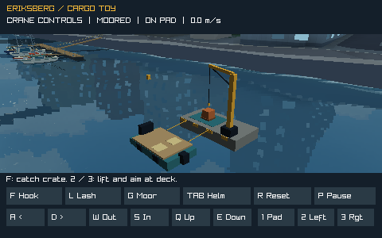
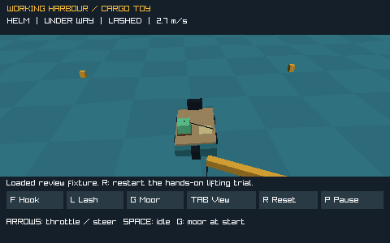
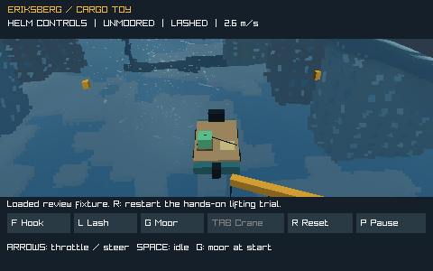
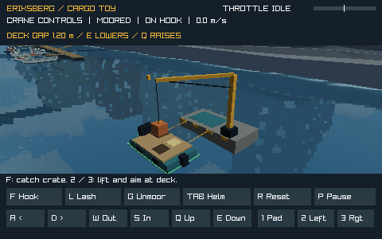
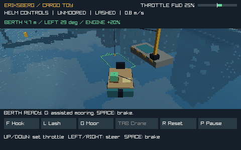
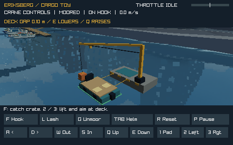
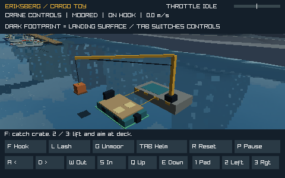

# Free ride sandbox: a working harbour

Status, 2026-11-07: **S1a-S1d and the deck-edge fix are merged to main (0f09479; PRs
#163-#168).** The standalone `cargo_sandbox` loads its `outer` sites and job from the bundled
package's [`scene.work`](PLUGIN_API.md#work-sites-s1a): the Eriksberg site, the turned landing
(S1b, whole tour accepted), the delivery job (S1c, "Landing works great now!") and the quay
pickup on a new jetty 120 m east (S1d, played and approved; [result](#s1d-result-2026-11-07)).
S0a and S0b are merged (#159-#162). `--location basin` retains the controlled reference without
a job. It is still an experiment, without payouts, saves or an addition to
the normal free ride menu. This plan owns
free ride's interactive cargo, player changes to places, Creative/Working Harbour rules, boat
ownership and economy. The [adventure plan](FREE_RIDING_ADVENTURE_PLAN.md) retains geography,
weather and the journey toward Vinga. [Marina authoring](MARINA_AUTHORING_PLAN.md) owns static
scene recipes and scheduled harbour life; [plugins](PLUGIN_PLAN.md) own authoring/runtime
contracts, including the [working-harbour contract](PLUGIN_PLAN.md#working-harbour-contract-proposed-2026-11-07);
[room content](ROOM_CONTENT_PLAN.md) owns loading and distribution.

Completed: design and requested Astra review; S0a's one-crate crane, pad, wave-posed deck,
explicit catch/release/lashing, assisted berth, load balance, recovery and native CPU/GPU view;
clearer helm/crane control switching; S0b's first mapped work site, receiver-projected landing
footprints, assisted return mooring and the wave-phase footprint correction. The user accepted
the basic toy, reported that harbour loading works as well as the basin, and accepted the
wave-stable footprint (“Now it works well!”, 2026-11-06). The return UX after the depth/mooring
changes has no separate acceptance beyond that report. No earnings or progression is
implemented, and the S0c qualification limits below remain open.

Completed planning task, 2026-11-07: review against the merged code found that every work-site
value is compiled into C (core `#define`s, the site header, a custom platform mesh and the
sandbox's hull), and the sandbox loads no package. The [content/mechanics split](#content-in-plugins-mechanics-in-c)
now places site layout, loads, jobs and project outcomes in a plugin package and keeps
physics and validation native. Completed S1a-S1d, 2026-11-07: see the [S1a](#s1a-result-2026-11-07),
[S1b](#s1b-result-2026-11-07), [S1c](#s1c-result-2026-11-07) and
[S1d](#s1d-result-2026-11-07) results; the user played the landing and both outings and
approved them. They then reported that cargo collision was sometimes off; that was S0a's deck
contact, fixed in the [deck-edge fix](#deck-edge-collision-fix-2026-11-07), merged with the
rest. Still owed: the user's play check of that fix and S1's review of fun, then broader S0
qualification. S1e's F1-F4 are implemented locally on `feat/sandbox-plugin-fixtures`, and
[SV1, local save and resume](#sv1-local-save-and-resume), is designed (2026-11-07): automatic
saving, the working harbour as a Single Player menu content in `wake_velocity`, and saves
discovered in the menu. SV1a (the core cargo snapshot and restore) and SV1b (the save format) are implemented locally; next
implementation task: [SV1c](#sv1-steps), resume and the autosave policy in memory. Future PRs still
require the user's approval.

## S0a: try the cargo toy

Build and run from the implementation worktree root:

```sh
cmake -S . -B build -DCMAKE_BUILD_TYPE=Debug
cmake --build build -j
./build/cargo_sandbox
```

This native experiment defaults to `outer` and GPU; `--renderer cpu` uses the reference
rasterizer. `--location basin` selects the original isolated fixture. Each location's site comes
from its bundled work package (`proteus.outer-work` on `outer`, `proteus.basin-work` on the
basin; `--package ID` selects another bundled free package with work sites at that location). It starts with a
borrowed deck boat moored beside one crate and a small service crane in the Eriksberg inlet.
There is no save, money or timer. Since S1c the package's job, shown at the top right, is to
carry the crate to the `landing`; delivering it builds a quay beside the landing, and since S1d
the quay's pad holds the next crate, for a new `jetty` up the river. **C** returns an unhooked,
unlashed crate to its source pad (the quay's, after the supply). **R resets boat, crate and job immediately**;
**P pauses the simulation**, including a suspended load. Escape closes the experiment.



First lift:

1. Press **F** to catch the crate. Press **2** or **3** for the left/right deck target.
   The optional aim assist raises and slews the crane using its ordinary limited motors;
   it does not teleport the load. Wait for the hook to stop above the deck.
2. Hold **E** to lower. A dark footprint follows the receiving deck before contact,
   and **DECK GAP** reports the remaining height. The prompt changes at touchdown.
   Press **F** to release the hook, wait briefly for settling, then **L** to lash it.
   A green crate and two straps confirm it is secured.
3. Press **G** to unmoor and **Tab** to activate helm controls (and change camera). Use **Up/Down** to adjust throttle,
   **Left/Right** to steer and hold **Space** to idle the throttle and brake. Try a short turn through the yellow
   markers. Reset and compare the other deck position, or leave the crate on the pad
   and take the boat out empty.

For manual crane experiments, **A/D** slew, **W/S** extend/retract and **Q/E** raise/lower.
Manual motor input cancels aim assist; **1** aims at the source pad. Mouse buttons expose
the crane motors and actions; driving currently uses the keyboard. The Tab button names its
destination, **Helm** or **Crane**, and the header names the active controls. Tab switches
controls as well as camera, returning to the helm
while a load hangs, stopping the motors while physics continues. Departure rejects a
connected hook or loose deck cargo. To return, use the berth distance/turn cue and approach
the boat-shaped outline at low speed. Hold Space to stop; when **BERTH READY** appears,
press **G** to stop and align automatically. Press G again to cancel the assist. R remains
the immediate recovery if docking gets in the way.
Unlash only at low speed; a floating/dropped crate remains simulated and can be caught again
if in reach. Reset is always available when it is out of reach.

Useful feedback: does catching, lowering and lashing read clearly; is the aim assist helpful;
does sway invite another attempt; can you see the receiving deck; are empty/left/right turns
different enough to explore? No reward loop is needed to answer these questions.

### S0 steps and current limits

| Step | Status | Next gate |
| --- | --- | --- |
| S0a controlled handling toy | Implemented as native `cargo_sandbox`; basic toy accepted by the user; control labels clarified | Review the updated labels in the harbour experiment |
| S0b harbour placement | First Eriksberg work site merged, with native CPU/GPU scenery, boat/shore/camera contacts, landing footprints and assisted return; wave-stable footprint accepted | The second receiving site is package data from [S1b](#s1b-result-2026-11-07); the user drove the crossing by hand |
| S0c broader qualification | Not started | Multiple loads and measured 16-body stress ceiling, browser/touch, audio feedback and harbour traffic/wake performance |

The original S0a test basin preceded harbour site selection; it remains an explicit
reference mode. One upright 0.8 m crate is the
entire active-body budget in this step. Four bounded cable projections, one support contact
and fixed 120 Hz stepping provide pendulum motion, deck sliding and water recovery; there
is no cargo/cargo contact, stacking, free angular rigid-body solver or dependency addition.
The pad and deck catch contact use bounded support regions; a fallen crate has simple
surface recovery rather than multi-sample buoyancy. No solver stability claim extends beyond
these fixtures. The boat has a 4.6 × 2.6 m contact/visual recipe but still uses the existing
speedboat's six buoyancy supports. Secured cargo reduces speed changes and adds bounded
trim/heel; loose/hanging cargo exerts no reaction forces. This is an authored workboat
approximation. The temporary work platform uses a conservative circular boat exclusion;
the `outer` boat
also uses the existing mapped shoreline, berth and moving-traffic contacts. Dropped floating
cargo stops at the compiled bank. The platform is a new temporary native prop, not an
existing decorative quay assumed to be a load-bearing surface.

Both renderers consume the same evaluated box/beam meshes, including the hook, cable,
crate, straps and deck markers, at 480 × 300 with nearest-neighbour integer presentation.
The basin retains its simple test view; `outer` uses the production scenery, harbour actors
and water meshes (including the GPU near-water patch). The custom boat/crane/cargo pass has
simple lighting and does not yet participate in GPU reflections or cast directional sunlight
shadows. A shared vertical landing footprint is projected onto the deck, pad and water
before contact to provide a depth cue; it is not a sunlight shadow-map implementation.
The correction clips to the renderer's actual triangles, including the bow,
and uses exactly the current GPU vertex count; see the wave-phase result below. The CPU
reference limits draw distance to 240 m to bound displaced-water work; the GPU uses 4500 m. CPU
display-free captures contain the 3D view; windowed CPU and GPU captures include the HUD.
There are no new sounds. Browser/touch, normal-game integration, persistence, multiple cargo
IDs, progression and multiplayer remain outside these S0 steps.

Review and measurement commands:

```sh
./build/validate_boat_cargo --benchmark
./build/cargo_sandbox --survey
./build/cargo_sandbox --location basin --renderer cpu --screenshot build/cargo-basin-cpu.png
./build/cargo_sandbox --renderer cpu --screenshot build/cargo-origin-cpu.png
./build/cargo_sandbox --renderer gpu --scenario swing --screenshot build/cargo-swing-gpu.png
./build/cargo_sandbox --renderer gpu --scenario loaded-left --screenshot build/cargo-left-gpu.png
./build/cargo_sandbox --renderer gpu --scenario loaded-right --screenshot build/cargo-right-gpu.png
./build/cargo_sandbox --demo --frames 360
```

`swing` advances actual crane physics; the two loaded review fixtures use the application's
aim assist to lift onto the wave-posed deck, release, settle, lash, depart and drive a short
turn. They fail if a transfer cannot complete. The display-free CTests
`cargo_sandbox_left_screenshot` and `cargo_sandbox_right_screenshot` exercise the basin paths;
`cargo_sandbox_outer_left_screenshot` and `cargo_sandbox_outer_right_screenshot` repeat them
in the harbour;
`boat_cargo` separately checks the core state/constraint transitions. Automated fixtures do
not establish a successful human lift or enjoyable controls. `--benchmark` measures a single
hanging cargo tick with timer overhead; it does not establish the harbour/16-body budget.

## S0b: first Eriksberg work site

The experiment's default mooring is simulation **(10, 245), heading 0** at the north end
of the Eriksberg inlet, outside the marina entrance and registered traffic paths. The
3 × 6 m temporary fixed work platform sits five metres toward simulation +X from the
boat, with its original 1 m pad surface and 5.5 m crane tip height. It is an explicit test
prop, not a claim about existing quay strength, seabed depth or real crane engineering.
One cargo/crane state is translated to this origin; the normal game's map and packages are
unchanged. This step does not yet author a second work site, unload at a destination or
complete a persistent landing.

`--survey` loads the actual scenery pack and checks the site's water and berth clearance
on a 1 m grid over local X = -3..11, Z = -5..12, with a 1 m shoreline margin. It checks a
larger conservative traffic rectangle (centre +2,+2, half beam 10 m, bow/stern 12 m) at
0.25 s intervals through the longest retained actor period. This covers each compiled
actor's cycle; it is sampled clearance evidence, not a proof about future authored routes.
The launch runs the same check. Initial and live cameras check loaded scenery, berths,
traffic, and the temporary platform/tower/boom along the viewing segment.

Try the same lift, then drive out towards the marina at low speed, steer around the
moored boats and return. The boat outline now marks the actual final berth position,
with a bow arrow for heading 0. Enter the larger assisted capture zone, roughly facing
the arrow, at no more than 1.5 m/s; **BERTH READY** signals that G can take over alignment.
Hold Space to slow down, and use G again to cancel an active capture. R remains the quick reset. This tests whether loading still reads clearly against a real waterfront and whether
a loaded boat is interesting to take out and dock again. The broader map retains its
ordinary visual traffic wakes; no physical ferry wakes were added.

Two other candidate footprints, **(-105, 0)** and **(-200, -150)**, passed the preliminary
water/berth/traffic survey. [S1b](#s1b-result-2026-11-07) authored the nearer one, (-105, 0),
as the package's receiving site; (-200, -150) remains an unreviewed candidate. No earnings come
first.

## S0b: depth cues and returning to the berth

User feedback, 2026-11-06: harbour loading works as well as the basin, but the shadow did
not communicate depth and returning was very difficult. Confirmed causes: the old landing
marker stayed at water height until physical deck contact, hiding it beneath the boat; the
green lines were behind the actual berth, and the G gate required an unmarked point within
0.6 m, speed below 0.5 m/s and heading within about 9 degrees. Throttle was not displayed.
This feedback establishes a working harbour loading path, not acceptance of the return UX.

The shared CPU/GPU landing footprint now projects onto actual visible hull, deck, helm,
platform and water triangles **before** contact, clips at their edges and darkens their
albedo close to touchdown. It retains the receiver's triangle planes rather than bridging
them with a separate four-corner quad. The DECK GAP readout measures crate-bottom
clearance from the actual deck plane. These are explicit vertical depth cues; the custom
boat/crane/cargo pass still has no directional sunlight shadows. The whole temporary
platform's supported crate-centre area now agrees with its drawn length.

The return outline marks the final hull pose, with a bow arrow and water-following lines
raised above the waves. The HUD reports distance and a turn cue: toward the berth when
away, then toward the bow-arrow heading in the capture area. It also shows throttle
FWD/REV/IDLE, a signed bar, speed and engine response. Up/Down sets persistent throttle;
releasing the arrow does not idle it. Holding Space cuts the command and adds a bounded
2 m/s² stopping aid, only in this experimental tool. Ordinary game handling is unchanged.

G becomes available when the boat centre is in local renderer X = -0.6..2.4 m and
Z = -3.5..5 m, speed is at most 1.5 m/s, heading is within 45 degrees of the bow arrow,
and the hull is upright. The asymmetric zone stays on the open-water side of the platform
and inside the surveyed work envelope. The outline is the **final** boat pose; BERTH READY
appears before exact alignment is needed. G starts an explicit alignment assist (at most
1.5 m/s translation and 0.6 rad/s yaw), idles/centres controls and retains wave heave, pitch
and roll. It ends at the original berth; G cancels without an additional snap and ordinary movement
resumes. Departure
still rejects a connected hook or loose deck cargo, and a capsize cancels capture.

Review commands (`berth-approach` is an explicit return pose; `mooring`/`remoor` then use
a crate obtained by a real lift/lash and real G/capture ticks, not a seeded moored state):

```sh
./build/cargo_sandbox --scenario shadow-high --screenshot build/shadow-high.png
./build/cargo_sandbox --scenario shadow-low --screenshot build/shadow-low.png
./build/cargo_sandbox --scenario berth-approach --screenshot build/berth-approach.png
./build/cargo_sandbox --scenario mooring --frames 180
./build/cargo_sandbox --renderer cpu --scenario remoor --screenshot build/remoor-cpu.png
```

Next: review these depth and return controls by hand, then continue with the receiving site
and first useful crossing. No new boats, rewards, persistence or physical ferry wakes are
part of this correction.

## S0b: wave-phase shadow correction

User feedback, 2026-11-06: footprints still disappear on the boat and sometimes on water,
correlated with waves. The prior centre-deck snapshots did not cover the bow/receiver-edge
case. A new virtual-clock render probe reproduces the failure and counts the footprint's
actual visible pixels over eight poses and 32 water phases per pose.

Confirmed causes and corrections:

- The projected rectangle was clipped to the loading deck's ±1.9 m fore/aft bounds, while
  the rendered hull extends to ±2.3 m. Pitching moved a bow-edge projection outside the
  smaller rectangle. The decal now clips to actual upward-facing receiver triangles,
  covering the visible bow and raised helm as well as the deck and pad.
- Four independently sampled water corners formed a different plane from the rendered
  water triangles. The decal now retains those triangles' planes. CPU uses the already
  displaced mesh; GPU evaluates only intersecting near-patch triangles with the same
  vertex water samples and patch fade as its water shader. The small drawing separation
  is 12 mm above that exact receiver, rather than a wave-height approximation.
- The custom GPU upload changed `triangleCount` but left `vertexCount` at allocated
  capacity. Raylib's non-indexed draw uses `vertexCount`, allowing stale trailing geometry
  to be drawn when the current mesh shrinks. Each draw now uses exactly its current
  vertex count, including zero for an empty mesh.

This changes the visual receivers; the physical loading deck and lashing rules remain as
before. The footprint can be occluded by the crate or by nearer geometry, as expected.
No directional sunlight shadows, reflection integration or new cargo physics is claimed.

Developer checks:

```sh
./build/validate_cargo_decal
./build/cargo_sandbox --location basin --renderer cpu --shadow-review
./build/cargo_sandbox --renderer gpu --shadow-review
./build/cargo_sandbox --scenario shadow-bow --screenshot build/shadow-bow.png
./build/cargo_sandbox --scenario shadow-water --screenshot build/shadow-water.png
```

The review uses eight explicit poses (centre deck, bow edge, water and pad, with high/low
load variants) over 256 virtual-clock frames, with diagnostic colours used only to count
rendered footprint pixels. It has no wall-clock wait or performance assertion. An optional
`--screenshot FILE` with `--shadow-review` writes the first missing-footprint frame on
failure; it writes no image on success. GPU review also draws a nonempty mesh followed by
an empty one and checks that no old pixels remain. `shadow-bow` and `shadow-water` are
normal-colour review fixtures at simulated 3.5 s, including a formerly failing bow phase.

**Workflow (history):** the user tested this correction and approved publication on
2026-11-06; it was folded into PR #162, which has since merged with the rest of the S0 stack.
Approval covered that correction only; future PRs still require the user's approval.

## The experience

Give the boat a purpose and let the player leave useful changes behind. Dock beside a small
working quay, swing a pallet onto a deck boat, lash it down, cross the river, and unload the
parts that complete a pontoon. Next time, that pontoon is a usable place to moor. A boat that
was previously just scenery might need a tow; an exposed delivery becomes easier with a
different hull or a better loading arrangement. Cruising, jumping wakes and exploring remain
reasons to take a boat out even when no job is accepted.

The proposed loop is:

```text
Explore and spot an opportunity
        -> load / tow / help
        -> make an interesting boat journey
        -> deliver and change a place
        -> earn money, equipment or access to another kind of work
        -> choose the next outing
```

The first question is whether manipulating a load and carrying it are enjoyable. A payout
cannot rescue dull handling. Keep the playful Wake Velocity movement, readable low-resolution
presentation, compact C systems and recognizable Gothenburg setting. Make careful work and
reckless experimentation both entertaining choices.

Near-term success: **a player can make a small plan, try it with the boat and crane, get a
surprising but understandable result, and quickly try another idea.** Voluntary experimentation
is stronger evidence than repeating a lift only to overcome awkward controls.

## Two ways to use the same world

| | Creative | Working Harbour (working name for survival/progression) |
| --- | --- | --- |
| Boats and tools | Available immediately; spawn, borrow and swap supported boats | Start with a useful small boat and access to a shared quay crane; buy, rent or earn equipment |
| Cargo | Spawn supported loads and experiment freely | Carry owned goods, accepted jobs or salvage |
| Changing places | Place, move, remove and restore supported harbour pieces | Supply materials and earn access to improvements at suitable sites |
| Fuel | Unlimited by default; consumption can be enabled for experiments | Pay for fuel once the basic work loop is established |
| Failure | Recover objects, undo edits and reset the sandbox | Recover boat and cargo; bound losses and always retain a route back to useful work |
| Goals | Player chosen projects and experiments | Optional jobs, local projects and an eventual expedition boat/journey |

Creative and Working Harbour use the same cranes, ropes, cargo and placement rules. Creative
eventually exposes every supported interaction without earning gates; it does not promise
arbitrary terrain destruction, custom mesh import or changes to every existing landmark.
Prioritize moving cargo, arranging a working waterfront and changing usable infrastructure.
Offer projects, rather than requiring a first-person avatar, hunger, crafting trees or combat.

Keep today's unrestricted cruising available. A new progression save must not suddenly lock an
existing player's Explorer or make old free ride consume fuel. Start new Working Harbour worlds
explicitly. A Creative copy can be made from a progression world; sandbox spawning/undo must
not flow back into its economy. No proposed menu label is an implemented control.

## First outing: one load that matters

Use the existing `outer` harbour. Survey two nearby, sheltered working sites with clear
approaches, enough crane reach and no obstruction of ferries or marina entrances. Reuse the
marina's fixed/floating structure recipes, adding a modest service crane rather than turning
the huge Eriksberg landmark into a precision loading machine. Exact sites need a collision and
camera survey; do not assume a decorative quay is already a usable work surface.

The player borrows a compact flat-deck workboat, starting the first session already moored
beside its source load. At later visits they secure the boat,
enter a crane view, select a pallet's generous lifting target, slew/luff/hoist it onto the
deck, then explicitly lash it. They switch back to the helm for a short crossing. At the
destination a second crane unloads the pallet into a marked receiving area. Unloading the
supplies completes a small prepared landing with a working mooring point. Delivery commits
only after the hook is detached and the load is settled; entering a destination circle with
cargo aboard is insufficient.

That landing immediately becomes a recovery/loaner point or a nearer pickup for the next
outing. Demonstrate its usefulness on the following trip. A project completes once; repeatable
deliveries continue paying for ordinary work without rebuilding the same landing. Later jobs
can start near the last destination rather than requiring an empty return every time.

Aim for a **5–8 minute outing**, including handling and a brief water leg; this is an optimistic
playtest target, not a measured duration. Measure active handling separately from waiting,
searching and empty travel. Allow leaving halfway, dropping a load, retrieving it and
trying again. No hard timer or up-front cargo deposit in the introductory job. Include a
nearby reset/recovery action and a clear return to the helm from crane mode.

At game resolution, communicate hook target, deck footprint, legal load, lashing state and
delivery progress through silhouettes, colour plus shape/text, a landing shadow and short
context prompts. Crane view should keep hook and receiving surface visible. Support keyboard,
mouse and the existing touch flow before a public playable release; final bindings follow
the control experiment. Motor/rope/impact sounds and gentle load sway provide useful feedback.

Start with assisted mooring at authored work berths: constrain horizontal drift/yaw while
retaining bounded wave motion. Entering crane mode idles thrust and keeps the boat secured;
the world continues on the same tick clock, with solo pause available immediately. Returning
to the helm stops crane motors but retains a suspended load and its dynamics. Reject departure
while a hook remains connected to the boat or its load, with a clear release prompt. Test
crane-mode exit, premature unmooring and disturbance at the work berth. Physical multi-line
mooring can wait. Ordinary traffic wakes remain visual; initial tests use qualified ambient
water/player wakes and do not add physical ferry wakes.

## Cargo and crane physics

Start with a deliberately small simulation experiment, not a whole harbour of active rigid
bodies. Existing boats have heave/pitch/roll and planar contacts, but `BoatHandling` currently
contains thrust and a hull pointer: cargo mass, a working deck and crane constraints are new
work, not values that can simply be added to a scene definition.
`BoatHull` adjusts contact footprint/yaw inertia while buoyancy still uses speedboat-sized
support locations and shared normalized parameters. A wider visual hull is not automatically
a physically supported workboat; declare the workboat's deck/support and handling approximation.

Proposed approximation:

1. A crane has authored joints, limited motor speeds, reach and load limits. Its hook supports
   one load through a damped distance constraint with visible pendulum motion. Start with one
   rope segment; a rope mesh can suggest detail. Catch targets are generous and attachment is
   an explicit action. Do not require exact hook collisions to select an item.
2. Cargo uses boxes with position, velocity, orientation, simple contact shapes and modest
   restitution. Implement quay/deck contact first, then limited cargo/cargo contact. Qualify
   both a hanging load and transfer onto a moving, wave-posed deck. Restrict stacking until
   contacts are stable; a pile simulator is a separate ambition. For S0 the deck is a prescribed
   moving support: loose/suspended cargo does not feed reaction forces back into the boat.
   Only secured loads affect its authored handling. Do not count hook-supported weight twice;
   detaching cargo preserves its deck-point velocity, including the hull's rotation.
3. Loose cargo can shift or fall. Lash a settled item inside a supported deck footprint to
   attach it to the hull; unlash only at a safe speed. Cargo has one explicit state/owner:
   stored, suspended, loose, secured, floating/lost or delivered. Every transfer is atomic.
4. Secured cargo contributes bounded load and fore/aft/lateral balance to the boat model.
   Start with acceleration/braking and a readable trim/heel effect; tune larger stability
   consequences through play. Reject overloads clearly. Empty boats retain their existing
   handling. A hull without a cargo deck can carry only explicitly supported small loads.
5. A fallen introductory crate floats long enough to retrieve, using the existing water
   query with a few buoyancy samples. Other cargo can later have authored recovery properties.
   Never strand the player waiting for a drifting job object that cannot be found or reset.

Use the existing 120 Hz tick, bounded constraint iterations, speed limits, contact margins and
sleeping for settled objects. Proposed S0 budget: **16 active cargo bodies, one operated crane
and no arbitrary stacks** as a stress ceiling. Prove one load, then a few, before enabling
cargo/cargo contact or raising the budget. Settled distant cargo can retain stored
state; a held or falling load must not freeze because the camera turns away. Include capsize,
reset, hook release and a moving deck in the stability fixtures.

The [Box2D simulation guide](https://box2d.org/documentation/md_simulation.html) is a reference
for fixed stepping, kinematic/dynamic bodies and sleeping. This is our proposed 3D cargo
approximation; that reference does not select Box2D or establish a solver choice. S0 should
compare the smallest viable constraint/contact implementation against a small existing 3D
solver only if measured instability warrants a dependency. Do not replace boat physics.

## Boats, work and progression

Boats should open different play rather than form a single ladder of increasing speed.

| Boat/tool | Useful capability | Tradeoff to make interesting |
| --- | --- | --- |
| Small launch / existing cruising boat | Explore, carry a small supported parcel, visit nearby jobs | Limited load space; convenient and cheap to run |
| Flat-deck workboat | Carry several pallets, arrange weight, deliver building pieces | Slower with a load; requires access to quay cranes |
| Winch/tow fitting | Retrieve floating goods and assist disabled craft | Tow length and tension affect turns and docking |
| Tug or crane-equipped workboat | Move a barge, handle heavier loads or unload away from a crane | Higher cost, larger clearance and reduced agility |
| Explorer / expedition variant | Longer exposed outings, remote service or survey work | Range and weather suitability, not the best cargo carrier |

Introduce one physical new capability at a time. Rental/borrowing lets players try work before
buying a specialist boat. Separate hull/handling, equipment, ownership and appearance explicitly;
today's Explorer is a stronger solo engine selected through a livery. Keep that shortcut in
unrestricted free ride while defining a real boat identity for progression. Selling/trading
must preserve a starter/loaner option and must reject a sale with unresolved cargo or tow state.

Early work can be local deliveries and salvage. Then add one disabled boat and a simple tow
constraint; useful speed/length/tension cues matter more than a many-link rope. Rescue can
initially mean reaching an indicated casualty craft and bringing it to shelter, avoiding a new
swimming/ragdoll system. Later variations include fragile cargo, awkward dimensions, exposed
routes and urgent assistance. Let these combinations arise from shared tools, not separate
mission minigames for every job.

Use short, finite local projects: repair a landing, add a finger pier, install a fuel service
point, or bring equipment to a remote worksite. Supplied objects become persistent usable
infrastructure. Author valid sites and keep protected channel/bridge/traffic corridors clear.
Creative later permits freer arrangement within validated areas; progression earns the same
pieces through jobs/materials. Keep a few places densely interactive before enlarging the map.

The optional long goal is acquiring and fitting out an expedition-capable Explorer, then
making a prepared voyage toward Vinga when that geography is delivered. Give it useful jobs
after purchase. The harbour must already work as an open-ended game on the current map; neither
Vinga nor a final purchase should be necessary to make the first deliveries worthwhile.

## Money, fuel and recovery

Start with one currency, fixed quoted job payouts and posted purchase/rental/fuel prices.
Avoid commodity speculation or a simulated market. A completion can pay money **and** advance
a visible local project, giving the trip both a personal reward and a lasting result.

Add scarcity after a load feels worth carrying. Show estimated fuel needed, fuel available and
expected job income before departure; mark service points on the chart. Consumption depends
on engine effort and boat/load recipe, with deterministic ticks. Fueling happens alongside a
service point at rest; never require balancing a handheld nozzle to resume normal play.

Initial balancing hypotheses for an ordinary completed job: fuel takes roughly **10–20%** of
the payout and a meaningful early purchase takes **3–5 varied outings**. These are deliberately
unverified tuning targets. Include loading time and the return/next job leg in cost estimates.
Do not make every interesting boat expensive to operate or every departure a ledger exercise.

An empty tank, lost crate or capsize must not create a debt spiral. Provide starter fuel at a
home quay or a loaner/assistance path; cancellation returns job state to a known valid origin.
Recovery may forfeit the current payout or charge a capped fee only when affordable. No idle
offline fuel drain, mandatory maintenance timers or permanent loss of the player's only boat.
Display reserve warnings early enough to choose shelter. Judge whether fuel adds route and
load choices; reduce or disable it if players just avoid exploring.

## Content in plugins, mechanics in C

Decision, 2026-11-07 (requested by the user): keep as much of the working harbour as possible
in plugin packages, and keep only the gameplay mechanics in native code. S0 compiled every
work-site value into C: the deck bounds, berth capture box and mooring limits are `#define`s
in `src/boat_cargo.h`; the crane base and crate pad are constants in `src/boat_cargo.c`; the
mooring position and survey are fixed in `tools/cargo_sandbox_site.h`; the platform is a custom
box mesh; and the workboat hull/handling are fixed in `tools/cargo_sandbox.c`. The sandbox loads
no package. Adding a second site that way would duplicate those constants, so S1 moves content
into data first.

| Native C (mechanics and safety) | Plugin package (content and rules) |
| --- | --- |
| Crane motors, rope constraint, cargo states and their atomic transitions | Work sites: crane placements, source pads, receiving areas, work berths and capture zones |
| Deck/pad/water contact, lashing rules and secured-load effect on the boat | Which loads exist and where they start, chosen from registered cargo presets |
| Assisted mooring motion and its bounds | Platforms and landings, as scene `marina.modules` once a fixed in-water module kind exists (S1a keeps the platform in its preset; see the [S1a result](#s1a-result-2026-11-07)) |
| Deciding a delivery happened (hook detached, load settled, inside a declared receiver) and emitting it as an event | Jobs: what to deliver where, project progress and HUD text; later payouts and prices |
| Placement/clearance validation, generalised from the S0b survey | What changes when a project completes (modules or berths that appear) |
| Input, cameras, rendering, save commits and file I/O | Which registered workboat recipe a site lends |

Guardrails:

- **Presets, not raw tuning.** A package selects registered crane, cargo and workboat presets
  with bounded placement overrides (position, heading, chosen limits within a preset's range),
  the same pattern as traffic routes. Motor speeds, rope limits, masses and contact margins
  stay native so the solver's tested envelope remains meaningful.
- **Invalid content fails at staging.** The S0b site survey becomes the staging validator for
  every authored work site: mapped water, berth and module clearance, the traffic sweep, crane
  reach to its pad and receivers, and the berth capture zone. The bundled catalog build runs
  the same check, so an invalid bundled site fails the build.
- **The core stays file- and Lua-free.** `proteus_boat_core` receives a copied, pointer-free
  site definition, like `BoatSceneDefinition`; decoding lives with the other plugin decoders.
- **Plugin reload policy.** Until a finer policy is specified, a changed work-site definition
  restarts the cargo session (cargo, crane and mooring reset), while display-only edits may
  preserve it. A load in mid-lift is never carried across an incompatible edit.
- **Native solo first.** Rooms, replays, recordings and browser imports reject the new grant
  and subsystem until each is qualified, as `scene.define` was introduced.

The [plugin plan](PLUGIN_PLAN.md#working-harbour-contract-proposed-2026-11-07) owns the
schema, grant, event and command contract; this plan owns the gameplay steps and acceptance.

## State, authoring and multiplayer

Keep immutable map/scenery and authored service/cargo/site definitions separate from mutable
world state: cargo poses/ownership, crane state, changed structures, jobs, boat inventory,
fuel and currency. Use stable IDs and bounded caller-owned arrays. Native code validates and
executes commands; Lua supplies supported data. The [content/mechanics split](#content-in-plugins-mechanics-in-c)
assigns each piece. Current `free` packages have no objective or callback grant, so S1c adds
one explicitly. Existing voyage HUD objectives alone cannot implement cargo or money safely.

Put physical cargo/constraint stepping behind the core boundary. A small data-only sandbox
rules layer can own transactions; the application owns menus, input, file I/O and save commits.
Both renderers consume a shared evaluated view of cargo, hook, ropes and changed structures.
Extend authoring placement checks into runtime validation; free placement must update drawn
geometry, contact envelopes, camera exclusion and navigation clearance together. Plugin reload
and Undo need a stated reconciliation policy before mutable sandbox state is supported.

First deliver solo with explicit session state and reset. **All persistent state saves
automatically; the player never has to save** (the user's rule, 2026-11-07). Writes happen at
safe between-tick boundaries: each committed job or objective batch, each delivery, supply,
build or mooring change, periodically while state is dirty, and when pausing, leaving to the
menu or quitting. A small "saved" mark is the only feedback, and Continue resumes the latest
state. Money, boats, fuel and projects follow the same rule; [SV1](#sv1-local-save-and-resume)
is its first application. Add versioned local save/resume before persistent progression: content identity, stable IDs, inventory, fuel, transaction IDs
and completed projects. A quit/save request must always finish promptly. Record each item's
last stable support (pad or secured deck); on save during a lift, store a recovery configuration
that returns the same cargo ID to that support and releases the hook on resume. Capsize or
unrecoverable job cargo uses the declared home/source recovery path. Preserve completed
deliveries, project completions and rewards; never rewind the entire outing. A full destination
pad requires moving its occupant or choosing another valid receiving pad, with cancellation
available. Test each recovery path for duplicate/missing items and blocked pads. Write outside
the tick with an atomic replacement/backup; reject incompatible saves with a clear recovery choice.
Qualify browser storage and failure reporting separately from native files.

Plan cooperative play, but do not make it a prerequisite for the first lift. Later, the host
owns cargo, money, fuel and world edits. Commands include intent/identity; the host checks
ownership, distance, crane control and placement. Duplicate/reordered requests must not pay
twice. Checkpoints include mutable objects and project/job state; content packages still only
describe their initial definitions. Resolve whether money belongs to a shared company before
cooperative progression; proposed first rule is one host-owned world and shared funds, with
no transferable cross-server wallet. Follow [plugin P5](PLUGIN_PLAN.md) and the existing
[protocol](MULTIPLAYER_PROTOCOL.md) for authority, late joins, prediction and compatibility.

## Playable slices and gates

S0 and S1 begin as small playable experiments. Later rows are milestones, not single-PR
commitments: Creative manipulation, placement/undo, save storage and boat trading each need
separate reviewable steps. Refine only the next milestone into implementation tasks. Each
implementation step uses a separate worktree/PR; dependent branches target their parent until
merged, following the repository stack workflow. S0a implements the first controlled test;
the remaining gates below are still open.

| Slice | Depends on | Playable result and completion gate | Status |
| --- | --- | --- | --- |
| S0: handling experiment | Current main | One service crane, pallet, static pad and moving deck. Swing/drop/recover a crate; load two different deck positions and try a short turn. Observe voluntary experiments without rewards, stability and controls. Measure bounded tick cost. | S0a basic toy accepted; S0b first harbour site implemented; receiving site and S0c qualification remain |
| S1: useful crossing | S0 | Flat-deck loaner, assisted mooring, two working sites, one short delivery and a landing that helps the next outing, with site content and jobs in a plugin package. Optional variation: two light crates versus one awkward load. Empty/loaded boats feel distinct. Retry/capsize/reset leave a valid job. A player completes it without developer help and tries another idea. Delivered as [S1a–S1d](#s1-steps); [S1e](#s1e-remaining-fixtures-as-package-data) moves the remaining fixtures into data. | S1a–S1d merged; S1b crossing, S1c landing and S1d both outings played and accepted |
| T0: towing toy | S1 | Borrowed tow fitting, one disabled craft and shelter handoff, without currency or a rescue countdown. Try turns, release, reset and recovery. Establish a second enjoyable activity before pricing work. | Proposed; before S3 |
| S2: Creative harbour | S1 | First expose boat selection, cargo spawning/removal and reset as a small toybox. Then add validated dock pieces, undo and layout export in separate steps. Reject obstructed channels/entrances atomically. Player builds a useful or amusing arrangement without a job prompt. | Proposed |
| S3: saved Working Harbour | S1 + T0; reconcile S2 edits | Versioned native/browser save path, a few varied local jobs, currency and buy/rent/sell boats, delivered in separate steps. Persistent project changes; preview a purchase through borrowing. Save/reload cannot duplicate goods or payouts; player has a choice beyond repeating one delivery. | Proposed |
| S4: fuel and services | S3 | Fueling, readable range/reserve, service points and recovery. Round-trip economics stay positive for introductory work; a zero-funds/empty-tank save remains playable. Test whether scarcity creates interesting decisions. | Proposed |
| S5: towing and assistance jobs | T0 + S3; S4 for priced fuel | Develop the proven tow toy into winch, tension/length cues and paid assistance. Break/release/reset safely; prove turns, wake crossings and capsize without solver explosions. Try a rescue and a barge-like cargo job. | Proposed |
| S6: harbour projects and expedition | S2–S5; adventure map for Vinga | Several persistent useful sites and boat capabilities; Explorer fitting-out goal. A short local expedition works before any Vinga expansion. Review progression pace and reasons to keep playing after the purchase. | Proposed |
| S7: cooperative working harbour | Stable solo state; plugin/network authority contract | Two friends can share helm/crane work, join late and reconnect. Host validates edits, cargo and spending; tests cover conflicting commands and duplicate rewards. Qualify native/browser pairs. | Proposed |

Review fun after every playable slice; these gates are observations to gather, not automatic
approvals or substitutes for automated checks. If S0 feels fiddly, simplify attachment, damp
sway or improve the camera before adding more physics. If S1 is dull, shorten travel and make
the destination change more useful before introducing money. Do not turn open play into a
required chain of chores merely because later slices are listed.

### S1 steps

Each of S1a-S1d was its own worktree and PR, stacked on its parent (all merged). S1e below replaces that wording for its series.

| Step | Result | Completion gate | Status |
| --- | --- | --- | --- |
| S1a: existing site as package data | Today's Eriksberg site comes from a bundled package; behaviour unchanged | Existing cargo CTests, survey and shadow reviews pass; inspected CPU/GPU captures match the S0b site | Merged; [result](#s1a-result-2026-11-07) |
| S1b: second receiving site | A receiver at a surveyed candidate, placed by editing the package | A native receiver preset and site heading first (S1a has one layout facing heading 0); then no further C change beyond bug fixes; staging survey passes; camera review of the receiver and approach; a hand-driven crossing between both sites | Merged, accepted 2026-11-07; [result](#s1b-result-2026-11-07) |
| S1c: delivery events and a job | Native delivery commit and cargo events; a Lua objective counts the delivery and completes the landing | Exactly-once delivery across retry/reset/capsize; the landing appears through a validated scene command; HUD shows job state | Merged, played 2026-11-07; [result](#s1c-result-2026-11-07) |
| S1d: useful landing playtest | The built quay is the next outing's nearer pickup: its load goes on a short second crossing ([plan](#s1d-the-quay-becomes-the-next-pickup)) | The user completes both outings without developer help and tries another idea | Merged, played and approved 2026-11-07; [result](#s1d-result-2026-11-07) |

#### S1a: the existing site as package data

Move the S0b site out of C without changing how it plays:

1. Replace the site and deck `#define`s in `src/boat_cargo.h` and the constants in
   `src/boat_cargo.c` with a pointer-free work-site definition (crane preset and placement,
   pad, work berth and capture zone, cargo start) passed to `boat_cargo_reset_at` and the
   step functions. Keep the workboat deck bounds with the workboat preset. The current values
   become the registered defaults, and `boat_cargo` keeps passing unchanged.
2. Add a `scene.work` subsystem to the scene envelope (scene v4, keeping the v2→v3
   no-compatibility precedent), decoded into that definition. Add the [plugin API](PLUGIN_API.md)
   schema, discovery entry and diagnostics.
3. Add a bundled `proteus.outer-work` package (`kind = "free"`, `location = "outer"`,
   `["free.define", "scene.define"]`) that describes today's site, with its platform as a scene
   `platform` module instead of the custom box mesh. Check the platform's contact, camera
   exclusion and supported crate area against the module; a visible change in the platform's
   look is expected and must be inspected, not assumed.
4. Make `cargo_sandbox` open that package through the catalog (`--package ID`, defaulting to
   it on `outer`); the basin reference stays an explicit fixture. Remove `CARGO_SITE_MOORING`.
5. Generalise `cargo_site_clear` into the staging validator for authored work sites and run
   it from staging, the catalog generator and `--survey`. Add rejection cases: dry or blocked
   footprint, receiver out of crane reach, overlapping work berths, and traffic conflicts.

Not in S1a: a second site, new presets, objectives, events, browser or room support, or any
change to cargo physics. Reload policy is the restart rule above.

#### S1a result, 2026-11-07

Implemented:

- `scene.work.sites` (1–4 sites: `id`, `preset`, `cargo`, `x`, `z`) in `BoatSceneDefinition`,
  decoded from Lua, validated, digested, carried on the plugin/stage wire and described in
  `tools/plugin_schema.py`. The [API](PLUGIN_API.md#work-sites-s1a) owns the contract. Only
  `free` packages accept it; rooms reject it as solo-only.
- The survey moved from `tools/cargo_sandbox_site.h` (deleted) into the core as
  `boat_cargo_site_clear`, now including authored traffic periods, plus
  `boat_cargo_sites_apart`. `boat_plugin_free_check_location` takes the map and runs it for
  every site with spawn and site-overlap checks, so staging, the catalog generator and
  `boat_room_package` share it.
- Bundled native-only `plugins/outer-work`; `cargo_sandbox` opens it through the catalog
  (`--package ID`, default `proteus.outer-work` on `outer`), binds its scene and resets from
  its first site. `CARGO_SITE_MOORING` is gone.

Deviations from the step list above, decided during implementation:

- **No scene v4.** `work` is an optional scene v3 subsystem, like `traffic` and `gulls`.
  Bumping the version would have changed every scene package and the room wire (which
  validates version 3) for no gain; absent work keeps all existing digests.
- **The platform stays part of the native preset, not a `marina.modules` piece.** No module
  kind fits a fixed platform standing in water: `platform` heaves with the waves (it would move
  the pad), `quay_deck` must stand on land at 3.8–8 m, and any present module list replaces the
  whole compiled marina. Landings in S1c will need a fixed in-water module kind, or a way to
  add modules without replacing the compiled set.
- **The preset values stay where they are.** The berth/crane/pad constants in
  `src/boat_cargo.[ch]` and the sandbox's drawing are documented as the registered
  `service_platform` preset rather than moved into a struct. With one layout, a struct would
  only add indirection; S1b's receiver preset is when a preset table earns its place.

Verification, Apple M1 Max/macOS arm64, Debug, pinned local raylib/Lua/ENet sources,
`PROTEUS_GPU_TESTS=OFF`: the build is warning-clean apart from the existing upstream
`stb_vorbis.c` warning, and `ctest --preset full` passed all **382 enabled tests** in 42.49 s
(13 retired tests disabled; local sockets enabled; 37.97 s on the post-format rerun). New checks: `boat_plugin.work_sites`
(decoding, nine rejected forms, the voyage refusal, a wire round-trip with an unchanged digest,
and staging accepting two separate sites while rejecting overlapping, shore, spawn and basin
sites) and additions to `boat_cargo` (a site reset equals the S0 origin; a site on a compiled
ferry path passes with traffic disabled and fails with it). `room_package.catalog_rooms` checks
that the package is refused as a room.

Behaviour parity: CPU captures of `origin`, `swing`, `loaded-left`, `loaded-right`,
`shadow-high`, `shadow-bow`, `shadow-water`, `berth-approach` and `remoor` on `outer`, and basin
`origin`/`loaded-left`, are **byte-identical** to the pre-change build (`b525f3a`); so are GPU
`origin`, `loaded-left` and `shadow-bow`. The GPU shadow review reports 0/256 missing. The
loaded-turn GPU capture was inspected. Nothing in motion, input, audio or presentation changed,
so no new windowed or hands-on review was run; Windows, Linux and the browser build were not
run locally.

Known limits: one preset and one cargo type; sites face heading 0; the survey samples clearance
with the sandbox's gentle water and is not depth or seabed evidence. Separately, the review found
that `free` packages' marina/traffic scenes (such as `proteus.harbor-room`) get no map check in
`boat_plugin_free_check_location`; only work sites are checked there. That gap predates S1a and
is left for the plugin plan.

#### S1b result, 2026-11-07

Native first, then content. The native changes:

- **Site heading.** `scene.work` sites take a required `heading` (radians, the moored boat's
  heading, as berths use). The cargo core keeps one crane per site (`BoatCargoCrane` now
  carries its origin, heading and preset) and works in each site's frame: crane tip and slew,
  pads, the PAD shadow, berth status, capture and the assisted alignment to the site heading.
  The survey grid, traffic rectangle, site overlap (now a separating-axis test of the turned
  envelopes) and spawn check turn with the site. At heading 0 the arithmetic is unchanged.
- **Receiving preset.** `receiving_platform` shares the `service_platform` layout, starts empty
  and draws its pad cream with a yellow border. A work list must contain a service platform;
  the sandbox starts moored at the first. Both presets share one layout, so there is still no
  preset table.
- **Several sites in the sandbox.** Every site's platform, crane, berth outline and turning
  posts are drawn. Unmoored, the HUD title, berth guidance and green outline follow the
  nearest berth; G moors there and makes its crane the active one (aim keys, hook and camera).
  Each platform blocks the boat. A crate on the receiving pad reads **ON RECEIVING PAD**.
  Delivery is not detected or committed; that is S1c.
- **Finding the next site.** The user's first hand-driven attempt (2026-11-07) found Eriksberg
  easy but the landing hard to find: the helm camera looks down at the boat, so a berth 270 m
  away is above the view (and about a pixel wide). After departure the helm HUD now guides to
  the next site (`TO LANDING 189 m / LEFT 15 deg`), and a yellow marker pins its bearing to
  the edge of the view; N cycles the guided site. Within 12 m of the guided berth the ordinary
  berth line takes over.

Content: `proteus.outer-work` adds `landing`, a `receiving_platform` at the first surveyed
candidate (-105, 0), about 270 m south-east of Eriksberg. Every tried heading at that point
passes the survey (open water); **-0.45** points the berth's bow along the line from
Eriksberg, so a boat arriving from there drives straight in.

Review commands (an explicit pose replaces the crossing; the unload uses the real G, lash,
aim, hook and release paths with the landing's crane):

```sh
./build/cargo_sandbox --survey
./build/cargo_sandbox --scenario crossing --screenshot build/crossing.png
./build/cargo_sandbox --scenario receiver-approach --screenshot build/receiver-approach.png
./build/cargo_sandbox --scenario delivered --screenshot build/delivered.png
./build/cargo_sandbox   # drive from Eriksberg to the landing by hand
```

User acceptance, 2026-11-07: after the guidance change the user drove the whole tour by hand
(load at Eriksberg, cross, moor and unload at the landing) on macOS and reported “Works great!
I did the whole tour. Mechanics work great.”

Known limits at S1b (delivery and the job arrived in S1c): no payout; both presets share one
geometry; the landing's depth and seabed are not evidenced (the survey is water/clearance
sampling only); the sandbox title shows a site's id in capitals rather than an authored name.

#### S1c result, 2026-11-07

Native mechanics (`src/boat_cargo.[ch]`, `proteus_boat_core`):

- **Delivery commit.** A released crate that rests 0.5 s on a receiving pad is delivered. The
  commit is once per session: lifting it off, recovering it or setting it down again never
  repeats it; only a reset (R) clears it.
- **Cargo events.** `secured` (lashed), `delivered`, `lost` (first water contact after a deck or
  pad support, including a load shed by a capsize) and `reset` (recovered), each with a site,
  queued in order and drained by the application every tick.
- **Retry path.** C returns an unhooked, unlashed crate to its source pad (`cargo.reset`); a
  hooked or lashed one stays put. Previously only R, a full restart, recovered a lost crate.
- **Hidden sites.** A site may be `hidden`: no platform, berth, pad, collision, guidance or
  drawing until built. `boat_cargo_site_enable` builds one unless the boat (within 3 m) or the
  crate is inside its surveyed envelope.

Content and contract (`plugins/outer-work`, the [plugin contract](PLUGIN_PLAN.md#working-harbour-contract-proposed-2026-11-07)
and [API](PLUGIN_API.md#work-site-job-s1c)): the package now requests `objective.hud` and returns
`init`/`update` beside `free`. Its job shows `CRATES TO LANDING / 1: 0`; on the first
`cargo.delivered` at `landing` it shows `LANDING BUILT: 1` and sends `work.enable` for
`landing_quay`, a hidden `service_platform` at (−125, 10), heading −0.45, beside the landing (the
first surveyed candidate 22 m to its side). `cargo_sandbox` hosts the job with the existing
objective transaction (12-tick updates, committed HUD rows, suspension) and checks each
`work.enable` before committing the batch: while the boat or crate is in the way it keeps the
previous checkpoint and events and shows `BUILD WAITING: MOVE CLEAR`.

Decided during implementation:

- **A work site, not a marina module set, is what appears.** The S1a finding still holds: no
  module kind is a fixed in-water structure, and a module list replaces the compiled marina.
  A hidden site reuses the surveyed presets, so enabling it never creates unvalidated geometry.
- **The built quay is a placeholder outcome.** It is a moorable service platform with a crane
  and an empty pad. Whether it supplies a nearer pickup or is a mooring is S1d's content
  decision; it is not yet useful on a next outing (there is no next outing without saves).
- **One crate, so no cargo id.** Events carry the site id only.
- **The free grant is narrow:** `objective.hud` only, after `scene.define`, with work sites
  required; no timers, migration or live reload. The catalog bundles this one objective kind
  and probes its init; `wake_velocity --plugin` refuses it.

Review commands (`delivered` now also requires the counted delivery and the built quay):

```sh
./build/cargo_sandbox --scenario landing-built --screenshot build/landing-built.png
./build/cargo_sandbox --renderer cpu --scenario redelivered --screenshot build/redelivered.png
./build/cargo_sandbox --renderer cpu --scenario job-reset --screenshot build/job-reset.png
./build/cargo_sandbox --renderer cpu --scenario build-blocked --screenshot build/build-blocked.png
./build/cargo_sandbox   # load, cross, unload at the landing; watch the quay appear
```

First play check, 2026-11-07 (macOS): right after the first landing, the bottom message flickered
too fast to read. The "LANDING_QUAY built." notice, and the crate-recovery notice, pointed into
raylib's reused `TextFormat` buffers, so each frame showed whatever HUD text last filled that
buffer. Both notices are now copied into the sandbox's own buffer (the quay's reads "LANDING
QUAY built."), and the `delivered` check cycles every `TextFormat` buffer before requiring that
notice; it fails on the previous code. `ctest --preset full` passed all 391 enabled tests again
(36.24 s).

Second play check, 2026-11-07 (macOS, the S1c worktree at `402de03`): the user played the job
with the notice fix and reported “Landing works great now!” This records the user's acceptance
of the S1c landing (delivery, job HUD, the quay appearing and the readable notice). It does not
cover `BUILD WAITING`, which was not reported, or a use for the quay, which is S1d.

Known limits: the quay has no job of its own; one crate and one
delivery; no payout, save or browser/room support; `BUILD WAITING` was exercised by the
`build-blocked` check but not captured on screen; Windows, Linux and the browser build were not
run.

#### S1d: the quay becomes the next pickup

Decision, 2026-11-07 (the user asked for S1d to decide between a nearer pickup and a mooring):
**the built `landing_quay` offers a nearer pickup.** When it is built, the supplies delivered to
the landing are used up and the quay's pad holds the next load. That load goes on a short
second crossing to a new receiver, so the second outing starts where the first ended instead
of with an empty 270 m return to Eriksberg.

Why not a mooring:

- G already moors at every visible berth, the landing's included, so a mooring quay adds no
  new action; the S1c quay is already moorable but gives no reason to stop there.
- A mooring's value is a shorter recovery or a nearer start on a later session. There are no
  saves (S3), and R restarts the whole sandbox, so no later outing exists for it to shorten.
- The quay already has an idle crane and an empty pad. A pickup puts them to work, removes
  the empty return the [first-outing design](#first-outing-one-load-that-matters) wants to
  avoid (“later jobs can start near the last destination”), and gives the completion gate's
  “tries another idea” a new route to try.

The outing, as the user plays it:

1. Unload at `landing` (S1c, unchanged). The quay is built beside it and a fresh crate stands
   on its pad; the notice reads that the landing supplies built the quay.
2. Moor at the quay 22 m away, lift and lash the crate, and depart. The helm guidance points
   at the new receiver, `jetty` (working name).
3. Cross to `jetty` and unload. The job reports the jetty supplied; the S1 chain is complete.

Native first, as in S1b:

1. **One active load, delivered in sequence.** The sandbox keeps its single crate body: the
   S0 rule of proving one load before cargo/cargo contact still holds, and two crates never
   coexist. A new `cargo.supply {id}` command uses up a delivered crate and places a fresh,
   undelivered load on the named site's pad; that site becomes the load's source, so C
   recovers there. The host checks it before committing the batch, as for `work.enable`: the
   site is a built `service_platform` with an empty pad, and the crate is delivered, unhooked
   and resting on a pad or floating. Otherwise the batch waits with `SUPPLY WAITING`.
2. **Delivery once per load.** The once-per-session flag becomes once per load. Each supply
   starts a new load number (the session's first load is 1), and every cargo event carries
   `load` beside the site `id`, so the job tells the landing's delivery from the jetty's.
3. **Job guidance.** `work.guide {id}` sets the helm guidance target to a visible site; N
   still cycles. Today departure guides to the next site in list order, which with four
   sites would point a loaded boat back at Eriksberg.
4. **Reset unchanged.** R still restores load 1 at Eriksberg and hides the built sites.

Content (`plugins/outer-work`):

- A fourth site, `jetty`: a hidden `receiving_platform`, the schema's maximum of four sites.
  Pick it with `--survey` from open-water candidates closer to the quay than the first
  crossing (about 80–160 m) and approached on a different heading, so the second leg is short
  and not a repeat of the first.
- The job: on the landing's delivery of load 1, `work.enable` for `landing_quay` and `jetty`;
  once both are built, `cargo.supply` for the quay and `work.guide` for the jetty, with the HUD
  row `SUPPLIES TO JETTY / 1: 0`; on the jetty's delivery of load 2, `JETTY SUPPLIED: 1`.

Checks: `boat_cargo` (supply consumes the delivered crate once and refuses while it is hooked,
aboard or undelivered; load numbers in events; one delivery per load; C after a supply returns
to the quay; R restores load 1 and hides both sites); `boat_plugin_state.work_commands`
(`cargo.supply` and `work.guide` fields, the grant, stale generations); `boat_plugin.work_sites`
(the four-site package); the survey with `jetty`; and `cargo_sandbox` scenarios `quay-pickup`,
`jetty-approach` and `jetty-delivered`, inspected on CPU and GPU, with the S1c captures still
byte-identical up to the landing's delivery. Then the user plays both outings by hand; note
how long each leg takes, to compare with the 5–8 minute target.

Not in S1d: two crates at once, cargo/cargo contact, the two-light-crates variation, a
mooring or recovery point, saves, payouts, browser or room support. A third outing needs
either more than four sites or a repeatable job; that is a decision for S3.

#### S1d result, 2026-11-07

Native mechanics:

- **Supply** (`boat_cargo_supply`, core). Uses up a delivered crate resting on a pad or floating
  and places load N+1 on a visible service platform's pad, which becomes its source. Refused,
  changing nothing, while the crate is hooked, loose on deck or lashed, or for a hidden or
  receiving site. Still one crate body; the S0 one-load rule holds.
- **Load numbers.** `BoatCargo.load` starts at 1 and every cargo event carries it; the plugin
  event gains `load`, passed to Lua only when non-zero.
- **Job host.** `cargo_sandbox` accepts `cargo.supply` and `work.guide` (each once per batch, in
  their own id namespaces) and checks the whole batch first: unknown ids, a guide to an unbuilt
  site or a supply to anything but a built service platform suspend the job; a supply whose
  crate is busy waits with `SUPPLY WAITING: SET CRATE DOWN`, as a blocked build does. The
  committed guide sets departure guidance; R clears it.

Content: `jetty`, a hidden `receiving_platform` at (−245, 10), heading −1.57, 120 m east of
the quay. A temporary scan of `boat_cargo_site_clear`, the site-overlap check and the camera
check from the quay found clear water from south through east to north-east at 70–170 m;
east keeps the second leg along the river rather than across it, so its bow points east. The
job sends one batch on load 1's landing delivery (both builds, the supply and the guide) and
shows `LANDING BUILT: 1` and `SUPPLIES TO JETTY / 1: 0`, then `JETTY SUPPLIED: 1`.

Decided during implementation:

- **One batch, not two steps.** The plan had the supply wait until both sites were built; the
  host already checks a batch before committing it, so the job builds, supplies and guides
  together and the quay never appears empty.
- **Once per load at each receiver**, not once per load. With per-load delivery, load 2 set
  down at the landing by mistake would have spent its one delivery there and could never count
  at the jetty. A per-site bit (`receivers`) keeps exactly-once at each receiver; the job
  ignores the landing's delivery of load 2 by its `load`.
- **The quay's pad is not required to be empty.** With one crate body, a supply always moves
  that body, so nothing else can be on the pad.
- **The S1c job captures moved to the slow lane.** `landing-built`, `redelivered`, `job-reset`
  and `build-blocked` take about 0.5–0.8 s each, so their quick label did not fit the
  100 ms quick lane; the three new captures join them.

Review commands:

```sh
./build/cargo_sandbox --survey
./build/cargo_sandbox --scenario quay-pickup --screenshot build/quay-pickup.png
./build/cargo_sandbox --scenario jetty-approach --screenshot build/jetty-approach.png
./build/cargo_sandbox --scenario jetty-delivered --screenshot build/jetty-delivered.png
./build/cargo_sandbox   # landing, then pick up at the quay and carry it to the jetty
```

Play check, 2026-11-07 (macOS, the S1d worktree at `e127672`): the user played both outings
and reported “Otherwise things work great! Counters are counting up on landings. Approved.”
This records acceptance of S1d and approval to publish it. They also reported, with a
screenshot, that “the collision detection is sometimes off”, without knowing which step it
came from: a hanging crate lowered across the deck's edge had sunk into the hull. Deck contact
had only ever caught a crate whose whole footprint was inside the deck, and the hull was not
solid, so this dates from S0a, not S1d; the fix is a separate follow-up, not part of S1d's
approval.

Known limits: the leg timings are unmeasured; the jetty is in open
water like the landing (its depth and seabed are not evidenced); four sites is the schema
maximum, so no further outing can be added without a schema change or a repeatable job;
`SUPPLY WAITING` was exercised only by the validator, not captured; Windows, Linux and the
browser build were not run.

#### S1e: remaining fixtures as package data

Planned 2026-11-07 at the user's request: integrate this plan with the [plugin
plan](PLUGIN_PLAN.md#working-harbour-contract-proposed-2026-11-07) so that the sandbox's
remaining compiled fixtures become plugin data as far as possible; saving the player's state
comes after, one step at a time. All of S1e and SV1 goes on one branch
(`feat/sandbox-plugin-fixtures`) as many commits, with one PR opened only when the user
approves. This replaces the "one worktree/PR per step" wording above for this series.

| Step | Result | Completion gate | Status |
| --- | --- | --- | --- |
| F1: workboat preset | The workboat hull `{2.3, 2.3, 1.3, 5}` and thrust 3.1 (`tools/cargo_sandbox.c:24-25`), the deck dimensions and berth capture box (`src/boat_cargo.h:13-22`) become a named native workboat preset (e.g. `flat_deck`). An optional `scene.work` field selects it (default `flat_deck`; unknown names rejected at staging). Mooring speed/angle limits stay native mechanics | Behaviour unchanged; cargo CTests pass; the bundled package names the preset | Implemented 2026-11-07 (local) |
| F2: basin reference as a package | The compiled basin site `{id="basin"}` (`tools/cargo_sandbox.c:1334-1337`), the `--package` refusal for basin (1356) and the hardcoded default package id `proteus.outer-work` (1340) become a bundled native-only `proteus.basin-work` package plus a catalog lookup from location to default work package | `--location basin` unchanged with no compiled site; catalog and staging checks cover the new package | Implemented 2026-11-07 (local) |
| F3: job text from the package | The job-flavoured notices "Crate delivered...", "Supplies used. Next crate waits on the %s pad.", "Crate returned..." (`tools/cargo_sandbox.c:209, 279, 714`) come from the objective: a bounded `objective.notice` or text fields in the work commands (choose and record in [PLUGIN_API](PLUGIN_API.md) when implemented). Control/help prompts tied to key bindings stay native | Notices unchanged in play; the browser evaluator rejects or ignores it as with the other work commands | Implemented 2026-11-07 (local) |
| F4: review scenarios keyed on package ids | About 20 named review scenarios (`tools/cargo_sandbox.c:1009-1250`) find receivers by first `RECEIVING_PLATFORM`, and one matches the string "LANDING QUAY" (line 1195). Key them on site ids/roles from the package | All scenarios produce the same captures | Implemented 2026-11-07 (local) |
| SV1: save and resume | Versioned local native solo save/resume of the sandbox, designed 2026-11-07 (revised the same day for menu integration, discovery and automatic saving) as nine commits SV1a–SV1i: see [SV1: local save and resume](#sv1-local-save-and-resume) | Per step, in that section | SV1a and SV1b implemented locally (2026-11-07); next SV1c |

##### F1 result, 2026-11-07

`scene.work.boat` (optional, default and only value `flat_deck`) selects a native workboat preset
(`BoatCargoWorkboat`, `src/boat_cargo.c`): hull, thrust, deck rectangle and mooring capture
box. The sandbox takes its handling and deck/berth numbers from the selected preset instead of
file-scope constants in `tools/cargo_sandbox.c` and the `BOAT_CARGO_DECK_*`/`BERTH_*` macros
(kept as the flat-deck values). Decisions: one preset per scene, not per site; mooring
speed/angle stay macros; the default leaves scene digests unchanged. `proteus.outer-work`
names `flat_deck`. Verified on macOS arm64, Debug: full build warning-clean, quick and cargo,
plugin and catalog tests pass (`validate_boat_cargo` and `validate_boat_plugin` gained preset
checks). No visual change was expected or captured for F1; F4 compares scenarios.

##### F2 result, 2026-11-07

`plugins/basin-work` (`proteus.basin-work`, `free`, `basin`, `scene.define`, no job) holds the basin's
single `service_platform` site `basin` at the origin; `cargo_sandbox` no longer compiles a basin
fixture and reads every location's package through `boat_plugin_catalog_work_default`. The
compiled `--package` refusal for the basin is gone. Decision: staging an unmapped location has
no map to survey, so `scene.work` there checks only that each berth is 16 m inside the basin
walls and clear of earlier sites (no spawn or traffic check). The EMSCRIPTEN catalog omits the
package, as for `outer-work`, and rooms reject it as solo-only. Verified on macOS arm64, Debug:
build warning-clean, the full CTest preset passed 396 tests (retired wake tests disabled), and
all 34 CPU review captures that exist on `outer` and the basin (22 scenarios on `outer`, the 12
non-job ones on the basin) are byte-identical to captures taken before the change.

##### F3 result, 2026-11-07

Decision: the job's feedback lines are static scene data, `scene.work.notices`
(`delivered`, `built`, `supplied`, `returned`; a `{site}` token; see
[PLUGIN_API](PLUGIN_API.md#work-sites-s1a)), not an `objective.notice` or text in commands. The
native cargo event shows them on the tick it happens, with no Lua round trip, and packages without
a job (the basin fixture) can still word them. Absent keys keep the native defaults, which
`proteus.outer-work` now states explicitly; "Crate delivered..." (delivery), "{site} built.",
"Supplies used..." and "Crate returned..." were the four in `tools/cargo_sandbox.c`. Key-binding
prompts stay native. Verified on macOS arm64, Debug: warning-clean build, the full CTest preset
passed 396 tests, `validate_boat_plugin` checks the decoded texts, four rejections and the digest,
and all 34 CPU review captures are byte-identical to the baseline taken at F1.

##### F4 result, 2026-11-07

The review scenarios in `tools/cargo_sandbox.c` find their sites by the package's ids
(`landing`, `landing_quay`, `jetty`) with `find_site`, instead of the first `RECEIVING_PLATFORM`
or the first hidden site of a preset; the supply-notice check expands the package's own
`supplied` template rather than comparing the literal "LANDING QUAY" text. A package without
those ids refuses the scenario (as the basin does) instead of indexing past its sites. The
scenarios stay fixtures of the bundled outer job, not a general mechanism. Verified on macOS
arm64, Debug: all 34 CPU captures that exist (`--renderer cpu` default for screenshots; 22
scenarios on `outer`, 12 on the basin) were rendered before F2 and after F2, F3 and F4 and are
byte-identical (`cmp`). The full CTest preset passed 396 tests with a warning-clean build. No
GPU frames, windowed run or hands-on play were done for S1e.

**SV1a result (2026-11-07, macOS arm64, Debug).** `BoatCargo` records its last stable support
(`BoatCargoSupport`: a pad or the lashed deck), kept by reset, recover, supply, lashing and
`boat_cargo_step`. `boat_cargo_snapshot` and `boat_cargo_restore` (`src/boat_cargo.[ch]`, no file
I/O) apply the resume rules: hanging and loose loads return to the last support with the hook
released, floating loads to the source pad (keeping `delivered`/`receivers`), moored, mooring and
capsized boats resume moored, and a free upright boat resumes at rest. Restore validates first
and leaves both outputs untouched on refusal. `validate_boat_cargo` (`boat_cargo`) gained
`check_snapshot`: each state, round trip, 14 refusals, built flags, and two restores run 1200
ticks identically with no re-delivery. No drawing path changed, so no captures were compared. The full CTest preset passed 396 tests (13 disabled wake experiments not run) with a warning-clean build.

**SV1b result (2026-11-07, macOS arm64, Debug).** `boat_scene_work_digest` (core) hashes the work
sites (id, preset, cargo, position, heading, initial hidden flag) and the workboat, and excludes
`scene.work.notices`. `boat_plugin_objective_encode`/`decode` (`src/boat_plugin_state.c`) write the
committed checkpoint field by field without `commands`; decode checks the counts, the 1-23
printable id and label text, the timer order and that the state bytes are canonical (a plain C
walk of the P3 state format, no Lua); encode refuses what decode would. New `proteus_sandbox_save`
(`src/boat_sandbox_save.[ch]`, byte buffers only) has the encode, decode and header-only `peek`
(magic, format, header length and checksum, then the summary; at most 512 bytes), `check` and the
FNV-1a `boat_sandbox_source_hash`. Site references are written as ids and read back as indexes
into the record's own site list; an unknown id is `MALFORMED`. Decisions: one load per record
(`BOAT_CARGO_SNAPSHOT_LOADS`); the verdict reasons are `PACKAGE CHANGED` (package id or work
digest), `PHYSICS CHANGED` (physics revision or tick rate) and `PROGRESS FORMAT CHANGED`; decode
is not reentrant (it keeps one static scratch record off the stack). `boat_sandbox_save`
(`validate_boat_sandbox_save`, `cpu;quick`, 0.01 s) checks round trip byte identity, header-only
parsing, every truncation length, every header byte and every 97th body byte flipped, a
checksum-valid body with an unknown site id, the 64-event, 8-row, 16-timer and 16 KiB bounds, the
verdicts, and the work digest. No drawing path changed, so no captures were compared. The full
CTest preset passed 397 tests (13 disabled wake experiments not run) with a warning-clean build.

#### SV1: local save and resume

Designed 2026-11-07 at the user's request ("save the state of the player", one step at a time,
all on `feat/sandbox-plugin-fixtures`). It was revised the same day for two more requests: "I
want it integrated into the menu system as well. Saved states should be auto-discovered." and
"I want save to be as transparent as possible. I don't want to have to remember to save. This
will apply to all future state as well." Status: **SV1a and SV1b implemented locally (2026-11-07); SV1c–SV1i planned.**

SV1 applies [State, authoring and multiplayer](#state-authoring-and-multiplayer) to today's
single-crate job. Saving is automatic, a quit always finishes promptly, nothing is duplicated or
lost, and an incompatible save is set aside rather than destroyed. The working harbour becomes a
Gothenburg Harbour content in `wake_velocity`'s Single Player menu. That menu finds saves
without any configuration and offers Continue, New and Delete. It is native and solo: browser
storage, rooms, payouts and several slots come later.

Grounding (code as of `8fec4cb`):

- All session state is in `Experiment` (`tools/cargo_sandbox.c`, about lines 46-73) and
  `BoatCargoSandbox` (`src/boat_cargo.h`).
- The core queues cargo events. Every tick, `job_tick` moves them into `Experiment.events`
  (up to 64), where they stay unacknowledged until the next 12-tick update commits. The sandbox
  commits objective batches directly, with no T/T+1 pending output.
- User files already live in `boat_replay_data_directory` (`~/Library/Application
  Support/Proteus`, `%LOCALAPPDATA%/Proteus`, `$XDG_DATA_HOME/proteus`), with a `--data-dir`
  override. `boat_replay_save` already writes a temporary file and renames it.
- The sandbox has no live reload or Undo. A capsize is final until R.
- `cargo_sandbox` is a separate tool with its own renderer, input and HUD.
- `wake_velocity --plugin` refuses a free package with a job. The game runs no work sites
  (`tools/wake_velocity_plugin.c`).

##### What is saved

| Item | Decision | Why |
| --- | --- | --- |
| Content identity | Compared: save format, package id, a **work digest**, the manifest `state_version`, `BOAT_PHYSICS_REVISION` and the tick rate. The work digest is a new `boat_scene_work_digest`: site ids, presets, positions, headings, hidden flags and the workboat preset. It leaves out `scene.work.notices`. Stored for messages only, never compared: the entry-source hash and the build string | Each compared value changes what a resumed world means. Display text (notices, and HUD labels in the Lua source) can change without invalidating saves. The build string changes on every commit |
| Tick | The native tick, saved and restored | Objective updates stay strictly after the committed `objective.tick`. Event ticks and sequences stay monotonic, and wave phase and scheduled traffic match the saved moment |
| Sites | Per site, by id: built (not hidden) | The only mutable site state. Ids survive a reorder, and the work digest still requires the same sites |
| Cargo | One record per cargo body (one today), keyed by its load number: load, `delivered`, `receivers` bitmask, the source site and a resting support | Exactly-once delivery lives in these fields. The record list is sized for more bodies later |
| Resting support | The core keeps each load's **last stable support**: a pad (site) or the lashed deck. A crate on a pad or lashed to the deck is saved as it is. A hanging crate (only possible while moored) or a loose one on deck is saved at its last stable support, hook released. A floating crate is saved on its source pad (the C recovery path), keeping `delivered` and `receivers` | The plan's rule: no load is restored in mid-air or mid-slide, and none is created or dropped |
| Boat (decided) | A free, upright boat resumes at its planar position and heading, at rest. A boat that is moored, mooring or capsized resumes moored at the active site's berth (a capsized deck has already shed its load) | Progress on a crossing is kept. A sinking or half-moored pose is never resumed, and zero velocity means the boat never resumes at speed |
| Active site, source, guide, target | Saved as site ids | The guide and target are job state the player sees. The source decides where C recovers |
| Objective | The whole committed `BoatPluginObjective` except the inspection-only `commands`: canonical state bytes, HUD rows, timers, grants, RNG, `acknowledged`, `tick`, `state_version`, `generation`, `initialized` and `quarantined` | Reuses the P3 checkpoint. A suspended job resumes suspended, and a reset still restarts it |
| Queued events, sequence, host generation | The unacknowledged `Experiment.events`, `sequence` and the host's generation counter | A delivery queued but not yet counted would otherwise be lost. Nothing is re-derived from cargo, so nothing is counted twice |
| Not saved | Crane slew, reach and rope (cranes return to their rest pose); boat velocity, heave, pitch and roll; wake and water history; `waiting` (recomputed at the next boundary); notices; camera, aim, pause and brake | Mid-motion state cannot be resumed safely, and none of it affects the job |

Snapshot rule: a save is taken only between ticks. First, any core events queued by key actions
(C queues `cargo.reset`) move into `Experiment.events`. Resume never queues events.

##### Automatic saving (decided)

General rule, also in [State, authoring and multiplayer](#state-authoring-and-multiplayer):
**all persistent state saves automatically; the player never has to save.** There is no save
key. A developer `--save-now` flag exists only for tests.

Dirty tracking: the session keeps one `dirty` flag plus a `milestone` flag. Any of these set
`dirty`: a tick that changes the boat's pose, any cargo event, any committed objective batch,
any site built or supply, and any mooring change. These also set `milestone`:

- a committed job batch that changed the objective digest;
- a delivery, a supply or a site built;
- mooring completed, or a departure;
- the load becoming lashed or set down on a pad.

Cadence. Every trigger is checked once per frame, after the tick loop, outside every tick:

- **Milestone:** write at the end of the frame in which it happened. Several in one frame make
  one write.
- **Periodic:** while `dirty`, write once 30 s of *simulation* time (3600 ticks) have passed
  since the last write. Virtual ticks drive it, never the wall clock. A paused session does not
  advance it.
- **Leaving play:** opening the pause menu, losing window focus, returning to the title,
  closing the window and quitting each write if `dirty`.
- A reset (the menu's restart row, or R in `cargo_sandbox`) starts a fresh session. Its first
  write replaces the file, and that write keeps the previous file as the backup.

Each write encodes one snapshot (at most 32 KiB) into a reused buffer. It writes the file once
with an atomic replace, so it costs about a millisecond and never runs inside a tick. A
successful write clears `dirty` and `milestone`. A failed write keeps `dirty`, retries at the
next trigger, and shows a small persistent `SAVE FAILED` line until a write succeeds. On quit,
the reason goes to stderr and the program still exits. The only other feedback is a small
`SAVED` mark in a corner for 1.5 s of presentation time after a milestone or leave write;
periodic writes show nothing. The decision of *when* is pure logic over ticks and flags
(`BoatAutosave`, SV1c), so tests drive it with a virtual clock.

##### Format, location and slots

- **Binary, versioned, little-endian, written field by field** (never a struct dump). The file
  is a small **summary header** followed by the body.
- **Header** (at most 512 bytes, so discovery reads only this): magic `PRSV`, format 1, header
  length and an FNV-1a 64 header checksum. Then the identity fields; the package's display name
  and location; and `saved_at` (Unix seconds, supplied by the application, display only).
  Then the tick, the load number, built and total site counts, and the job's first HUD row
  (label and value, e.g. `JETTY SUPPLIED: 1`).
- **Body:** its length, then the save record (below), then an FNV-1a 64 checksum over the whole
  file. Floats are their IEEE bits. Strings are length-prefixed and bounded. The objective state
  is already canonical bytes.
- **One slot per package (decided):** `cargo-<package id>.sav` in the game's data directory,
  next to `title.txt` and the personal bests. Each location has one work package and one
  continuing world, and automatic saving already keeps the latest state. Slots would cost menu
  rows without a reason until S3 (several companies or boats). The format and discovery list
  allow more files later.
- **Atomic replace:** write `NAME.tmp`, rename the current file to `NAME.bak`, then rename the
  temporary file into place (`MoveFileExA` on Windows, as `boat_replay_save`). Load tries
  `NAME`, then `NAME.bak` when `NAME` is missing, truncated or fails its checksum.
- **Command line** (both `wake_velocity` work sessions and `cargo_sandbox`): `--save PATH`
  uses an explicit file. `--data-dir DIR` replaces the data directory, as `wake_velocity`
  already allows. `--new` starts fresh without reading the save. Only interactive play reads or
  writes the data directory. `--scenario`, `--screenshot`, `--survey`, `--shadow-review`,
  `--time` and `--demo` never touch it, so CTest cannot read or overwrite a player's file;
  they use a save only with an explicit `--save PATH` or `--data-dir DIR`.

##### Discovery in the menu

`wake_velocity` does the bounded scan:

1. It lists up to 16 files named `cargo-*.sav` (names up to 128 bytes) in the data directory,
   ignoring everything else (`.bak`, `.tmp`, `.rejected`, other names). A missing directory
   gives an empty list.
2. It reads only the first 512 bytes of each and parses the header.
3. It checks each header against the bundled catalog entry of its package.

Each found save is one of these:

- **Available.** Shown on its place's Working Harbour row.
- **Unavailable, with a reason:** `DAMAGED` (bad magic, header checksum or truncation),
  `NEWER FORMAT`, `PACKAGE CHANGED` (work digest), `PROGRESS FORMAT CHANGED` (`state_version`
  without a migration; SV1i adds migration), `PHYSICS CHANGED`, or `PACKAGE NOT INSTALLED`.

A body that is damaged although its header is fine is found only on Continue. Then the `.bak` is
tried; if that fails too, the row turns unavailable with `DAMAGED` and the player stays in the
menu. Discovery never crashes, writes or deletes. Starting **New** over an unavailable save
renames it to `NAME.rejected`, replacing an older one, and says so. Nothing is ever silently
deleted.

##### Reaching the menu (decided)

The working harbour has to run inside `wake_velocity`, because the menu, title, settings, pause
menu and return-to-title flow all live there. It becomes a fifth Gothenburg Harbour content,
`WORKING HARBOUR` (`working-harbour`). Its package comes from
`boat_plugin_catalog_work_default("outer")` (F2), so a future basin or another location's job
package appears the same way. Because the basin reference package has no job, the basin gets no
entry.

`cargo_sandbox` stays as the review and validator harness: survey, review scenarios, shadow
review and resume checks. It shares the session code instead of duplicating it.

Single Player panel with `WORKING HARBOUR` selected:

- The WATER row is hidden; the job uses the sandbox's gentle water.
- A `SAVE` row cycles `< CONTINUE / NEW >` when an available save exists. It reads `< NEW >`
  alone, plus the reason, when the save is unavailable or missing.
- The hint line summarises the save: `LOAD 2 · JETTY SUPPLIED: 1 · SAVED 2026-11-07 14:32`,
  using local time from `saved_at`.
- `START` continues or starts. **New** over an existing save asks `START OVER? YES / NO`.
- Delete is a `DELETE SAVE` choice on the same row (cheap). It asks `DELETE SAVE? YES / NO`,
  then removes `NAME` and `NAME.bak`.
- Continue is the default whenever an available save exists, so the latest state is one press
  away.
- In play, the Escape/P menu gains `RETURN CRATE` (today's C) and `RESTART JOB` (today's R). It
  saves before it draws.
- The browser build omits the content, as its catalog omits the package.

Cost, which is the largest part of SV1: three steps (SV1e-SV1g) before the menu step itself.

- **SV1e** moves the `Experiment` simulation, job host, save/resume and autosave out of
  `tools/cargo_sandbox.c` into a shared module, and the work-site/crate/crane model building
  into `src/boat_cargo_view.c`. That is roughly 900 moved lines and no behaviour change.
- **SV1f** draws that session in `wake_velocity`'s CPU and GPU frames and drives it from
  scripted captures. The session replaces the free ride boat step, keeps the game's camera,
  water and harbour drawing, and adds the cargo models and job HUD rows. That is roughly
  400-600 new lines, plus CPU and GPU capture review.
- **SV1g** adds controls, HUD, pause menu and automatic saving. The game's keys win where they
  clash:
  - W/S, arrows and A/D drive at the helm, and TAB switches to the crane, where WASD and Q/E
    move it, as in the sandbox.
  - C stays camera reset, so crate return moves to the menu.
  - N stays the minimap, so target cycling moves to J.
  - P and Escape open the menu, which pauses.
  - F (hook), L (lash), G (moor) and 1/2/3 (aim) keep their keys; the game uses L and G only in
    time trials.
  - F5 is not used, because it is the plugin reload key in `wake_velocity`, and there is no
    save key at all.

  That is roughly 300-400 lines plus `docs/BOAT_HUD.md`.
- **SV1h**, the menu, is roughly 250 lines in `tools/boat_title.c` plus discovery glue.

##### Compatibility

| Saved versus current | Result |
| --- | --- |
| Unknown magic, bad checksum, truncated or malformed | Not loadable; try `.bak`; otherwise unavailable (`DAMAGED`) |
| Newer format | Unavailable (`NEWER FORMAT`) |
| Different package id, physics revision, tick rate or work digest | Unavailable |
| Different `state_version` | Migrate with the P3.3b contract when the current package returns `migrate` (SV1i); otherwise unavailable |
| Same `state_version`, different source (behaviour, HUD text) | Resume with the current code |
| Everything equal | Resume |

Why a changed source with the same `state_version` resumes: a save load starts a session; it is
not a live edit beside a running world. `state_version` is the author's declared meaning of
the state, so text and behaviour edits that keep it keep saves valid, which is what the user
asked for. An author who changes what the state means bumps `state_version`. P3.3b's live-edit
rule (equal versions need an explicit `migrate`) still governs live reload, which the work
session does not offer. A changed work-site definition still invalidates saves, matching the
[reload rule](PLUGIN_PLAN.md#working-harbour-contract-proposed-2026-11-07). A resumed job is
never restarted beside built sites or a supplied load, because its init would send
`cargo.supply` again.

Migration (SV1i) applies when only `state_version` changed and the package returns
`migrate(context, state)`:

- The game runs `boat_plugin_objective_migrate` at the saved tick, with the saved version as
  `previous_state_version`, the manifest's version as the target, and a fresh generation.
- Queued events stay unacknowledged for the next update, as P3.3b specifies.
- If migration fails, the save is unavailable.

##### Reload, Undo and exactly-once

Neither the work session nor the sandbox has live reload or Undo. A save binds to one accepted
revision's identity and never stores revision history. If a reload host is added later:

- a reload that restarts the cargo session also makes the next write carry the new identity;
- a manifest-only rename, or a text-only edit, keeps the identity.

Exactly-once rests on one rule: the cargo record, the queued events and the objective checkpoint
come from the same between-tick snapshot, and resume re-derives nothing. A delivered load keeps
its `receivers` bit wherever it is restored, so setting it down again never commits a second
delivery. A supply has already consumed the delivered load before any save can see the new one.

##### SV1 steps

Each step is one commit on this branch, in order. Each must build and pass `ctest --preset
full` before the next starts. New tests take a virtual clock (ticks only) and write files only
under the build tree. The user's hands-on play check is at **SV1h**, the first step where the
menu flow is playable.

| Step | Result | Files | Tests | Completion gate |
| --- | --- | --- | --- | --- |
| SV1a: cargo snapshot in core | The core records each load's last stable support. It can take and restore a pointer-free snapshot of the cargo session with the resume rules above | `src/boat_cargo.[ch]` (`proteus_boat_core`); `tools/validate_boat_cargo.c` | `boat_cargo` (existing): each cargo state's snapshot; mid-lift and loose-on-deck return to the last support with the hook released; floating returns to source, keeping `delivered`/`receivers`; capsized and mooring boats resume moored; restore refuses out-of-range or hidden sites and leaves the sandbox unchanged; snapshot → restore → snapshot is equal; the same snapshot restored into two sandboxes gives identical cargo events and poses over 1200 scripted ticks; a delivered load restored on its receiver never re-delivers | `boat_cargo` and `boat_core_boundary` pass; no file I/O in core |
| SV1b: save format | The work digest, the byte codecs for the objective checkpoint and the save record with its summary header, header-only parsing for discovery, and the compatibility verdict. No files yet | `src/boat_scene_definition.[ch]` (`boat_scene_work_digest`, core); `src/boat_plugin_state.[ch]` (objective codec, `proteus_plugins`); new `src/boat_sandbox_save.[ch]` in a new `proteus_sandbox_save` library; `CMakeLists.txt`; new `tools/validate_boat_sandbox_save.c` | New `boat_sandbox_save` (labels `cpu;quick`): encode → decode → encode is byte-identical; header parse needs only the first 512 bytes; every truncation length is refused; header bytes and every 97th body byte flipped are refused; bounds are refused (64 events, 8 HUD rows, 16 timers, 16 KiB state, unknown site ids); each verdict holds; a notice-only edit keeps the work digest and a moved site changes it | New test under 100 ms; warning-clean |
| SV1c: resume and autosave policy in memory | `cargo_sandbox` converts its `Experiment` to and from a save record. Pure `BoatAutosave` logic decides when to write. Still no files | `tools/cargo_sandbox.c`; `src/boat_sandbox_save.[ch]` (`BoatAutosave`); `CMakeLists.txt` | `boat_sandbox_save` gains autosave cases: a milestone writes that frame; several milestones in one frame make one write; periodic every 3600 dirty ticks; none while clean or paused; leaving writes only when dirty; a failure keeps dirty and retries. New `--resume-check SCENARIO` CTests `cargo_sandbox_resume_<scenario>` (slow lane) for `swing` (mid-lift), `departure` (lashed), `crossing`, `delivered`, `landing-built`, `build-blocked` (waiting), `quay-pickup`, `jetty-delivered` and a new `capsized` fixture. Each compares 1200 continued ticks of the live and decoded copies. `delivered` also saves between the core delivery and the objective update, and requires exactly one counted delivery and one built quay | The 34 existing CPU captures stay byte-identical; all resume checks pass |
| SV1d: files and automatic saving in the harness | Atomic write with backup, header-prefix reads, bounded directory listing and the data-directory slot. `cargo_sandbox` gains `--save`/`--data-dir`/`--new`, automatic saving (milestone, periodic, pause, quit), `.bak` fallback, `.rejected` set-aside and the `SAVED` mark | New `src/boat_file.[ch]` in a new `proteus_file` library (`boat_replay_data_directory` becomes a wrapper); `tools/cargo_sandbox.c`; `CMakeLists.txt`; `docs/PLUGIN_API.md` (work-site job: saves) | New `boat_file` (`validate_boat_file`, labels `cpu;quick`, a build-tree directory): write; replace keeps `.bak`; a failed write keeps the old file; `.bak` fallback; missing directory created; listing ignores other names and stops at 16. CTest fixture `cargo_sandbox_save_write` (`--save-now`) → `cargo_sandbox_save_resume` (captures the resumed `landing-built` frame with the quay and HUD rows). `cargo_sandbox_save_rejected`: a changed work digest sets the file aside and starts fresh. `boat_replay` still passes | Full preset passes; resumed capture inspected on CPU and GPU. No hands-on check required here; the user may try it in the harness |
| SV1e: shared work session | The session moves out of the tool: simulation, job host, save/resume and autosave in a new module; work-site, crate and crane model building in the cargo view. `cargo_sandbox` becomes a thin harness over them | New `src/boat_work_session.[ch]` in a new `proteus_work_session` library (links `proteus_sandbox_save`, `proteus_plugins`; no raylib, no files); `src/boat_cargo_view.[ch]` (`proteus_render`); `tools/cargo_sandbox.c`; `CMakeLists.txt` | All existing cargo tests, resume and save checks; `boat_core_boundary` | The 34 CPU captures are byte-identical; no behaviour change |
| SV1f: work session in the game, scripted | `wake_velocity --location outer --work` runs the bundled outer work package's session in place of the free ride boat step. It draws the sites, crate, crane and job HUD in CPU and GPU frames. Scripted `--time` captures work; there are no controls yet. `--plugin` still refuses a job package (no live reload) | `tools/wake_velocity.c`; a new `tools/wake_velocity_work.[ch]` glue; `CMakeLists.txt` | `wake_velocity_work_cpu_screenshot` (and a GPU twin in the GPU lane) at the Eriksberg berth and after a scripted landing delivery; the standard free ride captures are unchanged | CPU and GPU captures inspected next to `cargo_sandbox` captures of the same moments |
| SV1g: playable work session in the game | Helm/crane controls with the key map above; job HUD rows and notices; the pause menu gains `RETURN CRATE` and `RESTART JOB`; automatic saving per the cadence, including focus loss, pause, return to title and quit; the `SAVED` and `SAVE FAILED` marks | `tools/wake_velocity.c`, `tools/wake_velocity_work.[ch]`, `tools/wake_velocity_menu.[ch]`; `docs/BOAT_HUD.md` | `wake_velocity_work_save` fixture: `--work --save PATH --save-now` after a scripted delivery, then `--work --save PATH` resumes and captures the quay; a windowed `--demo --frames` smoke run with autosave into a build-tree `--data-dir` | Full preset passes; inspected captures; a developer windowed demo |
| SV1h: menu and discovery | The `WORKING HARBOUR` content, the `SAVE` row (Continue default, New with confirmation, Delete with confirmation), the hint summary, unavailable reasons, and `.rejected` on New over an unavailable save | `tools/boat_title.[ch]`; `tools/wake_velocity_work.[ch]` (discovery: list → header → verdict); `tools/wake_velocity.c` (`--title-start outer-working-harbour`); `docs/TITLE_SCREEN_PLAN.md` | `boat_sandbox_discovery` (in `validate_boat_sandbox_save`, a build-tree directory): available, damaged header, newer format, changed digest, uninstalled package, ignored names, 16-file bound, missing directory, a fixed `saved_at` formatted with a fixed UTC offset. Title captures `--title --screenshot` of the panel with an available and an unavailable save (via `--data-dir`) | **The user's hands-on play check:** start Working Harbour from the menu; play part of the job; quit mid-crossing without saving; Continue from the menu; finish both outings; capsize and resume; return to the title and Continue; try New and Delete. Confirm no duplicated crate or count and that saving was never something to think about |
| SV1i: objective migration at load | A free work-site job may return `migrate`. A save whose `state_version` changed migrates instead of becoming unavailable | `src/boat_plugin.[ch]` (`BoatPluginFree.migrates`, decode and catalog probe); `src/boat_sandbox_save.c`; `src/boat_work_session.c`; `docs/PLUGIN_API.md`; `docs/PLUGIN_PLAN.md` | `boat_plugin` (a free job with `migrate` decodes; a non-function is rejected); `boat_sandbox_save` (success keeps queued events unacknowledged and takes a fresh generation; failure leaves the file unavailable and untouched) | Full preset passes; contract rows updated |

Implementation detail for each step:

**SV1a.** In `src/boat_cargo.h` add

```c
typedef enum { BOAT_CARGO_SUPPORT_PAD, BOAT_CARGO_SUPPORT_DECK } BoatCargoSupportKind;
typedef struct {
    BoatCargoSupportKind kind;
    unsigned char pad; // Site index for PAD.
    Vector3 deck_local; // Lashed position for DECK.
} BoatCargoSupport;
```

Add a `BoatCargoSupport support;` field to `BoatCargo`. `boat_cargo_step` sets it whenever the
load is `PAD` (that pad) or `SECURED` (its `deck_local`); reset, recover and supply set it too.
Then add

```c
#define BOAT_CARGO_SNAPSHOT_LOADS 1
typedef struct {
    unsigned load, source;
    bool delivered;
    unsigned char receivers;
    BoatCargoSupport support; // Where it rests on resume: PAD or a lashed DECK only.
} BoatCargoLoadSnapshot;
typedef struct {
    unsigned crane_count, active;
    bool built[BOAT_SCENE_WORK_SITES];
    BoatCargoLoadSnapshot loads[BOAT_CARGO_SNAPSHOT_LOADS];
    unsigned load_count;
    bool moored; // Resume moored at ACTIVE's berth.
    Vector2 position; // Simulation metres, when not moored.
    float heading;
} BoatCargoSnapshot;
void boat_cargo_snapshot(const BoatCargoSandbox *sandbox, const Boat *boat,
    BoatCargoSnapshot *out);
bool boat_cargo_restore(BoatCargoSandbox *sandbox, unsigned workboat,
    const BoatSceneWorkSite *sites, unsigned count, const BoatCargoSnapshot *snapshot,
    Boat *boat);
```

`boat_cargo_snapshot` applies the support and boat rules in the table above. `boat_cargo_restore`
validates everything first: the count equals `crane_count`; `active` and `source` are visible; a
pad support is on a visible site; `receivers` bits are only on receiving sites; the pose is
finite. Then it calls `boat_cargo_reset_sites_with`, applies the built flags, places the load
(the pad point `{-5, 1.4, 0}`, or lashed at `deck_local` on the boat's pose) and sets the boat
at rest (`Boat` zeroed except position and heading). On any failure it returns false and leaves
both outputs untouched. Nothing here reads files.

**SV1b.** Add `uint64_t boat_scene_work_digest(const BoatSceneDefinition *)` beside
`boat_scene_digest` (core). In `src/boat_plugin_state.h` add
`bool boat_plugin_objective_encode(const BoatPluginObjective *, unsigned char *out, size_t capacity, size_t *size)`
and `bool boat_plugin_objective_decode(const unsigned char *, size_t, BoatPluginObjective *)`.
Decode validates the state bytes with the existing canonical state decoder, the HUD and timer
ids (1-23 printable characters), timer order and the counts; `commands` stays empty. The codec
lives beside the objective because only that file knows the checkpoint's invariants. New
`src/boat_sandbox_save.h`:

```c
#define BOAT_SANDBOX_SAVE_FORMAT 1
#define BOAT_SANDBOX_SAVE_MAX 32768
#define BOAT_SANDBOX_SAVE_HEADER_MAX 512
typedef struct {
    char package[64], build[64];
    uint64_t work_digest, source_hash; // SOURCE_HASH and BUILD: messages only.
    unsigned state_version, physics_revision, tick_hz;
} BoatSandboxIdentity;
typedef struct {
    BoatSandboxIdentity identity;
    char name[64], location[16];
    int64_t saved_at; // Unix seconds from the application; display only.
    uint64_t tick;
    unsigned load, built, sites;
    char progress_label[BOAT_PLUGIN_TEXT];
    int64_t progress_value;
    bool has_progress;
} BoatSandboxSummary;
typedef struct {
    BoatSandboxSummary summary;
    char site_ids[BOAT_SCENE_WORK_SITES][BOAT_PLUGIN_TEXT]; // Index order of the snapshot.
    BoatCargoSnapshot cargo;
    unsigned guide, target; // Site index, or crane_count for none.
    bool has_objective;
    BoatPluginObjective objective;
    BoatPluginEvent events[BOAT_PLUGIN_EVENTS];
    unsigned event_count, generation;
    int64_t sequence;
} BoatSandboxSave;
typedef enum { BOAT_SANDBOX_SAVE_OK, BOAT_SANDBOX_SAVE_TRUNCATED, BOAT_SANDBOX_SAVE_MAGIC,
    BOAT_SANDBOX_SAVE_NEWER, BOAT_SANDBOX_SAVE_CHECKSUM,
    BOAT_SANDBOX_SAVE_MALFORMED } BoatSandboxSaveStatus;
typedef enum { BOAT_SANDBOX_RESUME, BOAT_SANDBOX_MIGRATE, BOAT_SANDBOX_REJECT } BoatSandboxVerdict;
bool boat_sandbox_save_encode(const BoatSandboxSave *, unsigned char *out, size_t capacity,
    size_t *size);
BoatSandboxSaveStatus boat_sandbox_save_decode(const unsigned char *, size_t, BoatSandboxSave *);
// Header only: needs at most BOAT_SANDBOX_SAVE_HEADER_MAX leading bytes.
BoatSandboxSaveStatus boat_sandbox_save_peek(const unsigned char *, size_t, BoatSandboxSummary *);
BoatSandboxVerdict boat_sandbox_save_check(const BoatSandboxIdentity *saved,
    const BoatSandboxIdentity *current, bool current_migrates, char *reason, size_t capacity);
uint64_t boat_sandbox_source_hash(const char *source, size_t size); // FNV-1a 64.
```

Site references are written as ids and mapped back to indexes on decode; an unknown id is
`MALFORMED`. `proteus_sandbox_save` links `proteus_plugins` (and through it core). It holds
byte buffers only, never files. It cannot join the core boundary list because it includes plugin
headers; the no-file rule holds by review and because its validator links no I/O helper.
Register `validate_boat_sandbox_save` and the `boat_sandbox_save` test in `CMakeLists.txt` with
the warning flags, labelled `cpu;quick`.

**SV1c.** In `tools/cargo_sandbox.c`, split `job_tick` into `job_queue_events(Experiment *)`
(which drains core events into `events`) and the update. Add
`static void experiment_save(Experiment *, BoatSandboxSave *)`: it calls `job_queue_events`,
then `boat_cargo_snapshot`, and copies the objective, events, sequence, generation, guide,
target, identity and summary. Add
`static bool experiment_resume(Experiment *, const BoatSandboxSave *)`: it re-inits the world as
`reset` does and calls `boat_cargo_restore`. It sets the tick and `crane_view = moored`, clears
aim, pause, brake and `waiting`, and installs the objective, events and sequence, with
`generation` taken from the objective. Identity comes from the catalog entry (`id`), the
revision's scene (`boat_scene_work_digest`), `revision.source` and the manifest.

In `boat_sandbox_save.h`, add `typedef struct { bool dirty, milestone; uint64_t last_write; } BoatAutosave;`
plus:

- `void boat_autosave_note(BoatAutosave *, bool changed, bool milestone)`;
- `bool boat_autosave_due(const BoatAutosave *, uint64_t tick, bool leaving)`;
- `void boat_autosave_written(BoatAutosave *, uint64_t tick, bool ok)`.

`--resume-check SCENARIO` stages SCENARIO and saves. It resumes copy A from its own record and
copy B from the encoded → decoded bytes, then steps both 1200 ticks with the scenario's
scripted input. Each tick it compares cargo state and pose, boat pose, every queued event (tick,
sequence, kind, id, load), the objective digest and the HUD. It exits 0 only when all match and
the per-scenario checks pass. Add a `capsized` staging fixture (from `crossing`, set the boat
capsized). The `cargo_sandbox_resume_<scenario>` CTests join the slow lane.

**SV1d.** New `src/boat_file.h` (`proteus_file`, no raylib):

- `bool boat_file_data_directory(char *, size_t)`: the paths now in `boat_replay.c`, which keeps
  its function as a wrapper.
- `bool boat_file_make_directory(const char *)`: one level; an existing directory is fine.
- `bool boat_file_read(const char *path, unsigned char *out, size_t capacity, size_t *size)`: a
  file that is too large fails. A prefix read is the same call with a small capacity, returning
  the bytes read.
- `bool boat_file_write_atomic(const char *path, const void *, size_t)`: tmp, then current to
  `.bak`, then tmp to path; removes tmp on failure.
- `bool boat_file_set_aside(const char *path, const char *suffix)`.
- `bool boat_file_remove_save(const char *path)`: removes the path and its `.bak`.
- `unsigned boat_file_list(const char *directory, const char *prefix, const char *suffix, char names[][128], unsigned capacity)`:
  `opendir`, or `FindFirstFileA` on Windows, as `tools/wake_velocity_plugin.c` already does.

`cargo_sandbox` drives `BoatAutosave` after its tick loop, on `P`, on focus loss and after
`WindowShouldClose`. It loads at startup (the file, then `.bak`), sets rejected files aside and
draws the marks. `--save-now` (with `--scenario` and `--save PATH`) writes once after staging,
for the fixture. Update the usage text, this plan's review commands and `docs/PLUGIN_API.md`.

**SV1e-SV1h.** Each step's row names its files. Keep `tools/wake_velocity_work.[ch]` as the only
game-side owner of the session, its drawing calls, discovery and save paths. `tools/boat_title.c`
receives an already-built list of discovered entries (place, label, hint, available, reason)
rather than scanning files itself. `boat_title_outer_package` gains the `working-harbour` entry.

**SV1i.** Parse an optional `migrate` function for free packages, as voyages do
(`BoatPluginFree.migrates`; a non-function is a schema error; the catalog probes it). Let
`boat_sandbox_save_check` return `MIGRATE` when only `state_version` differs and the current
package migrates. In the resume path, run `boat_plugin_objective_migrate` on the decoded
objective before installing it. Update the work-site job section of `docs/PLUGIN_API.md` (it
currently says `migrate` is not offered) and the contract row in `docs/PLUGIN_PLAN.md`.

##### Decisions settled 2026-11-07

The coordinator settled the four earlier open questions on the user's behalf:

1. **Boat on resume:** the saved position at rest when free and upright. Moored at the active
   berth when moored, mooring or capsized.
2. **Saving:** automatic only (above). No F5, which is the plugin reload key in
   `wake_velocity`, and no other save key.
3. **Reset:** resets the session in memory. The next write replaces the file and keeps the
   previous one as `.bak`.
4. **Display text:** notices and HUD strings are outside the compatibility digest, so editing a
   message keeps saves valid.

##### Open questions for the user

None blocks SV1a; each has a default the steps assume.

1. **The `WORKING HARBOUR` entry while it is an experiment.** Default: shown in the native
   Single Player menu once SV1h lands, labelled as the work sandbox. Alternative: hidden behind
   a command-line flag until S1's fun review.

Known limits of this design:

- One crate, and one slot per package.
- No browser storage, rooms or payouts.
- Wake/water history and crane motion restart on resume, so a resumed run equals the saved
  snapshot's normalized state, not an uninterrupted run.
- Up to 30 s of simulated driving can be lost on a crash (not on a normal quit).
- The file format is experimental and may change before S3.

#### Deck-edge collision fix, 2026-11-07

Follow-up to the user's S1d report (“the collision detection is sometimes off”), on local
branch `fix/cargo-deck-edge`, stacked on S1d (published as a PR at the user's request). Their screenshot showed a hanging
crate lowered across the workboat's deck edge, half sunk into the hull. Deck contact only
caught a crate whose whole footprint was inside the deck, and nothing else stopped it, so a
crate overlapping the edge fell through the hull to the water level. This dates from S0a.

The deck now tops a solid hull box (`src/boat_cargo.c`, `contact`):

- A crate whose centre is over the deck rests on it, even when it overhangs the edge, but it
  cannot be lashed until it is fully inside (the existing lash prompt already says so).
- A crate whose centre is past the edge and whose bottom is below deck level is pushed out of
  the hull's side along the shallower overlap, and stops moving inward; it then falls into the
  water beside the boat. This applies to hanging and released crates alike.

`boat_cargo` checks both cases (overhangs at the side and the stern rest at deck level and
refuse lashing; three crates past the edge never enter the hull and end floating beside it);
the check fails on the previous code. The user's check of the fix in play is owed.

## Astra review, 2026-11-06

At the user's request, Astra reviewed this proposal against the existing boat/marina code and
suggested additions. Incorporated: voluntary toy experiments in S0; assisted mooring and explicit
crane-mode time; a landing useful on the next trip and finite versus repeatable work; an early
towing toy before money/fuel; explicit one-way moving-deck coupling and a one-load-first budget;
and short-session recovery/save rules. Creative starts as a small toybox, and later milestones
are split into separate implementation PRs. This review supports the design direction; it is
not physics verification, human playtesting or user acceptance of a future implementation.

## Verification and handoff

For implementation, test virtual-clock stepping, finite states, constraint limits, moving deck
contacts, legal state transitions, reset/capsize, deterministic job events, save failures and
exactly-once rewards. Preserve core/net boundaries and existing empty-boat traces. Capture
and inspect CPU/GPU frames for crane reach, load/deck clearance, placement previews and the
completed improvement. Run a windowed manual demo for motion/audio changes, then hands-on
crane, boat and touch controls; scripted screenshots cannot establish enjoyable handling.
Run the build and full CTest preset for each implementation handoff. Profile the maximum active
cargo case beside harbour traffic and wakes; record tick p95/p99 and frame cost on named
hardware before committing larger budgets. Qualify saves and controls on native and browser.

### S0a implementation verification, 2026-11-06

Apple M1 Max / macOS arm64, Debug, `PROTEUS_GPU_TESTS=OFF`, retired wake tests off:
configure and complete build passed using the existing pinned dependency source trees.
The clean build emitted the existing upstream `stb_vorbis.c` pointer-comparison warning;
the added C code built without warnings. The final `ctest --preset full` with local socket
access passed **373 enabled tests** (13 retired tests disabled); the earlier sandboxed run
failed the existing socket tests. Core/net boundaries and the existing game checks pass.
Targeted Release builds of `validate_boat_cargo` and `cargo_sandbox`, cargo checks and both
actual lift/departure captures also pass; no Release full-suite run is claimed.

Inspected CPU/GPU origin, suspended swing and left/right loaded-turn captures. Windowed
GPU (360 frames) and CPU (180 frames) scripted crane demos exited 0. One initial sandboxed
graphics launch could not access desktop services; a later attempt found the display asleep.
The final desktop checks ran with desktop access and the display awake. No new sound was
implemented or reviewed, no GPU CTest matrix was enabled, and no hands-on keyboard/mouse,
touch, human motion/audio review or user acceptance is claimed.

The single hanging-body measurement reported approximately **0.15 µs mean / 1 µs p95 /
1 µs p99** in Debug and **0.08 / 1 / 1 µs** in Release, including timer/check overhead;
the 1 µs timer quantization limits interpretation. This is cargo stepping alone, not frame
cost, multiple-body capacity or harbour traffic/wake qualification. The real application
lift/departure CPU capture checks each took about 0.05 s in the targeted CTest run.



All 268 local links/anchors across the four changed guides resolved before adding these two
evidence links (both image paths checked separately); `git diff --check` passed. Windows,
Linux and browser builds were not run locally. Native CI and hands-on feedback remain
separate gates. Next task and known limits are listed in the S0a section above.

### Historical planning verification

Planning verification, 2026-11-06, macOS arm64: Debug configure/build passed using the existing
pinned raylib/Lua/ENet source trees; `PROTEUS_GPU_TESTS=OFF`, retired wake-field tests off.
The build emitted one upstream `stb_vorbis.c` pointer-comparison warning. The first full CTest
run encountered sandbox socket restrictions; the complete rerun with local socket access
passed all **370 enabled tests** in 34.63 s (13 retired tests disabled). All **330 local
links/anchors** across the five changed Markdown files resolve; `git diff --check` passes.
Native GitHub build workflows skip Markdown-only changes; opening a PR does not imply those
build checks ran. This is a documentation-only proposal; no new audiovisual review is needed.
No cargo simulation, runtime performance, hands-on playback, balance or player acceptance is
established. Windows/Linux/browser builds and GPU tests were not run for this change.
At that planning checkpoint, unresolved design details were exact working sites, cargo solver,
boat dimensions/deck capacity, control bindings, prices and cooperative ownership. S0a now
provides experimental solver/deck/control choices; their qualification and harbour sites
remain open as described above.

### S0a control clarity follow-up, 2026-11-06

The user successfully loaded, lashed and unmoored, and called this a solid base to build on.
They understood “Tab View” as a camera-only change, so the button now names the destination
controls (Helm/Crane), the header names the active controls, and the unmoored crane prompt
explicitly explains how to start driving. Secured/unmoored state guidance takes precedence
over an old hook message. This records acceptance of the basic toy, not broader S0
qualification or acceptance of the updated UI. Next: S0b harbour site survey/integration.

Parent CI: macOS and browser authoring passed; Linux's existing `boat_plugin_stage` timed out
and Windows could not download Lua. The cargo checks passed on Linux. These failures were
inspected and are not attributed to cargo portability; they remain unverified until rerun.

Control follow-up verification, 2026-11-06, M1 Max/macOS arm64: Debug configure/full build
and `ctest --preset full` passed all 373 enabled tests (13 retired tests disabled; GPU CTest
matrix off, local sockets enabled). GPU departure/helm captures were inspected and a 120-frame
windowed scripted demo exited 0. `--scenario departure` reproduces the user's unmoored crane
handoff after a real lift/release/lash. No hands-on acceptance of these revised labels is
claimed. Next: harbour site survey. The [departure capture](evidence/sandbox/2026-11-06/departure-controls.png)
records the new prompt and destination button.

### S0b first-site verification, 2026-11-06

Apple M1 Max/macOS arm64, Debug, pinned local raylib/Lua/ENet sources,
`PROTEUS_GPU_TESTS=OFF`, retired wake tests off: configure/full build passed, followed by
**376 enabled CTests passing** in 36.07 s with local sockets enabled (13 retired tests
disabled). The clean build emitted the existing upstream `stb_vorbis.c` warning; added code
built without warnings. Targeted Release builds, core cargo checks, the site survey and
both real harbour lift/departure CPU captures passed. No Release full suite is claimed.

The validator now checks translated-origin sway/mooring and floating cargo stopping at a
real mapped bank. Translation initially exposed sway drift from reconstructing velocity
using global float position differences; applying constraint corrections directly to velocity
fixed the regression. Basin and mapped actual lift/release/settle/lash/departure tests pass.
The surveyed site and initial camera are clear; nearby shore, compiled marina and retained
traffic remain enabled. These checks do not prove seabed support or future route clearance.

Inspected CPU/GPU harbour origin, swing, departure and left/right loaded-turn captures, plus
a normal-game GPU capture confirming the ordinary player remains visible. The shared scene
can retain its water/focus anchor while hiding the built-in boat for this custom workboat
pass; normal scenes retain the default behaviour. Windowed GPU scripted runs completed,
including a final 240-frame run in 5.61 s end to end (startup included). This is not a frame
p95/p99 measurement. The final 120-frame CPU demo completed in 19.85 s, exit 0.

CPU limitation: the first 4500 m CPU water view was unexpectedly expensive; two long CPU
demo runs were stopped after diagnosis rather than counted as passing. A 3 s Xcode
Instruments Time Profiler trace was recorded at `build/cargo-cpu.trace`; a simultaneous
[stack sample excerpt](evidence/sandbox/2026-11-06/cpu-water-sample.txt) places the sampled
main-thread work in displaced-water evaluation (1.4 GB footprint, 1.8 GB peak in that
pre-limit process). The CPU reference now caps its draw distance at 240 m, but remains
about six frames/s in the recorded scripted run. **Use the default GPU renderer for play.**
Far-water/CPU optimisation and maximum-load/traffic frame budgets remain open S0c work;
this result does not establish a CPU performance target or a 16-body budget.



No human acceptance of the harbour site, revised control labels or numerical sway fix is
claimed. Windows/Linux/browser builds were not run locally; the GPU CTest matrix, touch,
new audio, custom-object reflections/shadows, a receiving site and persistent delivery
remain open. Original S0a PR CI passed native macOS/Linux/Windows and browser authoring
(after retrying unrelated Linux stage and Windows dependency-download timeouts); the
control follow-up's macOS/Windows checks passed, with its Linux stage timeout retried.
The new harbour branch requires its own CI. Next: try a loaded outing and return, then
qualify/author a receiver for the useful crossing, without adding money yet.

Documentation handoff: all 402 local links/anchors across the seven changed guides resolve;
`git diff --check` passes. The overview records the first mapped site; detailed remaining
steps stay in this plan. No generated build caches, profiling trace bundle or save data are
committed; the stack-sample excerpt and two review screenshots are intentional evidence.

### S0b depth/return verification, 2026-11-06

User report: harbour loading works as well as in the basin; landing depth is unclear and
returning is very hard. Confirmed and corrected the below-deck pre-contact marker, the
unmarked exact mooring point, missing throttle feedback and lack of a stopping aid. This
records the reported loading path and usability problems, not acceptance of the fixes.

Apple M1 Max/macOS arm64, Debug, pinned local dependencies, `PROTEUS_GPU_TESTS=OFF`:
complete build and `ctest --preset full` passed **379 enabled tests** in 41.02 s (13 retired
tests disabled; local sockets enabled). The initial clean build emitted the existing
upstream `stb_vorbis.c` warning; the added C code is warning-clean. Release cargo checks
and the high/low hanging-load and loaded-remoor CPU review scenarios also passed; no
Release full-suite claim is made.

`boat_cargo` now checks a landing footprint before contact on a pitched/rolled deck,
receiver-edge clipping, pad and moving-water heights, capture rejection reasons, bounded
translation/yaw, preserved wave pose, secured cargo following the assist, cancellation,
capsize cancellation, blocking unlash during capture and braking without reversal. The
three new application checks stop real lifts at about 1.2 m / 0.2 m deck clearance and
complete the real G/capture path with cargo obtained through an actual lift/lash. The
return pose is an explicit fixture; it does not establish a human-driven round trip.

Inspected CPU and GPU high/low landing footprints, ready-to-moor, mid-capture and completed
loaded-return frames. GPU windowed smoke runs completed for mid-capture (180 frames) and
the crane demo (240 frames); a 12-frame CPU mid-capture windowed run also exited 0. These
are scripted motion/input-path checks, not hands-on keyboard/mouse or user acceptance.
No sound changed. Native Windows/Linux/browser checks and a GPU CTest matrix were not run
locally for this follow-up; its own PR CI remains separate from parent #161's successful CI.





Known limits remain the slow CPU reference, approximate workboat/load handling, vertical
landing cues rather than directional sunlight shadows, no custom-object reflections,
keyboard helm input, a single source site and no delivery or save. Next: hands-on depth
and return review, then the receiving site/useful crossing. The area overview remains at
its first-harbour-site milestone; these per-step details stay in this owning plan.

Documentation check for this follow-up: all 97 local links/anchors across the four changed
guides resolve, command examples match `cargo_sandbox --help`, and `git diff --check` passes.

### Local wave-phase correction verification, 2026-11-06

Apple M1 Max/macOS arm64, Debug, pinned local dependencies, `PROTEUS_GPU_TESTS=OFF`:
complete build and `ctest --preset full` passed **381 enabled tests** in 51.27 s (13 retired
tests disabled; local sockets enabled). Targeted Release geometry and CPU wave-cycle
checks also pass. The clean dependency build emitted the existing upstream `stb_vorbis.c`
warning; changed project code builds warning-clean. No Release full suite is claimed.

The same 256-frame probe with the old projection restored loses **33 CPU basin frames**
and **14 GPU harbour frames**. With the receiver-triangle correction, both report
**0/256 missing** (minimum 13 visible CPU pixels / 4 GPU pixels at the narrow bow edge).
The counterfactual old projection keeps the corrected draw count to isolate that failure.
The independent populated-to-empty GPU test reports **10,368 → 0 pixels** after the fix;
a local counterfactual with the old vertex count reports **10,368 → 10,368** and correctly
fails. These checks establish the selected wave/edge regression, not unrestricted shadow
or performance qualification. [Captured output](evidence/sandbox/2026-11-06/shadow-wave-regression.txt).

Inspected normal-colour GPU bow, water, high/low load and matching CPU bow/water captures.
A GPU 240-frame crane demo and a CPU 12-frame bow-view windowed smoke run exited 0.
The new GPU review command directly passed with the real mapped water and includes the
stream regression; the optional full GPU CTest matrix was not configured. At this automated
verification checkpoint, no new sound, hands-on acceptance, Windows/Linux/browser build or
CI result was claimed for the local correction. Existing CPU speed and lighting/reflection
limitations remain unchanged.





The previous static snapshots missed this regression; wave-phase pixel checks now cover
it alongside geometry clipping tests. At the local handoff, hands-on review and publication
approval were pending; no branch had been pushed and no PR had been opened or updated.
The acceptance entry below supersedes that pending status.

Local handoff checks: all 88 local links/anchors across the four changed Markdown files
resolve, the documented review commands match `--help`, and `git diff --check` passes.
Build/profiling/counterfactual binaries remain untracked under `build/`; the two normal
captures and compact before/after diagnostic log are intentional evidence. At that handoff
it was held on local branch `fix/cargo-shadow-wave-depth` for user testing and approval.

### User acceptance and approved publication, 2026-11-06

After trying the local correction, the user reported **“Now it works well! Approved.”**
This records hands-on acceptance of the wave-stable shadow correction and approval to
publish it. Fold the tested change into existing [PR #162](https://github.com/doomdavve/proteus/pull/162),
which already owns the landing-depth/mooring work; do not open another PR for this feedback
iteration. Keep its parent/base at the harbour-site branch so the existing stack merges in
order. This approval does not authorize merging the stack or future PRs automatically.

Completed: corrected receiver geometry and GPU draw counts, automated wave/stream
regressions, native local verification, and user review. Next: existing-PR CI/review, then
the receiving site and first useful crossing. The slow CPU reference, approximate
workboat/load model, broader platform/touch qualification, lighting/reflections and
multiple-body budget remain open; the accepted correction does not establish those gates.

Approved-publication preflight, 2026-11-06, M1 Max/macOS arm64: rebuild passed and the full
local CTest preset passed all 381 enabled tests in 36.03 s (13 retired tests disabled;
GPU CTest matrix off, local sockets enabled). No runtime code changed after the accepted
wave-phase correction. All 280 local links/anchors across the four updated guides resolve;
`git diff --check` passes. No additional audiovisual acceptance is inferred from this
preflight; the user's explicit report above owns acceptance.

### Content/mechanics split planning, 2026-11-07

Documentation-only change at the user's request: S1 is split into S1a–S1d so work-site content,
jobs and project outcomes live in plugin packages, with the matching
[plugin contract](PLUGIN_PLAN.md#working-harbour-contract-proposed-2026-11-07). No runtime code
changed. Apple M1 Max/macOS arm64, Debug, pinned local raylib/Lua/ENet sources,
`PROTEUS_GPU_TESTS=OFF`: the build passed (only the existing upstream `stb_vorbis.c` warning)
and `ctest --preset full` passed all **381 enabled tests** in 33.69 s (13 retired tests
disabled; local sockets enabled). All 332 local links/anchors across the three changed guides
resolve; `git diff --check` passes. No audiovisual review is needed. The proposed `scene.work`
schema, preset ranges and S1c command are unimplemented; their exact fields are decided in
S1a/S1c, and no receiver site has been selected.

### S1b receiving-site verification, 2026-11-07

Apple M1 Max/macOS arm64, Debug, pinned local raylib/Lua/ENet sources, `PROTEUS_GPU_TESTS=OFF`:
the build is warning-clean apart from the existing upstream `stb_vorbis.c` warning, and
`ctest --preset full` passed all **385 enabled tests** in 35.99 s (13 retired tests disabled;
local sockets enabled). New checks: `boat_cargo` (turned site frames round-trip and match the
boat's bow; a turned receiver reports status, captures, aligns to its heading and supports a
released crate on its pad, with a pad shadow inside the pad; turned overlap and spawn margins;
a list without a service platform is refused); `boat_plugin.work_sites` (the bundled pair
decodes and round-trips the stage wire; missing, extra and out-of-range headings and a
receiver-only list are rejected; a turned overlap is refused at staging); and the
`cargo_sandbox_crossing_screenshot`, `cargo_sandbox_receiver-approach_screenshot` and
`cargo_sandbox_delivered_screenshot` captures.

Behaviour parity at the first site: CPU captures of the nine `outer` scenarios and the two basin
scenarios listed under the S1a result, and GPU `origin`, `loaded-left` and `shadow-bow`, are
**byte-identical** to S1a (`f50997b`) with the two-site package. The GPU shadow review reports
0/256 missing (minimum 4 visible pixels, as on S1a). CPU and GPU `receiver-approach` and
`delivered` captures and the GPU `crossing` capture were inspected (its marker sits on the same
side as the HUD's turn direction, at the expected bearing): the turned landing, its marked pad and crane, the green
BERTH READY outline, the moored workboat and the crate resting on the receiving pad read
correctly against the open water and the quay behind. `--survey` reports both sites' water,
berth, traffic and camera clear. The user's first hand-driven try found the landing hard to locate,
which the guidance above addresses. With the guidance, the user then completed the whole tour
and accepted it (see the S1b result). Windows, Linux and the browser build were not run locally.

### S1c delivery-job verification, 2026-11-07

Apple M1 Max/macOS arm64, Debug, pinned local raylib/Lua/ENet sources, `PROTEUS_GPU_TESTS=OFF`:
the build is warning-clean apart from the existing upstream `stb_vorbis.c` warning, and
`ctest --preset full` passed all **391 enabled tests** in 35.53 s, and again in 52.35 s after a
final help-text change (13 retired tests disabled; local sockets enabled). All 491 local
links/anchors across the eight changed guides resolve. New checks: `boat_cargo` (one delivery after the rest time, none on
lifting off and setting down again; one loss per water contact; recovery to the source pad
keeps the delivery and is refused while hooked; lashing reports `secured`; a capsize sheds the
load as one loss and no delivery; a hidden site has no berth or pad, refuses to build while
occupied and is idempotent; a reset clears delivery and hides the site again);
`boat_plugin_state.work_commands` (the grant, exact fields, one id per batch, a stale
generation); `boat_plugin.free_objective` (grant order, both callbacks, work sites required,
no `migrate` or timers); `boat_plugin.work_sites` (the bundled three-site package, the
`hidden` type and a hidden-only start rejected, the callbacks flag on the stage wire); and
the `delivered`, `landing-built`, `redelivered`, `job-reset` and `build-blocked`
`cargo_sandbox` scenarios. `./build/wake_velocity --plugin plugins/outer-work` exits with
"a free package's work-site job runs in cargo_sandbox".

Behaviour parity: CPU captures of `origin`, `swing`, `loaded-left`, `loaded-right`,
`shadow-high`, `shadow-bow`, `shadow-water`, `berth-approach`, `remoor`, `crossing`,
`receiver-approach` and `delivered`, and basin `origin`/`loaded-left`, are **byte-identical** to
S1b (`ab2e1a2`): the hidden quay draws nothing until built. GPU `origin`, `loaded-left`,
`shadow-bow` and `crossing` differ only inside the new job row (x 325–475, y 58–72 of the
480 × 300 frame). CPU and GPU `landing-built` captures were inspected: the landing with the
delivered crate, the built quay beside it with its crane and empty teal pad, and the HUD row
`LANDING BUILT: 1`; GPU `origin` shows `CRATES TO LANDING / 1: 0`. `--survey` reports all
three sites clear, the quay "hidden until built". No windowed or hands-on run was made; the
user's play check of the job is owed.

### S1c play check and S1d planning, 2026-11-07

Documentation-only: records the user's S1c play report and plans S1d. No runtime code changed
since `402de03`, whose full CTest run is recorded under the S1c result, so no build or test was
rerun. All 351 local links/anchors across the three changed guides resolve; `git diff --check`
passes. S1d's `jetty` position, the `cargo.supply`/`work.guide` field names and the leg timings
are unimplemented proposals, settled during implementation.

### S1d quay-pickup verification, 2026-11-07

Apple M1 Max/macOS arm64, Debug, pinned local raylib/Lua/ENet sources, `PROTEUS_GPU_TESTS=OFF`:
the build is warning-clean apart from the existing upstream `stb_vorbis.c` warning, and
`ctest --preset full` passed all **395 enabled tests** in 47.17 s (13 retired tests disabled;
local sockets enabled). New checks: `boat_cargo` (supply refused before a delivery, for hidden,
receiving or unknown sites and while the crate is hooked, loose on deck or lashed, changing
nothing; a supply starts load 2 on the quay's pad as its source with no event; recovery returns
it there; load 2 commits once at the landing and still once at the jetty; reset restores load 1
and hides both sites); `boat_plugin_state.supply_commands` (the grant, one batch enabling,
supplying and guiding the same id, `load` reaching Lua and absent from other events, five
rejected forms); `boat_plugin.work_sites` (the four-site package); and the `quay-pickup`,
`jetty-approach` and `jetty-delivered` captures. `--survey` reports all four sites clear,
`jetty` "hidden until built".

Behaviour parity: CPU captures of `origin`, `swing`, `loaded-left`, `loaded-right`,
`shadow-high`, `shadow-bow`, `shadow-water`, `berth-approach`, `remoor`, `crossing` and
`receiver-approach` on `outer`, and basin `origin`/`loaded-left`, are **byte-identical** to the
S1c build: nothing changes before the landing's delivery. CPU `landing-built`, `quay-pickup`,
`jetty-approach` and `jetty-delivered` and GPU `delivered`, `jetty-approach` and
`jetty-delivered` were inspected: the landing's pad is empty after the build, load 2 stands on
the quay's teal pad, the lashed crate approaches the jetty with BERTH READY, and it ends on the
jetty's receiving pad; the GPU HUD shows `LANDING BUILT: 1` above `SUPPLIES TO JETTY / 1: 0`,
then `JETTY SUPPLIED: 1`. Windowed GPU runs of `--scenario jetty-approach --frames 120` and
`--demo --frames 240` exited 0; they are scripted smoke runs, not a hands-on check. All 496
local links/anchors across the eight changed guides resolve; `git diff --check` passes. The
user's play check of both outings is owed.

### Deck-edge collision verification, 2026-11-07

Apple M1 Max/macOS arm64, Debug, pinned local sources, `PROTEUS_GPU_TESTS=OFF`: the build is
warning-clean apart from the existing upstream `stb_vorbis.c` warning, and `ctest --preset full`
passed all **395 enabled tests** (13 retired tests disabled; local sockets enabled). With the
old `contact` restored, `boat_cargo` fails. CPU captures of all eleven pre-delivery `outer`
scenarios listed under the S1d verification and of `delivered`, `landing-built`,
`quay-pickup`, `jetty-approach` and `jetty-delivered` are byte-identical to S1d: their crates
land fully inside the deck, so only edge contact changed. No new capture of an edge landing
was made, and nobody has tried the fix by hand yet; the user asked to publish it before trying it.

