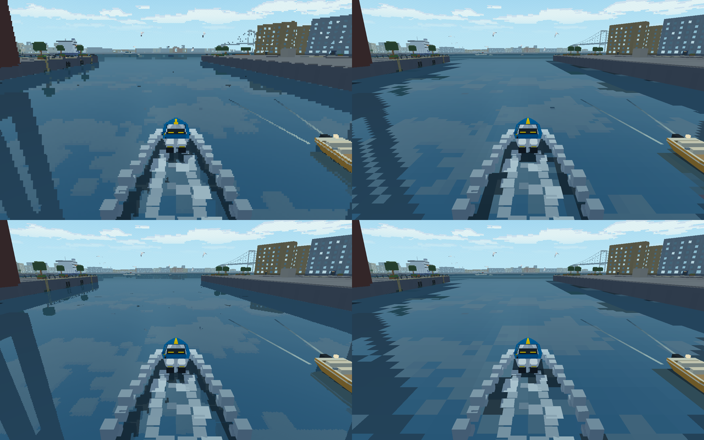

# Graphics overhaul plan

Status, 2026-11-01: **three work packages prepared; P1 is in progress**. G0 and G0w are
machine-verified on the M1 Max; the first Windows hardware report and browser smoke remain open.
Each package has one human playtest and, by default, one implementation PR. The detailed
G0–G5c briefs are internal checkpoints with focused commits and resumable agent handoffs. G6
remains a conditional study. **Next: P1/G1 on `feat/graphics-foundations`.** See the
[work packages](#work-package-register) and [execution
process](#package-execution-process) for scope, review and boundary-change rules.

Low resolution remains default. The [look test](#water-look-test--2026-10-31) rejected water squares
and favoured plain high resolution as an option; no overhaul result is accepted. Native Windows
capture and Mac analysis belong to [P1](#p1--performance-foundations), at its
[G0w checkpoint](#g0w--native-performance-capture-and-windows-to-mac-reports), before optimization.
M1 Max budgets remain the reference; Windows performance awaits actual returned reports.

## Intended result

Move the GPU renderer towards massive geometric and lighting complexity while keeping the game's
retro-rooted, modern-effects, cute and cozy feeling. In the user's words, low resolution "isn't
mandatory" for that feeling, the result must not look generic, and the water feeling alive and
dynamic is probably the key. So the water gets first call on the budget, and scale is a means to
that rather than the goal.

Non-goals: photorealism, physically based materials, and matching what a large engine does for its
own sake. Mesh shaders, virtual geometry, ray tracing and temporal anti-aliasing are out of scope:
they are costly here and push towards the generic look this plan exists to avoid.

## Identity rules

Check each visual stage against these. Change a rule by editing it here, with the reason.

1. **Judge it moving.** A look only counts if it holds up in play. World-anchored water squares
   looked fine in stills and "horrible in-game", so they are out. High resolution without them is
   welcome, and 320×200 stays available as a preset.
2. **Water comes first.** It gets the largest share of new frame budget and is the first thing
   reviewed in any capture.
3. **Toy-like shapes stay.** Keep flat facets and procedural finishes rather than photographic
   textures. The blocky foam thrown up by a fast boat is a signature the user loves: keep it, with
   lifetimes that make sense. Those cubes are objects that live and die, unlike the rejected water
   squares, which were a pattern painted over the surface.
4. **Colour is authored.** Keep palettes per time of day and restrained bloom. No filmic grey
   tonemapping, no temporal blur.
5. **Light is for coziness.** Lighting complexity should show up as warm windows and lamp streaks
   on the water, not as realism.

## Baseline — 2026-10-31

Measured at `d3467ff`, before #102 added the reflection-pass clip. M1 Max, macOS, GL `4.1 Metal -
90.5`, **Debug** build, hidden and unpaced, on the river route with waves, one run each:

```sh
./build/boat_water_review --benchmark PREFIX --aa off --waves
./build/boat_water_review --benchmark PREFIX --aa 4x4 --waves
```

| Per frame | 320×200 (`--aa off`) | 1280×800 internal (`--aa 4x4`) |
| --- | --- | --- |
| GPU time p50 / p95 | 2.54 / 2.94 ms | 3.45 / 5.41 ms |
| CPU submission p50 / p95 | 3.62 / 3.98 ms | 3.97 / 4.44 ms |

From the 4×4 run:

| Measure | p50 | p95 |
| --- | --- | --- |
| Scene triangles | 208 k | 750 k |
| Application submissions | 1,011 | 1,040 |
| Object submissions / triangles | 947 / 26 k | 966 / 27 k |
| Map submissions / triangles | 58 / 144 k | 98 / 706 k |
| Shadow / reflection / main submissions | 229 / 256 / 524 | 239 / 269 / 536 |

These are one-off development numbers, not a qualified baseline; G0 replaces them. No weak GPU or
browser was measured. Earlier controlled Release figures are in
[Boating performance](BOATING_PERFORMANCE.md#river-frame-benchmark--2026-10-25).

Findings from reading the code:

- **Draw calls are the ceiling.** Objects make about 28 triangles per draw, at about 4 µs per draw
  all-in, which would fill a 60 Hz frame at roughly 4,000 draws. Scene geometry is not the limit
  on this machine.
- **Objects are not culled** and are redrawn in each pass (`draw_life` in `renderer_gpu.c`).
- **Uniform lookups by name.** `draw_colored_mesh` makes two `GetShaderLocation` calls per draw,
  each a `glGetUniformLocation`; `set_water_uniforms` makes dozens per frame. The cost has not been
  profiled.
- **Vertex data is heavy.** `builder_triangle` writes three unique 36-byte vertices per triangle in
  separate buffers: about 93 MB for the 861 k-triangle river, with the same arrays kept in RAM.
- **No level of detail.** Long views down the river cost about 3.6× the median triangle count.
- **Wakes cost every water pixel.** `objectWake` in `waterfront_water.fs` loops over up to 256
  pieces with two texture fetches each. The benchmark does not exercise four racing boats.
- **Lights are a capped per-pixel loop** of 32, chosen on the CPU (`select_local_lights`).
- **Water ignores what is under it.** No scene depth reaches the water shader, so there is no shore
  fade or depth tint. Ambient displacement stops at the 80 m patch, and foam has no memory.
- **Pixels are comparatively cheap here.** 16× the pixels adds about 0.9 ms at p50 and 2.5 ms at
  p95. A linear estimate puts 1440p near 12 ms p95: fine at 60 Hz, not at 120 Hz. Unverified.

### Platform limits

Compute shaders, storage buffers and multi-draw indirect need GL 4.3. macOS stops at 4.1 and the web
build is ES 3.0 (WebGL2), so a fully GPU-driven pipeline needs a new backend; see
[G6](#g6--backend-decision).
Everything before G6 is designed to work on both. Watch points for that work:

- `DrawMeshInstanced` allocates and uploads a new instance buffer on each call and carries only a
  transform, so per-instance colour needs a persistent buffer through `rlgl`
  (`rlSetVertexAttributeDivisor`).
- `rlgl` has no uniform buffer helper; those would need direct GL calls.
- Rendering to float textures in WebGL2 needs `EXT_color_buffer_float`. Plan an 8-bit fallback.
- Shaders are `#version 330` and converted for the web in `cmake/Web.cmake`, so new shader features
  must survive that step.

## Package execution process

Status, 2026-11-01: **three work packages, P1 in progress**. Each package owns one
human playtest and, by default, one implementation PR. The G0–G5c sections below are ordered
internal checkpoints, not separate work packages or PR assignments. G6 is a dormant contingency,
outside the three-package count. **Next: P1/G1.**

Keep package definitions, prompts and process updates together in one planning PR. The original
twelve-PR planning stack was an interpretation error and is merged; it does not prescribe future
implementation boundaries. Three PRs is the starting plan, not a guarantee that each aggregate
change will remain reasonably reviewable. No graphics implementation or result acceptance is claimed.

### Context, checkpoints and code review

A work package may span multiple agent sessions. Do not depend on a single context window or one
agent remembering earlier decisions. Give a simpler agent the shared constraints, its current
checkpoint, established interfaces and durable handoff; it does not need the whole conversation.
Complete the checkpoints in order on the same branch and PR, keeping the package's final acceptance
in view. An agent can hand off unfinished work without splitting delivery or marking it complete.

At every checkpoint:

1. Work through its numbered tasks in order. Use small, coherent commits for separate ownership,
   data-format, algorithm and visual changes; do not combine unrelated refactors or squash the
   review history before review. Keep the build and quick tests passing at stable commits.
2. Run that checkpoint's specific parity, lifecycle, fallback and performance checks before layering
   the next feature. A new water layer must not hide a failed stamp comparison; LOD must not hide
   an ownership/parity error. Use the common full acceptance suite before package handoff.
3. Update its result with the commit(s), touched interfaces/ownership, decisions, checks actually
   run and artifact paths/commands. Record old/new budgets and errors where relevant. Leave the
   next checkpoint/task, unresolved questions and limitations explicit; never write just "done".
4. If switching agents/context, the next agent reads that result and verifies the checkpoint
   contract before continuing. Ask Astra for advice when ownership, parity, numerical stability,
   portability or design scope is unresolved; more context does not replace a sound decision.
5. Keep a PR review map listing checkpoint → focused commits → verification/artifacts → known risk.
   Reviewers can review completed checkpoints while implementation continues, then check final
   integration. Splitting the reading this way helps review, but does not make the total diff small.

A minimal durable checkpoint result contains:

```text
State: unstarted / in progress / machine-verified / blocked
Commit(s) and current task:
Interfaces/owners and decisions to preserve:
Verification, commands and evidence:
Unresolved issues / human review still pending:
Next checkpoint/task and files to read:
```

### When a delivery boundary needs to change

The first package has the largest scope risk: G0w adds diagnostics/export/packaging infrastructure,
then G1–G2 change submission, geometry ownership, LOD and shadows. The water and presentation
packages also cross several renderer concerns. Do not promise that handoff notes solve aggregate
code-review size, or estimate it from an invented line count.

Use completed checkpoint evidence to judge a split. A concrete reason is an independently useful
and verified prerequisite that can be reviewed/landed without the remaining renderer changes, or
an external dependency holding unrelated completed work. The most plausible extra boundary is
**G0+G0w diagnostics before the remaining P1 rendering work**. A large diff alone is a signal to
inspect cohesion and reviewability, not an automatic threshold or a reason to restore twelve PRs.

If that boundary is needed, record the actual changed subsystems/commits, independent acceptance
and reason in this plan, revise the affected work-package boundary explicitly and explain the
additional PR in the handoff before opening it. Keep completed tasks and pending acceptance clear.
Do not silently create more packages, deliver a partial package as complete, or add another human
artistic playtest. Otherwise keep the three-package plan. G6 still requires its own measured trigger.

### Work loop and delivery

1. Read [AGENTS.md](../AGENTS.md), this process, the assigned work package, the current checkpoint,
   [testing](TESTING.md) and its named owners. The detailed entry points originated on `b0f1233`;
   verify them against current source and record moves rather than creating another subsystem.
2. Work in a separate worktree on the package branch below, from current main after dependencies
   merge. If explicitly continuing an unmerged implementation stack, branch from and target its
   parent, and merge updated parents into open children before review, per AGENTS.md.
3. Check G0 budgets and numerical tolerances before optimization. P1 creates them at its first
   checkpoint. Complete only the assigned work package; checkpoints are not automatic stop rules.
   A missing context window permits a durable handoff and continuation on the same branch.
4. Open one draft PR once a coherent checkpoint builds and its machine checks pass; keep later
   checkpoints on that PR. For P1, a G0w checkpoint artifact from this draft supplies the Windows
   baseline before G1 optimization. Push checkpoint batches rather than every small commit, so CI
   and intermediate code review remain useful without unnecessary churn. A draft is not acceptance.
5. Before marking the PR ready, pass all included checkpoint gates, the package acceptance and full
   suite, update affected live guides, and prepare its one human playtest. A missing hardware run
   may remain explicitly pending in the PR, but cannot be claimed as qualification. Do not merge,
   release or deploy; the user reviews/plays and merges. Resolve feedback on this same PR.
6. Update the work-package status and checkpoint results with current/completed/next task, exact
   revision/platform/options, automated evidence, agent-observed capture/demo evidence, human
   verdict and limits. Keep those categories distinct. Search README.md/docs/asset guides for
   superseded claims; update docs/README.md only when its area-level summary or next milestone changes.
7. The PR body includes the review map, cumulative measured deltas, final integration checks,
   remaining limits, the next package prompt and **Needs the user** with its playtest. Stop after
   the assigned work package. Do not begin the next package until its human gate is recorded and
   blocking feedback is resolved. A passing test or agent-run demo is not user acceptance.

A checkpoint dependency means its machine checks pass and its interface/ownership contract is
recorded; it does not need a separate merged PR. A work-package dependency additionally needs its
merge and human verdict. Missing machine/browser budgets leave the checks that need them unready;
the documented Windows hardware exception remains below. If correct work would require physics/
network changes, weakened parity or an unplanned backend, finish independent work and report the
issue rather than silently widening scope.

### Common verification and evidence

Every implementation package runs a warning-clean Debug build and full enabled CTest suite:

```sh
cmake -S . -B build -DCMAKE_BUILD_TYPE=Debug -DPROTEUS_GPU_TESTS=ON
cmake --build build -j
ctest --preset quick
ctest --preset full
```

The first configure fetches pinned dependencies. Existing `build/_deps/*-src` may be copied from
the main checkout into the worktree, then configure with `-DFETCHCONTENT_FULLY_DISCONNECTED=ON`.
Keep build output out of Git. GPU cases require a graphics context and socket cases require local
sockets; report unavailable checks and rerun with the needed environment rather than claiming a
CPU-only pass qualifies the renderer. Tests use virtual time and assertions about behavior; never
make frame timings into wall-clock CTest thresholds.

At each render checkpoint, inspect G0 before/after captures and short moving sequences, run an
agent-observed windowed demo, and build/smoke WebGL2 with the documented fallback. The browser smoke
checks shader compilation, resources, effect/fallback activation, resize and teardown; it is not
human browser acceptance. Follow [WEB_BUILD.md](WEB_BUILD.md) for actual commands and current CI
lanes. Use local/offline play; no hosted-room join is needed. Full manual browser/device review is
batched at C, unless an earlier regression makes it necessary. Native/browser timing claims require
real hardware, identified browser/GL renderer, Release and repeated runs. Null GPU timer results stay
null. State exact input sequences when comparing physical `final_state` or `state_hash`.

Use G0's checked-in manifest/commands after it exists. Existing baseline commands are:

```sh
cmake -S . -B build-release -DCMAKE_BUILD_TYPE=Release -DPROTEUS_GPU_TESTS=ON
cmake --build build-release -j
mkdir -p build-release/graphics
./build-release/boat_water_review --benchmark build-release/graphics/waves-aaoff --aa off --waves
./build-release/boat_water_review --benchmark build-release/graphics/waves-aa4x4 --aa 4x4 --waves
```

GPU equality always means the same platform, backend, build, time, view and options. CPU output
stays a geometry/capture reference, not an oracle for new GPU effects. G1 and lossless G2a substeps
need byte parity; quantized geometry and texture-resampled water use **predeclared G0 numerical and
image bounds**, plus motion review. Preserve exact physical inputs/results throughout. Report per-
pass/group CPU/GPU cost and memory cumulatively against G0 and the previous checkpoint/package.

### Windows performance evidence throughout the overhaul

G0w makes the report path available before optimization starts. The default workflow is download
one Windows CI artifact, extract it, double-click Collect performance, then copy its ZIP to the
Mac. An in-game Export performance report action captures recent real play, including a hitch
that happened before the action. Both outputs include structured samples and a readable summary;
a profiler screenshot is optional context. Details and acceptance live in the G0w brief.

Collect a Windows baseline as soon as G0w is available. Reuse its launcher and live export during
the three existing human batches, on the exact candidate commit, with the original resolution and
pacing settings recorded. An agent supplies the CI artifact/commit, short instructions and Mac
comparison command in each batch handoff. On each implementation PR, keep capture metadata and
new renderer counters/effects compatible with the report schema; validate with local/synthetic
reports even if the user has not rerun Windows. Do not require a fresh full Windows matrix per PR.

A user hardware capture is a data-collection step, not a fourth full artistic review. Prefer one
short default collection and rerun only the affected scenario or changed preset; the full matrix
remains opt-in. Compare code revisions on the same Windows machine/settings; show Windows/Mac
side by side without interpreting the different hardware as a code regression. If Windows access
is unavailable, record the missing evidence and keep measuring M1; do not invent Windows timings
or treat CI/software rendering as hardware qualification. Final Batch C requires returned native
Windows reports, analyzed on the Mac, alongside desktop/browser review. No automated upload or
remote access is needed.

### Batched human playtesting

Three planned user sessions align with P1/P2/P3. Each render checkpoint supplies its own agent-run
demo and automated/capture evidence. Save comparison toggles or reproducible prior builds until
its batch is accepted; users must be able to isolate the contributing package. No wall-clock delay
or test pass supplies a missing verdict. A pending user session does not prevent opening its PR.

| Batch | When | Combined route and questions | What it gates |
| --- | --- | --- | --- |
| A — engine and geometry | P1 complete (through G2b) | Windows report when available plus G1/G2a/G2b: river long views, bridge/quay, basin and outer; forward/backward LOD crossings, camera turns, reflected/animated actors and both shadow ranges. Any popping, missing actors, shadow trails or changed facets? | P2 |
| B — all living water | P2 complete (through G4) | Windows report when available plus G3a/G3b/G4: river and outer sheltered/open water, four-boat wake overlap, fast turns/stops, quays, rain/gull fixtures, gust/squall approach, scroll/reset and both resolutions. Is water alive/cozy, stable moving, shore-aware, with distinct cube foam? Compare stamp-only, history and place layers. | P3 |
| C — final presentation | P3 complete (through G5c) | G5a/G5b/G5c: native Mac/Windows and hardware browser at low/high presets, returned Windows report analyzed on Mac, HUD/resize, calm/storm/day/dusk, lamps/windows/streaks, AO and cube spray; revisit A/B interactions. Is navigation clear and does the integrated look retain its identity? | Final G0–G5 acceptance; never automatically changes the default |

Batch B deliberately combines G3 and G4 rather than asking for a separate water session between
them: atlas boundaries/depth/shore foam are easier to judge with persistence in place. Keep a
stamp-only comparison to distinguish causes; fix any observed failure before adding more effects.
If that interaction cannot be isolated or feedback would invalidate downstream work, schedule a
focused earlier check and record why. Do not expand a batch to include unrelated gameplay work.

For each batch record: revision/branch, launch commands, settings, route, who played, date, verdict,
actions and unverified platforms. Until that happens write **human review pending**. Keep low
resolution default throughout; any future default switch requires an explicit separate user decision.

### Work-package register

These are the three delivery/PR boundaries. Detailed G sections are internal implementation
checkpoints retained so a simpler model can execute one coherent task at a time. All are unstarted.

| Work package | Ordered checkpoints | Branch | Human gate / next package | Status |
| --- | --- | --- | --- | --- |
| [P1 — Performance foundations](#p1--performance-foundations) | G0 → G0w → G1 → G2a → G2b | `feat/graphics-foundations` | Batch A before P2 | In progress; G0 and G0w machine-verified, next G1 |
| [P2 — Living water](#p2--living-water) | G3a → G3b → G4 | `feat/graphics-water` | Batch B before P3 | Unstarted; depends on P1 |
| [P3 — Presentation](#p3--presentation) | G5a → G5b → G5c | `feat/graphics-presentation` | Batch C before final acceptance | Unstarted; depends on P2 and sunset prerequisites |

G6 is a conditional backend decision, not a fourth scheduled package. The delivery-boundary rule
above handles a proven need for an additional prerequisite PR without creating extra playtests.

### P1 — Performance foundations

**Outcome:** a measured and observable client with reduced submission/geometry cost, ready for
expanding the water. Read and complete G0, G0w, G1, G2a and G2b in order on one branch/PR by default.
Start from current main. There is no human acceptance gate between these internal checkpoints.

Preserve the measurement baseline at the G0 commit, then establish the Windows report artifact at
G0w before optimization. Keep diagnostics, instances/culling, storage, LOD and shadow-reuse commits
separate so a reviewer can assess their contracts and parity without mentally undoing later work.
Resource ownership and culling parity must be resolved before downstream optimizations. This is
the most likely package to need the documented diagnostics/rendering split; justify it from work,
not from a token budget or the existence of five checkpoint headings.

**Acceptance:** every included checkpoint's machine checks pass; repeated Release results compare
against G0; lossless captures/physical state stay exact and any allowed lossy detail meets the
predeclared bounds. Windows collection/analysis tools are packaged and usable, with actual user
hardware evidence recorded or explicitly pending. Run the full suite, prepare one Batch A route,
and keep its human verdict separate. Fix blocking feedback before P2 starts.

**Result:** in progress. G0 and G0w are machine-verified on the reference Mac; G1 is blocked on
its instancing parity/submission contract, so G2a and G2b are unstarted. Completed: stress scenario, review-pose manifest, measured G0
budgets, bounded live capture, portable exports, Windows launcher/Mac analyzer and their tests;
G1 location caching and per-pass object culling. Next: resolve the G1 instancing parity/submission
blocker. Implementation verification: build, focused CTest cases and three-repeat Release
measurements at `d0b1970`/`60c1713`/`73e0a1b`. Agent playback: none yet for P1. Human acceptance: none;
Batch A has not been run. Known scope risk: diagnostics plus multiple renderer
ownership/submission changes; see the delivery-boundary rule. No boundary change is currently
justified: the diagnostics prerequisite is on the same branch and reviewable by checkpoint.

**Kickoff prompt:**

```text
Implement P1 in docs/GRAPHICS_OVERHAUL_PLAN.md on one worktree/PR by default. Follow the execution
process and complete G0, G0w, G1, G2a and G2b in order, with focused commits, checkpoint contracts,
verification and durable handoffs. Open a draft for checkpoint review and the pre-optimization
Windows artifact; keep subsequent work on it. Report a concrete need for any boundary change.
Update the plan, prepare Batch A and stop before P2. Do not infer human acceptance from tests.
```

### P2 — Living water

**Outcome:** stable, lively, shore-aware water with preserved analytic physics and cube foam.
Depends on P1 merged with Batch A blocking feedback resolved. Complete G3a, G3b and G4 in order on
one branch/PR by default. Keep a reference/stamp-only path until the combined water is reviewed.

Review the stateless stamp/scroll/fallback contract before persistence; prove fixed-time stability
and reset behavior before adding geography/depth. Keep map asset changes and depth/pass ordering
separately reviewable from shader tuning. These checkpoints share water ownership and benefit from
one combined motion review, but none may conceal a failing prior comparison.

**Acceptance:** all included checkpoint checks, G0 performance/error budgets, unchanged physical
state, browser fallback and full suite pass. Record cumulative costs against P1/G0 and prepare one
Batch B for river/outer, with stamp/history/place effects distinguishable. Fix blocking water
feedback before P3 starts; actual human acceptance stays pending until the user plays it.

**Result:** unstarted. Completed: package instructions only. Next: verify P1/Batch A, then G3a task 1.
No implementation verification, agent playback or human acceptance. Known risks: field/history
stability, shore/depth interactions and GL4.1/WebGL2 capability fallbacks.

**Kickoff prompt:**

```text
Implement P2 in docs/GRAPHICS_OVERHAUL_PLAN.md after P1 and Batch A. Complete G3a, G3b and G4 on
one worktree/PR by default. Keep each checkpoint's commits, contract, evidence and resume notes
reviewable; prove stamping before persistence and geography. Preserve analytic physics, cube foam
and portable fallbacks. Follow the execution process, update the plan, deliver Batch B and stop
before P3. Do not request separate human playtests for internal checkpoints.
```

### P3 — Presentation

**Outcome:** optional high resolution with crisp UI, cozy lighting and finishing, qualified as a
whole on native Mac/Windows and a hardware browser. Depends on P2 merged with Batch B resolved.
Check SUNSET_PLAN's shared lighting frame and fixed dusk prerequisites **before starting P3**;
they remain owned there. Report them if missing rather than starting an indefinitely blocked
presentation PR or inventing another lighting system. Complete G5a, G5b and G5c in order.

Separate sizing/HDR, clustered lighting and asset/particle commits. Review resource lifetime,
cluster capacity and authored daytime parity before tuning dusk and finishing. Low resolution
remains default; the final playtest does not implicitly authorize changing it. GPU particle work
must earn its complexity and remain portable, as G5c specifies.

**Acceptance:** all included checkpoint checks and full suite pass; final G0 comparison includes
cumulative rendering/memory cost, browser fallbacks and returned native Windows reports analyzed
on Mac. Prepare one Batch C covering presets/UI, mood, particles and P1/P2 integration regressions.
Mark the overhaul accepted only after the recorded user verdict and blocking fixes, with platform
limitations explicit. G6 is opened only if its separate measured trigger is satisfied.

**Result:** unstarted. Completed: package instructions only. Next: verify P2/Batch B and the sunset
prerequisites, then G5a task 1. No implementation verification, playback or user acceptance. Known
risks: external sunset dependency, multiple target/light lifetimes and integrated preset behavior.

**Kickoff prompt:**

```text
Implement P3 in docs/GRAPHICS_OVERHAUL_PLAN.md after P2/Batch B and the stated sunset prerequisites.
Complete G5a, G5b and G5c on one worktree/PR by default with reviewable commits, checkpoint evidence
and durable handoffs. Preserve the low-res default and portable fallbacks. Follow the execution
process, update the plan and deliver Batch C plus cumulative native/browser/Windows qualification.
Stop after P3; keep any untriggered G6 backend study dormant.
```

### Checkpoint register

These entries own internal progress, not independent PRs. Read the assigned work package and
execution process before a checkpoint. Stop at a checkpoint only for a handoff or an unresolved
gate; otherwise continue within the same package. No checkpoint is verified or accepted yet.

| Checkpoint | Work package | Dependency | Status |
| --- | --- | --- | --- |
| [G0](#g0--measurement-and-review-harness) | P1 | current main | Machine-verified on M1 Max; browser smoke and Windows hardware open |
| [G0w](#g0w--native-performance-capture-and-windows-to-mac-reports) | P1 | G0 | Tools machine-verified; Windows hardware baseline pending |
| [G1](#g1--persistent-instances-and-pass-culling) | P1 | G0 budgets and G0w tools | In progress: location cache and per-pass object culling landed; instancing blocked on byte parity |
| [G2a](#g2a--geometry-storage-and-ownership) | P1 | G1 | Unstarted |
| [G2b](#g2b--distance-detail-and-valid-shadow-reuse) | P1 | G2a | Unstarted |
| [G3a](#g3a--stamped-wake-shading) | P2 | P1/Batch A | Unstarted |
| [G3b](#g3b--foam-history-and-cosmetic-ripples) | P2 | G3a | Unstarted |
| [G4](#g4--shore-aware-and-far-water-character) | P2 | G3b | Unstarted |
| [G5a](#g5a--optional-high-resolution-and-restrained-hdr) | P3 | P2/Batch B and sunset readiness | Unstarted |
| [G5b](#g5b--clustered-cozy-lighting-and-dusk-water) | P3 | G5a and sunset prerequisites | Unstarted |
| [G5c](#g5c--ambient-detail-cube-spray-and-final-qualification) | P3 | G5b | Unstarted |

## Detailed implementation checkpoints

These task briefs refine the direction summaries below; checkpoint-specific gates and measured
G0 budgets govern. Numeric targets stay provisional until G0 records them. Ownership, acceptance
and fallback requirements are preserved when checkpoints share a delivery PR.

### G0 — Measurement and review harness

Stage coverage: G0. **Depends on:** current main.
Human review: No human gate; establishes all three review batches.

**Read first:** `tools/boat_water_review.c`, `tools/validate_boat_water_benchmark.py`,
`src/renderer_gpu.[ch]`, [performance](BOATING_PERFORMANCE.md), [testing](TESTING.md).

**Tasks, in order:**

1. Extend the existing benchmark rather than create a second timing tool. Preserve its default river
   route and report contract. Add a deterministic four-boat stress scenario with saturated
   player/traffic wake records; report emitter and active-piece counts so the load is proven. Keep
   fixture setup in review/presentation code, with unchanged production physics.
2. Add repeatable basin, river and outer review poses: close hull/wake, quay/bridge, long river
   skyline, sheltered dock and open coast. Record map, world position, camera, tick, wave/weather
   options and resolution in a manifest. Include movement through a tile boundary, fast turn,
   stop/restart, camera turn and teleport/map reload. Add capture/replay commands for the manifest;
   do not invent flags in documentation before implementing them.
3. Build Release on a recorded main commit including the merged near/far shadows. Run at least three
   repetitions after the same warmup of flat/waves × AA off/4x4 × ordinary/stress route. Record
   p50/p95/p99, sample availability, frame interval, CPU submission, GPU, pass/group
   submissions/triangles, and CPU/GPU mesh/target memory estimates. Separate unpaced throughput from
   visible paced behavior.
4. Take an Instruments Time Profiler trace for the visible river/stress path. Identify whether
   uniform lookup, draw submission, uploads or shader work is actually limiting. Build and smoke the
   WebGL2 browser on the M1 Max; report browser/version, renderer and unsupported timers. Measure
   equivalent ordinary/stress browser workloads with the same scenario inputs and in-app counters,
   including frame intervals, CPU submission and available GPU timers; add a small browser review
   entry point if needed. Do not substitute SwiftShader for a hardware browser performance claim.
5. Publish the review manifest, command matrix and compact results in this plan/performance guide.
   Replace provisional G1 targets with measured feasible submission and CPU p95 goals; allocate
   CPU/GPU and memory ceilings per pass/group, reserve explicit water headroom and a margin under
   16.67 ms. Set numerical/image tolerances for lossy geometry and stamped shading before those
   checkpoints start. Give every later checkpoint a baseline and measurable gate; label missing
   measurements as open instead of manufacturing numbers.

**Acceptance:** Benchmark contract tests cover scenario selection, counts, report schema and
deterministic final physical state. Repeat captures agree on the same platform. Full suite passes;
browser startup/render and trace evidence are recorded. Budget table has actual numbers and units,
target revision/platform and measurement commands; timing thresholds stay outside CTest.

**Limits and stop conditions:** If Instruments or a hardware browser cannot run, retain the harness
checkpoint with those limits explicit; dependent checkpoints needing those budgets remain unready.
The current Debug table is history, not a substitute. No look/default change.

**Checkpoint result:**
- State: machine-verified on the reference Mac; browser smoke and Windows hardware open.
- Commit(s): `d0b1970` (stress scenario, review manifest, report schema 4). Budgets are recorded
  in [Boating performance](BOATING_PERFORMANCE.md#graphics-g0-measurement-harness--2026-11-01).
- Interfaces/owners: `boat_water_review` owns the benchmark scenarios, review poses and their
  manifest; `BoatFleet`/`BoatWakeObjects` remain the physical/wake owners; the report adds
  `scenario`, per-frame wake counts and final stress state without changing the river route.
- Verification, commands and evidence: Release on Apple M1 Max, macOS 26.6.2/AppleClang 21,
  three repetitions of river/stress × flat/waves × AA off/4x4 after the 120-frame warmup.
  `boat_benchmark_contract` checks scenario selection, counts, schema, percentiles and exact
  stress parity (`--stress-state` and benchmark `final_state`). Reference p95: river waves 4x4
  GPU 3.85 ms / CPU submission 4.30 ms / 1,290 submissions; stress waves 4x4 GPU 20.01 ms /
  CPU 11.13 ms. Instruments summary and selected review captures are under
  `docs/evidence/graphics/`.
- Unresolved issues / human review: WebGL2 smoke was not run because `emcc` is absent; no human
  look review is implied. Windows hardware evidence is owned by G0w and remains pending.
- Next checkpoint/task and files to read: G0w task 1, then G1; read
  `tools/boat_water_review.c`, [Boating performance](BOATING_PERFORMANCE.md#graphics-g0-measurement-harness--2026-11-01)
  and `src/renderer_gpu.c`.

### G0w — Native performance capture and Windows-to-Mac reports

Stage coverage: G0 tooling and cross-machine evidence for every later checkpoint.
**Depends on:** G0 scenario/manifest and benchmark contract. Implement after G0 and before G1.
Human review: collect the first Windows baseline when the user has the machine available; repeat
at batches A/B/C, without adding another full artistic playtest. Tool implementation can be reviewed
before that hardware run; Windows performance remains unqualified until actual reports return.

**Read first:** `src/profiler.[ch]`, `src/boat_profile.[ch]`, `tools/wake_velocity.c`,
`tools/boat_water_review.c`, `tools/validate_boat_water_benchmark.py`, `src/renderer_gpu.[ch]`,
`CMakeLists.txt`, `.github/workflows/windows-boat.yml`, `.github/workflows/release.yml`,
`tools/windows/{launch.bat,README.txt}`, [performance](BOATING_PERFORMANCE.md),
[testing](TESTING.md) and [releases](RELEASES.md). Proposed new tool names below are design targets,
not commands that exist yet.

**User workflow to deliver:**

1. On the Mac, the developer supplies the Windows Release artifact from the implementation PR's
   CI run, identified by commit. No release/publication is required. Download/extract it on Windows.
2. Double-click the included **Collect performance** launcher. It runs the G0 ordinary/four-boat
   scenarios with warmup and repeated measured runs, then opens a report folder. Aim for a short
   default run of a few minutes, with the full G0 matrix available separately. The run is bounded,
   states progress, allows cancellation and preserves useful completed results on failure.
3. For a hitch during normal play, use **Export performance report** in the profiler UI or its
   documented shortcut. It saves the recent rolling history immediately; no need to reproduce the
   issue after pressing Record. A short success message shows the output location and how to open
   it. This works with the overlay hidden and does not reset the boat or change graphics settings.
4. Copy the generated ZIP to the Mac by any ordinary file-transfer method, then attach it to the
   development task or point the agent at it. No account linking, telemetry upload or remote service
   is required. Open the included HTML summary directly; the Mac comparison command can compare
   two report bundles or Windows/Mac runs and write a Markdown summary with frame-time plots.

**Tasks, in order:**

1. Define a versioned report manifest and reuse the G0 JSON/CSV field definitions, units and
   percentile convention. Keep `capture_kind` (`scripted` or `live`) and scenario/input identity
   explicit: live driving is evidence for a hitch, not a controlled cross-machine benchmark.
   Capture commit/version, clean/dirty state when known, actual Release/Debug configuration and
   compiler. Fix multi-config build metadata: `${CMAKE_BUILD_TYPE}` is empty for typical MSVC
   multi-config builds, so do not label those runs from that value alone.
2. Extend the native live client with a bounded rolling sampler, enabled by default at measured
   low overhead, independent of F3 visibility. Target the most recent 30 seconds, with a fixed
   memory/frame-count cap and actual duration/count recorded if truncated. Reuse BoatFrameMetrics
   for frame wall, simulation/physics, audio, render and present/wait; add frame-start intervals,
   discarded time/tick counts, active/focus/pause state and renderer pass/group counters. Include
   simulation time/tick, map, player/camera pose and active weather/wake counts to locate a spike
   in the world. Keep
   nested inclusive timings distinct; never sum physics into simulation twice or call render
   submission CPU time a GPU duration. Mark settings/map/pacing changes per segment rather than
   averaging incompatible modes together. Export raw ordered samples, p50/p95/p99/max and hitch
   counts relative to the recorded target interval, not just FPS or a picture of the overlay.
3. Reuse/factor the benchmark's asynchronous GPU timer where useful, with per-frame IDs linking
   delayed samples to their originating frame. Do not block, use `glFinish`, or read GPU data just
   to complete a live export. Missing/unsupported/pending GPU timings stay null, with coverage and
   skip counts. Record measurement scope, collection overhead, counter availability and whether
   timing includes extra views. Preserve the difference between GPU rendering, CPU work and
   presentation wait; these reports are not proof of scan-out latency or driver call-stack cost.
4. Add the profiler action and an explicit output-path option suitable for scripted tests. Snapshot
   completed samples on request, write outside the measured render interval and mark any export
   disturbance so it cannot masquerade as an original hitch. A context screenshot is optional and
   likewise excluded from timing; structured data is mandatory. Handle repeat exports, a full ring,
   startup/empty history, canceled runs and unavailable/unwritable paths without losing gameplay.
   Never overwrite older bundles. Use a writable per-user report directory, not the executable
   directory, and show its actual path. Keep file I/O in app/tool owners, outside core/net and the
   sampling/statistics helpers. Share the native capture path with macOS so it can be tested here.
5. Gather bounded system/session metadata without extra installations: Windows version, CPU,
   memory, GPU/driver, actual GL vendor/renderer/version, monitor refresh, window/framebuffer/scene/
   reflection sizes, DPI, fullscreen/VSync/pacer/AA/preset and enabled water/light effects. Prefer
   the active GL adapter identity to an arbitrary first GPU; preserve a distinction if the OS
   reports multiple adapters. Unsupported queries are explicit unknowns. Reuse build.txt and
   packaged assets/version identity. Record timestamps for correlating an optional later trace;
   exclude unrelated machine/user/network inventory and omit absolute personal paths from reports.
6. Package the review executable, required assets, launcher and a plain-language README in the
   existing Windows PR artifact; use the same mechanism for release packages when later cut.
   The user must not need Visual Studio, a developer checkout, Python or an external profiler.
   A small `.bat` launcher may invoke native tools and built-in PowerShell archive/metadata
   commands; provide quoted paths and propagate exit status. Set executable/asset paths from the
   launcher's directory and write reports to the user directory, so launching from Explorer or
   another working directory works, including spaces/non-ASCII names. Retain normal launch.bat.
   Produce one portable ZIP with manifest, summary.html, samples.csv/summary.json per run, logs
   and an optional context.png. If compression fails, keep the report folder and explain how to
   copy it. No automatic upload, installation, release or deployment is part of this checkpoint.
7. Add a small standard-library-only Mac/developer analyzer, proposed as
   `tools/compare_performance_reports.py`. Accept an extracted report or ZIP, validate schema and
   bounded contents, and output Markdown plus a standalone HTML frame-time view. Compare run
   distributions and repeated-run variation, show same-scenario/settings deltas, mark mismatches
   and missing GPU samples, and refuse a numerical regression verdict for incompatible runs.
   Different machines can be shown side by side; do not call their absolute difference a code
   regression. Do not require executable content in returned reports or a Windows trace viewer on
   the Mac. Check in tiny synthetic fixtures, not personal/hardware captures or large trace files.
8. Document actual implemented actions, artifact download, expected duration, output locations,
   copy-back and Mac comparison commands in the performance guide, Windows README and testing
   guide. Explain a short initial baseline and a focused rerun path, so the user need not run the
   entire matrix for every hitch. Measure sampler off/on overhead with repeated Release runs,
   report memory cap and worst export interruption, and make the toggle available for diagnosis.
   If aggregate samples cannot explain a bottleneck, record the next specific Windows CPU/GPU
   trace question and a verified tool recipe in the guide; do not make deep tracing a prerequisite
   for the basic capture workflow.

**Acceptance:** Serialization/ring ordering, time/cap truncation, inclusive timing labels,
segmentation, missing/delayed GPU queries, repeated/unwritable export, archive/schema rejection and
comparison compatibility have meaningful automated checks using synthetic/virtual inputs. Build
and full CTest pass; prove unchanged simulation/final states with capture on/off. Native macOS
export/import works, and the standard Windows CI runner validates launcher packaging, metadata,
portable paths and report/analyzer round-trip with CPU/synthetic data. A software-rendered CI run
is packaging evidence, never the user's Windows GPU baseline. Real Windows play must return at
least one live report and three repeats of matched G0 ordinary/stress runs, with a readable Mac
summary identifying the actual revision, CPU/GPU, timings/settings and timing coverage. Record
hardware run, sampler overhead and user usability verdict only when performed. No screenshot-only
or successful-build claim satisfies the actual hardware evidence gate.

**Limits and stop conditions:** This checkpoint delivers app-level timing/counters, not a native
sampling profiler, GPU debugger or remote-control agent. No dependence on external profiler
installation, new hosted services or access to the user's Windows machine. The M1 Max remains the
reference budget; Windows gets a recorded machine-specific baseline, not an invented hardware
floor. If the Windows hardware/report is unavailable, retain the verified tools on the P1 draft and
list that evidence as pending; later checkpoints may proceed against measured M1 budgets but cannot
claim Windows qualification. Final integrated acceptance retains the Windows return-report gate.

**Checkpoint result:**
- State: tools machine-verified on macOS; a real Windows hardware report is pending.
- Commit(s): `854d90b` (bounded capture, async GPU identity, F4/`--performance-report`, portable
  bundle), `60c1713` (Windows collection launcher, Mac analyzer, fixture tests, CI packaging).
- Interfaces/owners: `src/boat_capture.[ch]` samples and summarizes only, with no I/O or GL;
  `tools/wake_velocity_performance.[ch]` owns file/GL metadata and bundle writing in the app;
  `tools/boat_gpu_timer.h` owns asynchronous queries; `boat_capture` and `performance_analyzer`
  CTest cases cover the contract. Core/net are unchanged and still pass their boundary checks.
- Verification, commands and evidence: `boat_capture` covers ring ordering/eviction, segment
  separation, percentile convention and missing GPU samples. `performance_analyzer` covers
  compatible/incompatible comparisons, ZIP round-trip, schema/bounds/traversal rejection and
  HTML output using synthetic fixtures. Local scripted export
  (`wake_velocity --renderer cpu --frames 40 --performance-report ...`) produced a readable ZIP
  with manifest, summary, CSV, HTML and build metadata. Windows CI now packages the review
  executable/launcher and runs the relocated CPU-only fixture and analyzer as packaging evidence.
- Unresolved issues / human review: no Windows machine was available, so no live or repeated
  controlled Windows report exists; sampler overhead was not measured on Windows. The Windows
  ZIP is packaging evidence only, never a GPU baseline. User usability of F4/collect launcher
  is unverified.
- Next checkpoint/task and files to read: G1 task 1; read `src/renderer_gpu.[ch]` and the G0
  budget table. Keep the Windows baseline request in the Batch A handoff.

### G1 — Persistent instances and pass culling

Stage coverage: G1. **Depends on:** G0 budgets/review manifest and G0w capture tools.
Human review: Batch A after G2b; agent checks still run here.

**Read first:** `src/renderer_gpu.[ch]` (`draw_colored_mesh`, `draw_life`, `box_in_view`,
`set_water_uniforms`), `src/waterfront_scene.[ch]`, `assets/shaders/waterfront_city.*`, [3D](3D.md),
[performance](BOATING_PERFORMANCE.md).

**Tasks, in order:**

1. Cache all shader locations when each shader is loaded, invalidate them on reload/unload, and
   retain optional-uniform handling. Remove name lookups from per-draw/per-frame paths.
2. Build a caller-owned instance list from the already evaluated scene frame, grouped by
   mesh/material and pass-relevant state. Cover cubes, gull parts, boat parts, harbour/traffic
   pieces and actors; keep cloth dynamic and preserve transparency/order-sensitive paths. Preserve
   model/normal transforms, per-instance colour, emissive behavior and reflection clipping.
3. Allocate persistent instance VBO/VAO state with rlgl-compatible divisors; grow at a bounded
   capacity, reuse storage and release it before context destruction. Avoid DrawMeshInstanced
   allocation per call. Supply a scalar reference path for validation and a safe initialization-
   failure fallback.
4. Cull transformed conservative bounds separately for main, mirrored reflection and both shadow
   frusta. Include full animation extents. A light behind the main camera can still cast a visible
   shadow; never reuse the main visibility list for other passes.
5. Update submission statistics to count actual instanced submissions, instances and multiplied
   triangle work. Keep historical counter definitions scoped by schema; update validators,
   performance guide and renderer description.

**Acceptance:** On the same build/platform, scalar and instanced/culling paths produce
byte-identical G0 captures in every pass, including cloth and reflected/clipped actors. Existing
tile_culling and GPU lifecycle/view tests pass; add relevant instance-boundary/resource checks. Meet
G0 submission/CPU p95 ceilings with repeated ordinary/stress measurements and no GPU budget
regression.

**Limits and stop conditions:** No visual redesign, physics changes, compute, storage buffers or
direct GL-only dependency that breaks WebGL2. A parity failure is a bug to fix, not a reason to
widen tolerance.

**Checkpoint result:**
- State: blocked on the lossless parity/submission contract; the independent parts are
  machine-verified on the M1 Max.
- Commit(s): `73e0a1b` caches every uniform name the renderer uses per shader and culls
  transformed object meshes separately against each pass's own view projection. `--check-culling`
  now covers objects as well as map tiles and passes at 144 poses.
- Interfaces/owners: `WaterfrontGpuScene.bounds_cache` owns per-VAO local bounds; flags stay
  excluded because cloth vertices change every frame. `cached_location`/`prewarm_locations` own
  the location cache and forget it on shader unload. No statistics or scenario schema changed.
- Verification: Debug build warning-clean; `ctest --preset quick` passed 247 tests and the full
  GPU-enabled suite passed 377 tests. `--check-culling` passed at 144 poses with
  `gpu_culled shadow=16560 reflection=6663 main=7803` and `cpu_culled=2152`. Release, three
  repeats on the M1 Max, river/waves/4x4 p95: **2.21 ms GPU, 2.27 ms CPU submission, 286
  submissions**; river/waves/320x200 p95: 2.02 ms GPU, 2.19 ms CPU. These beat the G0 ordinary
  ceilings (≤400 submissions, ≤3.2 ms CPU, ≤4.05 ms GPU).
- Verification gap: four-boat stress/waves/4x4 p95 is 18.69 ms GPU, 10.42 ms CPU and **369
  submissions**; 320x200 is 12.85 ms GPU and 7.37 ms CPU. The stress submission (≤300) and CPU
  (≤8.0 ms) ceilings are **not met**, although GPU is inside its 21 ms noise ceiling and the
  frame p95 is 13.16 ms.
- Unresolved issues / human review: persistent GPU instancing was implemented and reverted.
  Grouped batches reduced draws to about 161 from 955 on a review pose, but a few coincident or
  shaded pixels differed from the scalar path even after matching per-instance MVP order,
  model/normal transforms and contiguous batching. The lossless G1 gate forbids that difference,
  so the submission ceiling is **not met** and this checkpoint is not ready to hand off to G2a.
  A correct solution needs either a parity-safe batching design or a reviewed, predeclared
  tolerance; neither exists yet. No human review is implied.
- Next checkpoint/task and files to read: resolve G1 parity/submission first;
  `src/renderer_gpu.c` (`draw_colored_mesh`, `object_is_culled`, `cached_location`) and
  [the G0 budget table](BOATING_PERFORMANCE.md#graphics-g0-measurement-harness--2026-11-01).
  G2a/G2b remain unstarted because their checkpoint dependency is not satisfied.

### G2a — Geometry storage and ownership

Stage coverage: G2 parts 1. **Depends on:** G1.
Human review: Batch A after G2b.

**Read first:** `src/renderer_gpu.[ch]` (`MeshBuilder`, `builder_triangle`), `src/boat_gpu.[ch]`,
`src/boat_model.[ch]`, `src/boat_scenery.[ch]`, [3D](3D.md).

**Tasks, in order:**

1. Audit readers and owners of every vertex/index array before changing storage. Separate uploaded
   static GPU-only copies from shared scenery used by CPU renderer, minimap, mesh recipes or
   collision; retain those shared sources.
2. Create indexed, interleaved GPU storage with explicit attribute types/strides and destruction
   ownership. Deduplicate only complete equal attribute tuples: position, normal, colour/material,
   UV. Never weld across flat-normal, facade UV or material seams. Keep uint16 batches within 65,535
   addressable vertices, or use a validated uint32 index path on both targets.
3. Land lossless indexing/layout changes first with exact captures. Then shrink attributes only
   where G0 error bounds permit, documenting representation and decoded error. Keep position
   accuracy at large world coordinates; avoid packing IDs as interpolated colours accidentally.
4. Release only unused GPU staging arrays after successful upload. Keep flag cloth writable,
   borrowed wave patches borrowed and CPU scenery available. Exercise failed upload, bind/unbind,
   repeated map switches and two simultaneous views.
5. Report retained CPU bytes, upload bytes and GPU estimates before/after per map, including
   duplicate-source memory. Update ownership comments and 3D guide.

**Acceptance:** Lossless phase matches exact G0 captures; any later quantization meets G0 numeric
and image limits with declared exceptions, preserving facets/material IDs. CPU captures and physical
final states stay exact. Measured memory reductions meet G0 targets; full GPU lifecycle and web
build/smoke pass.

**Limits and stop conditions:** No LOD, scenery pack format change, physics mesh change or
scenery-owner release. If quantization cannot meet the predeclared error bound, retain the precise
attribute and report savings honestly.

**Checkpoint result:** unstarted; instructions only. Owner: P1. Implementation verification,
agent playback and human acceptance: none. Next within this checkpoint: task 1, after dependencies.
After its machine gates: G2b. Record commits/contracts/evidence and a resume handoff here; keep
internal checkpoint work on P1's PR unless the delivery-boundary rule explicitly changes it.

### G2b — Distance detail and valid shadow reuse

Stage coverage: G2 parts 2–3. **Depends on:** G2a.
Human review: Batch A: geometry and submission review.

**Read first:** `src/renderer_gpu.[ch]` (tile drawing and near/far shadow cameras),
`tools/boat_water_review.c`, [shadow coverage](3D.md#gameplay-shadow-coverage),
[sunset](SUNSET_PLAN.md).

**Tasks, in order:**

1. Add a small fixed set of static tile LODs, selected using world distance/projected size with
   hysteresis. Use merged/simple far-building silhouettes or simple impostors; retain landmarks,
   bridge openings, shore silhouettes and emissive identity. Select per pass from its
   camera/coverage and keep transition state presentation-only.
2. Drive deterministic forward/backward threshold crossings and camera turns through the G0 review
   manifest. Prevent flicker and popping with a documented transition band; avoid temporal blur.
   Report near/far triangle distributions instead of choosing thresholds from stills alone.
3. Evaluate static shadow caching against the current two shadow maps. Reuse only with identical
   light/projection and valid static caster contents/LOD; track map/content/revision, sun, shadow
   transform and resource size. Both cameras follow the player, so a fixed sun is insufficient. Keep
   dynamic casters refreshed, combine depth without erasing static shadows and invalidate on
   teleports, map/edit reload and future lighting changes.
4. If the moving projections make caching ineffective or splitting static/dynamic depth costs more,
   retain uncached behavior and record repeated measurements proving that result. Do not ship unsafe
   caching to tick a checkbox.
5. Run the ordinary/stress matrix, record memory/triangle/CPU/GPU deltas and prepare Batch A launch
   commands plus before/after moving clips at transitions.

**Acceptance:** G0 p95 triangle and memory budgets pass without hidden reflection/shadow
regressions. Lossless shadow reuse matches uncached captures on hits and invalidations. LOD error
meets G0 silhouette/image bounds; full tests and web smoke pass. Batch A is ready with a dated user
checklist; actual human verdict remains separate.

**Limits and stop conditions:** No physics/content digest edits. Lighting-frame changes later must
invalidate caches. A failed human LOD review pauses dependent visual expansion until corrected;
successful automated checks do not approve popping.

**Checkpoint result:** unstarted; instructions only. Owner: P1. Implementation verification,
agent playback and human acceptance: none. Next within this checkpoint: task 1, after dependencies.
After its machine gates: Batch A; P2 only after P1 merge and blocking feedback resolution. Record commits/contracts/evidence and a resume handoff here; keep
internal checkpoint work on P1's PR unless the delivery-boundary rule explicitly changes it.

### G3a — Stamped wake shading

Stage coverage: G3 part 1. **Depends on:** G2b and Batch A verdict resolved.
Human review: Batch B after G4.

**Read first:** `src/boat_gpu.[ch]`, `src/renderer_gpu.[ch]`, `assets/shaders/waterfront_water.vs`,
`assets/shaders/waterfront_water.fs`, [wake rewrite](WAKE_REWRITE_PLAN.md),
[performance](BOATING_PERFORMANCE.md).

**Tasks, in order:**

1. Document which objectWake outputs feed height, slope and foam in both shaders. Keep vertex
   displacement analytic in this checkpoint; replace the fragment shading loop with a sampled cosmetic
   layer, so hulls retain the existing physical-surface agreement. Report remaining vertex work
   explicitly.
2. Allocate a bounded boat-following field with world-space coordinates, an integer-texel snapped
   origin and a guard/fade band. Stamp current player/rival/traffic wake pieces as bounded quads,
   preserving their signs, lifetimes, ordering-independent sums and slope/foam units. Clear and
   rebuild this stateless field each simulated frame; history belongs to G3b.
3. Probe actual render-target and blend support. Float renderability alone does not prove float
   blending. Provide a tested RGBA8 encoded path or the existing analytic fragment loop when
   unsupported; do not blend signed data incorrectly. Support GL4.1 and the WebGL2 shader
   conversion.
4. Handle patch edges, scroll, fast movement, teleport, time rewind, map/view changes and context
   recreation without texture swimming or stale data. Own resources per view and avoid framebuffer
   feedback/readback. Supply a comparison switch in the review harness.
5. Compare sampled shading against the reference at fixed world samples and G0 captures using the G0
   tolerance. Measure the whole field-build plus main/reflection water cost in saturated four-boat
   cases at both resolutions, including bandwidth and target memory.

**Acceptance:** Repeated four-boat measurements beat the original fragment loop within G0 GPU/memory
budgets. Analytic height and exact physical final_state/state_hash evidence remain unchanged;
numerical slope/foam errors meet the declared bound. Lifecycle, edge/scroll/reset and
supported/fallback browser paths pass; preserve blocky cube foam.

**Limits and stop conditions:** This is cosmetic render data only: no core/net edits, GPU readback
or retired physical field revival. Sampling is allowed bounded shading error, not a claim of
byte-identical images. Do not remove the fallback until it is no longer needed for comparison or
compatibility.

**Checkpoint result:** unstarted; instructions only. Owner: P2. Implementation verification,
agent playback and human acceptance: none. Next within this checkpoint: task 1, after dependencies.
After its machine gates: G3b. Record commits/contracts/evidence and a resume handoff here; keep
internal checkpoint work on P2's PR unless the delivery-boundary rule explicitly changes it.

### G3b — Foam history and cosmetic ripples

Stage coverage: G3 parts 2–3. **Depends on:** G3a.
Human review: Batch B after G4.

**Read first:** G3a field owner/shaders, `src/waterfront_scene.[ch]`, `src/waterfront_harbor.[ch]`,
`src/waterfront_flock.[ch]`, [wake constraints](WAKE_REWRITE_PLAN.md).

**Tasks, in order:**

1. Add separate ping-pong foam/history and ripple state under the G3a owner. Advance on explicit
   simulated fixed substeps with a bounded catch-up policy. Define coefficients, world spacing and
   stable timestep together; pause must freeze it and repeated fixed-step inputs must reproduce
   captures.
2. Advect and decay foam with bounded presentation flow, seed it from the stamped wake and expose a
   few named tunables. Preserve independent cube-foam emission and lifetime; a persistent white
   carpet is a failure.
3. Add bounded fragment-shader ripple propagation with obstacle masks for local quays/hulls. Use
   available shoreline geometry for the initial mask; G4 enriches it. Feed existing gull contacts
   and rain events when present, or deterministic presentation fixtures without adding a
   weather/gameplay system. Define what hull movement displaces and prevent injected energy from
   growing without bound.
4. Keep ripple/foam effects in shading; analytic vertex height remains authoritative. Scroll history
   consistently by whole texels, clear exposed strips, reset on rewind/teleport/content change and
   isolate each view. Add deterministic pre-roll to captures; define a bounded restore/replay policy
   rather than using wall time.
5. Exercise straight wake, overlapping wakes, stop/turn, wake decay, quay/hull bounce, rain/gull
   fixtures, patch seam and reset cases. Record peak field work and memory in the G0 stress suite,
   including byte-format fallback behavior.

**Acceptance:** Fixed-time replay, pause/resume, scroll/reset and stability tests pass without
wall-clock waits. No physical hash/height changes. Memory and total water time fit G0 budgets in
ordinary and saturated cases. Clips show the history and ripple effect and leave cube foam readable;
web fallback is explicit and exercised.

**Limits and stop conditions:** No automatic weather cycle, new gull behavior, physical collision
ripple solver or GPU displacement. Cap sources/grid work; if the ripple budget fails, reduce its
cosmetic resolution/extent and record it rather than borrow physics budget.

**Checkpoint result:** unstarted; instructions only. Owner: P2. Implementation verification,
agent playback and human acceptance: none. Next within this checkpoint: task 1, after dependencies.
After its machine gates: G4. Record commits/contracts/evidence and a resume handoff here; keep
internal checkpoint work on P2's PR unless the delivery-boundary rule explicitly changes it.

### G4 — Shore-aware and far-water character

Stage coverage: G4. **Depends on:** G3b.
Human review: Batch B: living water and place.

**Read first:** `tools/map_pack.py`, `src/boat_scenery.[ch]`, `src/renderer_gpu.[ch]`,
`assets/shaders/waterfront_water.*` (`exposure`), `cmake/Web.cmake`, [river guide](river/README.md),
[web](WEB_BUILD.md), [protocol](MULTIPLAYER_PROTOCOL.md).

**Tasks, in order:**

1. Bake a bounded per-map presentation atlas of shore distance, approximate depth, shelter and chop
   for river and outer. Document units, bounds, resolution, deterministic generation and whether
   depth is authored/estimated; do not describe it as surveyed bathymetry. Use existing water
   polygons/land consistently and keep shore distance valid around islands/narrow quays.
2. Keep the atlas presentation-only and outside the physics/network content digest. Choose a
   versioned optional scenery extension or sidecar with validated sizes/ranges and a legacy
   fallback. Update pack loading, native packaging and lazy outer/browser assets together; leave
   compiled water and collision untouched.
3. Provide an opaque scene depth source available before water rendering. Use a
   separate/resolved/copied readable source, never sample an attachment being written. Define
   near/far/reversed projection conversion as applicable and handle reflection cameras separately.
   Add shore fade, depth tint and restrained quay foam without leaking foreground depth into distant
   water.
4. Replace hand-written exposure with atlas sampling where available, feeding shelter/chop into
   cosmetic shading and G3 ripple boundaries. Preserve the analytic physical wave surface and the
   legacy fallback when data/depth is absent.
5. Add deterministic far-water gusts, chunky sun glitter and approaching squall patterns from
   explicit presentation time/existing weather strength. No new physical weather system. Verify
   stability at oblique headings and patch/atlas boundaries; avoid resurrecting the rejected water-
   square pattern.
6. Capture sheltered/open river and outer comparisons, low/high resolution and storms/calm. Measure
   atlas/opaque-depth/field costs together and prepare the Batch B route and settings with toggles
   for each effect.

**Acceptance:** Atlas bake/load bounds, deterministic output, legacy/malformed asset handling and
depth reconstruction checks pass; room digest and physical hashes are unchanged. River/outer visibly
distinguish docks from open water; no water/shore seam or depth-feedback artifacts. Full tests,
browser asset/lazy-load smoke and G0 budgets pass. Batch B records the user verdict separately.

**Limits and stop conditions:** No map collision changes, network compatibility changes, inferred
bathymetric truth or autonomous weather gameplay. Batch B acceptance gates G5 artistic expansion;
prepare the PR even if human play is still pending.

**Checkpoint result:** unstarted; instructions only. Owner: P2. Implementation verification,
agent playback and human acceptance: none. Next within this checkpoint: task 1, after dependencies.
After its machine gates: Batch B; P3 only after P2 merge, feedback resolution and sunset readiness. Record commits/contracts/evidence and a resume handoff here; keep
internal checkpoint work on P2's PR unless the delivery-boundary rule explicitly changes it.

### G5a — Optional high resolution and restrained HDR

Stage coverage: G5 parts 1–2. **Depends on:** G4 and Batch B verdict resolved.
Human review: Batch C after G5c.

**Read first:** `src/boat_gpu.[ch]`, `src/renderer_gpu.[ch]`, `tools/wake_velocity.c`,
`assets/shaders/`, `cmake/Web.cmake`, [3D](3D.md), [web](WEB_BUILD.md), [boating](BOATING_PLAN.md).

**Tasks, in order:**

1. Add a supported plain high-resolution preset based on the accepted spike configuration: 1280×800
   scene, independently sized 640×480 reflection and a crisp 320×200 logical HUD. Trace existing
   render/presentation settings and expose one coherent user option; do not ship spike environment
   variables.
2. Keep low resolution the default. Decouple scene resolution, HUD logical size, reflection size and
   window/framebuffer size with explicit resource ownership. Preserve integer-scaled nearest
   filtering for the low preset and readable HUD at supported window/DPI/browser resize/fullscreen
   sizes. Keep existing AA semantics documented.
3. Add HDR-capable scene targets and retain unclamped authored lighting until presentation.
   Introduce bounded restrained bloom and a compact grading structure for named lighting phases. Use
   the existing daytime phase; integrate the future shared lighting frame when available rather than
   invent a second time-of-day clock.
4. Probe renderability/filter/blend requirements and fall back to the existing LDR presentation on
   unsupported WebGL2 devices. Keep authored saturation and contrast, no grey filmic tonemapping or
   temporal accumulation. Record which effects are disabled in the fallback.
5. Exercise target allocation failure, repeated preset/resize changes, two views, captures and
   browser canvas/DPI behavior. Update actual controls/settings/CLI/help in user guides and add a
   review comparison at both presets; measure total frame and postprocess memory/cost.

**Acceptance:** Default low-res output remains exact with new optional processing disabled. HUD
positions/hit targets and scene/reflection sizing pass focused checks. Native/browser high preset
and LDR fallback load and resize correctly. Full tests, G0 budgets and moving/capture comparisons
pass; no default-change acceptance is inferred.

**Limits and stop conditions:** No default-resolution or AGENTS.md convention change. A high-res
look that the user likes in the old spike does not approve the shipped HDR preset. Sunset
implementation stays with SUNSET_PLAN.md.

**Checkpoint result:** unstarted; instructions only. Owner: P3. Implementation verification,
agent playback and human acceptance: none. Next within this checkpoint: task 1, after dependencies.
After its machine gates: G5b. Record commits/contracts/evidence and a resume handoff here; keep
internal checkpoint work on P3's PR unless the delivery-boundary rule explicitly changes it.

### G5b — Clustered cozy lighting and dusk water

Stage coverage: G5 parts 3–4. **Depends on:** G5a; external sunset shared frame and fixed dusk
prerequisites below.
Human review: Batch C after G5c.

**Read first:** `src/renderer_gpu.[ch]` (`select_local_lights`), `src/waterfront_scene.[ch]`,
`assets/shaders/waterfront_city.*`, `assets/shaders/waterfront_water.*`, [sunset
owner](SUNSET_PLAN.md), [plugins](PLUGIN_PLAN.md).

**Tasks, in order:**

1. Check SUNSET_PLAN.md first. Its shared caller-owned lighting frame, cache invalidation and fixed
   afternoon/dusk inputs must be implemented and reviewed before this checkpoint is ready. If absent,
   report this prerequisite and do not implement a competing frame or absorb the entire sunset plan.
   Automatic transitions, room phase ownership and Lua lighting remain outside this checkpoint.
2. Build bounded CPU light clusters each frame from the shared evaluated scene, upload lists through
   textures available to GL4.1/WebGL2, and define grid coordinates, list capacity, overflow policy
   and stable light IDs. Replace camera-nearest selection as the normal path; retaining a bounded
   per-cluster list is allowed, silently retaining a global cap of 32 is not.
3. Use the same light properties for city, water and mirrored reflection. Construct clusters for
   each view/camera or transform queries consistently; prevent lights popping at cluster boundaries.
   Provide a conservative capped-light fallback when allocation/capability limits require it,
   recording dropped lights and overflow.
4. Add warm building windows and quay lamps from existing scenery/presentation fixtures with stable
   authored placement. Render long stepped water streaks using the shared dusk frame and the
   approved water normals. Respect occlusion/shore masking, preserve navigation/boats/weapons in
   storm and dusk, and invalidate static shadows/sky caches with lighting changes.
5. Measure hundreds-of-lights stress at both presets, including cluster build/upload, reflection and
   water shader costs. Prepare afternoon/dusk comparisons using fixed explicit phases and record
   fallback differences without changing any simulation or room setting.

**Acceptance:** Cluster indexing/capacity/overflow and stable assignment tests pass, with boundary
and reflected-light captures. Daytime/reference fallback parity remains within declared limits; dusk
windows/streaks are readable and stable moving. Full suite, WebGL2 build/smoke and G0 CPU/GPU/memory
ceilings pass; Batch C is prepared, not accepted.

**Limits and stop conditions:** External sunset work is a real readiness gate; it is currently
proposed, not delivered. No new gameplay clock, Lua capability, room protocol or dynamic global
illumination. If the prerequisite remains unavailable, report G5b/G5c unready; final dusk acceptance
stays open.

**Checkpoint result:** unstarted; instructions only. Owner: P3. Implementation verification,
agent playback and human acceptance: none. Next within this checkpoint: task 1, after dependencies.
After its machine gates: G5c. Record commits/contracts/evidence and a resume handoff here; keep
internal checkpoint work on P3's PR unless the delivery-boundary rule explicitly changes it.

### G5c — Ambient detail, cube spray and final qualification

Stage coverage: G5 part 5 and qualification. **Depends on:** G5b.
Human review: Batch C: resolution, mood and final integrated review.

**Read first:** `tools/map_pack.py`, `src/boat_scenery.[ch]`, `src/renderer_gpu.[ch]`,
`src/boat_gpu.[ch]`, particle recipes in `src/waterfront_scene.[ch]`, [3D](3D.md),
[testing](TESTING.md).

**Tasks, in order:**

1. Bake compact static ambient occlusion into presentation scenery data only. Use deterministic
   geometry-based inputs, document units/range and avoid baking direct sun or dynamic actors. Extend
   optional asset version/loading/fallback conventions established in G4; preserve legacy assets,
   flat facets and authored colours.
2. Keep existing cube foam/spray shape, emission timing and lifetimes. Profile the G1-instanced
   particle path before moving simulation. Where justified, use bounded persistent buffers and
   fragment/vertex or transform-feedback techniques supported by GL4.1/WebGL2; retain CPU evaluation
   where the portable GPU path offers no measured gain. No compute dependency before G6.
3. Provide reference comparisons for particle age/position/size/colour across emission, fast turn,
   airborne/landing and expiry. Presentation randomness uses deterministic seeds and explicit time.
   Keep per-view cleanup, bounds and all core/net physical states unchanged.
4. Run the final G0 Release matrix and compare to both G0 and the preceding package. Supply the
   matching Windows artifact and obtain a G0w scripted/live report for Mac analysis against its
   initial Windows baseline; record exact commit/settings and any missing hardware evidence. Summarize
   cumulative CPU/GPU/memory, submissions/triangles, water cost, preset/browser fallbacks and
   outstanding budgets. Investigate regressions rather than hiding them behind new baselines.
5. Prepare one Batch C run covering presets/HUD, calm/storm/day/dusk river and outer, lamps/streaks,
   AO silhouettes and cube foam in motion. Revisit Batch A LOD transitions and Batch B water to
   catch interactions. Update the owning plan and affected guides with only actual evidence, user
   feedback and next task.

**Acceptance:** Bake/load/fallback and meaningful particle lifecycle/parity checks pass; full native
suite and browser build/smoke pass. AO is subtle and stable, cube foam signature/lifetime survives,
physical hashes remain exact and G0 budgets are met. Returned native Windows reports are analyzed
on the Mac. Final user desktop/browser play verdict is recorded separately; unresolved dusk or
platform checks remain explicitly open.

**Limits and stop conditions:** GPU particles are an optimization to earn, not a compute rewrite
requirement. No browser/desktop acceptance from stills alone, no release/deploy, and no
default-resolution change without a later explicit user decision.

**Checkpoint result:** unstarted; instructions only. Owner: P3. Implementation verification,
agent playback and human acceptance: none. Next within this checkpoint: task 1, after dependencies.
After its machine gates: Batch C / final acceptance. Record commits/contracts/evidence and a resume
handoff here; keep internal checkpoint work on P3's PR unless the delivery-boundary rule explicitly changes it.

### G6 — Conditional backend decision spike

Stage coverage: G6. **Depends on:** G1–G5 measured results exceed G0 budgets and profiling
identifies a backend-limited fix.
Human review: Only if opened; no routine fourth playtest.

**Read first:** [G0 results](#g0--measurement-and-review-harness),
[performance](BOATING_PERFORMANCE.md), [3D](3D.md), `src/renderer_gpu.[ch]`, [web
guide](WEB_BUILD.md).

**Tasks, in order:**

1. Keep this checkpoint dormant by default. Record the failed budget, repeated trace, limiting work and
   estimated recoverable time before proposing it. Content tuning or a shader mistake does not
   justify a backend rewrite.
2. If the trigger is met, consult Astra on whether a spike is justified and record the
   recommendation and decision here. Research current primary WebGPU/wgpu-native/Dawn and browser
   documentation at that time; this plan makes no present compatibility claim.
3. Create an isolated minimal experiment retaining raylib input/window/audio while drawing
   representative indexed/instanced city geometry, water targets and one cosmetic update. Prove
   resource/surface lifetime and shader translations for the representative path; estimate remaining
   shader port rather than porting the whole game.
4. Measure the identified workload and startup/target memory on the same M1 Max and a real browser.
   Compare one-backend versus WebGL2-fallback costs, platform/toolchain coverage and build/package
   implications. Include a no-migration option.
5. Deliver a decision report and a bounded follow-up implementation plan only if warranted. The
   spike PR must not replace the shipping backend or quietly commit to compute culling/indirect
   draws/particles/simulation.

**Acceptance:** A recorded go/no-go recommendation is supported by the trigger evidence and
prototype measurements, with unsupported platforms and integration limits named. Any shipping-code
changes still pass the full suite; default backend remains unchanged. Actual backend migration
requires a new reviewed plan.

**Limits and stop conditions:** This conditional study is not required to declare G0–G5 complete
when budgets pass. Planning its brief is not opening or implementing it.

**Checkpoint result:** dormant and outside P1–P3. No implementation, measurement or acceptance.
Next: evaluate the recorded trigger only after the main work; a satisfied trigger needs the bounded
spike/decision described here, not an automatic shipping-backend migration.

## Stages

These are direction summaries; execute P1–P3 using their detailed checkpoints above. Targets are
provisional until G0 sets real budgets. Each stage's gain figures are estimates.

### G0 — Measure and set budgets

1. Repeat the benchmark matrix on Release at current `main`, and take an Instruments trace to find
   where submission time goes.
2. Add a stress scenario: four boats with a saturated wake pool, which today's route does not cover.
3. Measure the M1 Max as the reference machine, plus a browser on it. Record what the browser
   build can hold, since its floor is [still open](#open-decisions). G0w then supplies native Windows
   capture/return tooling and a user-machine baseline; it executes before G1.
4. Pick a fixed set of review stops and cameras for before/after captures.
5. Record per-pass and per-group budgets in this plan, set well inside the M1 Max's frame time
   rather than filling it (see [hardware floor](#decisions)).

Done when: every later stage has a number to beat, including worst-case wakes.

### G1 — Draw submission

No visual change.

1. Cache uniform locations.
2. Add a persistent per-instance buffer (transform, colour, emissive flag) and instance cubes,
   gulls, boats and harbour pieces.
3. Cull objects per pass, using the existing `box_in_view` test.

Done when: same-platform GPU captures are byte-identical at the G0 review stops, `tile_culling`
still passes, and
submissions fall below about 150 with submission p95 near 1 ms (estimate, to be revised by G0). The
`app_submissions` definition in the performance guide is updated, since one draw is no longer one
object.

### G2 — Geometry

1. Index and interleave vertices and shrink the format; release the CPU-side copies where no
   consumer needs them. Flag cloth still updates its arrays.
2. Add distance detail: merged or simplified distant tiles and impostors for far buildings, to pull
   down p95 triangles. This one is allowed a visual change.
3. Evaluate static shadow reuse with valid light, projection and caster keys; a fixed sun alone
   is insufficient because the near/far shadow cameras move. See G2b for measured skip criteria.

Done when: map memory and p95 triangles have measured reductions, with no popping visible on the
review route.

### G3 — Living water

The largest gain for both speed and identity. Add a boat-following, world-anchored texture of
height, foam and ripples.

1. **Stamp wakes.** Draw wake pieces as small additive quads into the texture, replacing the
   fragment `objectWake` loop within G0 shading tolerances. The vertex loop stays analytic in G3a.
2. **Foam memory.** Surface foam lingers, drifts and fades instead of following only the current
   crest. It adds to the boat's cube foam and never replaces it.
3. **Ripples.** Run a small wave simulation in a fragment shader, so that ripples bounce off quays
   and hulls, and gulls and rain leave marks.

Hard constraints:

- **Strictly cosmetic.** Physics and multiplayer keep the analytic waves. No GPU readback, nothing
  in `proteus_boat_core` or `proteus_boat_net`, and `state_hash` unchanged. This does not reopen the
  retired physical wake field in the [wake rewrite plan](WAKE_REWRITE_PLAN.md).
- **Hulls still sit on what you see.** Where the texture drives displacement, it must stay within a
  stated tolerance of the physical surface, with a test. If it cannot, displacement stays analytic
  and the texture drives only shading.
- **Deterministic captures.** The layer takes explicit simulation time as input, never wall clock.

Done when: the four-boat stress case costs less than today's loop on the same machine, the hash is
unchanged, and the user has played it and judged the water.

### G4 — Water with a sense of place

1. Extend `tools/map_pack.py` to bake a per-map water map: shore distance, depth, shelter and chop.
   This generalizes the hand-written `exposure()`. Keep it outside the network content
   digest: presentation-only data must not break room compatibility.
2. Make scene depth available under the water, for shore fade, depth tint and quay foam.
3. Far-water life: wind gusts crossing the surface, a chunky sun glitter path, squalls visible on
   the water as they approach.

Done when: glassy docks and choppy open water read clearly apart in captures, on both `river` and
`outer`, and the user has reviewed them.

### G5 — Resolution, light and mood

1. **High-resolution preset.** Offer plain high resolution as an option, starting from the
   configuration the user liked in the [look test](#water-look-test--2026-10-31): low resolution
   stays the default. Changing the default needs explicit user acceptance later; only then update
   the nearest-neighbour convention in `AGENTS.md`, along with HUD scaling and the guides.
2. **HDR and grading.** Unclamp lighting, add restrained bloom and authored grading per time of day.
3. **Clustered lights.** Replace the 32-light loop with a CPU-built cluster texture, removing the
   lamp selection and its cap.
4. **Dusk on the water.** Hundreds of windows and lamps as long stepped streaks in the reflection.
   Requires the [gameplay sunset](SUNSET_PLAN.md) shared lighting frame and fixed dusk input,
   currently unimplemented; G5b must wait for that prerequisite.
5. **Finishing.** Baked ambient occlusion in the scenery pack; GPU particles for foam and spray
   within what the platform allows, keeping the cubes' look and lifetimes.

Done when: the user accepts the look at the chosen presets on desktop and in a browser.

### G6 — Backend decision

Do not start this by default. Open it only if content from G1–G5 exceeds the G0 budgets and the
Instruments trace shows that compute or indirect drawing would fix it.

If opened, the leading candidate is WebGPU through `webgpu.h` (wgpu-native or Dawn), since one API
covers Metal, Vulkan, D3D12 and browsers. It needs a spike covering: replacing raylib's drawing while
keeping its window, input and audio; rewriting about 1,100 lines of shaders; and current browser
coverage, which this plan has not checked. That spike decides between one backend and keeping
WebGL2 as a fallback. Then: compute culling, indirect draws, GPU particles and simulation.

## Decisions

From the user, 2026-10-31:

- **Order:** "probably right". Keep the stages as they are.
- **Default resolution:** low resolution stays the default "until this comes a lot further". New
  resolutions are options until then.
- **Hardware floor:** "we don't have to go much below a M1 Max". The M1 Max is the reference
  machine, and no stage needs to hold up on much weaker hardware.
- **Not a licence for waste:** "no need to be sloppy due to that". Stages still have to earn their
  cost, with budgets and measured gains, even where the M1 Max could absorb it.
- **Early look test:** run ahead of G0 as "cheap and prudent". After playing it, the user rejected
  water squares and liked plain high resolution "more than I expected". The default stays low
  resolution, as above, since they did not ask to change it.

For the implementer, decided here unless reversed:

- **CPU renderer:** stays a geometry and capture reference. New effects are GPU-only, and it is not
  expected to match them.
- **Browser parity:** every stage before G6 must also run in the browser build, or state its
  fallback.

## Open decisions

1. **Bring the high-resolution option forward?** It was simple to run in the spike and the user
   liked it, so it may not need to wait for G5. It does need real HUD scaling, and it shows off the
   plainer nearby buildings. Current choice: keep it in G5.
2. **Browser floor:** the hardware floor above was stated for machines generally. Whether browsers
   must hold 60 Hz on the same machine, or may fall back to fewer effects, is not decided. Current
   choice: fallbacks are allowed, and G0's browser measurement informs this.

## Water look test — 2026-10-31

A throwaway test of identity rule 1 on the draft PR branch `spike/water-look`, not for merging. It
shades each water pixel from the centre of a world-anchored square, whose size doubles with distance
so that squares stay at least four pixels wide. Captures are river drives at 1280×800.



Top: today's 320×200, enlarged; 0.5 m squares. Bottom: high resolution with no squares; 1 m squares.
A [second sheet](evidence/graphics/water-look-waves.png) compares today with 0.5 m squares in waves.

**User verdict after playing it:** squares fail. "It looks horrible in-game. One screen shot look ok
but not over temporal space." The surprise was the configuration without them, which the user "liked
more than I expected", run from that branch's build:

```sh
PROTEUS_SPIKE_SCALE=4 PROTEUS_SPIKE_REFLECTION=4 PROTEUS_SPIKE_SQUARE=0 \
  ./build/wake_velocity --location river --waves
```

That is a 1280×800 scene with a 640×480 nearest-filtered reflection and a 320×200 HUD. Its one Debug
benchmark run below is about the same as today's `--aa 4x4` path, which also renders 1280×800.

Pre-play findings, kept as history. They came from stills and three consecutive clip frames, and the
conclusion that the mosaic survives was wrong once the squares moved:

- **The mosaic survives high resolution.** At 0.5 m the water still reads as chunky retro mosaic,
  while the city, bridge and skyline get sharper. It also matches the sky's existing world-anchored
  cloud squares.
- **0.5 m beats 1 m.** At 1 m, reflections begin to dissolve into patches.
- **No measurable cost.** One Debug `--aa 4x4 --waves` run each on the M1 Max, GPU p50 / p95: today
  3.48 / 3.94 ms; 4× reflection 3.52 / 3.97 ms; with squares 3.46 / 3.93 ms. These differences are
  within noise. `final_state` was identical in all three, as expected of a shading-only change.
- **Defects to fix if adopted.** Thin slivers appear between squares, probably from the
  derivative-based size picking on triangle edges; a distance-based size should remove them. The
  squares align to world axes, so they turn into diamonds and zigzags on diagonal headings, which
  may be charm or noise.
- **Where it runs out.** Nearby buildings look plainer at high resolution, since nothing equivalent
  applies to them. Rule 1 covers only water, and G5 must consider the city too.

## Related work and conflicts

- **[#103](https://github.com/doomdavve/proteus/pull/103), merged before package planning,** adds a
  second distant shadow map. Its own Debug comparison moves submissions from 1,006 to 1,249 and CPU
  submission from 3.756 to 4.334 ms, which raises the case for G1. G0 must measure the merged
implementation, and G2b shadow reuse must account for both maps.
- **[Gameplay sunset](SUNSET_PLAN.md)** owns the shared lighting frame. G5 builds on it rather than
  adding another.
- **[Living city](LIVING_CITY_PLAN.md) and [plugin location
life](PLUGIN_PLAN.md#location-life-track-proposed-2026-10-30)**
  add more actors, which G1 should make cheap.
- **[Boating performance](BOATING_PERFORMANCE.md)** owns the benchmark contract, and
  [the 3D guide](3D.md) the renderer description. Update them as stages land.

## Verification policy

- Every stage: the build and `ctest --preset full`, with `PROTEUS_GPU_TESTS=ON` for renderer changes.
- G1 and lossless geometry/shadow reuse: same-platform byte-identical captures at the review
  stops. Quantized geometry and stamped shading use predeclared G0 error bounds, per the briefs.
- Visual packages: inspected captures and a windowed demo per PR, with human review batched
  at A/B/C in the execution process. Stills cannot accept
  anything that changes over time, as the look test showed. A passing run is not user acceptance;
  record them separately.
- Performance claims: Release, repeated runs, stating machine, options and commit.
- Tests never wait on wall-clock time, per the `test_time` rule.

## Log

Earlier package counts and PR assignments below are history, superseded by P1–P3 above.

- 2026-10-31: plan written from the GPU path review. Code reading, the two benchmark runs above and
  three inspected GPU captures (river at 320×200 and `--gpu-aa`, basin at `--gpu-aa`) on `d3467ff`.
  No renderer change, no user acceptance. Browser coverage for WebGPU and all gain estimates are
  unverified.
- 2026-10-31: recorded the user's first reactions under [decisions](#decisions). Documentation only.
- 2026-10-31: ran the [water look test](#water-look-test--2026-10-31) on `spike/water-look`, at the
  user's request: captures, clip frames, benchmark runs and a 120-frame windowed demo that exited
  cleanly. The suite was not run on the spike.
- 2026-10-31: the user played it. Water squares rejected, plain high resolution liked. Rule 1 and
  G5 rewritten to match. This accepts no shipped feature, since nothing has shipped.

- 2026-11-01: split the direction into eleven agent-sized package briefs and an explicit
  one-package/one-implementation-PR process; planning delivery itself is a documentation stack.
  Astra reviewed boundaries and the shader/geometry/shadow/platform acceptance traps. Human
  playtesting is batched at geometry, combined living water and final presentation. G6 stays dormant;
  sunset prerequisites stay owned by SUNSET_PLAN.md. No renderer implementation, new performance
  result, audiovisual review or user acceptance is claimed. Planning verification is recorded below.

- 2026-11-01: added G0w at the user's request for native Windows performance information returned
  to the Mac. The twelve-package execution order is G0, G0w, G1 onward. The brief owns one-click
  benchmark collection, recent live-play export, portable ZIPs, Mac comparison, packaging and
  real-hardware evidence; A/B/C reuse it without extra full playtests. Tooling and Windows hardware
  measurements are unimplemented/unverified. The follow-up is a documentation-only planning PR.

## Planning verification — 2026-11-01

Package entry points, stage coverage, dependencies and current sunset/shadow ownership were checked
against `b0f1233`. Local links and example commands are checked in the planning worktree.
Verification on 2026-11-01, macOS 26.6.2 / AppleClang 21.0.0, unchanged application code at
`b0f1233` in `/private/tmp/proteus-graphics-packages`: Debug configure/build succeeded using copied
pinned dependencies and `-DFETCHCONTENT_FULLY_DISCONNECTED=ON -DPROTEUS_GPU_TESTS=ON`. No project
compiler warnings; bundled raylib's stb_vorbis emitted one pointer-comparison warning. The initial
sandboxed suite hit local-socket restrictions and was stopped during graphics checks. A complete
rerun with desktop/socket access passed **365 enabled tests, including 28 GPU tests**, in 81.63 s;
15 retired wake-field tests remained disabled. This is regression evidence for unchanged code,
not verification of the unimplemented graphics packages. Local Markdown links/anchors, package
coverage, kickoff prompts, balanced fences and `git diff --check` pass for the planning documents;
command options were checked against current sources and the configure/build/full-preset commands
were executed. No browser build, new performance measurement or audiovisual review was performed
for this documentation-only change. Human package/batch acceptance remains pending.
Markdown-only PRs deliberately skip native CI under current workflow path filters; skipped checks
are not passing CI. No audiovisual review is required for this documentation-only stack.

## Windows capture planning follow-up verification — 2026-11-01

Inspected the live F3 profiler (240-frame history), inclusive BoatFrameMetrics, app frame timing,
existing JSON/CSV benchmark, asynchronous GPU-query implementation and Windows CI packaging.
The Windows checkpoint reuses those owners; none of the proposed capture/export/analyzer tools exists yet.
The eleven-package planning verification above is historical evidence for that stack. Follow-up
verification: 245 local links/anchors, twelve kickoff prompts, balanced fences and
`git diff --check` pass. On macOS 26.6.2 / AppleClang 21.0.0, Debug configure/build passed with
copied pinned dependencies, `FETCHCONTENT_FULLY_DISCONNECTED=ON` and `PROTEUS_GPU_TESTS=ON`.
There were no project compiler warnings; bundled stb_vorbis emitted its pointer-comparison warning.
The full CTest preset passed all 365 enabled tests, including 28 GPU cases, in 80.50 s with desktop
and local-socket access; 15 retired wake-field cases remained disabled. Application code is unchanged.
Markdown-only native CI remains skipped by existing workflow filters.
No native Windows run, portable report, cross-machine comparison or user acceptance is claimed.

- Process clarification, 2026-11-01: the user meant one PR per implementation work package, with
  package preparation batched in one planning PR. Corrected the execution process accordingly.
  The initial documentation stack is retained as history and merged in order at the user's request.

## Three-package refinement — 2026-11-01

The user likes the three-package overview and asked for judgement on agent context and code-review
size. Astra reviewed the detailed scope and renderer/profiler ownership. Context is manageable with
focused checkpoint sessions and durable contracts/handoffs; code-review size remains a separate
risk, greatest in P1's diagnostics plus renderer changes. Adopted three default delivery PRs and
human gates, early checkpoint review on the same draft, and a concrete boundary-change rule rather
than promising three PRs regardless of implementation evidence. G0+G0w is the most plausible extra
prerequisite boundary. Detailed technical tasks/fallbacks are retained, not deferred or deleted.

Completed: work-package definitions/prompts, checkpoint ownership/results, continuation/review rules,
Windows baseline delivery within P1, and live overview reconciliation. Next: P1/G0 after planning
review. Verification on 2026-11-01, at application baseline `6fca6c4`, macOS 26.6.2 / AppleClang 21.0.0:
Debug configure/build passed with copied pinned dependencies, disconnected fetching and
`PROTEUS_GPU_TESTS=ON`. No project compiler warnings; bundled stb_vorbis emitted its existing
pointer-comparison warning. With desktop/local-socket access, `ctest --preset full` passed all
375 enabled tests, including 28 GPU tests, in 79.89 s; 15 retired wake-field tests remained disabled.
All twelve detailed task sequences are retained (eleven internal checkpoints plus dormant G6);
250 local links/anchors, three package prompts, balanced fences and `git diff --check` pass. No graphics
implementation, new benchmark result, audiovisual review or user acceptance is claimed.
