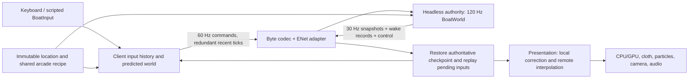

# Multiplayer: shared boating implementation plan

The proposed [room-content loading and distribution plan](ROOM_CONTENT_PLAN.md) owns runtime
map/scenario packages, selected-room content identity, download/cache lifecycle and staged
admission. It builds on these sessions and plugin P5; current rooms still require matching
compiled gameplay content. No distribution feature or wire-format change is implemented.

Current deathmatch extension (2026-10-30): [arsenal](DEATHMATCH_PLAN.md#arsenal-milestone--2026-10-27)
uses protocol v8. Enabled fleet checkpoints remain bounded at 16 KiB (9068 encoded bytes);
the per-tick combat state is a compact 1–3 page payload that omits rules, zero inactive slots
and wide fields (measured busy pool 2365 bytes, 2398 maximum; empty 558). The deterministic
four-client room measured 44.4 KiB/s/client downstream, down from about 140 KiB/s for the fixed four-page design;
broader bandwidth and qualification work remains open. Disabled free/race rooms do not send
combat pages. The dated M3/M4/M5 budgets and evidence below describe their original revisions.


Prepared 2026-10-23 against `2994e0d`. **M3, the protocol, ENet transport and separate
`boat_server` process, is implemented; M4 has begun with client prediction, so the own boat
answers the keys at once.** It is not yet the first playable (M4).
This document owns multiplayer decisions, milestones, verification and acceptance.
The [foundations plan](BOATING_FOUNDATIONS_PLAN.md) owns prerequisite extractions;
the [physics](BOAT_PHYSICS_PLAN.md) and [wake](WAKE_REWRITE_PLAN.md) plans own handling.
No networking, gameplay, dependencies, workflows or releases changed in this planning task.

Completed: source assessment, transport documentation review, phased design and first-task
definition. At preparation the next task was foundations **P2a**.
Current prerequisite status: P2a, P3a, C1–C3 (including the actual hour soak and manual
playback of all modes), the foundations basin W1/W3 slice (explicit world/session, isolation
gate; user-played), the basin S1/S2 slice (shared pose math, presentation split; not yet
user-played), the basin S3 slice (session-owned course/runs, replay view state, finish saves
outside the physical tick; user-played) and the basin S4 slice (static core library,
display-free core validator, source/symbol boundary check; not yet user-played) and the S3
`BoatInput` type (not yet user-played) are implemented, completing the minimum core
prerequisites. M2 (fleet step, simultaneous contacts, spawn/life rules, checkpoints and the
scripted `boat_server`) is implemented and automatically verified. The user played its crossing
rival on 2026-10-23 ("seems to work great"). See the
[M2 handoff](#m2-local-authority-handoff--2026-10-23). M3 (protocol v1, transport boundary,
in-memory impairment adapter, ENet adapter, authority/client sessions, `boat_server` rooms,
`boat_bot` and `wake_velocity --connect`) is implemented and automatically verified on macOS. It
is not yet user-played; see the [M3 handoff](#m3-protocol-and-transport-handoff--2026-10-23)
and the [protocol](MULTIPLAYER_PROTOCOL.md). M4 step 1, checkpoint/input replay (client
prediction, `boat_prediction`), is implemented and automatically verified on macOS; the user
played it beside `boat_bot` on 2026-10-24 ("Works really well!"); see the [M4 prediction handoff](#m4-step-1-client-prediction-handoff--2026-10-23).
M4 step 2 (wake reconciliation: digest-confirmed provisional records, held corrections, early
births by identity) is implemented and automatically verified; see the
[wake handoff](#m4-step-2-wake-reconciliation-handoff--2026-10-24). M4 step 3 (remote
interpolation 100 ms behind and the proximity blend, `boat_remote_view`) is implemented and
automatically verified; the user played both in the step-4a sessions without targeted checks ("I'm not sure what to look for but I didn't notice anything off") on 2026-10-24; see the
[remote view handoff](#m4-step-3-remote-view-handoff--2026-10-24). M4 step 4a (fleet rendering
with the Nordic skins by slot) is implemented and automatically verified; the user played it
with several boats and bots on 2026-10-24 ("It works!");
see the [fleet rendering handoff](#m4-step-4a-fleet-rendering-handoff--2026-10-24). M4 step 4b
(reset feedback: `RESETTING`, waiting for a clear spot, a short fade into the new life) is
implemented and automatically verified, not yet user-played; see the
[reset UI handoff](#m4-step-4b-reset-ui-handoff--2026-10-24). All M4 implementation steps are
done. The Mac and Windows packages now carry `boat_server` for LAN rooms (Windows CI pending;
see the [packaged server handoff](#packaged-lan-server-handoff--2026-10-24)). On 2026-10-24 the
user played across two machines: a Mac hosted `boat_server` and one client, and a Windows machine
joined over the LAN ("Multiplayer architecture works great!"); profile F and the contact-gap
measurement were not part of that session. LAN discovery (2026-10-24) lets the title find
rooms on the local network; it is checked on one Mac only. See the
[LAN discovery handoff](#lan-discovery-handoff--2026-10-24). On 2026-10-24 the user explicitly chose to advance to M5 and defer the remaining M4
manual acceptance, profile-F play and contact-gap measurement. These remain open checks,
not completed acceptance. M5 is active; M6–M8 remain pending. The [capsize deathmatch](DEATHMATCH_PLAN.md)
proceeds in parallel (D1 match core and D2 protocol v2 with the in-game HUD implemented
2026-10-24; next: D2 play, then D3). The live protocol is now [v4](MULTIPLAYER_PROTOCOL.md).
The next requested mode is a [river sprint race](RACE_PLAN.md), planned 2026-10-24:
45–60 seconds, a shared grid, frequent vessel-wake jumps and confirmed finish positions.
Race R0 provides a measured shortened route and playable physical ferry-wake trial, and the
[R1 race core](RACE_PLAN.md#r1-race-core--2026-10-24) (`boat_race`) adds authoritative
rules over the fleet, including a new fleet grid hold. R0 and R1 are user-approved; the
[R2 network race](RACE_PLAN.md#r2-network-race--2026-10-24) (`boat_server --mode race`,
protocol v4 with the hold and the race GO tick, predicted hold/ferry, HUD and results) is
implemented and automatically verified, awaiting human race-room play. R3's slalom and
moving storm are implemented, with the storm presentation user-accepted; full-course/pacing
work and R4 multiplayer acceptance remain in the [race plan](RACE_PLAN.md).
On 2026-10-25 the game gained [hosting from the title](#host-from-the-game--2026-10-25)
(MULTIPLAYER > HOST A ROOM, `wake_velocity --host`): the game runs a second copy of itself as
`--serve` and joins it, so packages ship one executable. User-played 2026-10-25 ("Works
great!"); Windows compilation unverified. The game executable was renamed from `boat_study` to `wake_velocity` on 2026-10-25.
Numerical budgets below are proposed gates, not measured multiplayer results.
The final evidence section distinguishes checks performed for this document from future checks.

## Recommendation and product boundary

Use a **server-authoritative, 120 Hz simulation**, with immediate local prediction,
server reconciliation and buffered remote presentation. Start with **two native players in
the basin**, then qualify **four total players, including the host**. Use **ENet** for native
transport; do not build acknowledgements, retransmission, congestion handling or connection
management directly on raw UDP. Authority is an application decision, independent of ENet.

Four is a justified initial release cap: it matches `BOAT_OBJECT_BOATS`, bounds the world to
128 wake objects and six player pairs, and has a local automated fleet precedent. That
precedent is not proof of network feel or four-player river performance. Do not promise eight:
eight means 256 objects with unchanged lifetime/cadence, 28 pairs, more replicated data and
substantially more shader/query work. Raise the cap only after a separate measured proposal.
Scenery vessels do not consume player slots and remain kinematic; no extra dynamic rival in
a full multiplayer room. Initially every human uses the same hull and normalized impact mass 1.

Build the authority as a small **headless `boat_server` process**, usable on a friend's machine
or a reachable server. Two-process first proof: one server, one rendered client plus a scripted
client; the human proof uses one server and two rendered clients. A later Host action starts
the same server as a child process and connects locally. This provides player-hosted play
without tying authority to a window's focus, render stalls or audio loop. No in-process listen
server variant or host migration is needed. (2026-10-25: the child is the game's own
executable in `--serve` mode rather than a separate binary; see
[host from the game](#host-from-the-game--2026-10-25).) The local host still has a latency advantage;
a remotely hosted server is the preferred fairness/connectivity option for regular sessions.

First release: shared free boating, collision/wake play, visible player colors/names, quick
safe recovery and direct connection. Cheap activities, after free boating passes its fun gate:
follow-the-leader wake slalom, take turns making a jump ramp, and a group trip to a named
landmark. These work by agreement with no new scoring system. A later session-only landing
counter can use confirmed outcomes. Accounts, public discovery, matchmaking, competitive
ranking, elaborate race rules, persistent progression, chat/voice and moderation are outside
this release. Friends can use their existing voice call.

Superseded in part on 2026-10-24: the user chose a timed capsize deathmatch, with scoring,
leaderboard and new capsize mechanics, as a server-selected room mode beside free boating,
then requested a short, jump-heavy river race with a shared start and finish positions.
The [deathmatch plan](DEATHMATCH_PLAN.md) and [race plan](RACE_PLAN.md) own those modes;
the paragraph above is kept as the original planning default. Race has a rules core but no room mode yet.

Assumptions: friends trust the host; a room uses one fixed map/settings revision; stable native
machines can run 120 Hz; initial quality target is RTT <=80 ms with modest jitter/loss.
These are release targets to test, not guarantees for every connection.

Only three product questions materially remain open; the plan proceeds with these defaults:

| Question | Working default | Consequence of changing it |
| --- | --- | --- |
| Must browser players join the first multiplayer release? | No; native first, browser single-player retained | If yes, evaluate WebRTC before M3 instead of first integrating ENet |
| Who operates the reachable friends server? | One friend maintains one small Linux server, or the group uses an existing private VPN | If nobody can, connectivity/managed relay work becomes release-critical |
| Must the first friends release include the river? | Basin proved the first slice; playable river/Eriksberg rooms pulled forward from M7 on 2026-10-24 | Fixed-map play is available now; full mapped qualification remains in M7 |

## Source assessment and corrections to older assumptions

| Source / symbols inspected | Reuse and consequence |
| --- | --- |
| `src/main.c` (the demo, removed 2026-10-25): `main`, `run_screenshot`, `run_profile`; [`tools/wake_velocity.c`](../tools/wake_velocity.c): `timed_boat_step`, `demo_step`, `ObjectStudy` | The game loop is in `wake_velocity`, not `src/main.c`. Keep the four-minute demo/music clock separate. The study is the integration point for joining, input and rendering. |
| [`src/boat.h`](../src/boat.h): `Boat`, `BOAT_STEP`; [`src/boat.c`](../src/boat.c): `boat_step`, `buoyancy_step`, `motion_step`, `boat_wake_stern` | Reuse the 120 Hz force recipe, steering/throttle **rates**, engine response, six support points, air yaw, landing and inversion timers. `Boat` also owns flag, particles, camera, course, location, water copies and borrowed wake pointers. It is not a packet or prediction checkpoint. |
| `boat_collide_pair`, `hull_vertical_bounds`, `resolve_hull_contact`, `resolve_traffic` in `boat.c` | Reuse OBB/SAT geometry, mutual planar/yaw impulses and mass-weighted separation. Vertical intervals reject clear jumps. This is not a full 3D solver: no vertical boat-on-boat impulse or deck landing, and pair response does not itself perform a final shoreline check. Sequential pair mutation is insufficient as the fleet scheduler. M2 (2026-10-23): `boat_collide_pair` now composes pure `boat_pair_contact`/`_speed`/`_impulse`/`_apply` helpers with unchanged arithmetic; `boat_fleet_solve` uses them simultaneously and holds separations at the shore. |
| [`src/boat_water.c`](../src/boat_water.c): `boat_water_query`, `boat_water_query_field`, `boat_water_resistance` | Arcade contributions add signed height, gradient and vertical surface velocity; current contributes slope-relative vertical motion before normal construction. Preserve this common physical surface and the CPU/GPU recipe. |
| [`src/boat_wake_objects.[ch]`](../src/boat_wake_objects.h): `BoatWakeObjects`, `boat_wake_objects_advance`, `boat_wake_objects_track`, `boat_wake_objects_query`, `boat_wake_objects_pack` | Caller-owned world already exists. Four emitters ×32 objects; cadence 60 ticks, maximum lifetime 1920 ticks, default crest 1.8 m; propagation 2.4 m/s. Immutable records evolve analytically with age. Emission is conditional on wetness/speed/span, not simply one event every 60 ticks. Emitter filters/start/cursor are future-affecting state. |
| `timed_boat_step` and [`tools/wake_objects_review.c`](../tools/wake_objects_review.c): `local_fleet`, `gameplay_envelope` | Rival and four-boat tests share a world. The app tracks player emission before stepping the rival; the fleet test tracks inside its boat loop and solves pairs afterward. Neither is the new authoritative schedule. Current births have a zero birth envelope on that tick, mitigating immediate surface-order effects; do not claim an observed order bug from inspection alone. |
| [`src/boat_replay.[ch]`](../src/boat_replay.h): `BoatReplaySample`, `boat_replay_pose`, `boat_replay_sample` | Pose recording omits vertical/angular velocities, planing, motion timers/state, complete wake/emitter state and session state. Keep ghosts/replays as views. At this source assessment file format was `REPLAY_VERSION 1` and handling compatibility was `BOAT_PHYSICS_REVISION 5`; C1 later advanced these to 2 and 6. Neither equals the future protocol version. |
| [`src/boat_map.c`](../src/boat_map.c): `shore`, `init`; [`src/waterfront_scene.c`](../src/waterfront_scene.c): `river_enabled`, `waterfront_scene_select_river`; `boat_water.c`: `surfaces`, `patches` | Map selection and caches are still global. Separate immutable map/query data from render resources through foundations work. Basin first avoids making mapped-world extraction a hidden first-slice prerequisite. S4 basin slice (2026-10-23): the selector is now `waterfront_city_select_river` in `waterfront_city.c` and the surface/patch caches are in `boat_water_mesh.c`, both still global. |
| [`src/waterfront_harbor.c`](../src/waterfront_harbor.c): `waterfront_harbor_contact_height`; [`src/waterfront_traffic.c`](../src/waterfront_traffic.c): `waterfront_traffic_motion`, `waterfront_traffic_contact_height` | Shared posed contact envelopes are useful. Ordinary traffic remains on authored routes, with one-way collision response and visual trails; it does not emit into the four-player arcade pool. Evaluate authoritative routes/obstacle poses at a common tick. |
| [`src/boat_gpu.c`](../src/boat_gpu.c): `boat_gpu_draw_with_ghost`; [`src/waterfront_scene.h`](../src/waterfront_scene.h): `WaterfrontSceneFrame`; [`src/renderer_gpu.c`](../src/renderer_gpu.c): `draw_ghost` | One player plus one special ghost is not a fleet renderer. Ghosts omit shadows/reflections. Add bounded ordinary vessel views; keep race ghosts separate. The frame's “owned/no mutable pointers” comment is no longer literally true: copied `BoatWater` contains a borrowed `objects` pointer. Freeze/copy the render wake records before passes. |
| [`CMakeLists.txt`](../CMakeLists.txt), [`cmake/Web.cmake`](../cmake/Web.cmake) | C17 and pinned raylib 6.0; common source lists are repeatedly compiled, simulation validators pull presentation. Emscripten builds `wake_velocity` then returns before native targets/tests. A headless core/server target and optional native transport dependency must respect this split. S4 basin slice (2026-10-23): static libraries replace the repeated lists, and `proteus_boat_core` has a display-free validator and boundary check; most simulation validators still link session and presentation. |
| [`tools/validate_boat.c`](../tools/validate_boat.c): `validate_flight_outcomes`, `validate_dynamic_pair`; environment, banking, replay, traffic and object validators | Preserve ballistic/dry control, capsize, vertical clearance, momentum/energy, banked handling, wake derivatives, expiry and shader parity checks. Extend with network histories/authority tests; do not replace physical checks with screenshots. |

The [2026-10-19 architecture review](ARCHITECTURE_REVIEW.md) is a dated baseline: its
64-entry shader discussion describes D3, and its struct sizes predate current state. Current
arcade storage is 128 records, not a physical grid. Existing physical-field deep-snapshot
experiments are not the live arcade networking solution. At the planning baseline, `Boat.time += BOAT_STEP` used
float accumulation even though the arcade pool already uses integer ticks; the general clock
work remains necessary. Foundations C1's old proposed revision numbers must use the next unused
values (currently physics 6, replay format 2 if its double-time format changes).

The user now reports jumping, landing and capsizing are fun. This is gameplay-direction
acceptance, not acceptance of networking, a tight-turn readability fix, Windows playback or
any performance budget. [Arcade implementation evidence](WAKE_ARCADE_IMPLEMENTATION.md)
already records flight/capsize and height-aware contacts; older descriptions of their absence
are historical. Its synthetic overlap sweep reaches 45.49 m height and 28.16 m/s vertical
speed. Protocol validation must not silently clamp valid extreme states to ordinary jump sizes.

## Authority, transport and hosting

| Architecture | Advantage | Cost / decision |
| --- | --- | --- |
| Authoritative server with prediction | One outcome for mutual impacts, capsize, spawn and wake births; small bounded world | Clients correct speculative motion. **Chosen.** |
| Deterministic lockstep / input delay | Small input traffic | Waits for slow peers; floating-point/libm/platform identity is unproven; delay damages the accepted controls. Reject. |
| Peer-authoritative boats or distributed rollback | Each owner reacts instantly | Conflicting collision/wake ownership, rollback cascades and disconnect authority changes. Much more work than four server-owned boats. Reject. |

Verified primary dependency documentation on 2026-10-23:

| Transport | Verified capability | Fit |
| --- | --- | --- |
| ENet | C implementation, reliable and unreliable sequencing, independent channels, connection servicing, Unix/Windows support, MIT license; upstream CMake target | Best fit for a small native C project. Its documented scope does not supply encrypted identity, rendezvous or relay hosting. See [design](https://github.com/lsalzman/enet/blob/master/docs/design.dox), [source/license](https://github.com/lsalzman/enet), [build](https://github.com/lsalzman/enet/blob/master/CMakeLists.txt). |
| GameNetworkingSockets | C interface over C++, encrypted reliable/unreliable messages, IPv6, ICE NAT traversal with application signaling | Strong alternative if encrypted native internet transport becomes a requirement. More build/integration surface. Open-source use does not automatically grant Steam authentication/signaling/SDR services; see [official README](https://github.com/ValveSoftware/GameNetworkingSockets/blob/master/README.md). |
| WebRTC DataChannels via libdatachannel | C bindings over C++, native/browser interoperability, ICE/STUN/TURN and TLS/SCTP dependencies; configurable unreliable/unordered channels | Best candidate if browser is required early; more signaling, build and operational work. See [implementation/dependencies](https://github.com/paullouisageneau/libdatachannel/blob/master/README.md) and [C API](https://github.com/paullouisageneau/libdatachannel/blob/master/DOC.md). |

Pin an audited ENet tag/commit and its license in M3, rather than tracking `master`. Compile
it statically for the existing native packages; verify the pinned build on macOS and MSVC.
Current upstream `ENetAddress` uses a 32-bit host address: plan IPv4/direct DNS-to-IPv4 first,
not assumed IPv6 support. [Public header](https://github.com/lsalzman/enet/blob/master/include/enet/enet.h).
Do not advertise encryption or strong authentication from an ENet connection/session token.
For this friends-only scope use a private VPN where privacy/access control is wanted, or a
restricted reachable server with a random room token. Do not invent application cryptography.

Connection progression:

1. Numeric loopback address and fixed UDP port (proposed 24680); bind loopback by default in
   development. CLI directs the client to the authority. No discovery server.
2. LAN IP/direct hostname and a copied room token. Host binds explicitly to a LAN interface;
   document OS firewall permission. Manual address entry suffices; LAN broadcast is optional later.
3. Friends use a reachable IPv4 host: forwarded UDP port plus host firewall, or a small public
   headless server with an allowed UDP port. Port forwarding cannot fix upstream CGNAT or
   every double NAT. ENet does not make inbound reachability automatic.
4. If friends cannot host, use an existing private mesh VPN or operate one reachable dedicated
   process. A VPN may itself relay; test its RTT/bandwidth. No custom hole-punching/relay service
   in M1–M6. Networks blocking UDP may still fail; report a useful timeout, not a false promise
   of universal connectivity.

A server operator owns OS/dependency updates, firewall, restart/service configuration, bounded
logs, version distribution and checking uptime/region latency. One room, no database or account
backend. Choose machine size from M5/M6 measurements rather than a promised price or core count.
Host exit ends the room; a child authority is explicitly stopped with its owning Host session.
Suspending the host machine cannot be hidden by a background process.

### Browser decision

Update, 2026-10-25: the optional WebRTC endpoint and browser gameplay integration are now
implemented in `web-parity`, after the local protocol-byte echo gate passed. The original
native-first rationale below is retained; current commands, evidence and hosting limitations
are owned by [browser boating](WEB_BUILD.md#webrtc-rooms). No public service or deployment
has been created. Native ENet remains the default.

Keep browser single-player compiling throughout. Ordinary browser code has no direct UDP;
Emscripten documents WebRTC as an alternative and socket-over-WebSocket proxying as principally
debugging infrastructure. Do not claim that recompiling ENet or deploying Pages creates a game
server. [Emscripten networking](https://emscripten.org/docs/porting/networking.html).

Add only a small transport boundary now: connect/listen, poll, bounded send by delivery class,
disconnect and statistics. It carries byte messages; ENet types cannot enter simulation or the
codec. An in-memory impairment adapter shares this boundary for tests. No transport plugin framework.

After native feel is proven, M8 evaluates browser `RTCPeerConnection` with unreliable/unordered
`maxRetransmits=0` data for state (application sequence numbers discard stale messages) and a
separate ordered reliable channel for control/bootstrap. Server endpoint: optional libdatachannel
C bindings; callbacks enqueue bounded messages onto the authority thread. HTTPS/WSS signaling
exchanges offers/candidates; ICE and a TURN service cover difficult routes. Pages hosts only the
client. Signaling/TURN require reachable infrastructure, credentials, updates and traffic costs.
The server remains authoritative even though WebRTC calls the endpoints peers.

The browser gate should consider migrating native clients to that same adapter if maintenance
is cheaper, or retaining two thin transport adapters with one protocol/core. Do not build both
today. WebSocket-only gameplay is a fallback experiment, not the recommended physics transport:
ordered reliable delivery can stall fresh input/state behind lost older data. Test browser tab
throttling, Asyncify yielding and buffered sends before promising support.

## Ownership and data flow



Proposed concrete boundaries (names can follow existing foundations names; responsibilities are fixed):

| Owner | State and work |
| --- | --- |
| `boat_sim` / `Boat` | Numeric physical/control state and force/contact functions; no devices, files, view or network handles |
| `BoatWorld`, `BoatClock`, fleet step | Definition/query data, tick, four boat slots/life generations, shared arcade pool/emitters, kinematic obstacles and spawn decisions |
| Server session | Input queues, client IDs, protocol state, world authority, timeouts and scheduler |
| Client session/prediction | Authoritative snapshots, speculative world, input/history rings, clock estimate; never writes the server world |
| `BoatPresentation` / view | Visual poses, corrections, cloth, camera, particles, audio parameters; immutable per-frame boat/wake view for all render passes |
| Codec/transport | Explicit bytes, sizes, validation, delivery and packet statistics; no physical integration |
| Offline course/replay adapter | Existing course, bests, ghost/replay views and persistence; not loaded by the multiplayer authority |

`boat_server` links the math/geometry/query core and transport, starts a monotonic clock and
poll loop, and never calls `InitWindow`, `InitAudioDevice`, render setup or asset/audio loading.
Harbor geometry/contact definitions must be separable from generated visual meshes. Raylib
vector/math headers are acceptable; a display/audio backend is not a server runtime prerequisite.
Linux must be able to configure a server-only target without fetching/building a GLFW window
backend. Keep compiled map data; no server filesystem work inside ticks. Startup configuration
and bounded log flushing outside ticks are allowed.

Example at RTT 80 ms: a client generates input for future authoritative tick 1012 while its
estimate of the server is around 1003. It immediately predicts 1012 and sends that command
with recent commands. The authority receives it before its tick 1012 deadline, steps all boats,
and sends post-tick snapshot 1012 at that 30 Hz boundary. On receipt the client may have
predicted to about 1026. It restores **all** physical state at 1012, replaces confirmed wakes
and emitter state, discards commands at/before 1012, and replays 1013–1026 with its saved input
and bounded remote estimates. It compares the old/new predicted 1026 pose, applying any visual
offset decay only in presentation. Exact tick offsets depend on the measured clock/lead; they
are not a latency-elimination promise.

## Fixed tick and continuous contact contract

Let `S[n]` mean the complete **post-tick** state at integer tick n. One world clock advances
once per 1/120 second, with double wall-clock scheduling and the existing float force timestep.
For tick n+1:

1. Poll/decode outside physics; admit commands to bounded queues. Apply scheduled join/leave/
   life-reset operations at this boundary, testing spawns against all existing/reserved hulls.
   Resolve competing spawn requests by queued request order, not boat-array position.
2. Advance shared wake age/expiry to n+1 once, retaining births through n. Freeze a read-only
   water view for this tick. Evaluate ambient phases and kinematic traffic/berth contact poses
   at n+1 against that view. Never advance water separately for each boat.
3. Select one input per boat for n+1. Integrate each boat from S[n] using the same frozen world.
   Preserve the existing per-boat order: wetness and `motion_step`, controls/engine/planing,
   planar forces, translation/rotation and static/traffic response, buoyancy/angular motion.
   Presentation, course and wake publication are excluded. No boat reads another partially
   integrated boat. Freeze the resulting candidate fleet.
4. Generate all unordered player-pair contacts from that fleet, using final candidate vertical
   intervals. Solve mutual planar/yaw response and separation in a fixed four-pass budget.
   Extract a pure contact/impulse calculation from `boat_collide_pair`: each pass reads one
   common candidate array, accumulates pair deltas, then applies all deltas together (Jacobi
   style). Use accumulated nonnegative normal impulses and a shared restitution target so
   repeated passes do not apply repeated bounce. Recheck shoreline/kinematic constraints after
   displacement; boats may not be separated through a quay. Publish a new candidate array
   between passes. Build/sum pairs canonically by stable IDs; storage permutation must not
   alter traversal or results. Exact coincident-center ties use a documented ID-based fallback.
5. Commit all boats. Obtain **all** wet-stern samples from the frozen pre-emission field and
   committed fleet first, then update each emitter once and publish births together. Births at
   n+1 become eligible for boat queries starting tick n+2. This replaces the app/test schedules;
   preserve the arcade equations and filters. Do not let tracking boat A change boat B's
   stern wetness sample. Snapshot at this point, including emitter continuation state.
6. Produce transition/contact episode IDs, update optional session rules, and enqueue a snapshot
   every fourth tick. Outside authority physics, clients update visual/audio state once from
   committed/predicted outputs. Render and replay viewing never emit physical wakes.

M2 must prototype the small simultaneous solver against the existing isolated two-boat response
before adopting it. Simply summing unconstrained pair impulses can add energy in a pile-up;
acceptance requires passive-contact energy and separation checks, permutation tests and manual
feel. If four passes cannot resolve a particular packed geometry, keep the last valid position
and report residual contact rather than teleporting through shore. A bounded, tested fallback
is preferable to an unbounded solver. A new general rigid-body engine is outside scope.
Compare role-swapped equal-mass fixtures as well as array permutations: canonical order alone
is reproducible, but not proof of symmetry or fairness. Test maximum current horizontal/vertical
speeds and crossing trajectories between ticks for tunneling; add a bounded swept contact test
only if those fixtures demonstrate a missed interaction. Any solver behavior change belongs to
the physics plan and compatibility revision, separately from mechanical extractions.

### Prediction and what each player sees

The server alone decides boats, contacts, wakes, motion state and safe spawns. A client predicts
a small copy of the four-boat world so an imminent mutual collision can move both transient
boats. Local commands are known; remote commands/physical state come from snapshots, with last
known controls used only over a bounded horizon. Clients never send position, impact, launch,
landing or capsize claims. This is prediction, not cross-platform deterministic lockstep.

Start rates: 120 Hz simulation/input generation, 60 Hz command packets, 30 Hz snapshots.
Client target tick = estimated current server tick + a lead of half measured RTT plus four ticks,
bounded to 4–16 ticks. The four-tick margin covers 60 Hz packet batching plus ordinary jitter.
Adjust gradually, never by changing `BOAT_STEP`; initial exchange/ping
estimates offset and RTT, without assuming symmetric latency is exact. The server accepts at
most 24 ticks of future input. Track late-input rate and adjust the small lead before changing
handling. Authoritative state is never delayed waiting for a slow client.

Restore a complete snapshot and replay buffered ticks at each useful correction. Checkpoint
contents include position, velocity, heading/yaw velocity, height/vertical velocity,
pitch/roll and both velocities, wheel, throttle, engine response/angle, planing, turn-roll load,
motion state, dry/landing/inverted-contact timers and landing counter. Include any additional
field found to influence the next physical tick. World state includes tick, water settings,
all live wake records, emitters' starts/ticks/cursors/strength filters, boat life generations,
scheduled reset/eligibility state and recent inputs used for remote prediction. If a contact
solver gains persistent warm-start impulses, snapshot them too; prefer no cross-tick cache.
Keep wave-entry audio output/cosmetics separately where they do not affect forces.

Use a 240-tick (2 s) history, with at most 32 replayed ticks per correction; a longer outage
gets a fresh state/resync instead of a long CPU burst. Four speculative boats are still small,
but their wake queries may be costly: M4 measures replay cost before calling this acceptable.
After 200 ms beyond the latest authoritative remote state, stop extrapolating that remote hull
and stop predicting new contacts against stale guesses. Mark stale connectivity; authoritative
corrections still apply. After 250 ms with no usable state, stop advancing the speculative world
and show reconnecting rather than inventing more flights. Recovery installs a fresh checkpoint.
Normal quality targets therefore apply to the supported profile, not a 200 ms RTT connection.

Remote drawing normally interpolates snapshots 100 ms behind estimated server time (adaptive
range 67–150 ms). Interpolate orientation correctly, preserve continuous pitch/roll flips, and
never blend across life generations. A brief buffer underrun can extrapolate up to 100 ms;
then hold the last bounded pose. Interpolation poses never serve as collision hulls.

There is a visible-time conflict: at 18 m/s an interpolated remote can be meters behind its
current physics estimate. When separation is <12 m or predicted contact is <0.5 s away, blend
that remote's display toward the speculative collision proxy over at most 100 ms. Use hysteresis
(leave proximity mode beyond 16 m for 0.5 s). Apply this before impact, not by suddenly moving
the boat at the impulse. The local water display uses the local predicted tick and confirmed
wakes plus provisional own wakes; near boats share that time. Distant interpolated boats can
have a small water-pose timing error; measure it rather than resimulating cosmetic scenery.
The thresholds are an M4 experiment, with a measurable visible contact-gap gate below.

Physical correction is immediate on restore; visual correction decays over 100–150 ms for
small errors. Snap/briefly fade for respawn, life changes, or errors >2 m or >30 degrees, rather
than dragging a boat through a solid hull or quay. Near-contact smoothing must not show sustained
overlap. Camera smoothing follows the visual boat; it never changes physical samples.
Prediction cannot guarantee identical perceived impact times on two machines.

| Encounter | Required behavior |
| --- | --- |
| Head-on | Authority applies one mutual mass-balanced impulse; both clients predict transient pair response and replace it from the same post-contact snapshot. No owner sends a “hit” RPC. |
| Side swipe | Preserve yaw and separation from the contact recipe, including the other boat's motion. Correct both proxies; do not treat the remote as infinite mass. |
| Airborne clearance | Use transformed hull/cabin intervals from predicted/authoritative physical orientation; an interpolated low silhouette must not become a collider. No full 3D landing-on-boat feature. |
| Capsize | Authority latches the existing sustained inverted wet contact rule. Speculative overturn is possible; confirmed capsize and disabled engine persist until a new life. UI/outcome counters only confirm server state. A late correction may change a speculative outcome once, but cannot repeatedly relaunch or relatch it. |
| Three/four simultaneous contacts | Common candidate fleet and bounded simultaneous solver; conservation/symmetry tests. A canonical player loop alone is insufficient. |
| Recovery near others | Escape > REQUEST RESET or a one-second Backspace hold requests a server reset. Use authored safe-water candidates with hull clearance plus a 10 m center buffer, no imminent swept boat/traffic approach for 0.5 s and a calm-surface check. Reserve accepted slots for the whole spawn batch. If none is safe, wait visibly; never spawn intersecting or clear other players' wakes. |

Respawn target: <=2 s after R in the ordinary basin scenario; retry at 10 Hz if blocked, offer
another authored safe berth. Reset only that boat, its prediction/cosmetics and its emitter's
new-span state; increment life generation. World clock and old wakes continue. No arbitrary
teleport to client-supplied coordinates and no automatic competitive invulnerability rule.

Start the spawn calm-water check with absolute surface displacement <=0.25 m, gradient length
<=0.2 and vertical surface speed <=0.5 m/s at the hull support points. Check current water and
the known field 0.5 s ahead; future human emissions cannot be guaranteed. Calibrate authored
candidates in M2/M7 rather than relaxing hull clearance to meet the recovery time.

### Rewind versus rollback

Do **not** rewind the authority to validate late physical collisions. Rewinding only the victim
would give mutually inconsistent continuous contacts; rewinding a wake-maker also changes later
births, other boats' launches and subsequent contacts. Complete server rollback would require
the full world state above, ordered inputs, lifecycle operations, static-content identity and
event suppression for every replayed tick. It adds delayed outcome revision for all players.
For four friends it is not justified. Late inputs affect neither past ticks nor other players'
already committed outcomes. Client checkpoint/replay is justified for responsive controls;
cross-platform floating-point divergence is corrected by snapshots and measured, not denied.
Keep authoritative traces for debugging; pose replay files are not rollback storage.

## Shared wake contract and replication

“Wakes interact” initially means every human boat's wake affects every boat, including its
own returning path; overlapping pieces sum signed height/gradient/vertical motion exactly as
`boat_wake_objects_query` and `boat_water_query` do today. Crests can reinforce and troughs can
cancel. No extra wave-wave collision, refraction, energy transfer, foam force or jump impulse
is required. Preserve tall crests, propagation, filters, six-support flight/landing/capsize and
the 16-second/32-piece bound. Do not attenuate overlaps to hide network errors.

| Replication approach | Assessment |
| --- | --- |
| Only inputs/boat poses; independently emit everywhere | Wet-stern history, capsize and missing controls diverge; join-in-progress cannot recover old wakes. Reject. |
| Only reliable birth events | Compact, but a missing event can stall later births on that ordered stream; no state repair or join baseline. Insufficient alone. |
| Entire wake world every 30 Hz snapshot | Simple but ~6 KiB ×30 per client before boats; exceeds one datagram and wastes bandwidth on immutable records. Reject as routine. |
| Authoritative immutable birth records plus bounded state repair | **Chosen:** redundant recent births, 1 Hz full registry, reliable join/resync checkpoint. Reconstruct only analytic age evolution, never guess authoritative emission. |

Record identity: `(session_epoch, emitter_slot, birth_serial)`, with owner/life generation as
metadata. A 32-bit serial per emitter never resets on respawn/reassignment; use wrap-safe serial
comparison or end the session before ambiguity. Physical pool slot and identity are distinct.
Proposed birth record <=48 bytes: seven f32 recipe values, u64 birth tick, u32 serial, u32 owner
generation, u8 emitter slot, u8 pool slot, two reserved bytes. No render-coordinate conversion
on the wire: simulation X/Z only, reflected X only in the view/pack adapter.

Send the most recent 1.5 s of births at 10 Hz (<=12 ordinary births with four emitters; cap a
batch at 16). Deduplicate by identity; apply to the correct slot only if its serial is newer.
Every second send a complete live-slot registry, including per-slot last serial/tombstones and
its checkpoint tick, as <=1100-byte application pages. Pages are unreliable/unsequenced with
explicit checkpoint ID/page index/count, so reordering pages does not make ENet discard an
earlier page as stale. Assemble atomically with a checksum; retain at most two assemblies.
Incomplete data expires after 1 s; the next registry repairs it, or a bounded reliable resync
request obtains a fresh checkpoint. Never append unbounded historical events.

Merge registry at tick K by replacing membership as of K, then overlay newer births/lifecycle
records already received. A missing slot at K cannot delete a birth after K; an old birth cannot
resurrect a newer overwritten slot. Retain tombstones/serials after expiry. Guard `query_tick <
born` before unsigned subtraction; expiry is `query_tick - born >= life_ticks` only after that
guard. Reconstruct gradients/velocity from the same record/age; do not transmit a sampled grid.

On join: reliable manifest and bounded complete checkpoint (boats, wake records, emitter
continuations, settings, generations, tick) use a bootstrap channel. Existing players keep
running. Buffer at most 2 s of later snapshots/births; after validating the checkpoint and
overlaying later data, acknowledge Ready and let authority schedule the new boat's spawn. Until
then the joiner is a loading/spectator view with no collision/wake emission. On overflow or an
expired baseline, discard it and request a newer one. No replay of 16 seconds of boat inputs.

Disconnect removes that hull at the scheduled tick after timeout; its live wakes expire
naturally. Reuse the emitter's 32 physical slots and retain its cursor/last-birth cadence, while
resetting the new owner's span/filter and changing owner generation. Enforce at least 60 ticks
between births even across reset/reuse; a new span needs its own 60-tick sample window. This
prevents rapid respawns filling beyond 32 or overwriting live waves. Old and new owner records
may coexist. Slot exhaustion is a counted contract failure to fix, not an excuse to clear the
shared ocean. Test reset/disconnect/rejoin immediately before pool wrap.

Own predicted births live in a separate provisional overlay, tied to input/life and the
predicted emitter serial. The authoritative checkpoint supplies emitter continuation and
serials; correction removes provisional records after its tick and re-emits from replayed
inputs. Match only the same identity, never spatial proximity. If a predicted birth did not
happen on authority, discard it; never add both versions. Remote births are authoritative only;
remote speculative boats do not publish durable wakes. This intentionally sacrifices perfect
prediction of a new remote wake until its record arrives.

For a late remote record, evaluate at its actual birth age, not at receipt time. If it affects
the local prediction interval, rebuild from the latest authoritative boat checkpoint with the
corrected wake set and replay once. Effects before that checkpoint are already reflected in
its boat state; do not apply a retroactive launch impulse. Retain expired/replaced records for
the 2-second replay window as well as the current registry. Each checkpoint references a complete
recoverable wake version. A discontinuity too old for history requests fresh state and a visible
resync; do not inject a grown crest under the hull while keeping stale vertical momentum.

Snapshots include motion timers/counters and last confirmed outcome IDs. Audio/splash/UI events
are emitted once on forward presentation, never during resimulation. Use an event key including
session, life, tick, type and pair/episode; cap recent event memory (1024 entries/2 s). Contact
forces arise only in the tick solver, not from event delivery. No duplicated landing count,
impact sound, launch or capsize on repeated packets. Small visual wake corrections may blend
over <=100 ms, but the physical query uses the corrected recipe immediately; measure visible
crest/contact mismatch and snap larger discrepancies with the boat correction.

## Protocol and bounded runtime policy

Proposed protocol v1 uses explicit byte encoding in network byte order. A fixed 32-byte header
contains magic, protocol version, type/flags, session epoch, message sequence, u64 server tick
and payload length/reserved fields. Define every width/enum and reserved value before M3 tests.
Use explicit f32 bit encoding via integer copies, reject unsupported non-IEEE hosts, NaN/Inf,
invalid enums, lengths and out-of-world values. Never send `sizeof(Boat)`, pointers, padding,
`bool`, native `long`, or compiler enum representations. No compression/delta dependencies in
v1 boat snapshots; independent absolute snapshots tolerate loss.

| Message | Required contents / delivery |
| --- | --- |
| Hello / Accept / Reject | Protocol/schema, simulation/handling and wake recipe revision, map/content digest, requested name, room token, build label; server-assigned player ID, life/session epoch and parameters. Reliable control. Reject mismatch before allocating a boat. |
| WorldBegin / WorldPage / WorldEnd / Ready | Checkpoint ID/tick/digest, roster, settings, all boats/emitter continuations/live wakes/slot serials and spawn state; reliable bootstrap, <=16 KiB aggregate, <=1100-byte pages. No downloadable maps. |
| InputBatch | Base command sequence/tick, up to 12 recent tick commands, each signed 8-bit steering/throttle rates and validated flags; latest snapshot/wake checkpoint received. Unreliable sequenced at 60 Hz. Keyboard ±1 and zero remain exact. |
| Snapshot | Post-tick n, full four-boat physical checkpoints/identities/emitter continuations, last selected command sequence per player, last used remote rates, input coverage, wake serial watermarks, confirmed outcome counters. Unreliable sequenced at 30 Hz; target <=800 bytes. |
| WakeBirthBatch / WakeRegistryPage | Birth records and redundant recent range, or full-registry checkpoint/page metadata and serial/tombstone table. Birth batches unreliable sequenced; registry pages unreliable unsequenced with application assembly. |
| SpawnRequest / Spawned / Despawn / Roster | Request ID, authority tick, player/life IDs, spawn transform and eligibility. Reliable control; snapshot repeats durable current life/state. Requests are idempotent. |
| Ping / Pong / ClientStatus | Clock/RTT samples, most recent processed state, inactive/focused state; periodic best effort, with reliable inactive/resume notification repeated in inputs until acknowledged. |
| ResyncRequest / Disconnect | Bounded reason/request ID, graceful leave and clear rejection/timeout diagnostics. Reliable where connected; authority never depends on receiving a leave packet. |

Use five ENet channels: control reliable; input/snapshot unreliable sequenced (opposite
directions); births unreliable sequenced; registry pages unsequenced; bootstrap reliable.
Reliable bootstrap traffic cannot hold up new snapshots. Transport acknowledgements mean bytes
arrived; **application acknowledgements mean a tick was finalized or a baseline installed**.
Snapshot n finalizes all input ticks <=n even if input was missing/substituted. Clients discard
those inputs and use authority state rather than replaying a stale command later. Server accepts
one immutable command per player/life/target tick; repeated copies cannot change it. Record last
received and last actually used sequences separately so packet receipt cannot masquerade as use.

Each snapshot also carries a canonical live-wake registry digest at its tick. Before replay,
the client must reconstruct that exact record set from its last complete registry plus births,
expiry and slot serials. Missing serials/digest mismatch hold a pending correction for <=100 ms
while redundant births arrive; request a reliable fresh checkpoint if repair fails. Keep at
most the newest two pending corrections. Never claim a complete prediction restore while
silently substituting an incomplete water field. Late records with birth tick after the restored
snapshot are inserted at their proper publication tick during replay, not all at its start.

Internal world ticks are u64, reset only with a new session epoch. Message/command sequences
are u32 with modular half-range comparison and bounded windows; test wrap explicitly. Life
generation changes on respawn/reconnect, invalidating old input, effects and view interpolation.
Reject future commands beyond 24 ticks, already finalized ticks and commands for someone else's
boat. Exact rules/settings/content digest must agree; a release display version alone is not
compatibility. v1 rejects mixed protocol versions clearly; no negotiation matrix or migration.

Input loss policy: repeat last received rate for at most 6 missing ticks (50 ms), then use zero
rates. **Zero throttle rate holds the current throttle**, so this is not an engine stop. At
250 ms without fresh input, server supplies a rate toward neutral using the existing adjustment
speed, centers the wheel and lets engine response decay. Inactive/help/focus notification starts
that safety behavior immediately. The boat remains physical and can be hit/capsize. Reconnect
requires fresh input after baseline; never replay a backlog of held keys. Disconnect timeout
5 s; stale indicator at 250 ms, initial handshake timeout 10 s. Reserve a reconnect identity
for up to 30 s with a fresh connection/life and safe spawn; old packets cannot reclaim authority.
Slot reservation counts toward four and is visible/releasable by the host. No saved account.

MTU policy: <=1100 application bytes per message and configured ENet UDP payload MTU <=1200
bytes, checked against actual captures including library headers/aggregation. IP/UDP headers
are additional; this is intended to avoid common-path IP fragmentation, not a universal MTU
proof. Split bootstrap/registries at the application layer; do not let oversized “unreliable”
messages silently use a reliable fragmentation path. ENet's public flags document fragmentation
behavior; verify the pinned revision in M3. [Packet flags](https://github.com/lsalzman/enet/blob/master/include/enet/enet.h).

Bounded storage/work: four accepted peers plus at most four handshakes; per-peer 256 input
slots; client 240-tick checkpoints, 64 received boat snapshots and two wake-page assemblies;
at most 16 KiB per bootstrap, 64 KiB pending reliable bytes per peer, 8 KiB queued obsolete-state
bytes before dropping/replacing stale state. Cap ENet packet/waiting-data allocations as well
as application queues. Admit <=120 input packets/s per peer with a small burst allowance,
<=2 spawn requests/s and <=1 resync/s. Decode at most 128 messages or 1 ms per poll cycle,
whichever comes first; continue ticking and disconnect persistent offenders. Bound strings,
page counts, indices, enum/range values and pending connection time before allocation.

Validation envelopes should be broad safety limits, independent of tuning: e.g. mapped X/Z
within declared map bounds +100 m, finite height within ±1000 m and speed/angular state within
documented generous limits, with a server fault log if its own output exceeds them. Check
directions, amplitudes and lifetimes against the negotiated recipe. Extend fixtures for the
existing 45 m synthetic jump; do not make quantization/range checks an invisible gameplay nerf.
Client packets carry no authoritative world state, asset paths or filenames.

No multiplayer pause: help/focus loss releases local input, but network service and authority
continue. Audio can pause locally. A child server remains independent of the Host client's
render loop. Server scheduler uses a monotonic accumulator, at most eight catch-up ticks per
service cycle, never larger dt or silent skipped ticks. On sustained backlog, reject joins and
reduce snapshots from 30 to 20 Hz first. If backlog >500 ms persists for 1 s, report overload
and end/restart the room cleanly with a new epoch. A client that cannot keep up resyncs or
disconnects; it cannot slow everyone else. Record these events in performance evidence.

Local offline pause/reset behavior remains its own session rule. A multiplayer reset request resets one boat;
changing map/settings starts a new room epoch and baseline for everyone. Network runs never
write offline time-trial personal bests or masquerade as compatible pose recordings. Existing
replay/handling checks and old best files remain preserved under their revision paths. Clock
or physical contact changes increment handling compatibility as required; packet layout changes
increment protocol independently. Network debug traces are bounded diagnostic artifacts, not
a promised multiplayer replay product.

## Initial resource budgets and measurement gates

These are engineering allocations, **not benchmark results**. Measure Release builds on the
development M1 Max and a named candidate minimum Windows machine, then a candidate Linux host.
Shared CI checks counts/invariants; do not make noisy CI enforce absolute millisecond gates.

| Resource | Proposed four-player bound / target |
| --- | --- |
| Authority CPU | 120 Hz; p95 full world tick <=1 ms, p99 <=2 ms; total deadline 8.33 ms. Includes all contact/wake work, excludes idle waits. Packet encode/decode p95 <=0.5 ms per 30 Hz update. No hot-path allocation. |
| Client CPU | Ordinary prediction plus reconciliation p95 <=4 ms per displayed 60 Hz frame, <=32 replay ticks/correction. If catch-up exceeds the cap, resync rather than accumulate debt. Separate normal and correction-tail timings. |
| Rendering | Sustained 60 fps target on named native hardware, p95 <=16.67 ms frame; measure AA on/off and full local overlap. Shared physics does not change with visual quality. Browser performance is a later gate. |
| Live simulation state | <=16 KiB for four physical boats, wake pool/emitters, lifecycle state; enforce measured actual size. The existing 5320-byte wake-world figure is a dated ABI observation, not a wire size. |
| Client histories | <=2 MiB for 240 full checkpoints if each packed in-memory simulation checkpoint <=8 KiB; separate <=256 KiB for retained wake versions/events/snapshots. Start with full bounded copies, not a general rollback allocator. |
| Total network-owned memory | <=4 MiB/client; <=8 MiB/server for all peers, queues, packet pools and traces. Excludes map/render/audio data and transport OS socket buffers; report process RSS separately. |
| Wake record rate | At most 8 ordinary births/s, <=128 live; ~48 bytes/record. Additional retained records cover expiry/replacement during the 2 s history, not another live field. |
| Client upload | ~112 bytes/input packet ×60 =6.7 kB/s; budget <=8 KiB/s application, <=12 KiB/s including measured transport/IP overhead. |
| Client download | <=800-byte snapshot ×30 =24 kB/s; recent births <=640 bytes ×10 =6.4 kB/s; full registry/pages/serials <=8 KiB ×1 Hz. About 39 kB/s before small controls; budget <=48 KiB/s application, <=60 KiB/s on wire. |
| Server egress | Four clients <=240 KiB/s wire (~2 Mbit/s), plus bounded <=16 KiB join bursts throttled to <=16 KiB/s per joiner. Qualify at 3 Mbit/s available upload; log real bytes, not nominal structs. |

Bandwidth totals intentionally include redundant birth repair and full absolute state. Final
codec sizes must prove the <=800/1100 bounds; trim redundant fields or split optional cosmetic
events if needed, never omit future-affecting checkpoint state. If target links are narrower,
first reduce registry frequency or snapshot rate with explicit tests, not physics Hz or wake
lifetimes. Under congestion keep newest state, preserve bounded control/bootstrap delivery and
use transport throttling; reliable queue growth must not silently consume the room.

The existing full-pool AA probe measured ~5.21 ms median rendering in a frozen basin fixture
and explicitly missed an earlier 2 ms whole-wake target. It excludes city/physics/presentation
and is not a four-client benchmark. CPU queries loop through 128 objects and mapped contact
queries scan shoreline data. M2/M5 must count water queries/object visits, pair candidates,
solver passes, replay ticks, encode bytes and high-water memory. Only add conservative spatial
shortlists if measured costs require them; compare against exhaustive results. Offscreen wakes
still affect physics and cannot be deleted for rendering performance.

## Foundations dependency agreement

Do not run the entire 2026-10-19 refactor as a prerequisite or invent a second core migration.
The [foundations plan's multiplayer amendment](BOATING_FOUNDATIONS_PLAN.md#multiplayer-prerequisite-slices--2026-10-23)
defines partial deliverables under its existing task IDs. Partial completion must stay marked
partial in that ledger. This plan consumes them in this order:

| Before | Minimum foundations work | Explicitly deferred |
| --- | --- | --- |
| Any structural/clock change | P2a simulation benchmark/report for the existing arcade loop; P3a named-state baseline and current captures | Full renderer counters and every P3 scenario do not block basin multiplayer |
| Fleet authority | C1–C3 clock/phase/compatibility contracts, with an actual one-hour bounded soak; W1/W3 basin immutable definition and explicit world/session; S1/S2 physical-pose/cosmetic split; S3 removal of course/file calls from the physical tick; S4 enforceable core-only target | Mapped cache/lifecycle migration, course save-queue polish and broad renderer consolidation |
| M7 mapped multiplayer | W1/W2/W3 mapped definitions, owned collision caches and query/render separation; W4 interleaved world/reload checks; precise harbor/traffic phases | Streaming, collision acceleration, spatial render chunks and external map format unless measurements require them |
| Full foundations completion | Remaining P2/P3, W/S acceptance and S5 baseline comparison | These remain owned there, not silently marked done after the network slice |

Temporary offline wrappers may keep current `boat_step`/view callers compiling while the new
explicit core API is introduced. Name each wrapper and removal task in the foundations ledger;
no default-world singleton. Multiplayer core must already be free of window/audio/files and
global mutable water. Two independent basin worlds must coexist for prediction tests. Mapped
single-player may temporarily retain its legacy adapters until M7, explicitly outside the
headless network target. This is a small dependency cut, not license to duplicate physics.

## Ordered milestones

All future commands/filenames below are **proposed**, not available CLI today. Every subtask
ends with a compiling tree and working offline boat study. At every handoff run the repository
configure/build/CTest recipe, keep retired field checks disabled, update owning statuses and
links, and report unavailable graphics/platform/manual checks. Source/physics/view changes add
representative CPU/GPU captures and manual motion/input/audio checks. Never infer human approval
from an automated run. Do not combine handling tuning with a mechanical extraction.

### M1 — measure, establish time, expose a headless basin core

Dependencies: current accepted arcade baseline. Deliver as three reviewable steps:

1. **M1a / foundations P2a then P3a:** benchmark/report and freeze named physical/wake traces;
   reuse `boat_profile_time`, `demo_step` and the production app's step sequence. Likely
   `tools/boat_benchmark.c`, a small tools-only fixture helper, `src/boat_profile.[ch]`, CMake,
   and `docs/BOATING_PERFORMANCE.md`. Exact first task below.
2. **M1b / C1–C3:** integer authority and exact accumulator duration, bounded double-derived
   phases, revisioned offline replay compatibility. Likely `boat_clock.h`, `boat.[ch]`, water,
   harbor/traffic/scene/shader time consumers, replay and their validators. No fleet/transport.
3. **M1c / basin W/S slices:** explicit water/world/input and physical state, pure shared pose
   math, view/cosmetic extraction and core build target. Likely `boat_world`, `boat_session`,
   `boat_pose`, `boat_presentation`, `boat_view`, `boat_water_mesh` and course-view boundaries
   already named in foundations. No general ECS or rewriting accepted equations.

Automated checks: baseline trace identity for mechanical changes, clock 0/1/one hour/24-hour
direct-time cases, actual hour soak, replay rejection/preservation, two isolated basin worlds,
presentation on/off and 30/60/144 Hz view invariance, forbidden-call/includes and server-core
link checks. Preserve all existing active assertions. Manual checks: original wake loop,
jump/landing/capsize/R, focus/help, course/replay and representative mapped demo regression.
Acceptance: one-boat feel unchanged except documented clock correction, finite bounded hour
run, no devices/files inside physical tick, current browser build still compiles. M1a need not
pass a new performance target; it must produce truthful repeatable data.

### M2 — four-boat local authority and resumable checkpoints

Depends on M1 core. Likely `src/boat_world.[ch]`, extracted pair-contact helpers from `boat.c`,
`boat_wake_objects.[ch]`, `tools/validate_boat_world.c`, `tools/boat_server.c`, CMake. Add
`boat_world_step(world, inputs[4])`, the staged order above, spawn/life rules and explicit
checkpoint save/restore without pointers. First keep one-boat output equivalent, then qualify
two boats, then the existing local four-boat scenario. Add bounded server CLI scripted mode
that does not yet listen on a socket. Checkpoint struct is internal; wire encoding comes later.

Automated: clone/resume mid-flight, mid-contact, half-emitted span, capsize and pool wrap;
same-build future trajectory equality from a complete checkpoint; storage permutation and
role-swapped impact tests; momentum/energy/no-overlap/shore containment; full-pool and repeated
spawn churn; no window/audio/assets; process exits after requested ticks. Invariant/tolerance
checks across compilers, not cross-platform bitwise determinism. Manual: adapt rival view to
drive against a real second physical boat; head-on, side swipe, clear jump, recovery.
Acceptance: six pair candidates max/pass, <=128 live objects, four solver passes max,
no lost wake histories on one-boat reset, full checkpoint <=8 KiB and no allocations per tick.
Record CPU against the proposed budget; network and multi-view presentation are non-goals.

Status, 2026-10-23: implemented as `BoatFleet`/`boat_fleet_step` in `src/boat_fleet.[ch]`,
`tools/validate_boat_fleet.c` and `tools/boat_server.c`; automated checks pass and the user
played the fleet crossing rival on 2026-10-23. Details, deviations and evidence are in the
[M2 handoff](#m2-local-authority-handoff--2026-10-23).

### M3 — protocol, transport and process boundary

Depends on M2. Likely new `src/boat_net_protocol.[ch]`, `boat_net_transport.[ch]`,
`boat_net_enet.c`, `boat_net_server.[ch]`, `boat_net_client.[ch]`, `tools/boat_server.c`,
`tools/validate_boat_net.c`, CMake. Pin ENet and license; isolate build flags from project
warnings. Implement handshake/version rejection, bounded queues, input/snapshot/control codec,
initial world/wake checkpoint and in-memory delivery impairment before real sockets.
Proposed diagnostic commands: `boat_server --bind 127.0.0.1 --port 24680 --location basin`
and `wake_velocity --connect 127.0.0.1:24680`; precise help/argument validation ships with them.

Automated: codec golden bytes/round trips, all truncation points, invalid counts/floats/versions,
duplicate/reset/sequence-wrap behavior, ENet packet MTU capture, localhost scripted client/server
process smoke and bounded shutdown. Address/port errors give clear failure. Manual: launch
two processes, join and see a server-driven boat; confirm mismatch rejection and clean exit.
Acceptance: no client transform accepted, no server device initialization, <=1100-byte messages,
all queues demonstrably bounded, native builds pass and web excludes ENet cleanly.
Non-goals: internet reachability, polished UI and accepted responsive multiplayer. This diagnostic
mode can be latency-delayed; it must not be presented as the first finished playable.

Status, 2026-10-23: implemented and automatically verified on macOS; manual two-process runs
done by the agent, not yet user-played. The web build was not built. Details, deviations and
evidence are in the [M3 handoff](#m3-protocol-and-transport-handoff--2026-10-23); the byte
layout is in [MULTIPLAYER_PROTOCOL.md](MULTIPLAYER_PROTOCOL.md).

### M4 — first playable: two people collide and jump each other's wakes

Depends on M3. Likely `boat_net_client`, new `boat_prediction.[ch]`, `boat_world`,
`boat_wake_objects`, `tools/wake_velocity.c`, `boat_view`, `boat_gpu`, `waterfront_scene.h`,
`renderer_gpu.c` and corresponding CPU path. Deliver in small steps: checkpoint/input replay;
wake births/repair and provisional-own reconciliation; remote interpolation/proximity view;
ordinary fleet rendering and safe reset UI. Use two player colors, ordinary opaque hulls with
consistent reflections/shadows; do not reuse the race ghost as a final remote renderer.
Cloth/spray/audio are local effects; no particle packets. Remote particles can use lower visual
caps without changing water or hull forces.

Automated: virtual-network two-player approaches/crossings with current production physics;
restore mid-jump and capsize; missing birth then repair; snapshot-before-birth and duplicate
input/record cases; render repeat does not mutate simulation; CPU/GPU wake-record parity and
full hull views. Manual: two humans, one authority, two windows/machines on LAN for 20 minutes;
swap wake maker/jumper, both crossing directions, head-on, glancing impact, airborne clearance,
capsize and R; repeat at profile F below. Inspect both views and record corrections.
Acceptance: each player drives without waiting for RTT, both can launch/land from the other's
real wake, impacts affect both boats, confirmed outcomes converge, no duplicate effects or
shared-world reset, LAN and F correction/contact-gap targets pass. This is the **first playable
vertical slice** and a fun gate before connectivity expansion. Non-goals: four-player release,
browser, accounts, activities scoring or an elaborate lobby.

Status, 2026-10-24: step 1 (checkpoint/input replay) implemented and automatically verified on
macOS (2026-10-23); user-played beside `boat_bot`, including its wakes, on 2026-10-24; see the
[M4 prediction handoff](#m4-step-1-client-prediction-handoff--2026-10-23). The subsequent steps
are also implemented, as recorded below. Step 2 (wake reconciliation) implemented and automatically
verified on 2026-10-24; see the
[wake handoff](#m4-step-2-wake-reconciliation-handoff--2026-10-24). Step 3 (remote view)
implemented and automatically verified on 2026-10-24; the user played both in the step-4a sessions without targeted checks ("I'm not sure what to look for but I didn't notice anything off"); see the
[remote view handoff](#m4-step-3-remote-view-handoff--2026-10-24). Step 4a (fleet rendering)
implemented and automatically verified on 2026-10-24, user-played with several boats and bots the
same day; see the
[fleet rendering handoff](#m4-step-4a-fleet-rendering-handoff--2026-10-24). Step 4b (reset UI)
implemented and automatically verified on 2026-10-24, not yet user-played; see the
[reset UI handoff](#m4-step-4b-reset-ui-handoff--2026-10-24). User-played on two machines
(Mac host with server and client, Windows client over LAN) on 2026-10-24: "works great". Next:
M5 four-player/session hardening, by explicit user direction on 2026-10-24. The remaining
manual acceptance checks (profile F), targeted reset play and contact-gap measurement above
are deferred, not passed; the user plans wider play once binaries can go to friends (M6).

### M5 — four-player/session and impairment hardening

Originally depended on the complete M4 feel gate; the user explicitly deferred its remaining
checks on 2026-10-24 and authorized M5 to proceed. Deferred M4 checks remain tracked above.
Likely network/prediction/world modules, `boat_profile`,
`validate_boat_net`, a bounded multi-process bot harness and `docs/TESTING.md`. Enable four
slots; implement all lifecycle, join-in-progress, old/new emitter generations, timeout, focus,
rate-limit/overload and resync policies. Complete the matrix below, portable sanitizers/parser
fuzzing, budget counters and reproducible seeds. Keep net traces separate from personal bests.

Automated: four sources clustered locally, all pairs, continuous reset/rejoin, 30-minute soak
and one-hour native authority run; two-hour overnight release soak before first public friends
package; memory plateaus after warmup, <=128 live records, event/input idempotence and sequence
wrap. Cap bandwidth and introduce asymmetric delay. Manual: four friends for 30 minutes,
help/alt-tab one client, disconnect/rejoin during wakes, concurrent R and blocked spawn sites.
Acceptance: profiles L/F meet gates, harsh profiles degrade explicitly without authority
divergence/crash or unbounded memory; CPU/memory/bandwidth targets met on named hardware.
Non-goals: more players, changing wake strength to meet a budget, or claiming browser readiness.

Status, 2026-10-24: M5 step 1 adds the four-player lifecycle validation and bounded real-ENet
process harness described in the [handoff](#m5-step-1-four-player-lifecycle-handoff--2026-10-24).
Next: extend four-player impairment coverage to J/H/A/B and shared egress/slow-peer limits,
add resource counters, parser fuzzing/sanitizers and execute the long soak gates. Four-human
play and deferred M4 acceptance remain open. M5 is not complete.

### M6 — friends over the internet and native packaging

The user requested a released Winterfell internet room on 2026-10-26, including browser
access, ahead of the remaining hardening. The initial deployment used pinned v0.0.17 sources with
optional WebRTC, systemd, existing nginx TLS and a private bounded coturn relay. The
[hosting guide](MULTIPLAYER_HOSTING.md) owns deployment commands and current verification;
that was a scoped hosting slice, not M5/M6 acceptance or a new weapons release at that point. This explicit
deployment request supersedes the implementation-test-only deployment restriction below
for Winterfell. Native and Chrome browser clients were verified together from a separate
internet connection with the VPN off; browser leave/rejoin and the public relay route passed.
The game-only TLS listener and pinned browser client use port 24443. Next: human play and
broader platform/impairment/soak checks; M6 acceptance remains outstanding.
The user confirmed browser connection without VPN on 2026-10-26 after switching from the
Pages launcher (empty browser STUN) to the Winterfell launcher; this is connection workflow
acceptance, not completion of the broader gameplay/soak gates.
The subsequent browser directory slice added a fetched public `servers.json`, a default
named Winterfell row and manual fallback (2026-10-26). It initially deployed as a UI update
against v0.0.17's core, when the server was still at handling 8. Named joining and simulated-list-failure
manual joining passed agent browser checks; the new row is not yet user-reviewed. Native
public-directory fetching remains deferred; Pages subsequently published v0.0.18. See the
[directory operator contract](MULTIPLAYER_HOSTING.md#known-server-directory).
Release preparation rebased this slice onto the weapons-enabled main. The shared directory
is now served by Winterfell with public CORS and generated server compatibility, so a newly
published protocol-v6 Pages client can discover the upgraded server without a second Pages
build. The release-aware browser recipe verifies its source commit against deployment.
The [cutover guide](MULTIPLAYER_HOSTING.md#cut-over-to-the-next-release) owns the coordinated
server/browser upgrade. The subsequent v0.0.18 cutover is complete through the `davve-srv`
baseline role: version pin → commit → push → `scripts/ansible-run.sh`. Native and browser
builds now run on Winterfell. The role rerun reported `changed=0`; native/browser joining and
weapon inputs/combat pages passed. The [routine operator workflow](MULTIPLAYER_HOSTING.md#routine-deployments-davve-srv)
owns future upgrades; human weapons balance/audio and wider soak acceptance remain pending.

Depends on M5. Likely `tools/boat_server.c`, Host launcher/client connection UI, native
packagers/workflows, CMake server-only Linux configuration, README, platform/release/test guides.
Deliver direct host/port plus room token, graceful exit/disconnect, child-process Host lifecycle,
firewall/NAT help and a minimal dedicated service/run guide. Prefer a standalone server package
for Linux; existing macOS/Windows player package paths remain stable. (Since 2026-10-24 those
packages already carry the diagnostic `boat_server`; see the
[packaged server handoff](#packaged-lan-server-handoff--2026-10-24). Since 2026-10-25 the
child-process Host is implemented and the packages carry the game alone, which serves rooms
with `--serve`; see [host from the game](#host-from-the-game--2026-10-25).) Include ENet license and
protocol/content IDs in build metadata. Do not publish/deploy as part of implementation tests.

Automated: macOS/Windows core+codec/loopback CI, Linux server build/run without display/audio
libraries, package relocation and dependency/license checks; process crash/parent exit and
host focus independence; same tagged protocol across packages. Manual: macOS↔Windows on two
real residential connections, then both through a reachable dedicated server; test denied
firewall, failed forwarding/CGNAT path, VPN fallback and 30-minute actual play. Packet capture
verifies MTU/bytes and an operator restarts/upgrades the room from its written guide.
Acceptance: two documented successful internet paths, useful connection failures, no window
focus coupling, first friends release sign-off at four players. Ordinary trusted friends only;
automatic hole punching, a custom relay, broad anti-cheat and universal UDP reachability are
non-goals. Internet delay remains part of the measured fun gate.

### M7 — mapped free boating and release qualification

The playable map slice was pulled forward on 2026-10-24 at the user's request: basin,
Eriksberg and river rooms now select their map on the authority and negotiate it with clients
(protocol v3; v4 adds race rooms on the river), for free boating, deathmatch and race. See the [river hosting handoff](#river-hosting-handoff--2026-10-24).
This delivers fixed-map play, not the full qualification milestone. The remaining work below
still depends on M6 and mapped foundations; the legacy process-wide crop/cache model permitted
one map per process. Since adventure A1.2 (2026-10-25) authorities, clients and their
prediction borrow a caller-owned collision map
([result](FREE_RIDING_ADVENTURE_FIRST_STEPS.md#a12-result-2026-10-25)). Since A1.3/A1.4
each CPU/GPU view owns its water-mesh cache and the scenery its renderer is bound to; only
immutable, map-independent assets remain shared. The A1.5 lifecycle gate
([result](FREE_RIDING_ADVENTURE_FIRST_STEPS.md#a15-result-2026-10-25)) adds a prediction
that keeps replaying exactly after another room's owner is released, and an agent-run river
room (server, windowed client, predicting bot).

Remaining qualification touches `boat_location`, `boat_map`, `boat_water_mesh`, harbor/traffic
query splits, `boat_world`, views and mapped validators. Verify shared clock/settings,
kinematic scenery and safe spawn coverage for the implemented fixed-map rooms. No map streaming
or interactive location transition during a room.

Automated: mapped shore/bridge/berth/traffic height contacts, common-time actor poses, two
world/cache isolation, mapped spawn coverage, four-player full-pool route costs and shader
parity. Manual: group river journey, passing ferry, shoreline side-swipe, jumping near a berth,
recovery with traffic nearby, AA on/off and lower-end Windows machine. Acceptance: no boat
separated through land, no dynamic-player slot consumed by scenery, profile F and resource
gates still pass. Update public commands only after they work. Broader dynamic harbor fleet,
watercraft variants are non-goals for M7. Competitive modes have separate owners in the
[deathmatch](DEATHMATCH_PLAN.md) and [race](RACE_PLAN.md) plans.

### M8 — browser feasibility gate, then an optional browser milestone

Current implementation, 2026-10-25: optional native libdatachannel v0.24.1 C endpoint,
complete-SDP WebSocket signaling, browser WebRTC/Wasm bridge and ENet/WebRTC multiplexing into
the existing authority. The byte echo gate passed before gameplay integration. Mixed native
bot/browser free, deathmatch and race checks passed locally, including reset/leave/rejoin.
A local capacity check with two browser clients and two native bots also passed, rejecting
a fifth client; three simultaneous software-rendered browser canvases remain unqualified.
Shared browser title, saved settings and return-to-title are implemented and browser-checked.
See [setup, verification and limits](WEB_BUILD.md#webrtc-rooms).

Next: real impairment, bounded resource measurements, tab suspension, Firefox/Safari,
sustained four-player browser load, cross-machine and secure public WSS/STUN/TURN qualification.
This is an implemented local slice; M8's broader acceptance gates below remain unmet.

Original proposed gate (retained as the qualification checklist):

Depends on native proof; can move before M3 only if browser-first becomes mandatory. First
build a tiny browser↔headless libdatachannel echo/impairment experiment, with protocol bytes
and both reliability classes, before touching gameplay. Likely an optional transport target,
web JavaScript bridge, `cmake/Web.cmake`, and a small external signaling service definition.
Verify pinned dependencies/licensing and TURN route behavior on current Chrome/Firefox/Safari.

Automated/manual: cross native/browser codec fixtures, DTLS/DataChannel connectivity, packet
loss behavior, bounded `bufferedAmount`, focus/tab suspension, direct and TURN-mediated play,
current web rendering/audio/storage smoke and native regressions. Acceptance for proceeding:
same authority/protocol, F targets on a named physical browser machine, no backlogged commands
after tab resume, clear service ownership/cost. Then integrate that adapter and repeat M4–M7
applicable checks. No browser server, raw-UDP proxy promise or second gameplay implementation.

## Verification matrix and telemetry

Run a seeded virtual transport for repeatability, plus real ENet process tests and an OS-level
impairment lane (for example a disposable Linux `tc netem` test network). Virtual message loss
alone does not exercise ENet retransmits or UDP datagram aggregation. Never impair the operator's
normal network interface by default. Apply independent controls in both directions; record
whether delay is one-way, jitter distribution, seed, burst model and rate limits.

| Profile | RTT / independent one-way jitter | Loss / duplicate / reorder | Available link per client | Purpose |
| --- | --- | --- | --- | --- |
| L: local | 0–10 ms / 0–1 ms | 0 / 0 / 0% | Uncapped | Baseline and first slice |
| F: supported friends | 80 ms (40 each way) / uniform ±10 ms | 1 / 0.2 / 1%; reorder adds 20 ms | 1 Mbit/s down, 256 kbit/s up | Primary feel/release gate |
| J: jitter/bursts | 120 ms / uniform ±30 ms | 3 / 1 / 5%; 200 ms outage every 30 s | 768/128 kbit/s | Recovery and visible degraded status |
| H: harsh | 200 ms / uniform ±50 ms | 5 / 2 / 10%; 500 ms outage every 30 s | 512/96 kbit/s | Bounded failure; no promise of fun |
| A: asymmetric | 20 ms up +100 ms down, then swapped / ±10 ms | 1 / 0.2 / 2% | 1 Mbit/s down, 128 kbit/s up | Clock/lead and late-input bias |
| B: constrained | F delay | 1 / 0 / 1% | 128 kbit/s down, 64 kbit/s up, then restore | Deliberately below budget; throttle/resync, bounded queues |

Reorder/duplication are independent from loss; use exact logged distributions, not vague
“bad Wi-Fi.” Test server egress shared at 3 Mbit/s, then 1 Mbit/s with four peers, and one slow
peer among three fast peers. Include complete 1 s and 6 s blackouts for resync and timeout.

| Scenario / fault | Automated oracle | Manual observation |
| --- | --- | --- |
| Straight, turn, coast at L/F/J/A | Tick-aligned prediction error, input lead/late rate, bounded history | Steering response and camera comfort |
| Head-on and side-swipe, roles swapped | Authority momentum/energy, all clients install same checkpoint; no duplicate impulses | Both boats visibly react; no invisible remote collision |
| Airborne pass, landing near another, simultaneous 3/4 contacts | Vertical rejection, finite state, shore containment, permutation invariance | Clearance, yaw and pile-ups look understandable |
| Wake crossing/surf/jump/capsize | Authoritative launch/landing/capsize IDs; same recipe records; expiry/derivatives | Crest position explains outcome, fun survives delay |
| Drop/reorder birth or registry pages; duplicate old snapshot | No resurrection, duplicate slot or extra landing; repair converges | No repeated launch/overturn or persistent phantom ramp |
| Join during 128 active wakes / moving pile-up | Atomic baseline, no active hull before Ready; bounded buffering | Existing players continue; joiner's first encounter is explained |
| Disconnect/reconnect at expiry/pool wrap; rapid R | Old wakes continue, generation isolation, <=32 slots/emitter, safe spawn | Quick return without pushing/teleporting others |
| Focus/help/minimize/host UI stall | Authority tick continues; inactive input neutralizes; no backlog replay | Returning player understands location/state |
| Slow client/server overload | Bounded queues, zero silent skipped authority ticks, explicit shutdown/resync | Room failures are understandable |
| Mixed versions/maps/settings / malformed traffic | Clear rejection before spawn; no parse mutation/crash, limits respected | Correct build/settings guidance |
| One-hour and two-hour sessions / u32 sequence wrap | Tick precision, memory plateau, bounded objects/history; no old-session packets applied | No growing correction frequency or performance decay |
| Four-player maximum overlap, map crossings | Six pairs/pass; measured CPU/query/byte/memory budgets | Readable wakes/boats and usable frame pacing |

Define metrics before tuning. At snapshot tick n, compare saved prediction S[n] to authoritative
S[n], not a current local pose to a delayed remote drawing. Also measure visual offset immediately
before/after correction, actual displayed hull gap at contact onset, corrected flight apex and
motion-outcome reversals. Partition free driving, contact ±0.5 s, and wake/flight encounters;
quiet water must not hide bad collision tails. Log p50/p95/p99/max and counts by profile/role.

Provisional acceptance targets, measured over >=100 scripted encounters per type and a
20-minute human session at L/F:

- Local input affects the predicted physical step within one tick and the next displayed frame
  (<=25 ms at stable 60 fps), independent of RTT. F late/substituted inputs <1% after warmup.
- Free-driving horizontal prediction error p95 <=0.25 m at L, <=0.5 m at F; vertical p95
  <=0.15/0.3 m. F contact/wake window p95 <=0.75 m horizontal and <=0.5 m vertical;
  heading correction p95 <=8 degrees. Record tails during flips rather than averaging angles.
- No unexplained >2 m snap in the L/F scripted ordinary-drive set; <1 such snap per 10 minutes
  of human play, excluding explicit recovery/reconnect. Corrected jump apex difference p95
  <=0.5 m at F for the agreed ordinary encounter fixture, separate from extreme synthetic cases.
- Displayed hull gap/penetration at first perceived impact <=0.5 m at L, <=0.75 m p95 at F;
  authority residual penetration <=0.05 m within four ticks for tested unconfined encounters.
  Report confined pile-ups separately; no tunneling through shore or another boat.
- Authoritative confirmed life/capsize/landing state agrees on clients within 200 ms at F;
  stored authoritative numeric checkpoints decode identically. No requirement for their
  speculative present-time trajectories to match bitwise. Outcome-ID duplicates: zero.
- F wake birth availability p95 <=100 ms from server birth; after one missing registry/birth
  burst, registry convergence within 2 s after healthy traffic resumes. No missing live wake
  once a complete checkpoint plus newer records has been installed.
- Join Ready/spawn <=2 s on L/F in a free spawn area; R recovery <=2 s in ordinary play.
  Blackout resync <=2 s after connectivity returns, or explicit disconnect at the 5 s timeout.
- Memory stays within fixed allocations; no growth after warmup in the soak. Per-peer slowdowns
  cannot increase other clients' input age or cause authority tick loss. J/H/B must stay bounded
  and converge after recovery; meeting L/F correction targets is not required there.

These targets need evidence from M4. Full-fleet speculative replay may miss the client CPU
budget at 128 locally overlapping wakes. First measure query/replay counts and skip replays
whose saved checkpoint, inputs and confirmed wake version already exactly match authority.
If that is insufficient, the targeted next experiment is full local-boat integration with
bounded remote contact proxies, retaining mutual transient impulses and the same authority
protocol; repeat the contact/airborne fairness gate before accepting that approximation.
Do not promise the full-fleet predictor meets the budget from today's one-boat timing.
If proximity presentation or late wake state cannot meet
them, stop expanding scope: compare 30/60 Hz snapshots and 67/100 ms interpolation in a targeted
experiment, or narrow the supported latency envelope with user feedback. Do not mask failure
with weaker physics, infinite history or a claim that authoritative outcomes alone feel fair.

## Human playtest and acceptance

Use two then four people, with the user included for final acceptance. Begin each session with
five minutes offline in the current accepted boat so networking changes have a feel reference.
Log build/protocol/content IDs, machine/renderer/AA, server location, impairment profile and
session seed. Record both views with permission; align captures by authoritative event ticks.

For two players, alternate roles for five runs each: drive parallel and cross the leader's wake
at shallow and right angles; surf a crest; jump/land; deliberate head-on and glancing contact;
pass above a boat; overturn and recover while the other moves nearby. Repeat under L and F,
then briefly J. Finish with ten unstructured minutes. Four-player sessions add intersecting
trails, a harmless pile-up, following one leader and a river trip (fixed-map rooms are available; M7 qualification remains open). Have one
player join late and one alt-tab/reconnect; swap who hosts so latency privilege is apparent.

Ask each person to rate 1–5: control response, whether the visible wave explained the launch,
whether both boats reacted fairly, whether recovery was quick, and desire to continue. Record
the exact moment of “I hit an invisible boat,” “that wave came from nowhere,” duplicated splash,
unexplained flip, or frustrating correction. Capsize frequency alone is not a failure: capsizing
is part of the requested fun. Avoid optimizing it away.

Proposed fun gate: median >=4/5 for responsiveness, readable encounters and desire to continue;
no recurring unexplained collision/launch in the final 20-minute L/F session. Scores guide
iteration, not replace judgment. Final user acceptance explicitly states that jumping, landing,
capsizing and collisions remain enjoyable with another person. Record objections and remaining
platform limits rather than declaring victory from a passing numerical suite.

Keep four evidence columns at every handoff: **implemented**, **automated verification**,
**manual observation**, **user acceptance**. A bot crossing proves mechanics; a human session
proves observed feel; only explicit feedback establishes acceptance.

## Documentation structure and maintenance

This file is the single multiplayer task/status owner. Keep the decision rationale, phase
dependencies, budgets, test matrix and acceptance here. Since M3 the byte schema lives in
[MULTIPLAYER_PROTOCOL.md](MULTIPLAYER_PROTOCOL.md), owning exact field tables, delivery classes,
fixtures and version rules, with a link here for task status. Do not duplicate the milestone
ledger there.
No separate multiplayer architecture essay is needed: the diagram and ownership contract above
are sufficient. At M6 add a short `docs/MULTIPLAYER_HOSTING.md` only if operator commands and
troubleshooting outgrow the README. All prospective files must be linked when actually created.

| Existing document | Change now / at implementation |
| --- | --- |
| [Documentation index](README.md) | Add planning-only multiplayer status and link; foundations next task P2a. At each milestone update only overview/evidence, leaving detailed checklists with their owner. |
| [Foundations](BOATING_FOUNDATIONS_PLAN.md) | Record P2a/P3a and minimum prerequisite slices, defer remaining full-phase gates explicitly. Update partial/full completion with evidence, not parallel refactor tasks. |
| [Architecture review](ARCHITECTURE_REVIEW.md) | Label dated 64-entry/size assumptions and point to the current source assessment; preserve the 2026-10-19 measurements as history. |
| [Physics](BOAT_PHYSICS_PLAN.md), [wake plan](WAKE_REWRITE_PLAN.md), [arcade implementation](WAKE_ARCADE_IMPLEMENTATION.md), [boating design](BOATING_PLAN.md) | Preserve accepted feel and acknowledge current user feedback. Link shared-fleet work here. Record clock/contact recipe revisions there when implemented; distinguish unresolved tight-turn readability from multiplayer acceptance. |
| [Project README](../README.md) | Add planning-only link now. M3/M4: actual connect/run commands, incompatible modes, per-player R, help/focus behavior, latency status. M6: Host/join workflow and direct-server limits. Do not change current offline control descriptions before code changes. |
| [macOS](MACOS_BUILD.md), [Windows](WINDOWS_BUILD.md), [releases](RELEASES.md) | Note current packages have no multiplayer. M6: server/transport build options, license/packaging, firewall and child-host behavior, protocol/map metadata, native compatibility matrix and tested relocated commands. Preserve historical CI limits until rerun. |
| [Browser](WEB_BUILD.md) | Record native-first choice and transport path now; M8: actual signaling/TURN config, browser capability/suspension checks. Pages remains static hosting. |
| [Testing](TESTING.md) | Link proposed matrix now; M3–M5 add actual fast codec/simulation/network labels, impairment runner commands and soak lane. Keep retired physical-field tests off. |

Before each handoff search README/docs/asset guides for superseded defaults, ownership,
capacity, pause/reset and compatibility claims; check changed links/anchors and command examples.
State the exact commit, platform, compiler/options, fixture/profile/seed and evidence paths.
No runtime command is documented as available until its parser/build/package exists.

## M2 local authority handoff — 2026-10-23

Started from `1ed6b70`; only the unrelated untracked `docs/TITLE_SCREEN_PLAN.md` was dirty.

| Implemented | Automated verification | Manual observation | User acceptance |
| --- | --- | --- | --- |
| Fleet step, simultaneous contacts, spawn/life, checkpoints, scripted server, crossing rival on the fleet | `boat_fleet`, `boat_server_scripted`, full suite and HEAD comparison below | Scripted CPU captures and windowed runs | User played the crossing rival, 2026-10-23: "Seems to work great!" |

**API.** `src/boat_fleet.[ch]` is part of `proteus_boat_core`. `BoatFleet` holds the immutable
world (definition and water settings), a pointer-free `BoatFleetState` and per-step
diagnostics. The state holds the tick, four `BoatFleetSlot`s (boat, life generation, active
and pending flags, request order and tick) and the shared `BoatWakeObjects` pool by value.
`boat_fleet_step(fleet, inputs[4])` runs the staged order above: queued spawns at the
boundary, one wake advance, every active boat integrated from S[n] against the same frozen
water, then `boat_fleet_solve`, then all wet sterns sampled before any emitter is tracked.
`boat_fleet_save`/`boat_fleet_restore` copy the state, and the world rebinds its borrowed
`objects` pointer on restore and on every step, so a by-value clone is independent.
`boat_fleet_hash` is a field-wise digest that ignores padding. Slot index is the stable player
ID and the emitter, and every hull has normalized mass 1.

**Solver.** Each pass reads one candidate array and visits pairs in slot order. A pair's first
touch fixes its restitution target, and accumulated impulses stay non-negative, so repeated
passes never bounce twice. A hull in several contacts shares each correction (`1/max` contact
count, a Jacobi relaxation), and deltas are applied together. A separation that would put a
hull on the shore keeps its previous position. The solver stops after four applied passes and
reports any residual contact. With one active boat the step is byte-identical to the study's
object-wake order. For an isolated pair it is byte-identical to `boat_collide_pair` at mass 1,
because the first pass uses the same expression and the separated pair no longer touches.

**Spawns and lives.** `boat_fleet_request_spawn` queues a join or a reset. Requests are
idempotent while pending and are served in request order, each against the hulls already
placed in that batch. A blocked request retries at 10 Hz. A candidate must be 10 m from every
other hull's centre over a 0.5 s straight-line approach, clear of the basin wall, and calm at
all six supports now and 0.5 s ahead. Calm means |height| ≤ 0.25 m, gradient ≤ 0.2 and
vertical speed ≤ 0.5 m/s. A placement increments the life and restarts that emitter's span
while keeping its cursor and every live record. `boat_fleet_leave` removes a hull between
ticks, and its wakes expire naturally.

**Deviations from the text above, for review.**
- The names are `BoatFleet`/`boat_fleet_step`, because `BoatWorld` already names the
  environment that `boat_step` reads.
- The calm check covers only the arcade wake contribution. Ambient waves are a uniform room
  setting, and absolute 0.25 m would block every spawn in wave rooms.
- There are eight authored basin candidates, and each slot starts its search at a different one.
- Mapped definitions and the legacy D3 trail are rejected until M7, since D3 history is not
  checkpointed.
- Commands for inactive slots are ignored, and non-finite commands integrate as zero.
- "No allocation per tick" holds by construction (fixed arrays), not by instrumentation.
- Recent remote inputs for prediction are not in the checkpoint yet (M4).

**`wake_velocity`.** `--wake-objects-crossing` now steps the player (slot 0) and the scripted rival
(slot 1) through one fleet. Single-boat modes keep their existing path. Behavior changes in
crossing mode only:
- equal masses (previously 1/1.6);
- the rival shares the player's water, waves included (it previously kept a calm world);
- simultaneous contact;
- a capsized rival asks for a reset after 2 s and returns at a safe candidate, instead of
  respawning at its fixed spawn.

The frozen P2a driver keeps its own copy of the old study state, and the C3 soak, which uses
crossing mode, now produces new hashes.

**Automated verification.** Apple M1 Max/macOS 26.6.2, Debug common recipe with
`PROTEUS_GPU_TESTS=ON`. The build is warning-free and the 93 active CTests pass (three new:
`boat_fleet`, `boat_server_scripted` and `boat_server_unscripted_rejected`; all three carry the
`core` label); fifteen retired field cases stay disabled. After the last two edits (the
tunneling fixture and a help-text line) the rerun passed all 72 non-GPU cases. The 21 GPU cases
then failed to create a window (GLFW could not find a monitor; the display had become
unavailable), so the final GPU rerun is outstanding. `validate_boat_fleet`, which links
core only, checks:
- one-boat byte equivalence in calm water and waves over 2400 ticks;
- head-on and side-swipe pair equivalence with `boat_collide_pair`;
- slot permutations and role swaps for two and four boats within 1e-3 after 240 ticks
  (worst 7.9e-7);
- 144 full-speed head-on and crossing encounters, none tunneling;
- 8000 passive solver fixtures: momentum error ≤ 7.8e-6, no energy gain, overlap never
  grows, and every hull stays inside the wall (317 shore holds). Random deep overlaps leave
  residual contact in 1926 of 4000 cases, the deepest 1.53 m. Realistic swept contacts leave
  residual contact in 40 of 4000, the deepest 0.023 m, within the 0.05 m gate;
- checkpoints taken mid-flight, mid-contact, mid-span, at capsize, at pool wrap and with a
  reset pending resume 600 ticks bit-identically, in a fresh fleet and in a by-value clone;
  a checkpoint is 5848 bytes;
- reset churn: 81 resets, all placed on their first attempt, spawns clear by more than 9 m,
  no live record lost, every hull inside the wall;
- a pool filled to all 128 records at the exact cadence survives resets, a leave and a rejoin
  at the wrap without a capacity failure;
- queue order, idempotent requests, 10 Hz retries while every candidate is blocked, and the
  rejected configurations.

**Comparison and CPU.** Comparison with a Release `1ed6b70` worktree showed the 18
validator/review outputs matching apart from timing. The benchmark trace hash
`2c318477117e222e` is unchanged. 52 of 54 captures are byte-identical; only the two
crossing-with-waves frames differ, as intended. A one-hour four-boat scripted run measured a
fleet tick of p95 0.031 ms and p99 0.034 ms, against the proposed 1/2 ms budget. Details are in
[the M2 comparison](BOATING_PERFORMANCE.md#m2-fleet-comparison--2026-10-23).
**Manual playback:** CPU captures of the crossing mode at 5, 12 and 30 s look correct.
Windowed 1200-frame `--wake-objects-crossing --demo` runs on GPU, and with `--waves`, exited
0. The CPU-renderer windowed run then failed to create a window (GLFW platform
initialization), and the unchanged default `--demo` failed the same way, so CPU windowed
playback was not checked. There was no keyboard play.

**Limits.**
- One machine; Windows, Linux and the browser build were not built or run.
- The user's play is one informal session; no structured head-on/side-swipe/jump/recovery
  sweep or calibration of the safe-spawn candidates was recorded.
- `wake_objects_review`'s `local_fleet` still uses its old sequential schedule as a historical
  review.
- No network, wire encoding, prediction or multi-boat renderer exists. The rival is still
  drawn through the ghost path.

## M3 protocol and transport handoff — 2026-10-23

Started from `803a901`; only the untracked `docs/TITLE_SCREEN_PLAN.md` was dirty, and it is not
part of this change.

| Implemented | Automated verification | Manual observation | User acceptance |
| --- | --- | --- | --- |
| Protocol v1 codec, transport boundary, in-memory impairment and ENet adapters, authority and client sessions, `boat_server` rooms, `boat_bot`, `wake_velocity --connect` | `boat_net`, `boat_net_loopback`, `boat_net_boundary`, six CLI checks, the full suite, and 8/8 identical single-player captures against `803a901` | Agent-run windowed `wake_velocity --connect` with a bot (GPU renderer) and its error paths; no keyboard play | None yet |

**Modules.** The new `proteus_boat_net` library holds the codec (`boat_net_protocol.[ch]`), the
transport boundary and in-memory adapter (`boat_net_transport.h`, `boat_net_memory.c`), the
authority session (`boat_net_server.[ch]`) and the client session (`boat_net_client.[ch]`). It
links only the core, and `boat_net_boundary` holds it to the core rules: no devices, files or
sockets. `proteus_boat_net_enet` (`boat_net_enet.[ch]`) is the only code that sees ENet or the
operating system: sockets, the monotonic clock and sleeping. ENet v1.3.18 is fetched at commit
`2662c0de09e36f2a2030ccc2c528a3e4c9e8138a` (MIT, `LICENSE` in its source tree). It is compiled
as `proteus_enet` with its own configure checks and warnings off, and only for native targets:
the web build returns before these targets and compiles `wake_velocity` without
`PROTEUS_BOAT_NET`.

**Authority.** `boat_net_server_service(server, now)` handles at most 128 messages, applies
handshakes, Ready, commands, spawn requests, resyncs and leaves at the tick boundary, then runs
the due 120 Hz ticks (at most eight per call). For each tick it selects one command per slot by
the loss policy, calls `boat_fleet_step` and sends births every twelfth tick and snapshots every
fourth tick. Ready requests the slot's first spawn through the M2 spawn rules. Commands are
immutable per tick and life. Clients cannot send world state: such messages are counted and
ignored, and 16 offences disconnect the peer. The server is a separate process. It opens no
window, audio device or asset, and its only file access is the console.

**Client.** `boat_net_client_service(client, now, input, inactive)` handshakes, assembles and
verifies the world checkpoint (byte digest and fleet hash), then keeps a mirror `BoatFleet`. A
snapshot replaces the boats, emitters and counters and expires old records; births fill the
pool. Each snapshot's wake digest checks the rebuilt records, and a mismatch lasting over a
second requests a fresh checkpoint. Commands are generated at 120 Hz for the estimated server
tick plus a lead of half the round trip plus four ticks (4–16), and sent 12 at a time at 60 Hz.
There is **no prediction**: `wake_velocity --connect` interpolates the mirror's two newest snapshots,
so the view runs about one snapshot plus one round trip behind the keys. It draws the nearest
other boat through the existing ghost path and prints a network status line. R requests a new
life.

**Commands.**

```sh
./build/boat_server [--bind 127.0.0.1] [--port 24680] [--token TEXT] [--players 1-4] [--waves]
./build/wake_velocity --connect 127.0.0.1:24680 [--name TEXT] [--token TEXT]
./build/boat_bot --connect 127.0.0.1:24680 [--seconds 5]
```

`boat_server` with no arguments now opens a loopback room. The M2 `--scripted` mode is unchanged
and refuses room options.

**Deviations from the text above, for review.**
- Wake birth identity is (pool slot, birth tick), not (epoch, emitter, u32 serial). Each pool
  slot belongs to one emitter, births are at least 60 ticks apart and a slot only ever receives
  newer births, so this identifies every record without adding serials to the wake state.
  Owner generations are not sent.
- There are no registry pages or tombstones yet. A wake digest mismatch that outlasts one second
  is repaired by a reliable full checkpoint (at most one per second).
- Spawned, Despawn and ClientStatus are not separate messages: snapshots carry life and active
  flags, the roster carries joins and leaves, and an inactive flag on each command carries the
  focus state. Recent remote inputs are limited to the last command used per slot.
- The 1 ms decode budget is not implemented, only the 128-message cap. The overload policy
  closes the room; it does not first reject joins or drop snapshots to 20 Hz. Outgoing reliable
  bytes are not counted per peer by the application (ENet caps waiting data at 64 KiB). The
  30-second reconnect reservation is not implemented.
- Snapshots received before the baseline is installed are dropped rather than buffered; held
  births (at most 64) are kept.
- The content digest covers the basin definition and the fleet/wake contract constants, since
  the basin has no map geometry.
- `BOAT_PHYSICS_REVISION` moved from `boat_replay.h` to `boat.h` so the core-only net library can
  name it; the value (6) is unchanged.
- The client's round-trip filter falls at once and rises slowly. A pong read late after a local
  stall (the window opening took about a second) had pushed the lead and clock estimate far
  ahead; the authority then refused 2224 commands as too far in the future. `boat_net` now
  reproduces that stall, and the fix brings the count to zero.

**Automated verification.** Apple M1 Max/macOS 26.6.2, Apple clang 21.0.0, Debug common recipe
with `PROTEUS_GPU_TESTS=ON`. The build is warning-free and the **101 active CTests pass** (21
GPU), with 15 retired cases disabled. The 13 `core` tests include the new `boat_net`,
`boat_net_loopback`, `boat_net_boundary` and six new CLI argument checks. `validate_boat_net`
(core and net only, under one second) checks:
- golden bytes for a Ping, an InputBatch and a Hello payload; snapshot offsets and a pinned
  digest; round trips of all 16 types; 2381 truncations; header, field, range and 224 non-finite
  faults; encoder self-rejection;
- checkpoints of busy four-boat fleets in calm and wave water (5336 bytes, 88 and 91 live
  records) that decode to the same fleet hash, re-encode byte for byte and resume 600 ticks
  bit-identically;
- a lossless room with a late joiner: the mirrors matched the authority's `boat_fleet_hash` at
  290/290 birth-batch ticks, 99.7% of integrated ticks used the client's own command, the
  largest message was 1064 bytes, a one-second client stall caused no future commands, and a
  graceful leave freed the slot and kept the wakes;
- full, token, version, handling, content and malformed Hellos rejected before any slot exists;
- missing input repeating for 6 ticks, then zero, then neutral from 250 ms (throttle 0.65 →
  0.17 over 160 ticks with the boat still physical); immutable, late, future, stale-life,
  stale-sequence and foreign-epoch commands; inactive neutralization; idempotent reset; a
  forged client snapshot ignored and repeated offences disconnected;
- sequence numbers wrapping in both directions with no stale discards (55/55 matches), and a
  2000-packet flood held to the 256-message queue and rate limit with the authority on time;
- profile F one way on both directions (40 ± 10 ms, 1% loss, 0.2% duplicates, 1% reordered
  by 20 ms) for 60 s with waves: RTT about 90 ms, lead 10, 0.58% of ticks without a command,
  975/1073 hash matches, no resyncs, mismatches repaired within 175 ms, queue high-water 5;
  then a 1 s blackout recovered and a 6 s blackout timed out on both ends;
- a damaged mirror asking for one checkpoint after a second and matching again.

`boat_net_loopback` runs real processes over ENet/UDP on 127.0.0.1. Two bots drive for 4 s,
and a third with the wrong token is refused. A second server on the same port fails with
"cannot listen". Each bot received about 120 snapshots with no resyncs and mismatches repaired
within 38 ms, and 98% of its integrated ticks used its own command. Messages were at most 1064
bytes, the largest datagram 1074 bytes, and the negotiated peer MTU 1200. The server stopped on
time with no faults, at 0.077–0.087 ms of service per tick (Debug, two clients).
Single-player CPU captures (default, crossing with and without waves, waves, environment,
course, river, Eriksberg) are byte-identical to a `803a901` build.

**Manual observation (agent).** A windowed `wake_velocity --connect` (GPU renderer, 900 frames)
joined a `--waves` room beside a bot and exited cleanly. It showed its own boat, the bot's
boat and wakes, and the status line. The server reported 2 accepted, 2 left, no faults and no
future or late commands. Window focus was elsewhere for part of the run, so 75 ticks were
neutralized. Wrong token, no server (10 s timeout with a reachability hint), a malformed
endpoint and `--connect` combined with `--waves` all print clear errors. There was no keyboard
driving, no two-window or two-machine session and no listening.

**Limits.**
- macOS only; the Windows (winsock) and Linux paths of the ENet adapter were not compiled, and
  the Emscripten build was not run. A native compile of `wake_velocity.c` without
  `PROTEUS_BOAT_NET` passed.
- Loopback only: no LAN, firewall or OS-level impairment lane; profile F ran on the in-memory
  adapter, which models ENet's sequencing but not its retransmission or aggregation.
- The view is deliberately late and draws one other boat; four-boat rendering, prediction,
  reconciliation and remote interpolation are M4.
- The first configure now also needs network access to fetch ENet.

## M4 step 1: client prediction handoff — 2026-10-23

Started from `c547f92` (M3 committed). The untracked `docs/TITLE_SCREEN_PLAN.md` and its
`docs/README.md` index row belong to the title-screen track and are not part of this change.

| Implemented | Automated verification | Manual observation | User acceptance |
| --- | --- | --- | --- |
| `boat_prediction` speculative fleet with own-command history, correction and replay; predicting `BoatNetClient`; `wake_velocity --connect` draws the predicted fleet with blended corrections | `boat_net` (replay exactness, three predicting rooms), the full suite | Agent-run windowed `wake_velocity --connect` beside a bot; no keyboard play | 2026-10-24: the user drove `wake_velocity --connect` beside `boat_bot`, interacting with its wakes: "Works really well!" |

**Module.** `src/boat_prediction.[ch]` is in `proteus_boat_net` and obeys the core boundary. A
`BoatPrediction` holds a speculative `BoatFleet` (its tick is the predicted tick), the own
commands of the last 240 ticks keyed by tick and life, and the rates the authority last used
for each remote slot. `boat_prediction_advance` steps it toward the newest command's target
tick. `boat_prediction_correct` restores the mirror (the newest snapshot plus applied births),
then replays the recorded commands to the previous speculative tick and records each slot's
speculative-minus-corrected pose. The own slot follows the authority's loss policy as far as
the client knows it: the command for the tick, else the last one for six ticks, else zero
rates; an inactive command eases to neutral through the same `boat_net_neutral_command` the
authority now uses. Remote slots repeat their last used rates for 24 ticks (200 ms) past the
authoritative state, then use zero rates (which hold the throttle). The prediction never runs
more than 32 ticks past the authority, so a replay is at most 32 ticks; past that it holds and
counts held ticks. No protocol change: v1 already carries every field this needs.

**Client and view.** `BoatNetClientConfig.predict` turns it on (`wake_velocity` on, `boat_bot`
off). A snapshot, a birth batch that changed the pool, or a resync marks the prediction for one
correction before the next commands; each command then advances it. `boat_net_client_view()`
returns the fleet to draw. `wake_velocity --connect` shows the own boat, the nearest other boat and
the water at the predicted tick. Corrections move the physical state at once; the drawn pose
adds the accumulated error (position, heading, height, pitch, roll), decaying with a 40 ms time
constant (about 95% gone in 120 ms). Errors over 2 m or 30 degrees, a new life, or a correction
that could not reach the same tick snap instead. On exit it prints a `prediction:` summary line.

**Deviations from the design above, for review.**
- Every speculative boat, remote ones included, emits provisional wake births into the
  speculative pool; each correction drops them and the replay re-emits them. The design keeps
  remote speculative boats from publishing wakes and keeps own births in a separate overlay;
  that is step 2.
- A mirror missing a birth that a snapshot already counts replays without it until the birth
  batch arrives (the next correction includes it). Late records are not yet inserted at their
  publication tick during the replay.
- Remote hulls keep moving on zero rates after 200 ms instead of stopping; the 32-tick hold
  bounds how far. The prediction does not yet stop at 250 ms without usable state, apart from
  that hold, and does not show a reconnecting state.
- The other boat is drawn from the predicted fleet, not interpolated 100 ms behind; remote
  interpolation and the proximity blend are step 3.
- Authority lifecycle events (spawn, reset) appear only through corrections.

**Automated verification.** Apple M1 Max/macOS 26.6.2, Apple clang 21.0.0, Debug common recipe
with `PROTEUS_GPU_TESTS=ON`. The build is warning-free and the **101 active CTests pass** (21
GPU), with 15 retired cases disabled; `validate_boat_net` now takes about 2 s. It adds:
- **Replay exactness** in wave water, four bot-driven slots: remote slots hold one command per
  32-tick block and the own slot changes command every tick. For 232 of 240 windows, a
  prediction reset from the tick-8 checkpoint, advanced 16 ticks, corrected from the tick-16
  checkpoint (8 replayed ticks) and advanced again matched the authority's `boat_fleet_hash`
  at ticks 24 and 32, with zero recorded error. The base checkpoints included 94 airborne, 44
  landing and 61 capsized boats. The other 8 windows contained a bot reset request, an
  authority lifecycle event a client cannot predict, and are skipped by design.
- **One player, steady 30 ms each way**, calm water, 20 s: 598 corrections replaying 11.0 ticks
  on average (max 13), own error max 0.000 m, no snaps or held ticks.
- **Two players, profile F both ways**, waves, 60 s: about 1810 corrections per client
  replaying 12.3 ticks (max 17); own error max 0.002 m; remote error mean 0.001 m, max 0.023 m;
  no snaps, no held ticks, at most 3 resyncs. With keyboard-style bots (rates rounded to −1, 0
  or 1) the numbers are the same within a few millimetres (max replay 21, remote max 0.026 m).
  Client service cost, including the replay, was 0.17 ms per correction (Debug validator,
  processor time).

**Manual observation (agent).** `boat_server --waves`, one `boat_bot` and a windowed
`wake_velocity --connect --frames 1200` (GPU) on loopback: 2922 server ticks, 0 late and 0 future
commands, 5408 of 5524 integrated ticks used received commands (79 neutralized while the window
lacked focus), no faults, clean exit. The view itself was not inspected and there was no
keyboard driving.

**Limits.**
- Bots steer smoothly and rarely collide on these routes, so the measured correction sizes
  say little about contacts, wake jumps near another boat or human key timing. The M4 gates
  (contact gap, two humans, LAN and profile F play) remain open.
- The user's play was one human beside a bot on one machine (macOS loopback); no two-human,
  two-machine or Windows/Linux/browser run.
- The replay cost was measured in the Debug validator only; no Instruments capture.

## M4 step 2: wake reconciliation handoff — 2026-10-24

Started from `c85bf66`. The title-screen row in `docs/README.md` and the untracked
`docs/TITLE_SCREEN_PLAN.md` are not part of this change.

| Implemented | Automated verification | Manual observation | User acceptance |
| --- | --- | --- | --- |
| Wake-change metrics, digest-confirmed carry of provisional records, held corrections, early births by identity | `boat_net` (`prediction_wakes` fixture, gated predicting rooms), the full suite | Three agent-run windowed `wake_velocity --connect` runs beside a bot; no keyboard play | Not targeted; 2026-10-24 the user played it during step-4a sessions: "I'm not sure what to look for but I didn't notice anything off" |

**Problem measured first.** Snapshots arrive at 30 Hz and births at 10 Hz, so a snapshot often
counts a birth whose batch is still on the way. The step-1 replay then started from a mirror
whose emitter had passed that birth: the speculative record vanished and came back when the
batch arrived. A new per-correction comparison by (pool slot, birth tick) identity counted
about 50 vanished and 50 re-added records per client in 60 s of profile F (two bots, waves),
all younger than the 0.3 s birth fade (none "visible", which the metric defines as at least 36
ticks old at the predicted tick). Reshaped records (same identity, different values) were
about 80–100, also all young: remote boats' speculative births replaced by the authority's.

**Changes.**
- When the restored mirror lacks births that the snapshot's wake digest counts, the
  correction tries the speculative records of the same pool slots, first for every emitter and
  then for each smaller subset of emitters, and keeps a combination only when it reproduces
  the digest exactly (so it equals the authority's set). A guess never replaces a missing record.
- Otherwise the client holds the correction for up to 100 ms (`BOAT_NET_HOLD_INCOMPLETE`) while
  the redundant birth batches arrive; after that it corrects with the incomplete set and counts
  it.
- Births that arrive before their snapshot (held by the client) replace the replay's own record
  of the same pool slot and birth tick when the replay reaches that tick. They never replace a
  nearby record or fill an empty slot, so the speculative emitter cursor stays consistent.
- `wake_velocity --connect` adds the wake counts to its exit summary. No protocol change: a
  snapshot carrying recent births (protocol v2) was considered and not needed by these numbers.

**Decision, for review.** Remote speculative boats still emit provisional births into the
speculative pool. They are never durable: every correction restores the mirror, and the
authority's record takes the same pool slot. Keeping them makes replays exact when the remote
guess is right; suppressing them would change own-boat physics in the 0.3 s fade without a
visible gain. This differs from the design text above.

**Automated verification.** Apple M1 Max/macOS 26.6.2, Apple clang 21.0.0, Debug common recipe
with `PROTEUS_GPU_TESTS=ON`. Warning-free build; the **101 active CTests pass** (21 GPU), 15
retired cases disabled.
- `prediction_wakes` (one bot slot, calm): a mirror missing the birth at tick 604 (pool slot 7)
  is completed from the speculative record and matches the authority's hash bit for bit; a
  damaged speculative record cannot complete the digest, so the correction is held, then
  applied without it (one vanished record), and the repaired mirror restores the hash; an early
  authoritative birth, sent twice, replaces the replay's differing record exactly.
- Profile F rooms, 60 s, smooth and keyboard-style bots: vanished records 0–1 per client (was
  about 50), none visible; 31–79 records carried; 0–2 incomplete corrections; 1–3 early births
  applied; own error max 0.004 m, remote max 0.030 m, no held ticks. The rooms now gate on at
  most 5 vanished, no visible vanished or appeared, and at most 5 incomplete corrections.
- Steady 30 ms single player: no wake changes at all. The bot's births fall on the 12-tick
  batch phase there, so this case does not exercise the fix.

**Manual observation (agent).** Three runs of `boat_server --waves`, one `boat_bot` and a
windowed `wake_velocity --connect --frames 1200` (GPU, loopback), plus a 200-frame run. All exited
cleanly with no vanished wakes and no snaps. One 1200-frame run carried 80 records and
reported **310 held ticks** (the prediction reached its 32-tick limit past the authority and
paused); the other runs held none. Neither validator stalls of 0.1–0.6 s nor the profile F rooms
reproduce it, so the cause is unexplained. The view itself was not inspected.

**Limits.** Bots seldom drive through each other's fresh wakes, so jump-on-remote-wake feel is
unmeasured; user play is the check. No two-human, two-machine or non-macOS run.

## M4 step 3: remote view handoff — 2026-10-24

Started from `55c1ce1`. The title-screen row in `docs/README.md` and the untracked
`docs/TITLE_SCREEN_PLAN.md` are not part of this change.

| Implemented | Automated verification | Manual observation | User acceptance |
| --- | --- | --- | --- |
| `boat_remote_view` snapshot history, interpolation/extrapolation and proximity blend; `wake_velocity --connect` draws the other boat with it | `boat_net` (`remote_view` fixture, gated predicting rooms), the full suite | Agent-run windowed `wake_velocity --connect` beside a bot; no keyboard play | Not targeted; 2026-10-24 the user played it during step-4a sessions: "I'm not sure what to look for but I didn't notice anything off" |

**Module.** `src/boat_remote_view.[ch]` is in `proteus_boat_net` (core boundary). The client keeps
the last 16 authoritative snapshots' slots (`BoatNetClient.remotes`, about 0.5 s) and exposes
`boat_net_client_server_tick()`. `boat_remote_history_pose` returns a slot's pose at a fractional
tick: interpolated between the bracketing snapshots (heading the short way round, pitch and roll
linearly so flips stay continuous, discrete state from the nearer snapshot); never blended
across a life change or a jump over 10 m, where the newer snapshot is shown; extrapolated with
the newest velocities for up to 12 ticks (100 ms), then held. `boat_remote_proximity_update`
enters proximity mode when the predicted hulls are within 12 m, or when their closest approach
at current velocities is under 8 m within 0.5 s, and leaves after 0.5 s beyond 16 m; the weight
moves over 100 ms, and a new life starts outside. These poses are display only.

**View.** The other boat is drawn at the estimated server tick minus 12 ticks (100 ms), blended
by the proximity weight toward its predicted pose (with the step-1 visual correction), which is
the pose the prediction collides with. The own boat and the water stay at the predicted tick.
On exit `wake_velocity` prints the share of frames interpolated, extrapolated, held and in
proximity mode.

**Deviations, for review.** The delay is fixed at 12 ticks, not adaptive between 67 and 150 ms.
The contact test uses current velocities, not a swept hull test. Only the nearest other boat is
drawn, still through the ghost path (step 4). The measurable contact-gap gate is not yet built.

**Automated verification.** Apple M1 Max/macOS 26.6.2, Apple clang 21.0.0, Debug common recipe
with `PROTEUS_GPU_TESTS=ON`. Warning-free build; the **101 active CTests pass** (21 GPU), 15
retired cases disabled.
- `remote_view` fixture: halfway interpolation, heading across the ±π wrap, pitch through a flip,
  no blend across lives or a teleport, 100 ms of extrapolation then hold, the oldest pose of the
  current life before the history, stale pushes ignored, the 16-entry bound, an inactive slot,
  and the proximity entry, 12–16 m hysteresis, 0.5 s exit, closing-contact entry and life reset.
- Profile F rooms (two bots, waves, 60 s, smooth and keyboard-style): the other boat was drawn
  106 ms behind the authority on average; 99.8–99.9% of frames interpolated, 0.1–0.2%
  extrapolated, none held; against the authority's real position at the drawn tick, mean error
  under 1 mm and max 5 mm over about 7640 samples per client (samples that straddle a respawn,
  where the new life is shown up to one snapshot early by design, are excluded); 5.9% of frames
  in proximity mode. The rooms gate on at least 99% interpolated, max error under 5 cm, a delay
  of 90–125 ms and some proximity time.

**Manual observation (agent).** `boat_server --waves`, one `boat_bot` and a windowed
`wake_velocity --connect --frames 1200` (GPU, loopback): 99.9% interpolated, 0.1% held, no proximity
mode (the own boat idled while the bot lapped), no faults, clean exit. The view was not
inspected.

**Limits.** Whether 100 ms behind looks right, and whether the proximity blend hides the gap
before impacts without visible sliding, needs human play: drive alongside and into the bot. No
two-human, two-machine or non-macOS run.

## M4 step 4a: fleet rendering handoff — 2026-10-24

Started from `6f26862`, after cherry-picking the Nordic speedboat skins (`024041e`, applied as
`38d76c6`; see [the skin handoff](BOAT_SKINS_HANDOFF.md)). The combined tree built warning-free
and passed all 102 active CTests before this step. The title-screen row in `docs/README.md` and
the untracked `docs/TITLE_SCREEN_PLAN.md` are not part of this change.

| Implemented | Automated verification | Manual observation | User acceptance |
| --- | --- | --- | --- |
| Rival boats as ordinary hulls on CPU and GPU, every remote slot drawn, slot countries | `boat_fleet_render`, `boat_net_study_skin_rejected`, the full suite, 8/8 identical single-player captures | Agent-inspected CPU/GPU fleet captures; agent-run windowed `--connect` beside two bots | 2026-10-24: the user played with multiple boats plus bots: "It works!" |

**Renderer.** `BoatRivals` (in `boat_view.h`) lists up to three other boats, each a view (pose,
skin) and an optional presentation (spray, cloth). `boat_draw_scene` and `boat_gpu_draw_scene`
draw the player, the rivals and the optional race ghost; `boat_draw_with_ghost` and
`boat_gpu_draw_with_ghost` are now wrappers with no rivals, and single-player output is
unchanged. The GPU frame gains `WaterfrontRivalState rivals[3]`: hull, cockpit and engine
transforms, skin, flag surface and at most 96 spray pieces (the player keeps 384). Rivals are
drawn by the same code as the player inside `draw_life`, so they appear in the colour,
reflection and shadow passes; each has its own dynamic flag mesh. The CPU path draws their
meshes, flags and spray. The GPU scene frame in `boat_gpu_draw_scene` is now static rather than
a large stack object. The ghost stays a dithered colour-pass overlay for race replays and the
single-player crossing rival.

**Connected view.** `wake_velocity --connect` draws every other active slot (not only the nearest)
with the step-3 interpolation and proximity blend. Each slot keeps its own presentation, reset
on a new life. Slots map to skins on every client: 1 Sweden, 2 Finland, 3 Denmark, 4 Norway
(`net_study_skin`), so no wire field is needed. `--skin` with `--connect` is refused with that
explanation. Choosing a country independently of the slot would need room metadata (protocol
work) and is not done.

**Automated verification.** Apple M1 Max/macOS 26.6.2, Apple clang 21.0.0, Debug common recipe
with `PROTEUS_GPU_TESTS=ON`. Warning-free build; the **104 active CTests pass** (86.24 s), 15
retired cases disabled (22 active GPU cases). New: `boat_fleet_render` runs `boat_fleet_review --check`, which steps a
real four-boat fleet in formation (waves, 3 s) and draws slot 0's view at 320x200 through
`boat_draw_scene`. Each rival changes the image (943, 639 and 399 pixels), a repeated draw is
identical, and the fleet hash and presentations are unchanged by drawing.
`boat_net_study_skin_rejected` checks the refusal. Single-player CPU captures (default,
crossing, crossing with waves, waves, course, river, Eriksberg, Norway skin) are byte-identical
to a `38d76c6` build.

**Visual review (agent).** `boat_fleet_review` CPU and GPU captures, calm and waves, show four
distinct boats (Sweden own, Finland, Denmark, Norway) with spray and wake trails; on GPU the
rivals sit in the lit water like the own boat. At 320x200 from the follow camera the far flags
are a few pixels. A windowed `wake_velocity --connect --frames 1200` beside two bots drew both
remote boats every frame (99.9% interpolated, 18.7% of boat-frames in proximity mode), with no
server faults. The connected view itself was not inspected.

**Limits.** Remote audio stays local-only (no engine sound for other boats). Spray of remote
boats is capped at 96 pieces. The GPU shadow map still centres on the own boat. User play was
on one machine (loopback); no two-machine or Windows/browser run.

## M4 step 4b: reset UI handoff — 2026-10-24

Started from `4d36ecf`. The title-screen row in `docs/README.md` and the untracked
`docs/TITLE_SCREEN_PLAN.md` are not part of this change. Protocol v1 is unchanged: the slot's
`pending` flag and `life` already travel in every snapshot.

| Implemented | Automated verification | Manual observation | User acceptance |
| --- | --- | --- | --- |
| Client reset progress, `wake_velocity --connect` reset notices and fade | `boat_net` (`authority` reset cases), the full suite | Agent-run windowed `--connect` beside a bot (join fade only; R not pressed) | None yet |

**Client.** `boat_net_client_reset_state()` reports the latest reset: `SENT` once the request
leaves, `WAITING` while the authority's snapshot shows the slot queued (`pending`), and `NONE`
when a snapshot shows the own slot in a new life. A request the authority never queues (the
two-per-second spawn rate limit, or loss) is given up after one second. Stats count completed
resets, the longest request-to-new-life time and dropped requests.

**HUD.** While a reset is in progress `wake_velocity --connect` shows `RESETTING` in place of the
capsize or airborne notice; after half a second still queued it adds `WAITING FOR A CLEAR SPOT`
and the seconds waited (the authority retries the authored spawns at 10 Hz until one is clear
of hulls and wakes). Without a boat it still shows `WAITING FOR A SAFE SPAWN`. Each new own
life, including the first spawn, fades in from the background colour over 0.35 s to hide the
camera cut. On exit a `resets:` line reports completed and dropped resets.

**Automated verification.** Apple M1 Max/macOS 26.6.2, Apple clang 21.0.0, Debug common recipe
with `PROTEUS_GPU_TESTS=ON`. Warning-free build; the **104 active CTests pass** (83.08 s), 15
retired cases disabled. The authority case now checks that a reset is reported in progress
right after the request, ends with the new life within 0.3 s on the ideal virtual network, and
that a rate-limited request reads `SENT` then expires after a second without a new life.

**Manual observation (agent).** `boat_server`, one `boat_bot` and a windowed
`wake_velocity --connect --frames 900` (GPU, loopback): joined, drew the bot, no faults, clean exit.
R could not be pressed and the notices and fade were not inspected.

**Limits.** The `WAITING` notice has no automated case with every spawn blocked. Try R in open
water, after a capsize, and next to another boat at a spawn point; the fade length is a guess.

## Packaged LAN server handoff — 2026-10-24

Pulled forward from M6 so friends can host from release packages before the M4 acceptance
session. `tools/macos/package.py` copies `boat_server` into `Contents/MacOS`, checks its
architecture and system-only dependencies and signs it before the bundle; the macOS workflow
runs it relocated with `--scripted --ticks 240`. The Windows workflow builds `boat_server`,
`boat_bot` and `validate_boat_net`, adds `boat_server_scripted`, `boat_net` and
`boat_net_loopback` to its tests, and packages `boat_server.exe` with `tools/windows/host.bat`.
Unchanged: no Host button, no Linux server package, no internet/firewall guide beyond the
README note; the title has no token field.

CI, 2026-10-24: Windows [run 40083439355](https://github.com/doomdavve/proteus/actions/runs/40083439355)
at `29d1afb` passed every step, including the net tests and the relocated `boat_server.exe`.
macOS [run 40083439307](https://github.com/doomdavve/proteus/actions/runs/40083439307) failed in
its test step (CTest exit 8). From the log the user supplied, three tests failed there while
passing locally; all three were test or tool defects, fixed after the HUD merge:
`boat_net_loopback` saw 1082 server ticks for `--seconds 9` because one late service caught up
past the limit (now `BoatNetServer.tick_limit`, checked deterministically in `boat_net`);
`boat_replay` compared padded `BoatReplaySample` arrays with `memcmp` (now field by field);
`boat_skin` called `boat_skin_generate` inside an `assert` that Release removed, then read the
uninitialized model (the call is now outside, and the validator keeps assertions in Release).
The CI-equivalent Release configuration passes all 84 active tests locally. The rerun
([40085540313](https://github.com/doomdavve/proteus/actions/runs/40085540313), `4c9c7c8`) passed
those three except `boat_net_loopback`, now on its "commands used" check: both bots sent only about
385 of 481 commands and the server used 74% of ticks. Sleeping the bot 50-200 ms locally reproduces
it, so the runner descheduled the processes. The check now compares `received_ratio` to the share
of ticks the bot sent (see [testing](TESTING.md#network-checks)). Not yet rerun on CI. The client
also jumps ahead after a stall of 4+ ticks, dropping a few commands the server could still use;
a gap-filling re-aim is a possible later improvement, not made here.

Verification, M1 Max/macOS 26.6.2, Debug build: `package.py` produced and verified the app
(`codesign --verify --deep --strict`); from the extracted ZIP outside the checkout the packaged
`boat_server --scripted --ticks 240` and the Eriksberg CPU capture passed, and
`tools/boat_net_smoke.py` against the packaged server printed `boat_net_loopback=ok`. Neither
workflow has run these changes; MSVC compilation of ENet, `boat_net_enet.c` and the server is
unverified. No LAN session between two machines has been played from packages.

The first Windows run of the M3+ code (run 40082682785, before these package changes) failed on
the `windows.h`/raylib name clash in `boat_net_enet.c`; the fix and its limits are in the
[Windows guide](WINDOWS_BUILD.md).

## LAN discovery handoff — 2026-10-24

User request: make LAN games easier to join by detecting running servers with broadcast. This
is a convenience pulled ahead of M6; no game protocol or simulation changed (still v2).

- [Protocol](MULTIPLAYER_PROTOCOL.md#lan-discovery): a 52-byte query and answer on UDP port 24681
  outside ENet, with their own format number. Answers carry protocol version, handling revision
  and content digest, so the title can flag rooms it cannot join. The codec and search list are in
  `boat_net_protocol.[ch]`; the sockets are in `boat_net_enet.c`, through ENet's portable socket
  calls plus `getifaddrs` (POSIX) or `SIO_GET_INTERFACE_LIST` (Windows) for subnet broadcasts.
- `boat_server` answers by default (`--lan-port N`, `--no-lan`). A loopback bind answers only
  this machine. The answer names the host machine, mode, players, capacity and token flag, and
  the startup line says whether discovery is on. The room epoch now converts through u64: on
  arm64 the old direct u32 conversion saturated, so the epoch only varied once a second.
- Title: MULTIPLAYER opens LAN / ADDRESS / CONNECT / BACK and searches about once a second
  while the panel is open. See the [title plan](TITLE_SCREEN_PLAN.md) for the row behaviour.
- `boat_bot --discover [--lan-port N] [--seconds S]` prints the rooms it finds;
  `boat_net_loopback` now checks that it finds the smoke room.

Verification, M1 Max/macOS 26.6.2, Debug: build warning-free and all 110 active CTests pass.
The title compiles warning-free without `PROTEUS_BOAT_NET` (as in the web build). By hand:
`boat_bot --discover` found a default loopback room, and two `--bind 0.0.0.0` rooms at once
(one free, one deathmatch with a token; one answered over loopback, the other through the
192.168.1.255 broadcast). It found nothing on an unused discovery port. The LAN row was
captured with two fake rooms and with none, using a temporary screenshot patch that has been
reverted.

Not verified: discovery between two machines; Windows (the `SIO_GET_INTERFACE_LIST` path has
not been compiled; Windows Firewall must allow `boat_server.exe` inbound and admit the unicast
answer to `wake_velocity.exe`'s broadcast); Linux; interactive use of the LAN row; networks that
drop broadcasts (guest Wi-Fi, client isolation, VPNs), where typing an address is still the way.

## M5 step 1: four-player lifecycle handoff — 2026-10-24

The user explicitly chose to proceed to M5, deferring the remaining M4 acceptance checks.
This authorizes implementation progress; it does not establish acceptance of those checks.

| Implemented | Automated verification | Manual observation | User acceptance |
| --- | --- | --- | --- |
| Four-player lifecycle fixture, bounded ENet process/churn harness, headless bot stress controls, early-bootstrap join fix | Seeded profile-F fixture and real-ENet lifecycle checks; final suite evidence below | Agent-run windowed client beside three resetting bots, 360 frames; no keyboard play | Authorized advancing to M5; no new gameplay acceptance |

**Join fix.** The new fixture initially failed with a client stuck in bootstrap. Control and
bootstrap are independently ordered reliable channels: the checkpoint could beat Accept and
was discarded before the client knew its epoch. `BoatNetClient` now retains at most 18 wire
messages (one maximum checkpoint: begin, 16 pages, end) while awaiting Accept, then processes
these through the ordinary epoch checks. Overflow is counted as a bootstrap failure and stays
bounded; the existing handshake deadline still applies. No protocol bytes/channels changed.
Seed 51 explicitly requires early bootstrap traffic and a single successful initial baseline
per client, so the regression fails if the buffer is removed.

**Lifecycle coverage.** Four predicting clients run profile F both ways, including the initial
handshake. A fourth joins while wakes are live; a fifth is refused. All four reset together,
one sends inactive input, then one encounters a 1 s blackout and recovers, followed by a 6 s
blackout and timeout. Its replacement reuses the slot with a newer life; stale-life commands
are rejected. After a lossless tail every surviving mirror hashes identically to the authority
at its snapshot tick. Replay depth, decode errors and authority backlog/faults are checked.
This is a lifecycle test, not proof of the deferred M4 correction/contact-gap targets.

**Real transport.** `boat_net_session` keeps three predicting `boat_bot` clients alive while
cycling the fourth through graceful leave, late join, process kill, timeout and replacement.
A fifth peer must be rejected while full. Bots request resets every 2 s and send inactive input
for 1 s every 3 s. The harness checks continued snapshots, completed resets, four-slot roster
visibility, wake/message/datagram/MTU bounds, timeout/rejection counts, every authority tick,
no protocol/emission faults and release of every slot. All children have deadlines and are
killed/reaped on failure; completed logs use temporary files and close their handles.
`--seconds 1800`, `3600` or `7200` repeats churn for longer runs; commands and exact limits are
in [Testing](TESTING.md#network-checks). These are opt-in drivers, not completed soak gates.

**Verification (2026-10-24, Apple Silicon, macOS 26.6.2, Debug).** Configure and build passed
without compiler warnings; CMake emitted its existing macOS OpenGL deprecation notice. All
111 active CTests passed (`ctest --test-dir build -j 4 --output-on-failure`, 114.85 s), with GPU
checks enabled, optimized validators enabled and retired wake-field experiments disabled.
The first suite exposed the join race above; the full rerun passed after the fix.
The standalone ENet lifecycle run passed (24 s clients, 36 s authority): six accepted/six left, one full rejection,
one crash timeout, 4320 authority ticks and zero protocol/emission faults. The repeated-cycle
run also passed (48 s clients, 60 s authority): two churn cycles, nine accepted/nine left, two
full rejections, two crash timeouts, 7200 ticks and zero protocol/emission faults. This is short
run evidence, not a long soak.

The windowed GPU client joined a loopback room beside three predicting/resetting bots and
exited after 360 frames. Server: 2160 ticks, four accepted/four left, zero timeouts, resyncs,
late/future commands or protocol/emission faults. Client: 184 corrections, max replay 9 ticks,
zero snaps/held ticks. This was an agent-run window check, without keyboard play or new visual
acceptance; the windowed run used a healthy loopback link, not profile F.

**Next and limitations.** Broaden four-player coverage to J/H/A/B, shared egress and one slow
peer; add resource counters and portable sanitizer/fuzz lanes; execute measured 30-minute,
one-hour and two-hour soaks. Memory plateau, full 128-wake overlap, CPU/bandwidth budgets,
OS-level impairment/ENet retransmit behavior, other platforms and four-human play remain open.
The remaining M4 profile-F human play, targeted R feedback and visible contact-gap checks stay
deferred by user direction. M5 remains in progress.

## River hosting handoff — 2026-10-24

The user asked to host `boat_server --bind 0.0.0.0 --mode deathmatch --location river` rather
than waiting for M7, then requested open-river spawn positions with more space. That playable
slice is pulled forward; M5 continues and full M7 qualification remains open.

| Implemented | Automated verification | Manual observation | User acceptance |
| --- | --- | --- | --- |
| River/Eriksberg free and deathmatch rooms, automatic client map selection, open-river fleet spawns, mapped coordinate validation and content compatibility | Four-client mapped fixtures; real-ENet river lifecycle and Eriksberg round synchronization; final suite evidence below | Agent-run river deathmatch window beside three hunting bots; connected frame inspected | Requested river hosting and more spacious spawns; new result not yet user-played |

**Behavior and compatibility.** `--location basin|eriksberg|river` works for listening rooms
and scripted authorities; basin remains the default. Clients join by address/title and receive
the room's location in Accept; their mirror, prediction, scenery, water and camera use it.
Mapped fleets use the existing shoreline, harbor, bridge and time-driven traffic queries;
scenery does not consume player slots. The compiled shoreline cache now rebuilds when its
selected crop changes. This still supports only one selected map per process, not independently
owned concurrent mapped worlds or live room map switching.

Protocol v3 uses one former reserved Accept byte for the location, permits positions up to
±8192 m on each horizontal axis, and hashes all compiled definitions (including multiplayer
start centres), mapped triangle/vertex geometry and fleet/wake constants into the shared
content digest. The immutable bundle digest is cached so LAN compatibility rows do not hash
geometry every frame. Old v1/v2 clients are rejected; all players need rebuilt clients, including
Windows players using an older package. (Protocol v4, for race R2, again requires rebuilt
clients.) No protocol migration or new release publication is
claimed. The [protocol](MULTIPLAYER_PROTOCOL.md) owns the byte layout.

**Spawns.** Multiplayer Eriksberg and river start around simulation `(-50, -290)` in open
river water. Eight river-aligned candidates form four lanes 60 m apart and an alternate row
70 m across; boats face the start area's centre. Ordinary safe-spawn checks still reject land,
occupied/approaching hulls and disturbed wake surfaces. The mapped fixture requires four starts
more than 200 m from the old dock, more than 50 m apart after initial movement and at least
35 m clear of shore. Single-player retains its authored dock spawn; basin spawn positions and
headings retain their original recipe. Mapped scripted bots now route around the river start.

**Loading pause.** A first window check exposed inflated RTT after renderer loading: an early
Pong read after the local pause could push the clock/commands too far ahead. Clients now exclude
Pong samples spanning a local service gap longer than 250 ms and wait for fresh samples.
The mapped fixture pauses a client for 1.5 s before its first measured Pong and requires a
healthy local RTT and no new future-command rejection on return.

**Verification (2026-10-24, Apple Silicon/macOS 26.6.2, Debug).** Configure/build passed
without compiler warnings (the existing CMake OpenGL deprecation notice remains). All 113 active
CTests passed after the spawn refinement (`ctest --test-dir build -j 4 --output-on-failure`,
136.20 s), with GPU checks/optimized validators enabled and retired wake-field experiments
disabled. The loading-pause fixture was strengthened to inject an outstanding Ping, then
`validate_boat_net` was rebuilt and passed again; that test-only refinement ran separately
while the full suite completed its remaining checks. Both new real-ENet map tests passed in
the full suite. `boat_net` joins four predicting clients in
each mapped location, checks shoreline-safe starts, an active deathmatch round, snapshots
outside the former basin envelope, reset, the loading pause and exact authoritative hashes
at a birth-batch snapshot. The river ENet harness adds room-full rejection, concurrent resets,
inactive controls, a killed client, timeout and replacement; Eriksberg compares completed-round
scores and event counts against the authority.

The final open-river window check used a GPU `wake_velocity --connect --frames 360` beside three
hunting/predicting bots, with `boat_server --bind 0.0.0.0 --mode deathmatch --location river`
(on a private port, LAN discovery disabled). Server: 2160 ticks, four accepted/four left, no
protocol/emission faults, zero future-command rejects, two late commands and one credited wake
capsize. Client: 132 corrections, max replay nine ticks, zero snaps/held ticks; remote poses
99.7% interpolated. It still counted three visible wake removals and eleven incomplete
corrections; this is not acceptance of wake reconciliation. The connected frame was inspected:
open river, distant shoreline/bridge and fleet are visible. Temporary capture code was removed
before the final build. No keyboard play or human gameplay acceptance was performed.

**Next and limitations.** Play the river room on the rebuilt clients; human handling/collision,
wake and reset feedback remain unaccepted. M5's broader impairment/resource/soak work continues.
Full river/bridge/berth/traffic encounter coverage, 128-wake map costs, independent cache/world
ownership and Windows/Linux qualification remain open. No new two-machine or cross-platform
session was performed for this change. Deferred M4 acceptance stays deferred.

## Host from the game — 2026-10-25

The user asked for multiplayer to be "dead simple to get started": the game itself should
start a server and join it, with the room's settings in a menu, and a later rename of the
executable should be planned.

| Implemented | Automated verification | Manual observation | User acceptance |
| --- | --- | --- | --- |
| Title MULTIPLAYER > HOST A ROOM panel; `wake_velocity --host`, `--serve`, `--port`; `boat_server --exit-with-stdin`; single-executable Mac/Windows packages | New CTests below; full suite; Mac package built and run relocated | Agent-run windowed host sessions, a bot in a hosted room, the game killed mid-room, a busy port; title panels captured and inspected | User played it on macOS, 2026-10-25: "Works great!" (setup not recorded: whether a second machine joined is unknown) |

**Decision: a child process of the game's own executable.** Options weighed with the user:
(A) launch the separate `boat_server` binary as a child, as this plan proposed; (B) an
in-process server thread, the integrated-server design Minecraft has used since 1.3; (C) an
in-process server ticked from the frame loop, Quake's listen server; (D) the game relaunching
itself as the server. The user chose D. It keeps A's isolation (the room's 120 Hz clock never
waits for the host's frames, focus, window drags or audio) and adds one executable to sign,
package and allow through firewalls, which also suits the rename below. B was set aside for
now because the core still holds process-wide lazily built state that a second simulation
thread would race on: `boat_map.c`'s shoreline cache, `waterfront_city.c`'s river crop switch
and the `initialized` model sets in `waterfront_harbor.c` and `waterfront_traffic.c`. Moving
that state into the world is the prerequisite if an in-process host (or the host's own client
over the in-memory transport) is wanted later. C was rejected: a stalled host loop
(a Windows title-bar drag blocks it) would freeze and then burst-correct every player.

**Behaviour.**
- `boat_server.c`'s entry point is now `boat_server_main` (`tools/boat_server.h`).
  `boat_server` is a two-line wrapper (`tools/boat_server_main.c`). `wake_velocity --serve ARGS`
  runs the same command line before any window, audio or asset work.
- `boat_server --exit-with-stdin` closes the room gracefully once its standard input ends.
  POSIX polls `poll`/`read` on stdin. Windows uses `PeekNamedPipe`, which fails once the
  writer has gone. The hosting game holds the only write end, so the room closes when the game
  leaves or dies.
- `tools/wake_velocity_host.[ch]` starts `<own executable> --serve --bind 0.0.0.0 --port N --mode M
  [--location L] [--waves] --exit-with-stdin`. POSIX uses `posix_spawn` and finds its own path
  through `_NSGetExecutablePath` or `/proc/self/exe`. Windows uses `CreateProcess` with
  `CREATE_NO_WINDOW` and `GetModuleFileName`. The room's merged stdout/stderr come back
  through a non-blocking pipe and are echoed with a `[room]` prefix. The game waits up to 5 s
  for the `boat_server listening on` line. While playing, it drains the pipe every frame and
  ends the session with the room's last line if the child exits. On leaving, the client
  disconnects first, then the game closes the room's input. It waits 2 s, then kills the child.
- `wake_velocity --host free|deathmatch|race [--location L] [--waves] [--port N] [--name TEXT]`
  hosts and joins `127.0.0.1:N` (default 24680). `--host race` requires the river. `--host`
  rejects `--connect`/`--token`, and `--port` requires `--host`. The Escape menu's last row
  reads CLOSE ROOM, with the hint "YOU HOST: CLOSING ENDS THE ROOM".
- On the title, MULTIPLAYER gains a first row, HOST A ROOM. It opens MODE (FREE BOATING,
  DEATHMATCH, RIVER RACE), PLACE (BASIN, RIVER; ERIKSBERG too until its removal later on 2026-10-25;
  fixed to RIVER for races), WATER
  (CALM, WAVES), START ROOM and BACK. The choices are saved in `title.txt` as `host_mode`,
  `host_location` and `host_waves`; the defaults are free boating on a calm river. Rooms are
  always open to the LAN, answer LAN searches, and have no token. A failed start (for example
  "cannot listen on 0.0.0.0:24680 (address in use or not available)") returns to the title
  with that reason.
- The Mac app no longer carries `boat_server`, and the Windows ZIP drops `boat_server.exe`.
  `host.bat` runs `wake_velocity.exe --serve --bind 0.0.0.0`. CI's relocated checks run
  `--serve --scripted --ticks 240`, and Windows CTest adds `wake_velocity_serve_scripted` and
  `boat_host`. The `boat_server` target remains for development, the network harnesses and a
  future Linux server package.

**Verification (2026-10-25, M1 Max/macOS 26.6.2, Debug).** The build is warning-free. New
CTests:
- `wake_velocity_serve_scripted`.
- Three argument rejections: `--host race --location basin`, `--host` with `--connect`, and
  `--port` without `--host`.
- `boat_host` (`tools/boat_host_check.py`): `wake_velocity --serve` on private ports, a 1 s
  `boat_bot` session, then closing stdin. The room must exit cleanly within 2 s.
- GPU-labelled `wake_velocity_host_gpu`: a windowed 120-frame river deathmatch host on port 24779.

The full-suite result is recorded in the [documentation index](README.md). Agent-run checks:
- A windowed `--host deathmatch --location river` session joined as slot 1. It left with
  `accepted=1 left=1` and no faults, and no `--serve` process remained.
- A `boat_bot` joined a hosted free room. Then the game was killed with `SIGKILL`; the room
  exited by itself within a second.
- `--host` against a port held by a running `boat_server` reported the listen failure and
  exited 1.
- The title's multiplayer and host panels were captured through temporary capture code
  (removed afterwards) and inspected.
- `tools/macos/package.py` built and verified the app. The extracted app outside the checkout
  contains only `wake_velocity`, and it ran `--serve --scripted` and a windowed `--host` session.

Not checked:
- The Windows code paths (`CreateProcess`, pipes, `PeekNamedPipe`) are uncompiled. CI has not
  run any of this.
- Whether macOS shows a second Dock icon for the room process. It never opens a window, so
  none is expected.
- The macOS and Windows firewall prompts, which now name the game.
- A second machine joining a hosted room.
- Keyboard/title navigation by a human.

**Executable renamed to `wake_velocity` — 2026-10-25.** The game target, its
`tools/boat_study*.{c,h}` sources (now `tools/wake_velocity*.{c,h}`), the `BOAT_STUDY_*`
macros, CTest names and commands, `tools/macos/package.py`, the Windows/Linux workflows,
`cmake/Web.cmake`, `tools/package_web.py`, `web/index.html`, `tools/check_wayland.sh`,
`tools/check_web_controls.py` and every document now use `wake_velocity`; package copies
no longer rename the executable. `boat_server` keeps its name. There is no `boat_study`
alias, and dated records were updated to the new command rather than kept verbatim. Internal
identifiers such as `NetStudy`, `ObjectStudy` and the `boat_net_study_*` tests were not
renamed. Direct command-line sessions now title their window "Wake Velocity" (formerly
"Proteus / boating sketch"), matching the title-screen path. Saved data stays in the `Proteus` directory.

Verified 2026-10-25 on macOS (Apple silicon, Debug, `PROTEUS_GPU_TESTS=ON`): warning-free
build producing `build/wake_velocity`; all 110 active CTests passed (15 retired wake-field
tests disabled); a CPU river screenshot and a 120-frame windowed `--demo` ran. Not run:
packaging, the web build, Linux/Windows builds and CI.

**Next.** The user played HOST A ROOM on 2026-10-25 ("Works great!"). Still open: a second
machine joining a hosted room through LAN, and CI on Windows and macOS. Show the host's LAN address in game (the title only advertises
the room through LAN search), and consider a port fallback when 24680 is taken. M5 and the
deathmatch/race plans continue.

## Client READY after presentation warm-up — 2026-10-30

A native `--connect` join used to install the world and send `READY` before the game opened its
window, GPU resources and audio device. The authority could then queue reliable roster, spawn
and match-state traffic while the client was still initialising, delaying those acknowledgements
and feeding ENet's RTT-driven outgoing packet throttle. This change adds
`BoatNetClientConfig.defer_ready` and `boat_net_client_ready()`: the windowed client installs
the world and enters PLAYING, but holds `READY` until its first frame has finished; the room
keeps sending unreliable snapshots in the meantime. `boat_bot` and other callers keep the
immediate-READY default.

Verified on 2026-10-30 with the Debug build and the full CTest preset: **312/312 enabled tests
passed** (13 retired wake-field cases disabled), including the new `boat_net.deferred_ready`
case, which confirms snapshots flow before `READY` and the room spawns only afterwards. A live
hosted room still showed 4/10 five-second snapshot blackouts, so this reduces the startup
reliable burst but does not by itself fix the ENet throttle interaction. The next changes are
snapshot liveness/resync and compact combat delivery; human gameplay and deployment are not
claimed.

## Snapshot liveness and resync — 2026-10-30

The client used to treat a missing fleet snapshot as a dead connection even while valid pongs,
births, roster and match messages were still arriving. It now tracks `heard_at` for any valid
matching-epoch message and `snapshot_at` for applied authoritative state:

- five seconds without any server message closes the session (`no message from the server`);
- ten seconds without applied authoritative state closes a session whose messages still arrive;
- after one second of snapshot silence while the path is alive, the client sends the existing
  reliable `RESYNC_REQUEST` (reason 2), which makes the authority send a complete checkpoint;
- the stale HUD indicator remains based on `snapshot_at` (250 ms), not on transport liveness.

`boat_net_client_failure()` distinguishes the no-message and no-state ceilings, and
`BoatNetClientStats.snapshot_resyncs` records the stall-driven requests. A new
`boat_net.snapshot_resync` test freezes the authority's tick clock so no snapshots are emitted,
lets pings and pongs continue, and checks that the client requests a checkpoint and stays
PLAYING.

Verified on 2026-10-30 with the Debug build and the full CTest preset: **314/314 enabled tests
passed** (13 retired wake-field cases disabled). Five live hosted `--connect --frames 1200`
runs all stayed connected; they received 262–294 snapshots over ten seconds, with one
stall-driven resync in one run. The remaining held prediction ticks show that unreliable combat
page loss can still stall authoritative state; compact combat delivery is the next change.
Human gameplay and deployment are not claimed.

## Compact combat delivery — 2026-10-30

Protocol v8 replaces the fixed four-page combat snapshot with a compact payload carried in
one to three pages. The reliable checkpoint still carries the complete 3716-byte combat state
and rules; the per-tick payload takes those rules from the checkpoint, omits zero inactive
slots and packs the active/recent-echo projectiles and waves. The authority canonicalises
inactive projectiles: a recent hit echo (under 45 ticks) stays for presentation, older slots
are zero. The client assembles the pages, decodes into the same `BoatCombat`, applies the fleet
snapshot and combat state atomically, and retains the eight bounded in-flight sets. Free and
race rooms send no combat pages.

Measured sizes are 2365 bytes for a busy pool (2398 maximum, three pages), 558 bytes for an empty state (one
page), and one or two pages in typical play. The deterministic four-client `combat_room` test now
reports **44.4 KiB/s/client** downstream at 12% loss, down from about 140 KiB/s. The 2000-tick
`combat_compact` round-trip drives the real fleet/combat path and requires byte-for-byte equality
with the canonical checkpoint encoding, including inactive hit echoes and wave expiry.

Verified on 2026-10-30 with the Debug build and the full CTest preset: **316/316 enabled tests
passed** (13 retired wake-field cases disabled). A local protocol-v8 river deathmatch with one
game client and one predicting bot produced 313 snapshots with zero decode errors, zero stale
and zero resyncs, and a 44 KiB/s client. The hosted room remains v0.0.22 / protocol v7; no deployment or human gameplay is claimed. The browser build and a packed native release
have not been rerun for v8. Worst-case combat still occupies three pages plus the fleet snapshot,
so snapshot liveness/resync remains the recovery path under severe loss.

## Exact first implementation task

Begin with **foundations P2a: a display-free benchmark for the existing one-boat arcade loop**.
The [P2a task contract](BOATING_FOUNDATIONS_PLAN.md#p2a--first-multiplayer-prerequisite-task)
is the implementation source of truth. It is deliberately smaller than the original all-mode
P2. It freezes the current feel and supplies honest cost/state evidence before clock/core work.

Coding-agent brief:

> Implement only foundations P2a. Read AGENTS.md, the P2a contract and the current
> `tools/wake_velocity.c` step/demo code. Add `boat_benchmark` simulation-only, sharing the
> existing arcade one-boat driver without changing update order or float time. Emit bounded
> JSON/CSV and named-field state evidence. Keep existing app behavior and every current
> mode compiling. Add the small CTest contracts described there, build and run CTest,
> update the foundations ledger and documentation index, and record actual verification.
> Do not add ENet, sockets, a fleet scheduler, new physics, integer clock migration or gameplay UI.

Next after P2a: P3a captures/records this baseline; then M1b clock work. There is no further
architecture decision required to begin P2a. This planning request itself does not implement it.

## Verification of this planning change

2026-10-23, Apple Silicon macOS, repository `2994e0d`, existing Debug configuration:

- Read AGENTS.md/index, the requested sources/plans, actual boating app loop, wake/fleet
  validators, collision/traffic/view boundaries and build/release/browser guides. Checked
  current ENet, GameNetworkingSockets, libdatachannel and Emscripten primary documentation
  linked above. No transport dependency was installed or compiled.
- `cmake -S . -B build -DCMAKE_BUILD_TYPE=Debug` and `cmake --build build -j` pass. Configure
  reports the existing raylib macOS OpenGL deprecation notice. Build options are
  `PROTEUS_GPU_TESTS=ON`, `PROTEUS_WAKE_FIELD_TESTS=OFF`, `PROTEUS_OPTIMIZE_TESTS=ON`.
- The initial sandboxed CTest run passed CPU cases, then `wake_objects_gpu` timed out at
  120 s with macOS desktop-service errors. It was stopped. Re-running the required
  `ctest --test-dir build -j 4 --output-on-failure` with desktop access passes **83 active
  cases, including 20 GPU cases, in 113.65 s**; fifteen retired field cases remain disabled.
  Evidence: ignored `build/Testing/Temporary/LastTest.log` and `CTestCostData.txt`.
- Documentation-only change: no new frame inspection, manual driving/listening, network
  experiment, dependency build, Windows/Linux execution, browser build or user multiplayer
  acceptance is claimed. Source-derived architecture risks and future numerical targets
  remain unverified until their milestones. No Instruments capture was warranted here.

Changed-document local links/anchors (259 checked) and whitespace checks passed after editing.
Known design uncertainties are the simultaneous-contact solver, close-contact display timing, prediction CPU
cost and late-wake correction feel; M2/M4 provide targeted experiments rather than hiding them
behind a finished networking framework.
