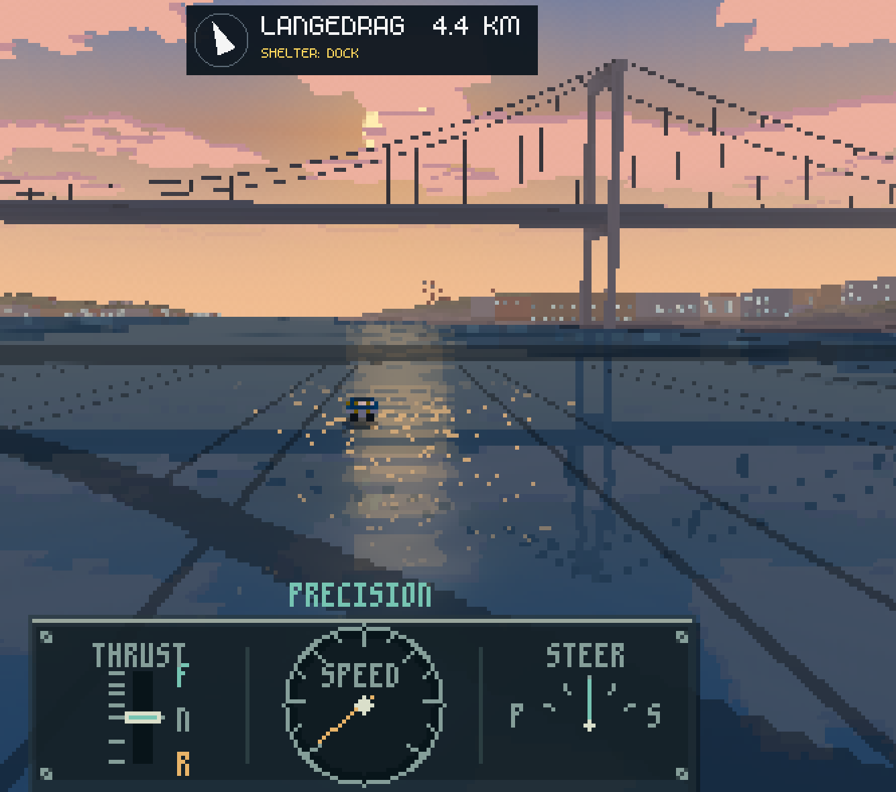

# Lighting through the day

Status, 2026-11-07: the shared frame and user-approved sunset/dusk presets (#138) and the
remembered fixed menu selector are on `main`. Gameplay stays daytime by default.
SETTINGS → LIGHTING remembers DAY, SUNSET or DUSK for the local player's new solo and
multiplayer sessions; explicit CLI launches use `--daylight` independently. The revised
direction is to represent any hour of an authored 24-hour day, beginning with fixed-time
evaluation and review. A later sandbox-specific step now targets a 15-real-minute
day/night cycle (900 seconds = 24 game hours). General Auto controls, room-wide time and
plugin schedules remain deferred. T1 adds the fixed-hour evaluator, artistic anchors and
a developer review input, approved by the user on 2026-11-07. The named presets and player
settings are unchanged. T2a implements the native GPU static-mask/uniform sky upload path.
T2b is implemented locally: CPU sky drawing uses visible samples, the basin shares the frame
light/sky, and textured materials follow the frame light/tint. T2c local Mac qualification is
recorded: sampled-cycle native GPU costs fit the measured budget, while CPU reference rendering
fails the interactive budget. Mirror lighting and performance-report target dimensions are fixed.
Night course/weapon readability still needs playtest acceptance. Next is that review and T3
fixed-hour controls; T4 also needs the glitter-phase contract and continuous-clock qualification.
Cloud/reflection attenuation remains deferred.

The proposed [plugin location-life track, L5/L6](PLUGIN_PLAN.md#location-life-track-proposed-2026-10-30)
will expose approved fixed lighting choices, then separately scoped transitions and
building/street lighting schedules after the native prerequisites here are implemented
and reviewed. No lighting capability exists in the current Lua API. This plan continues
to own the shared lighting frame, renderer/cache agreement and visual acceptance.

## Intended result

Make the basin and Gothenburg Harbour playable at any selected hour: night, dawn,
morning, day, late afternoon, sunset and blue dusk. Sky, sun direction, ambient/direct
light, distant haze, water/reflections, grading and occupied windows should agree about
the selected time. Keep navigation, shorelines and boats legible at 320×200. Preserve the
integer-scaled aesthetic, calm glitter and storm readability. The day is an artistic
lighting recipe with a coherent sun path; it need not match Gothenburg's latitude,
season or any particular date. Real-world astronomy and a running clock are unnecessary.

A fixed hour is a complete useful result: selecting or seeking a time must work without
waiting through a cycle. Smooth evaluation between hours supports later transitions
and remains the foundation for the sandbox's separately planned 15-minute cycle. Other
modes keep their fixed lighting choices and Day default.

## Evening foundation and original qualification (2026-11-03–06)

1. **Shared lighting frame (implemented 2026-11-03).** Introduce a small caller-owned presentation value
   for sun direction, direct/ambient color and strength, sky/horizon and haze colors,
   and window-light blend. Evaluate it from an explicit normalized daylight phase,
   never the wall clock. Keep daytime as the default and preserve its existing output.
   Trace consumers through `waterfront_scene`, CPU `renderer3d`/`waterfront` and GPU
   `renderer_gpu`, including river/outer scenery and water. Sky panorama caching must
   follow the supplied lighting value rather than the current fixed ready-once sky.
2. **Fixed sunset and dusk (implemented and approved by the user 2026-11-03).** Feed the same lighting frame into both renderers and their
   water/reflection paths. Add warm low-angle sunlight and a restrained horizon glow;
   keep blue dusk's sky/cloud contrast and warm occupied windows. Do not fake gameplay
   sunset with the title's screen-space palette or authored window coordinates.
   Review fixed river/bridge, basin and outer-coast views before exposing a setting.
3. **Controls (fixed selector implemented 2026-11-06); transitions deferred.** The
   remembered selector is a local presentation preference in solo and rooms. Automatic
   transitions are not part of this step. If separately requested, interpolate approved
   presets with an explicit presentation time/phase input and decide the title's phase.
   Keep visual time separate from 120 Hz physics,
   water simulation time and course clocks; scripted captures must be repeatable.
   Define replay phase persistence and room-wide phase ownership before enabling
   automatic changes there. A room setting may need protocol/content-version work;
   this plan does not silently introduce one or infer host authority from local clocks.
4. **Original qualification scope (partly open; evidence below).** Check CPU/GPU sky,
   water, scenery, material and fog agreement; inspect captures at afternoon/sunset/dusk
   and transition midpoints. Run full CTest,
   meaningful lighting/cache checks and a windowed transition demo. Measure frame cost,
   review storm/course/weapon visibility, and qualify browser/native packaged behavior.
   Physical playback and user acceptance remain separate gates.

## Review and direction, 2026-11-07

**Baseline finding, before T1:** the shared `WaterfrontLighting` is the right consumer
boundary, but its original input is a clamped evening blend, not a clock. `waterfront_lighting(phase)` maps
0 → day, 0.5 → sunset and 1 → dusk; all three use the same sun bearing. Extending this
scalar past 1 or reversing dusk back into day would not give a coherent full day. Dawn
needs its own sky and opposite-side low sun, and night needs a readable recipe beyond
the approved dusk. The shader/cache and presentation consumers must follow that model.

### Fixed-time contract

- Evaluate an explicit presentation hour in [0, 24), wrapping 24 to 0. Document finite
  input normalization and invalid-input handling. A new full-day input must remain
  distinct from the legacy evening phase; do not reinterpret `--daylight 0.5` as noon
  or change the meaning of saved DAY/SUNSET/DUSK names. Keep the existing zero-initialized
  day default and exact approved recipes available through a compatibility path.
- Use a small native table of artistic lighting anchors and a coherent sun path. Give
  dawn/sunrise, morning, day, late afternoon, sunset, dusk and night distinct treatment;
  interpolate every hour, including the night-to-dawn and midnight seams. Choose and
  document anchor hours during implementation; they are art decisions, not solar claims.
  Keep the approved day, sunset and dusk recipes as regression references. Any intentional
  change to those named looks, including sun bearing, needs explicit visual review.
- Keep sun elevation and bearing continuous, with no zero-length direction or noon
  singularity in sky/shadow calculations. Sunrise and sunset must occur on opposite
  sides of the scene. Gate direct sunlight, disc, glitter and directional shadows around
  the horizon together; no direct sunlight at night. A readable ambient night and harbour
  lights are sufficient initially; moon phases, stars and a second shadow-casting light
  are optional art work, not prerequisites.
- Produce the same caller-owned lighting frame for sky, CPU/GPU materials, water,
  reflections, haze, windows/lamps and HDR grading. Audit `WaterfrontLighting.phase`,
  `waterfront_grade`, title grading and existing dusk-dependent effects so an hour never
  accidentally passes through the old clamped evening evaluator. Keep window occupancy
  stable; vary emission/intensity without re-rolling occupied rooms on each selection.
- Keep visual time separate from physics, wave time, course clocks and weather. A fixed
  hour stays fixed while boats and waves move. Evaluation and direct/backward seeks must
  not depend on previously rendered hours, local wall time or accumulated frame deltas.
  If later transitions vary sparkle speed, derive its phase from an explicit timeline
  (or a deterministic integral), rather than multiplying wave time by the current speed.
- Preserve the current local presentation preference in solo and multiplayer. A fixed-hour
  renderer does not imply shared room time, a protocol change, replay persistence, Lua
  access or an automatic schedule. Define ownership and persistence before adding those.

### Implementation slices

| Step | Scope | Completion evidence |
| --- | --- | --- |
| T1 — full-day evaluator and fixed-hour review input (implemented locally) | Explicit hour contract, artistic anchors and sun path behind a developer review input. Legacy preset/CLI/save behavior and default Day remain. One shared frame, no Auto. | Evaluator, CLI and capture checks passed; T1 preview approved by the user on 2026-11-07. Detailed evidence is in the [T1 result](#t1-implementation-2026-11-07). |
| T2a — GPU sky upload path (implemented locally) | Upload the static cloud mask once per GPU scene, shade changing sky light from uniforms at the original panorama texels, and remove the per-light panorama upload. Keep the CPU panorama as the reference and preserve weather/camera behavior. | CPU mask stability and native GPU sky comparisons/seeks/spies passed; detailed evidence and limits are in the [T2a result](#t2a-implementation-2026-11-07). |
| T2b — CPU visible-sample sky and material agreement (implemented locally) | Draw changing-hour CPU sky from visible samples with a bounded lazy cache over the shared static cloud mask; keep the full panorama as a separate-storage reference. Make the CPU basin share the frame sky/light and apply one water multiplier policy to both CPU flat-water paths. Make textured CPU materials follow frame ambient/diffuse/tint and emissive tint without double-applying palette brightness, while navigation lamps keep emitter colours. | Visible sky compared with the full-reference traversal across hours/sizes/cameras/squall; cache work/reuse and seeks checked; basin and mapped flat-water tint checked; renderer light/tint and lamp exemption checks pass. Detailed evidence and limits are in the [T2b result](#t2b-implementation-2026-11-07). |
| T2 — renderer agreement and readable night/morning | Refine the new looks and wire every consumer, including grading, materials, lamps, water and reflections. Keep the T2a/T2b bounded GPU/CPU sky paths and shared basin/material inputs; qualify their costs and readable night/morning views before exposing continuous scrubbing. Record simplified CPU rendering limits explicitly. | Inspect matched CPU/GPU basin, outer harbour/bridge/quay and outer-coast views at anchors, all integer hours and difficult midpoints. Review seam/horizon/azimuth boundaries, emissive vs illuminated surfaces, storm, course/weapon visibility and glitter in motion. Record measured frame/cache cost. |
| T3 — fixed-hour player controls and qualification | Expose the reviewed hours through the local LIGHTING setting, keeping the existing named choices and Day default. Choose a simple hour control/names after the review; persist a versioned choice without repurposing the old numeric phase. Add documented CLI/review examples when implemented. | Verify native/browser save/load, invalid and old settings, explicit CLI precedence, new solo/join/host sessions and return to title. Run build/full CTest, inspect representative captures and a windowed manual demo; qualify platform/package limits. Fixed-selector and new-look user acceptance remain separate. |
| T4 — sandbox 15-minute day/night cycle | After T1–T3 and their rendering/performance gates, drive the free ride sandbox's shared lighting from a session-owned presentation timeline: 900 active real seconds = 24 game hours. Wire the custom workboat/crane/cargo view into that frame. See the clock and upload contracts below and the [sandbox owner](FREE_RIDE_SANDBOX_PLAN.md#sandbox-daynight-cycle-t4). | Virtual-clock tests prove rate, pause/resume, seeks and repeated midnight wrap; matched CPU/GPU captures and a windowed cycle review prove smooth light and readable crane/cargo work at night. Measure sky work/upload and frame cost through a whole cycle. Planned, not implemented or visually accepted. |
| Later — general Auto and script/room ownership | General Auto controls, title phase, replay persistence and room authority remain separate decisions. Coordinate plugin L5/L6 bounds and versioning before adding scripts or shared time. | Room/replay/Apply/Undo and synchronization evidence where those features are introduced. These remain deferred and are not dependencies of the solo sandbox cycle. |

T1 is implemented and user-approved. Split T2 into reviewable steps:

- **T2a — GPU sky upload path (implemented locally).** Upload static cloud structure once per
  GPU scene, shade changing sky light with uniforms, preserve accepted appearance and the
  existing CPU panorama as the reference. Prove zero steady-state sky texture writes/allocations.
  See [the T2a result](#t2a-implementation-2026-11-07).
- **T2b — CPU and material agreement (implemented locally).** Move changing-hour CPU sky work
  to visible samples, make the basin share the frame sky/light and water tint, and make
  textured materials follow the frame light/tint. Keep actor, water and grading inputs
  coherent. See [the T2b result](#t2b-implementation-2026-11-07).
- **T2c — local qualification recorded; acceptance/platform limits open.** All-hour and
  representative scene review, native fixed/cycle Release costs and hardware-browser fixed-hour
  game costs are recorded. CPU performance and night playtest limits remain explicit before T3/T4. See [the T2c result](#t2c-implementation-2026-11-07).

The cloud/reflection mismatch below is deferred separately; T2a must preserve its current
behavior rather than silently bundling an artistic fix into the upload migration.

### Sky rendering and GPU uploads (T2 prerequisite for T4)

Before T2a, `draw_scene()` in `src/renderer_gpu.c` called `waterfront_sky_image()` and
`UpdateTexture()` whenever `waterfront_lighting_same_sky()` detected a change. That is a
1024×512 RGBA8 image: **2 MiB per update**, about **120 MiB/s at 60 updates/s**, before
driver overhead. The recorded ~25 ms Debug cost is CPU panorama painting, not a measured
GPU transfer cost. A slowly moving clock would still invalidate this exact-value cache
on every frame; a 15-minute cycle alone does not solve the problem.

**Implemented strategy (T2a):** separate fixed sky structure from changing light. Generate the
existing cloud underside/rim mask once, retain it in caller-owned scene resources and
upload a point-sampled texture once at scene creation or GPU context recreation. Extend
`assets/shaders/waterfront_sky.fs` to compute the gradient, horizon glow, sun disc/halo,
cloud colours and fixed grain from the shared frame's small set of uniforms. Preserve
panorama texel-centre sampling/quantization so the new path retains the pixel aesthetic.
The sun is evaluated at its current direction, avoiding doubled suns from cross-fading
complete preset panoramas. Main, reflection and mirror passes use the same frame values;
camera and squall inputs retain their existing pass-specific behavior.

Time-of-day changes must cause **zero sky texture uploads or texture allocations** in
steady state; only lighting uniforms change. This applies to sky uploads, not the
existing light-list/wake textures used elsewhere. Keep the CPU sky as a reference and
move continuous CPU rendering to the same mask/recipe evaluated at visible sky samples,
avoiding a full panorama repaint for every new hour. Preserve a fixed-preset comparison
path while qualifying the migration; do not introduce a second independently tuned sky.

Qualification records texture-write/allocation counts, CPU sky preparation/upload time,
GPU sky pass time and whole-frame p50/p95 against fixed-hour baselines at low/high
resolution, including native and browser contexts. Test a full virtual cycle, direct
seeks, two scene instances and context recreation, plus seam/horizon views and approved
presets. Measure steady state separately from first-use costs. GPU fragment work may
increase, so compare with the graphics plan's existing budgets before enabling T4.
T2a implements this upload strategy with native upload checks, a WebGL2 shader smoke check
and one fixed-hour native cost comparison recorded below. T2b moves CPU sky drawing to visible
samples with a bounded lazy cache. T2c records the sampled native cycle and hardware-browser
fixed-hour costs below; a real continuous-clock/browser cycle and other platforms remain open.

### Deferred: clouded sun and water reflection

On 2026-11-07 the user observed that clouds can obscure the visible sun while the water
still shows a strong, apparently unobstructed road of sunlight. They asked to document
it and explicitly defer the fix. It may predate T1; its first introduction was not
investigated. The supplied screenshot is retained as evidence:



A later change should make cloud visibility and the sun's water highlight/glitter agree,
with restrained, stable attenuation as clouds cover the sun. Define the exact artistic
recipe then, and review CPU/GPU, direct seeks, camera motion and clear/partially covered/
fully covered cases. This is not a request for a general weather or astronomy simulation.
**Status: documented, not scheduled or implemented.** Keep it outside T2a, and retain the
mismatch in its regression references so a deliberate later correction remains reviewable.

### Sandbox clock contract (T4)

The requested initial tuning is **15 real minutes per full day**, equivalent to one
game hour every **37.5 real seconds** (96× game time). Use
`hour = wrap24(start_hour + active_elapsed_seconds * 24 / 900)`, with an explicit input
timeline so captures and tests can seek directly without waiting 15 minutes. T4 starts a
new sandbox at T1's 12:00 Day anchor after its visual review.

Advance during active play, including crane mode. Proposed solo behavior: pause freezes
the presentation clock with the world; suspended/background time causes no catch-up jump
on resume. Keep this clock separate from physics/wave/course rates: it changes light,
not boat or crane speed. Resetting a load or recovering the boat retains the hour;
a new session restarts it. When sandbox saves arrive, store the current hour and cycle
rate in versioned session state and resume without offline progression. Shared multiplayer
time belongs to the later room-authority contract. Keep a fixed-hour developer override
for comparisons, and review night-time handling before enabling the cycle by default
in the sandbox. The 900-second target is initial tuning, not a measured fun result.

### Acceptance and limits

The user should recognize morning, day, sunset, dusk and night from the scene and water,
and be able to select intermediate hours without discontinuities. Night retains readable
shorelines, boats and navigation; it must not simply darken dusk until play becomes hard.
Window lights belong to buildings and remain stable as the camera moves. The title should
eventually use an approved shared recipe, avoiding a second independent palette; its
phase is a separate decision. Dates/astronomy, seasonal daylight lengths, weather changes
and new gameplay visibility rules remain outside this work. T4 adds cycling only to the
sandbox; general Auto remains deferred.

## Current status

### T1 implementation, 2026-11-07

**Completed:** `waterfront_lighting_hour()` evaluates a fixed artistic day with anchors at
0 night, 4.5 dawn, 6 sunrise, 9 morning, 12 day, 15 afternoon, 18 sunset, 19.5 dusk and
21.5 night; hour 24 repeats night at the seam. Elevation and azimuth are interpolated as
angles, sunrise/sunset use opposite bearings, and the maximum elevation stays below the
zenith. Direct light, disc, glitter, highlight and cast water shadow share a continuous
horizon gate, so all are zero at or below the horizon. Night and dawn have their own recipes.
Day, sunset and dusk reuse the approved palettes at their anchor hours with new bearings;
the user approved the T1 preview on 2026-11-07 (see acceptance below). The legacy evaluator,
`--daylight`, named saves and the zero-initialized Day default are unchanged.

Finite hours wrap into `[0,24)`; negative values come back from the other side of
midnight. Signed zero, and any wrapped result that rounds to 24, are canonicalized to 0.
Non-finite input and bad strings fail explicitly and preserve outputs.
`waterfront_grade_hour()` supplies a neutral new-hour grade without calling the legacy
evening evaluator with an hour. `BoatGpu`/`BoatCpuView` carry a zero-safe `hour`/`hour_set`
override, and `--lighting-hour H` is available in `wake_velocity` and `boat_water_review`;
it overrides `--daylight` independent of order. The game's `--time` remains drive/wave
time; review tools keep their explicit pose ticks and clip frames. Review metadata
reports the mode, legacy daylight value and hour separately.

**Automated verification (2026-11-07, Apple Silicon/macOS, Debug):** the final incremental
build passed without compiler warnings. `ctest --preset full` passed all 387 enabled tests
with local sockets enabled (`PROTEUS_GPU_TESTS=OFF`, 13 retired checks disabled). The
focused lighting/grade/CLI selection passed 8 of 8 and the quick preset passed 268 enabled
tests. Coverage includes legacy fixtures, invalid/wrapped inputs with output preservation,
all integer hours, a dense sweep with separate field scales, positive near-horizon
attenuation, midnight/horizon boundaries, unit sun directions, neutral grades and
direct/backward/reordered seeks. CLI precedence is compared against an hour-only reference.
Review caught and corrected a degrees/radians error in the five-degree fade; the new
near-horizon checks reject the original error.

**Agent visual and integration checks:** six legacy CPU captures (basin/outer at
day/sunset/dusk) and three outer GPU captures remained byte-identical to `c7ab6d8`.
Main-CLI checks
passed `0=24`, `-1=23`, both hour-over-dusk orders, title-injected preset override and
invalid/missing hours. After the fade correction, CPU/GPU captures at 0, 4.5, 6, 6.1, 6.5,
9, 12, 15, 18, 19.5 and 21.5 hours were inspected. Both review-tool runs produced 31
captures across 13 pose groups at hour 6.5 with correct mode/hour metadata; basin, bridge,
coast and dock samples were inspected. A high/HDR night capture and a 180-frame windowed
GPU HDR night demo (music Off, exit 0, final frame inspected) passed. Local artifacts are
in ignored `build/t1-review/`; the saved pre-change references are in `build/t1-baseline/`.
Changed links, command examples and `git diff --check` were checked before handoff.

**Limits:** T1 preview acceptance does not qualify every hour, view or platform. Browser/Windows and the GPU CTest
matrix were not run. CPU basin sky/light, textured-box lighting, night shadow-map cost
and storm/course/weapon readability remain T2 work; no continuous-clock performance is
claimed. An initial GLFW monitor-enumeration failure also affected the unchanged binary;
macOS/GLFW display probes and subsequent baseline/new GPU runs succeeded without a source
workaround. Its exact cause was not established.

**User acceptance (2026-11-07):** after trying the fixed-hour preview, the user reported
“Looks nice! Approved” and asked to continue the OpenCode/DeepSeek implementation-and-review
workflow. Their screenshot records the cloud/reflection issue above. Exact hours, settings
and platform coverage were not stated; this is T1 preview acceptance, not blanket
qualification of every hour, T2 performance, player controls or the future cycle.

**Next task at this baseline (superseded by T2c below):** broader CPU/GPU qualification.
T3 menu controls, T4 cycle, Lua access, room time and replay persistence remain planned.

### T2a implementation, 2026-11-07

**Completed:** the GPU no longer paints or uploads a panorama when the light changes.
`waterfront_sky_cloud_mask()` adds a borrowed, light-independent RGBA8 mask at the original
1024x512 panorama texel centres (R underside, G lit rim); each `WaterfrontGpuScene` uploads it
once as `sky_mask` and unloads it with the scene. `assets/shaders/waterfront_sky.fs` now
quantizes the view ray to the original panorama texel, then evaluates the same elevation,
bearing, `sky_mix` blends, horizon glow, halo/disc, cloud flags and fixed ordered grain as
`waterfront_sky_image`, rounds to the same 8-bit sky and applies the existing squall.
`WaterfrontLighting` reaches the sky pass as a bounded uniform group. `draw_sky()` takes the
frame lighting for the main and reflection passes; the per-light `UpdateTexture()` path and
`sky_lighting` cache were removed. The CPU panorama stayed as the unchanged reference.

**Automated verification (2026-11-07, Apple Silicon/macOS, Debug):** the final build
passed without compiler warnings; changed C files passed `clang-format --dry-run --Werror`.
The display-free `ctest --preset full` passed all 387 enabled tests (13 retired checks
disabled). After enabling `PROTEUS_GPU_TESTS=ON`, the full preset passed all 421 enabled
tests, including 36 GPU-labelled cases (15 retired checks disabled), with local sockets
available. `ctest --preset quick` also passed all 268 enabled quick tests earlier in the
step. `./build/validate_waterfront_lighting` passed, including stable/non-empty mask flags.
`./build/gpu_fixture --city --check` passed the original `sky_targets`
target/overlay/squall/pass matrix plus new `sky_lighting_targets`, `sky_seeks`,
`sky_texture_stability` and `sky_scene_lifecycle` checks:

- legacy day/sunset/dusk and hours 6.5, 9, 18.5 and 21.5, plus a sunset azimuth-seam view,
  each compared with the unchanged CPU sky at 320x200 and 1280x800 under the existing probe
  spacing, tolerance 3 and 1% mismatch budget;
- a changing-hour sweep and direct/backward seeks returned identical frames for the same hour;
- a separate throwaway RGBA8 probe proved the spies observe raylib's real update path before
  measurement: one `UpdateTexture` produced `tex_image=0 tex_sub_image=1`, then one GLAD
  `TexImage2D` allocation produced `tex_image=1 tex_sub_image=1`;
- real native GLAD `TexImage2D`/`TexSubImage2D` spies after warm-up observed
  `id=3 tex_image=0 tex_sub_image=0` while all 24 integer hours were drawn, and the resource
  ID stayed stable;
- a second live scene produced the same sky with a different mask ID, and destroy/recreate
  produced the same sky again;
- `reflection_waterline` still passed; the source passes the frame lighting to both the main
  and reflection sky calls.

The first full GPU-enabled attempt lost its display during the run: 14 late GPU cases
failed to initialize a window. A CoreGraphics probe reported `active=0 asleep=1`; AppKit
still listed a screen, but pinned GLFW's Cocoa monitor enumeration explicitly skips asleep
displays and reported zero monitors. A temporary `caffeinate -d -i -u` assertion restored
`active=1 asleep=0`. The complete 421-test rerun under that command-scoped assertion passed;
no renderer change or persistent power-setting change was needed. This establishes the
cause of that run's failures, not every earlier transient monitor failure.

**Supervisor visual verification (2026-11-07, same native build):** all 22 outer captures
(CPU/GPU at 0, 4.5, 6, 6.1, 6.5, 9, 12, 15, 18, 19.5 and 21.5 hours) were byte-identical
to T1, as was the high-resolution HDR night frame. Eight of nine legacy basin/outer/preset
captures were byte-identical; GPU outer dusk differed by one channel value at one of 64,000
pixels. The GPU river-kit review at hour 6.5 retained all 31 captures / 13 pose groups:
30 were byte-identical, with one channel-value difference at one pixel of
`river-tile-boundary-2.png`. CPU/GPU hour sheets, basin/bridge/coast/dock views and the final
windowed demo frame were inspected. The CPU panorama implementation is unchanged.

**Browser shader smoke (2026-11-07):** the actual shader conversion block from
`cmake/Web.cmake` generated the ES 3.00 sky fragment. In isolated headless Chrome/SwiftShader
WebGL2 it compiled, linked with the pinned raylib default vertex shader's mediump varying,
and drew/read back a 64×40 sky without a GL error. Sky arithmetic is highp;
`fragTexCoord` explicitly remains mediump. This is a shader check, not a full Emscripten
game build, hardware-browser performance measurement or browser visual qualification.

**Native cost comparison (2026-11-07, M1 Max, Debug):** one sequential parent/T2a pair used
`boat_water_review --benchmark PREFIX --renderer gpu --aa off --scenario outer
--lighting-hour 6.5 --resolution high --hdr off`, hidden/unpaced, with 12,003 measured frames
after 120 warm-up frames per run. The final simulation states were identical.

| Metric, ms | T1 parent | T2a |
| --- | ---: | ---: |
| Frame p50 / p95 | 2.307 / 3.705 | 2.314 / 3.775 |
| CPU submission p50 / p95 | 1.849 / 2.185 | 1.859 / 2.292 |
| GPU p50 / p95 | 1.979 / 2.374 | 1.990 / 2.954 |

Both runs had zero frame-deadline misses at 16.667 ms. GPU p95 rose by 0.580 ms in this
pair; whole-frame p95 rose by 0.070 ms. These fixed-hour whole-renderer measurements do not
isolate the sky pass or establish repeated-run variation. They do not qualify a changing
clock, all-hour/HDR/storm/low/high combinations, Release, Windows or hardware browser
performance; those remain T2c gates before T4.

**Windowed smoke (2026-11-07):** a 180-frame native GPU outer sunset demo at hour 18,
resolution high, HDR on and soundtrack off completed with exit 0; its final frame was
inspected. This is an agent-run rendering/motion smoke check, not physical input/audio
playback or additional user acceptance.

Local ignored artifacts are in `build/t2a-review/` (image comparison JSON, hour sheets,
river-kit captures, WebGL2 smoke, benchmark CSV/JSON and demo frame). Parent performance
artifacts remain in the T1 worktree's `build/t1-review/t2a-baseline-perf.*`.

**Limits:** T2b later moved CPU sky drawing to visible samples and resolved the basin/material
gaps; broad readability qualification remains T2c. Full browser/Windows game builds and
hardware performance are not qualified here. The cloud-obscured-sun/water-reflection mismatch
remains deliberately unchanged and deferred. The user approved T1; no separate T2a user verdict
is inferred.

**Next task at this baseline (superseded by T2c below):** broader CPU/GPU qualification.

### T2b implementation, 2026-11-07

**Completed:** the CPU sky draw no longer calls the full panorama painter. A shared
`sky_texel` recipe now backs both `waterfront_sky_image()` (the full reference in separate
storage) and `waterfront_sky_draw_squall()`, which ray-maps only visible pixels and evaluates the recipe on
demand using T2a's `waterfront_sky_cloud_mask()` flags, so static cloud hashes are not repeated
per sample. The weather squall is still applied per ray after the cached base sky, and the
original elevation/bearing mapping, grain, rounding and azimuth seam are unchanged.

The draw cache owns one sky snapshot and a `uint32` generation stamp per 1024x512 texel
(about 4 MiB static, no per-frame heap or unbounded per-hour history). A changed sky starts a
new generation rather than clearing large arrays, so no old texel can be reused; each visible
texel is evaluated at most once until the next change. Consecutive fixed-light draws do no
recipe work. Alternating lights and direct/backward seeks re-evaluate only visible texels and
produce the same image for the same light. `waterfront_sky_stats()` exposes full-reference
paints, visible misses, cache hits, draw calls and adopted generations for tests. Drawing is
single-threaded like the renderer, and the reference panorama remains separate and borrowed.

The Web CPU startup path now defers its initial CPU draw and CPU screenshot export until
after the window/UI and Emscripten `scenery_ready()` path, before the CPU image is uploaded as
a texture. The native display-free screenshot path and native startup ordering are unchanged.
This fixes mapped Web CPU sessions (including `outer`) whose scenery registry was still empty
at the earlier draw; GPU ordering and lazy pack fetching are untouched. The startup gap was
also present in the parent source. The packaged-browser checks below exercise this correction.

The CPU basin now draws the same `boat_view_squall` sky as the mapped scene, begins with the
evaluated `lighting.sun_direction`, and uses the same `cpu_ambient`, `cpu_direct` and
`cpu_tint`. Both CPU flat-water paths apply the frame water multiplier once around the
flat-water submission with that ordinary shading: the basin keeps its unchanged
`{36,107,125}` body colour and the mapped path keeps its map water colours, so a day factor of
one retains the default mapped water. Displaced water keeps its existing self-coloured mesh
and water tint. The CPU water remains a simplified flat shade without the GPU atlas,
reflection or glitter, so this is shared policy rather than pixel parity. This intentionally
changes basin captures from earlier daytime-only builds; physics and the water model are
untouched.

`renderer3d` textured materials no longer use the hardcoded `.16 + .12 * N.L` light.
Non-emissive materials select a palette ramp from the frame's ambient/diffuse plus bounded
point light and apply the frame tint once after selection, so palette brightness is not
multiplied twice. Emissive textures select the brightest ramp and follow `emissive_tint`, not
sun/fill. World-space perspective mapping, negative coordinate wrap, clipping and the
default `.30/.70/white` renderer values are unchanged. Navigation lamps deliberately draw with
a temporary white emissive tint so they keep their authored colours when wakes and gulls use a
non-white unlit tint, matching the GPU emitter semantics and preserving night readability;
other emissive textures still follow the caller's tint. The production textured boxes are
these lamps; final outer CPU captures remain byte-identical to the parent, including lamp
pixels. Generic non-emissive textured boxes become brighter at the default light.

**Automated verification (2026-11-07 follow-up, Apple Silicon/macOS, Debug):** the Debug build
completed warning-clean. Focused CTest with genuine exits covered
`waterfront_lighting` (0.07 s; 0.08 s direct), the new slow `waterfront_lighting_sky`
exhaustive check (1.24 s), `renderer3d_is_valid` (0.01 s) and
`boat_world_isolation.cpu_basin_lighting` (0.24 s, now registered `SLOW_CASE` because it
paints the full reference); `ctest --preset quick` then passed 268/268. The exhaustive sky check compares visible output with full-panorama
ray mapping for legacy day/sunset/dusk and hours 4.5, 6, 12, 18, 19.5, 21.5, 23.9999 and
0.0001 at 320x200 and 97x61 across three cameras, with and without a squall. It confirms zero
new samples on a repeated fixed-light draw, bounded visible samples on changed/seeking/
alternating lights, exact restore after a backward seek and no stale cache output; reference
and draw share `sky_texel` but have separate storage/traversal, with captured parent images as
the independent recipe baseline. `boat_world_isolation.cpu_basin_lighting` checks the basin top
sky against that reference, hour 30.5 as hour 6.5, direct/backward seeks, the expected
afternoon basin flat-water colour plus both the default (day, factor one) and non-white
hour-18.5 mapped flat-water colours, with the renderer tint restored after the mapped path.
`renderer3d_is_valid` covers ambient/diffuse level selection, one-time tint, point-light
front/back, emissive-tint independence and the navigation-lamp exemption while confirming
wakes still follow the unlit tint and caller tint is restored.

**Supervisor verification (2026-11-07, M1 Max/macOS, native Debug):** the final warning-clean
build and `caffeinate -d -i -u ctest --preset full` passed all **423 enabled tests**, including
36 GPU-labelled cases (15 retired wake checks disabled), with localhost sockets available.
Changed C files passed the checked-in clang-format rules. The command-scoped awake assertion
prevented the display/GLFW failure recorded in T2a; no saved power setting changed.

All 34 full-panorama reference hashes matched the T2a parent: legacy day/sunset/dusk, every
integer hour and 0.0001, 4.5001, 6.1, 6.5, 18.5, 19.4999 and 23.9999. All 11 outer CPU hourly
captures and their 11 GPU counterparts were byte-identical to the parent at hours 0, 4.5, 6,
6.1, 6.5, 9, 12, 15, 18, 19.5 and 21.5. Five GPU basin hour captures and the high-resolution
HDR night frame were also byte-identical. The nine legacy captures retained all six outer
CPU/GPU images exactly; only the three CPU basin images intentionally changed. All 11 new
CPU basin hour views and the unchanged outer CPU views were inspected as sheets. The CPU
river-kit review at hour 6.5 retained 31 captures / 13 pose groups: all 29 mapped views were
byte-identical, with only the two basin fixtures intentionally changed.

**CPU sky cost (2026-11-07, M1 Max, native Debug):** a local harness called the real
`waterfront_sky_draw_squall()` at 320x200 with a fixed camera, clear or squall sky, 10 warm-up
draws and 180 measured draws. Changing-hour runs advanced from hour 6.5 by one 60 Hz frame of
the proposed 900-second day on each draw; the clock was virtual, with no waiting. Three
parent/T2b repeats were interleaved after other tests finished. The output checksums agreed.
Numbers below are the range of per-run mean milliseconds; they measure sky drawing, not a
whole game frame or the future cycle.

| Sky workload | T2a parent, ms | T2b, ms |
| --- | ---: | ---: |
| Fixed hour, clear | 0.631–0.634 | 0.987–1.001 |
| Fixed hour, squall | 3.488–3.497 | 3.532–3.567 |
| Changing hour, clear | 16.888–16.961 | 2.669–2.694 |
| Changing hour, squall | 19.765–19.870 | 5.622–5.653 |

Changing-hour sky p95 was 2.785–2.808 ms clear and 5.831–5.898 ms with squall, versus
17.341–17.374 and 20.267–20.392 ms in the parent. Fixed clear sky costs about 0.36 ms more
because the lazy cache checks stamps/counters; that cost is retained explicitly rather than
claiming every case improved. First use, including static mask preparation, was separately
10–11 ms clear / 13–14 ms squall in T2b, versus about 17 / 20 ms in the parent. The added CPU
draw cache is 4 MiB alongside the existing 2 MiB full reference and 2 MiB mask. Full-frame,
moving-camera, all-hour, Release and hardware-browser budgets remain T2c.

**Browser build and smoke (2026-11-07):** installed Emscripten 6.0.12 MinSizeRel `web`
build/packaging passed. Application code was warning-clean; pinned raylib emitted upstream
miniaudio Emscripten-macro deprecations and a stb_vorbis pointer-comparison warning on the
first dependency build. Isolated Chrome/SwiftShader ran CPU basin at hours 0, 6.5 and 18,
CPU outer at 21.5, GPU basin at 0 and GPU outer at 6.5. Each case ran 45 browser animation
callbacks after starting and produced an inspected canvas capture, with no JavaScript
exceptions, shader/asset failures or GL error. The test response changed only startup CLI
arguments at the existing PLAY callback; packaged files were untouched. This is software
WebGL2 smoke coverage, not hardware-browser timing or normal title/settings qualification.

**Windowed motion smoke (2026-11-07):** native CPU demos in the basin at hour 6.5 and outer
harbour at hour 21.5 each completed 180 scripted frames with exit 0 and soundtrack off.
The final frames were inspected. This is an agent-run motion/rendering check, not physical
input, audio listening or user acceptance.

Local ignored evidence is in `build/t2b-baseline/` and `build/t2b-review/`: image comparison
JSON and hour sheets, CPU river-kit captures, reference hashes, actual sky timing/checksums,
Web build scene captures/result metadata and native demo frames.

**Limits:** the cache is one static, single-threaded snapshot, not a cross-hour cache; a
changing sky re-evaluates visible unique texels. The cloud-obscured sun with a full water
reflection/glitter remains deliberately deferred. CPU flat-water shading remains simplified
compared with the GPU atlas/reflection/glitter, so shared inputs do not imply pixel parity.
CPU basin visuals intentionally changed, with T2b user acceptance pending. Full-cycle,
readability and whole-frame performance qualification, Windows, Safari and hardware browsers,
physical input and audio listening remain open. No new player hour controls or sandbox cycle
were added. T1 approval and the T2a evidence above remain as recorded.

**Next task at the T2b baseline (superseded below):** T2c readability and whole-frame qualification.

### T2c implementation, 2026-11-07

**Completed locally:** `boat_water_review --lighting-qualify
PREFIX` runs two finite production-draw workloads on the same independent physical trajectory:
a fixed `--lighting-hour` baseline and a sampled virtual 900 s cycle. `--lighting-samples`
accepts 25..3601 (default 241), eight warmup frames are stored separately and excluded, and the
measured samples independently span virtual elapsed 0..900 s inclusive, so all 24 hour bins and
the midnight wrap are visited without claiming 54,000 real 60 Hz frames. Route scenarios
`river`/`outer` and the saturated `stress` basin use the existing sessions, fixtures, camera,
scene and water paths. CPU drawing is the whole `boat_draw`/`boat_draw_scene` frame at 320x200;
GPU drawing uses the production scene plus the benchmark's presentation path and actual
asynchronous `GL_TIME_ELAPSED`, with query availability reported (`null`, not CPU time, when
unavailable). JSON/CSV record build/platform/GL, resolution/HDR, hour/cadence, per-frame
simulation/submission/presentation/frame/GPU times, p50/p95/p99/max, deadline misses, final
state parity, CPU sky reference/visible/cache counters and scene submission counters. No
timing threshold is embedded in CTest and no game clock or Auto behavior was added.

```sh
./build/boat_water_review --lighting-qualify build/lighting-qualify --renderer gpu \
  --scenario outer --lighting-samples 241 --waves --lighting-hour 6.5 \
  --resolution high --hdr on
./build/boat_water_review --lighting-qualify build/lighting-cpu --renderer cpu \
  --scenario stress --lighting-samples 25 --waves
```

**Cycle regression:** the existing native GL sky spies now also cover a bounded 241-sample
virtual cycle that crosses midnight and alternates the accepted above-city and azimuth-seam
views, retaining zero sky `TexImage2D`/`TexSubImage2D` observations and resource-ID stability
alongside the original 24 integer-hour, target, overlay, pass and squall matrix.

**Consumer audit and bounded corrections:** phase/hour grading, main/reflection passes, sky,
water and emissive/navigation lamps consume the shared frame as recorded in T2b. Two concrete
gaps were fixed. The CPU rear-view mirror kept its own zero-initialized Day lighting, so it did
not follow a legacy sunset/dusk or full-hour main view; and its 30 Hz sample cache ignored a
light change at the same wave time. `boat_rearview_set_lighting()` now supplies only
daylight/hour/hour_set to the mirror's own `BoatCpuView`, while the GPU mirror reads the main
`BoatGpu` selection, and the cache key includes renderer, light and location while retaining
unchanged-light reuse. `wake_velocity` and `boat_combat_review` pass their selected light.
`boat_combat_review` now accepts `--lighting-hour H`, rejecting invalid/missing values before a
window, so existing cannon/grenade/torpedo/mirror captures can be reviewed at any hour. The
presentation check now proves actual CPU and GPU mirror pixels refresh on a same-time light seek
and return exactly to the first light. Fixed-hour direct/backward seeks remain history
independent; this is fixed-light determinism, not qualification of a running T4 clock.

The actual-game qualification also exposed stale report metadata: both F8 and
`--performance-report` exported fixed low-resolution dimensions even at high/HDR. They now read
the actual GPU scene/reflection targets, and CPU reports no reflection target. The hardware
browser matrix and native high/HDR demo verify those exported dimensions.

**Recorded T4 risk (not fixed here):** GPU water glitter derives its phase from the current
`glint_speed` multiplied by frame time (`phase(rate * lighting->glint_speed, frame->time)`).
A future continuous clock whose `glint_speed` changes with hour can therefore show a phase
discontinuity at the change, even though fixed-hour samples and direct seeks are deterministic.
T4 should use a seekable presentation-phase integral or an explicit sparkle timeline rather
than multiplying total wave time by the instantaneous speed. No clock or workaround was added
in T2c.

**Readability review (2026-11-07, agent inspection):** 152 native low-resolution game captures
cover 38 fixed hours (all integer hours plus dawn/dusk, horizon and midnight neighbours), both
renderers and basin/outer. All four labelled sheets were inspected. The 22 saved outer T2b
hour references remain byte-identical. The existing 31-pose review produced 310 captures over
hours 0, 6.1, 12, 18 and 19.5 on both renderers; 60 representative hull, quay, bridge, skyline,
coast and dock views were inspected. A further 24 cannon/grenade/torpedo views with mirrors,
ten full-scene squall views and eight course views were inspected. Selected
[combat/mirror](evidence/lighting-t2c/combat.png) and
[course](evidence/lighting-t2c/course.png) sheets are retained in the repository.

Night, dawn, daylight and dusk remain distinct; sky seams/horizons, harbour lamps, occupied
windows, shore silhouettes and HUD agree with the selected hour in the reviewed views. Night
course buoys and small cannon/torpedo details remain dark silhouettes, especially on the CPU
flat-water course. Their visibility in actual play is an open acceptance gate; these stills
do not establish competitive combat or safe course navigation. No palette retune or cloud/sun
reflection change was bundled into qualification.

**Repeated whole-scene cost (2026-11-07, Apple M1 Max, macOS 26.6.2, native Release):** three
interleaved repeats per case, waves on, fixed start 6.5 versus the sampled virtual 900 s cycle,
eight warmup draws per workload excluded. GPU uses 721 measured samples (1.25 virtual seconds
per sample); CPU uses 241 (3.75 s). Within each pair the physical route is identical and its
reported final state matches; physical motion remains two ticks per drawn frame, so these
are about 12.13/4.13 s route probes, not a real-time 900 s gameplay soak. All 24 hour bins and
the wrap are checked. Values below are medians of the three runs' percentiles, in milliseconds.
[Raw reports and repeat ranges](evidence/lighting-t2c/native-qualification.json) preserve
p50/p95/p99/max, first use, counters and GPU query coverage.

| Scene / renderer / preset | Fixed frame p50 / p95 | Cycle frame p50 / p95 | Fixed / cycle GPU p95 |
| --- | --- | --- | --- |
| Outer / GPU low, LDR | 1.950 / 3.245 | 1.945 / 3.297 | 1.846 / 1.829 |
| Outer / GPU high, HDR | 2.637 / 3.696 | 2.686 / 3.655 | 3.258 / 3.347 |
| Four-boat stress / GPU low, LDR | 3.184 / 4.462 | 3.221 / 4.657 | 3.160 / 3.148 |
| Outer / CPU low | 446.002 / 490.106 | 450.606 / 496.651 | unavailable |
| Four-boat stress / CPU low | 93.666 / 95.040 | 95.724 / 97.204 | unavailable |

Every GPU workload had zero measured 16.667 ms frame-deadline misses and 721/721 actual GPU
queries. Cycle frame p95 ranges were 3.200–3.536 ms low outer, 3.618–4.041 ms high/HDR outer
and 4.417–4.786 ms stress. The CPU reference renderer fails the interactive budget in both
fixed and cycle workloads: all 241 measured frames miss in every repeat. Its cycle p95 ranges
were 489.212–714.239 ms outer and 96.969–170.593 ms stress; this variation prevents attributing
a precise full-frame increment to lighting. CPU full-reference sky samples remain zero.
GPU frame includes simulation, scene submission and hidden-window presentation; GPU query
covers the scene draw. CPU frame is simulation plus software rendering without presentation.
Neither native workload includes the game's HUD, input or audio. These are useful local
budgets, not a replacement for the older G0 river/4x4 matrix or Windows measurements.

First-use cost is separate: fixed outer GPU first draw was 278–294 ms before warmup, versus
26–29 ms stress; CPU outer was 564–570 ms and CPU stress 96–98 ms. Reused process resources
make the subsequent cycle's first draw a warm start, not an independent cold-start comparison.

**CPU diagnosis:** a separate ten-second Xcode Instruments 16.0 Time Profiler capture of the
Release CPU outer workload found 78.07% inclusive time in `boat_water_surface_visible`, 71.95%
in its `query` path, about 50% self time in wave trigonometry, and 20.91% inclusive in
`draw_mesh_list`. Sky drawing was small (0.07% self). These overlap and must not be added.
The [sample summary](evidence/lighting-t2c/cpu-profile-summary.json) excludes the first two
trace seconds. The profiler's time limit intentionally killed its child; that partial
qualification report is excluded from the timing matrix. Water-sampling performance is a
separate CPU follow-up; T2c does not establish an interactive CPU cycle.

**Hardware browser (2026-11-07):** Emscripten 6.0.12 MinSizeRel build/packaging passed.
Chrome 156.0.8078.81 headless used actual ANGLE Metal on Apple M1 Max with software fallback
disabled. Six inspected gameplay canvases cover CPU basin 0 / outer 21.5, GPU basin 0 / outer
6.1, and GPU outer high/HDR at 0 and 18.5, without JavaScript exceptions, asset/shader failures
or GL errors. These exercise production lazy map loading; the HTTP test response changes only
startup arguments and leaves packaged files untouched. Solo V does not activate a deathmatch
mirror; the browser mirror is not claimed as checked here.

A separate actual-game performance export, with waves on and soundtrack off, records 240
frames per GPU case and 48 for CPU. After discarding 24 GPU / 12 CPU startup frames, GPU
frame p95 is 4.1 ms at night low, 4.5 ms dawn low, 4.4 ms noon high/HDR and 4.5 ms dusk high/HDR;
frame-interval p95 is 17.5–17.6 ms. CPU outer night frame p50/p95 is 2074.3/6230.9 ms over
36 retained frames, confirming its budget failure. First GPU game frames cost 529–534 ms and
are reported separately. These game frames include HUD and loop work; browser intervals
include animation scheduling. No GPU queries were available, so these are not GPU execution
times or proof of a stable 60 Hz browser delivery. Each is one fixed-hour run, not a browser
cycle. [Settings, backend and retained percentiles](evidence/lighting-t2c/browser-qualification.json)
include the corrected actual scene/reflection dimensions (320x200/160x120 low,
1280x800/640x480 high; CPU reflection 0x0).

**Build/tests and native motion (2026-11-07):** final Debug and Release builds were warning-clean;
final Web build/packaging passed. `ctest --preset full` with `PROTEUS_GPU_TESTS=ON`, native graphics
and local sockets passed all 426 enabled tests, including 36 GPU cases (15 retired checks
disabled; 96.70 s). The qualification contract rejects conflicting check modes before window
creation, validates explicit CPU low/HDR-off, cadence, state parity and finite recomputable
JSON/CSV. Final format, local documentation targets and `git diff --check` passed. Native
windowed GPU combat with mirror at hour 0 completed 480 frames, and outer dawn 6.1 at high/HDR
with waves completed 180 frames; final captures were inspected and the latter's exported target
dimensions verified. These are agent-run scripted motion checks; physical input, audio listening
and human acceptance were not performed.

**Limits and next task:** local T2c qualification is recorded, including a failed CPU performance
gate. Obtain the night course/weapon readability verdict and carry any bounded art correction
into the owning plan before calling night gameplay accepted; then T3 exposes fixed-hour
controls. Windows, Safari, browser deathmatch mirror and real continuous-clock/cycle motion
remain unqualified. T4 must address the glitter-phase contract above and remeasure the actual
900-active-second sandbox timeline, pause/resume and crane/cargo work; these sampled native
inputs do not enable it. General Auto, Lua/network/replay ownership and the deferred
cloud-obscured-sun/water-reflection issue are unchanged.

Local ignored evidence is in `build/t2c-baseline/` and `build/t2c-review/`: all-hour and pose
captures/manifests, weather probe and images, complete native CSV/JSON repeats, browser canvas
checks and game exports, Instruments trace and windowed demo frames. The compact committed
[evidence index](evidence/lighting-t2c/README.md) links selected sheets and measurement summaries.

### Plan review, 2026-11-07

**Completed:** reviewed the current evaluator, sun path, scene/sky cache, renderer and
grading consumers and the native/plugin plan boundaries. Expanded the goal from evening
presets to any fixed hour of an artistic day, with T1–T3 above. Added the requested T4
sandbox cycle (15 real minutes = 24 game hours) and a concrete static-mask/uniform sky
upload strategy; general Auto remains deferred. Existing fixed recipes retain their
approval; new hours, controls and transitions have no visual
or user acceptance yet.

**Verification (2026-11-07, Apple Silicon/macOS):** native Debug configure/build passed
using the existing pinned dependency sources, with one upstream `stb_vorbis.c` warning.
`ctest --preset full` ran 381 enabled tests (`PROTEUS_GPU_TESTS=OFF`, 13 retired checks
disabled): 369 passed in the sandbox; all 12 socket-dependent failures passed with local
socket access via `ctest --preset full --rerun-failed`. The initial review's 22 changed/owning-plan
local link references and `git diff --check` passed. This is documentation-only work; no new
captures, playback, GPU/browser/Windows checks or audiovisual acceptance were performed.

**Cycle/upload follow-up verification (2026-11-07, same platform/options):** incremental
Debug build and `ctest --preset full` with local sockets passed all 381 enabled tests.
All 48 changed/owning-plan local link references and `git diff --check` passed. The
sandbox cycle and upload strategy are documentation only; neither has runtime or
performance evidence yet.

**Next task at the plan-review baseline:** T1, now implemented above. The current menu still
needs the player's playback review. The historical verification and limits below apply to
their dated changes, not to the T1 full-day work.

### Menu setting, 2026-11-06

**Completed:** SETTINGS → LIGHTING selects DAY, SUNSET or DUSK with Left/Right, Enter
or a click. `BoatTitleSettings.lighting` persists named presets in native `title.txt`
and the existing browser save mount. Missing or invalid names leave the default Day.
New solo, joined and hosted sessions receive the choice through `--daylight`; each player
owns their local view. Settings rows use 14-pixel spacing to retain room for all seven
rows, hints and footer. The title backdrop and the three approved lighting recipes are
unchanged. The user requested this selector and expressed uncertainty about whether Auto
would be fun; Auto, astronomy, transitions and new presets are not scheduled by this change.

**Verification (2026-11-06, Apple Silicon/macOS):** native Debug and Emscripten MinSizeRel
builds passed. `ctest --preset full` passed all 370 enabled tests with
`PROTEUS_GPU_TESTS=OFF` (13 retired checks disabled); local socket access was required for
the network tests. A focused Chrome/SwiftShader check passed the initial Day default,
Left/Right wrap, Enter and pointer activation, IndexedDB saves and reload persistence,
and three solo session/return cycles. Captured GPU sun-direction uniforms agreed with
Day, Sunset and Dusk. Settings and all three browser gameplay captures were inspected.
A native windowed GPU sunset demo (`--location outer --daylight sunset --demo --frames 120`)
and a CPU dusk capture through `--title-start outer-standard --daylight dusk` passed;
their captures were inspected. Local evidence is in ignored `build/lighting-review/`.
Changed documentation links and `git diff --check` passed. These are agent checks, not
human acceptance. Windows, Safari, physical input/audio, native title save/reload and
non-default lighting in a joined/hosted room were not exercised in this step.

**Next task at the 2026-11-06 baseline (superseded by the plan review above):** review the
fixed selector in play. Any later transition or room-wide lighting ownership needs a
separate decision. This change does not add in-session lighting
controls or change replay persistence; the existing renderer/readability limits below remain.

### Fixed preset result, 2026-11-03

**Completed (steps 1–2):** `src/waterfront_lighting.[ch]` evaluates one
caller-owned `WaterfrontLighting` from an explicit phase (0 day, 0.5 sunset, 1 dusk, linear
between them). `WaterfrontSceneFrame.lighting` carries it to the GPU sky, city lighting, fog,
shadow direction, water and reflections and the CPU sky, flat shading, displaced water and
self-coloured actors; windows share an occupancy rule and light up as `window_light` rises.
At this baseline the sky panorama repainted when the light's sky changed, and each GPU
scene re-uploaded its texture (superseded by T2a's static GPU mask above).
`BoatGpu.daylight`/`BoatCpuView.daylight` choose the phase; `wake_velocity --daylight`
and `boat_water_review --review DIR --daylight` exposed the three presets for review at this step;
the menu setting above now exposes them to players.
Design and API notes are in [3D.md](3D.md#scene-lighting).

- Sunset: sun 7° above the horizon on the daytime bearing; warm direct light, cool
  violet fill, an orange horizon with a glow and halo under the sun, warm cloud undersides,
  orange haze, blue-violet water with a warm, dashed road of light toward the sun and a few
  slow sparkles, long shadows and a few warm windows.
- Dusk: sun 5° below the horizon, so no direct light, glitter or water shadow; deep blue
  scenery after the title grade (land darker than water), a lavender horizon with a fading
  pink afterglow, dark cloud deck and warm occupied windows (about three in eight).

**Verification (2026-11-03, M1 Max, macOS, Debug with `PROTEUS_GPU_TESTS=ON`):**

- Daytime parity (before the calmer glitter below): all 29 `boat_water_review --review` poses in each renderer and
  `wake_velocity --screenshot ... --time 3` for basin, river and outer in CPU and GPU are
  byte-identical to `main` at `90b3e92`.
- `waterfront_lighting` (quick lane): exact day constants and preset returns, no step larger
  than its share of a preset difference over a 2048-step sweep, sky repaint and exact
  restore, occupancy near 3/8 in every glass colour, parsing, and renderer defaults.
- Agent-inspected captures: `--review --daylight sunset|dusk` in both renderers (river
  bridge/skyline/quay, outer coast/dock, basin hull) and outer `wake_velocity` screenshots;
  windowed 600-frame outer `--demo` runs at sunset and dusk exited cleanly. These are agent
  checks, not user acceptance.
- `ctest --preset full`: 385 of 385 enabled tests passed (GPU tests included).

**Calmer glitter (2026-11-03, after the user's first look):** the user found the sunset
reflection "basically static noise" without `--gpu-aa` and "far from soothing" with it, and
then allowed calmer daytime glitter too. Sunset/dusk now draw the road of light described in
[3D.md](3D.md#place-aware-water) with 30% of the sparkles at 40% speed; daytime keeps 55% at
55% speed. Measured with `boat_water_review --place-clip DIR 120 calm --clip-aa off|4x4
--daylight ...` on rows 38–110 (the glitter band) against the clip's no-far-water control (mean
frame-to-frame change above the control; share of pixels changing by more than 32): sunset
without AA 3.32 → 0.50 and 6.6% → 1.9%; with AA 1.42 → 0.34; day without AA 0.77 → 0.44 and
2.7% → 2.1%. Daytime captures are therefore no longer byte-identical in GPU glitter areas
(16 river/outer review poses); CPU captures and the basin still are. Agent-inspected clips
only; the change needs the user's play in motion.

**User acceptance (2026-11-03):** the user approved the fixed sunset and dusk presets
("I'm approving dusk and sunset"), after the calmer glitter that #138 merged. Which locations and platform they played was not stated.
This approves the fixed presets only, not a transition, setting or default.

**Known limitations at the 2026-11-03 baseline:** storm/squall readability, course and
weapon visibility at sunset/dusk not reviewed; the squall's own cloud and rain colours and
the overcast overlay are unchanged; the shadow maps still render at dusk; a full panorama
repaint costs about 25 ms (Debug); no frame-cost measurement, browser or Windows check yet;
intermediate phases are untested visually. The title keeps its own grade. This baseline's
CPU basin sky/light gap, textured-box light gap and per-frame panorama repaint were superseded
by T2b above; the reference panorama itself still pays a full repaint when a caller requests a
different sky.

**Next task at the 2026-11-03 baseline (superseded by the menu setting above):** step 3
(transition, controls and ownership), which needed the user's
decisions on names, defaults and the title phase; don't start it unasked. The graphics
overhaul's G5b builds its dusk lamplight, streaks and harbour lamps on the frame's window
light (machine-verified 2026-11-03 on `feat/graphics-presentation`; see
[the plan](GRAPHICS_OVERHAUL_PLAN.md#g5b--clustered-cozy-lighting-and-dusk-water)).
