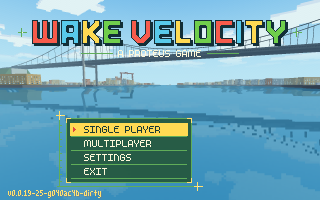
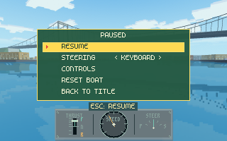
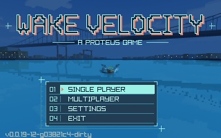

# Boating game title screen and main-program plan

Status: revised 2026-10-28. This document owns the title, menu and promotion of
**Wake Velocity**. Two compile-time palettes now share the same backdrop placement, geometric
wordmark, m5x7/m3x6 fonts and menu flows. Cartoon daylight is the default; configure with
`-DPROTEUS_WARM_MENU=OFF` to retain the user-selected cyan dusk design from 2026-10-27.
The shared title retains single-player setup, public/LAN/address joining, hosting and saved
settings. Volume settings, title music and a live river backdrop remain deferred.
Next: user comparison of both palettes and physical input/playback review; native/browser
package qualification remains outstanding. Gameplay sunset is owned by the
[sunset plan](SUNSET_PLAN.md), independently of these title-only colour treatments.
Music status belongs to the [boating plan](BOATING_PLAN.md#selectable-soundtracks--2026-10-24).

## Warm daylight alternative and shared game typography, 2026-10-28

Completed: `PROTEUS_WARM_MENU=ON` (default) uses the fixed river capture's bright original
daylight colours, grassy green panels, cream text and sunny yellow selection. The title's
interiors alternate red, blue, yellow and green, with a dark navy edge and offset shadow.
The user liked the initial daylight direction but found its brown panels/title grade too
brown; the supplied Super Mario World reference inspired the brighter cartoon palette.
That earlier brown/terracotta treatment is superseded. OFF retains the original cyan title/dusk grade and occupied windows. Both use
exactly the same captured river geometry, logo silhouette, fonts, title placement and row
bounds. No new generated art or asset changes are required. There is no runtime theme setting.

The Escape menu uses the selected palette, m5x7 and a fixed chevron in place of the older
bobbing `(*)`. Gameplay overlays/help/scoreboard text use the same m5x7, scaled only by whole
integers; instrument labels use m3x6. `src/boat_ui.[ch]` owns shared colours and the game font
lifetime, loaded only after a graphics context exists and released before it closes.
Standalone instrument primitive review tools retain their built-in fallback lettering when
UI fonts have not been loaded. Core/session simulation and world lighting are unchanged.

Review captures:

Verification, 2026-10-28, Apple Silicon/macOS: Debug builds passed for both ON and OFF.
Final `ctest --preset full`: all 230 enabled tests passed (14.79 s), with 15 retired
experiments disabled and `PROTEUS_GPU_TESTS=OFF`. The initial sandboxed run could not bind
local test sockets; the full run with socket access passed. No project warnings; the first
raylib build reported its existing bundled stb_vorbis pointer-comparison warning.

A temporary uncommitted harness captured all five warm panels plus the pause menu with
instrument labels; these and the retained cyan title capture were inspected at native size.
It presented 120 title frames, and a separate river `--demo --frames 120` windowed run
completed cleanly. Formatting, changed local link targets and `git diff --check` passed.
These are agent-run graphics/demo checks, not physical input or listening acceptance.
No browser/package builds, Windows/Linux runtime, physical input/listening, course/voyage
playthrough, or GPU CTest lane were verified for this revision. Next: user comparison and
hands-on navigation/playback, then browser/package qualification. The dated 2026-10-27
sections below describe the retained cyan variant.

## Cyan workstation redesign, 2026-10-27

Native review capture (development build version shown):

Completed: replace the bowed/bobbing logo with a title-owned, outlined bitmap wordmark;
keep coral offset depth and a small centered A PROTEUS GAME. The main menu is compact,
left of center over the water, with plain option labels, a cyan reverse-video selection, coral
chevron, fine dividers, bracket corners and sparse registration marks. Text stays fixed
when selection changes. Submenus retain their wider value/editing space with the same
cyan selection and framing; hints have dedicated room above the footer. Rendering stays
320×200, nearest-neighbour and integer-scaled, including browser BACK TO LAUNCHER.

The scenery-only river capture is graded once when loaded, with a deeper blue sky,
cooler water and a few authored occupied-window pixels anchored to its fixed facades.
No generated mock-up art is shipped. Gameplay scenery, physics, replay and network
content are unchanged. A live sunset requires the shared renderer work in the sunset plan.

The lower-left version follows the web packager's Git convention:
`git describe --tags --match 'v[0-9]*' --always --dirty`, resolved at CMake configure time.
Reconfigure after changing revisions to refresh it. Source archives/release builds may
supply `-DPROTEUS_VERSION=v0.0.19`; absent Git metadata and an override, it says `unknown`.
The old PROTEUS 2026 footer is removed; SETTINGS retains MAP: OSM CONTRIBUTORS.

## Geometric lettering and clean river, 2026-10-27

User feedback: the first two custom alphabets still looked uneven compared with mock-up B;
menu row numbers and the small center boat were unnecessary. Completed: replace the
coarse alphabet with a separately generated native bitmap wordmark. All letters share a
24 px cap height and 6 px stems/bars; diagonal strokes are drawn at final pixel resolution,
with consistent spacing and no oversized I serifs. The one-pixel cyan edge, dark fill and
two-pixel coral depth follow B. `tools/generate_title_wordmark.py` owns the geometric source;
[asset notes and regeneration](../assets/title/README.md) document both graphics.

The main menu now has only the four option labels and selection chevron; the number gutter
is removed and the panel fits the shorter rows, including browser BACK TO LAUNCHER. A fresh
scenery-only river render removes the player boat and its wake while preserving the bridge
composition. `title_backdrop` uses the existing GPU renderer, a fixed camera/time and no
player layer; gameplay rendering is untouched. Native/browser packaging includes the
wordmark and native relocation workflows check its presence.

Verification, 2026-10-27, Apple Silicon/macOS: Debug build and all 256 enabled CTests
passed with GPU tests ON (62.50 s; 15 retired cases disabled). Native all-panel captures,
row-center hit checks and 120 windowed title frames passed; captures were inspected.
A temporary bitmap audit found twelve connected glyphs sharing the same top/baseline,
6 px stems and 3/10 px letter/word gaps. Wordmark regeneration produced identical bytes.

Emscripten MinSizeRel packaging, Chrome/SwiftShader title/settings persistence, repeated
sessions and audio-context checks passed. A pointer check entered Settings/Multiplayer,
returned and exited to the launcher. Native and 4× browser captures were compared with B.
A local ad-hoc-signed macOS ZIP was extracted outside the checkout; its title capture
loaded the new wordmark and clean river and was inspected. Chrome retained its existing
ScriptProcessorNode/ReadPixels warnings. C formatting, Python syntax, changed local links
and diff checks passed. Next: user visual review. Physical input/listening, Finder launch,
Windows/Linux runtime and Firefox/Safari remain unverified for this revision; passing
checks do not establish acceptance of the lettering.

## Initial redesign verification (historical)

Initial implementation verification, 2026-10-27 (before the font refinement below),
Apple Silicon/macOS: Debug configure/build passed, with no
project-source warnings (raylib's bundled stb_vorbis emits its existing pointer-comparison
warning on the first build). Full CTest with `PROTEUS_GPU_TESTS=ON`: all 256 enabled tests
passed (63.58 s); 15 retired wake-field/prototype cases disabled. A temporary, uncommitted review
harness captured every panel and selected row, checked row-center hit bounds and the
main error hint, and completed 120 windowed title frames. Native title, settings, join
and error captures were inspected; the explicit river `--demo --frames 120` smoke run
exited cleanly. Final title lettering was captured and inspected again.

Emscripten MinSizeRel packaging passed. Chrome/SwiftShader's existing
`tools/check_web_title.py` passed keyboard navigation, settings save/reload, two solo
sessions and return to title, plus the audio-context assertions; captures were inspected.
It reported ScriptProcessorNode deprecation and ReadPixels performance warnings, with
no failing runtime/shader errors. Local documentation links, clang-format and diff checks
passed. The initial sandboxed graphics attempt was stopped and rerun with desktop access.

Limits: no physical keyboard/mouse play, listening acceptance, Windows/Linux run,
Safari/Firefox or packaged-binary review. The temporary title harness was agent-run,
not a human playtest. Mock-up B was user-selected; implementation acceptance remains
pending. Next: user visual review and physical playback, then the sunset lighting-frame step.

## First compact-font refinement, 2026-10-27 (lettering/layout superseded)

User feedback: the generated B mock-up's title and font looked better than the first
implementation. Completed: replace the narrow 5×7 title alphabet with a separately
authored 7×9 bitmap wordmark using broad two-cell strokes, square counters, a cyan edge
and coral depth. Menu labels, values, row numbers and A PROTEUS GAME now use Daniel
Linssen's **m5x7**; hints and footer data use **m3x6**. Both fonts are credited in SETTINGS
and in [the bundled font notes](../assets/fonts/README.md). Existing gameplay HUD and
in-game Escape menu fonts remain outside this title-menu refinement.

The supplied TTFs are retained as source assets. The first runtime-TTF experiment was
superseded: raylib's ascent-to-descent sizing produced uneven 7×9 / 4×8 capitals at its
nominal 16 px height. `tools/generate_menu_fonts.py` now bakes BMFont metrics/atlases at
the author's intended 16 px em size using Pillow/FreeType. The shipped atlases have true
5×7 / 3×6 capitals, integral advances and binary coverage; title-owned fonts load/unload
with the title and draw 1:1 with point filtering. Width fitting and edit cursors use the
same font metrics as drawing. Native/macOS/Windows and browser packaging include the
fonts and attribution. No TTF rasterization happens at runtime.

Verification, 2026-10-27, Apple Silicon/macOS: Debug build and all 256 enabled CTests
passed with GPU tests ON (62.67 s; 15 retired cases disabled). The temporary native
review captured every panel/selected row and completed 120 windowed title frames;
font glyphs were checked for binary coverage, native capital size and integral advances.
Captures were inspected at 1× and integer scale. Atlas regeneration with Pillow 13.0.0
produced identical file hashes. A locally ad-hoc-signed macOS ZIP was extracted outside
the checkout; its title capture loaded the packaged fonts and was inspected.

Emscripten MinSizeRel packaging, Chrome/SwiftShader title/settings persistence, repeated
solo sessions and audio-context checks passed. A separate pointer check entered Settings,
returned, entered Multiplayer and returned to the launcher; captures were inspected.
Chrome reported the existing ScriptProcessorNode deprecation and ReadPixels warnings.
Changed local documentation links, Python syntax, C formatting and diff checks passed.
Next: user visual review of this capture. Physical input/listening, Finder launch,
Windows/Linux runtime and Firefox/Safari remain unverified for this refinement.

## Browser parity, 2026-10-25

Implemented in `web-parity`: browser PLAY enters this shared title; browser EXIT becomes
BACK TO LAUNCHER, flushing saves before reload. SINGLE PLAYER now opens a five-row setup
(PLACE, WAVES, SMOOTHING, START, BACK) on both platforms, preserving the browser launcher's
River/Basin/Basin trial choices. Settings and setup persist through native `title.txt` /
browser IndexedDB. Browser sessions reuse the title window and retain the gesture-started audio
device, so BACK TO TITLE and repeated sessions work without reloading. The browser multiplayer
panel originally offered URL/CONNECT/BACK, using the existing join flow with WebRTC; no host/LAN rows.
Since 2026-10-26 it adds a default named SERVER row fetched from `servers.json`: Winterfell
can be joined without typing, with manual URL/CONNECT retained. The
[browser guide](WEB_BUILD.md#known-browser-servers-2026-10-26) owns implementation,
verification and deployment limits; human review of this new row remains pending.

Verification: Chrome/SwiftShader automated title/settings/solo navigation, repeated sessions,
Escape/return, save/reload and audio-context checks pass; captures inspected. Native and
multiplayer verification, next tasks and limits are owned by
[browser boating](WEB_BUILD.md#webrtc-rooms). Hand play/listening acceptance remains outstanding.

## Safe reset menu, 2026-10-26

Implemented in `controls-pedals-stability`: insert RESET BOAT / RESTART RUN / REQUEST RESET
between CONTROLS and the leave row, preserving RESUME as the default. Activation closes the
menu and invokes the existing session reset or authoritative request with neutral controls.
A room request is allowed from this paused input frame; race/grid/respawn restrictions still
belong to the authority. The one-second Backspace shortcut is device-free state shared with
the interactive race trial, with cancellation and one-fire-per-hold semantics. R no longer
resets. Current behavior, verification and next task: [controls handoff](CONTROLS_PEDALS_HANDOFF.md).

## Identity and first screen

**Wake Velocity** remains the user-selected name (2026-10-23). The 2026-10-27 cyan
workstation direction above supersedes the original bowed cream/coral logo and bouncing
`(*)` selection. Keep **A PROTEUS GAME** as the small demo-group credit.

The backdrop is a scenery-only GPU river sample, just past Älvsborgsbron looking
back from boat-local `(641.115, -842.196)` with a 32 m / 4 m camera and fixed 62° lens.
Its explicit scene time is 73.350 s; it preserves the original sample's composition without
the player layer. The title-only dusk grade preserves the 320×200 pixel grid. A later live title scene may show a slowly passing boat and gulls,
driven by its own presentation clock without advancing a player's session or wakes.

Earlier comparisons included Watercraft and GBG/Gothenburg names. BUOY! was superseded
because [Buoy already has a Steam listing](https://store.steampowered.com/app/1687170/Buoy/).
The original 2026-10-23 prototype and 2026-10-24 integration evidence below are history;
they do not describe the current logo, footer or selected-row appearance.

## Menu behavior

| Entry | Current behavior | Later work |
| --- | --- | --- |
| Single Player | Opens River, Basin or Basin trial plus waves/smoothing setup, then starts the existing session. The explicit `--course` path remains available. | Broader mode selection remains deferred. |
| Multiplayer | Public server selection, native LAN/host flow and manual address joining; browser WebRTC joining. | Broader platform/network qualification remains owned by the multiplayer plans. |
| Settings | Name, boat, steering, soundtrack and smoothing, with retained map credit. | Volume and display controls remain deferred. |
| Exit | Close the native program. | On the web, replace with “Back to launcher” if the page launcher remains; browser tabs cannot be closed reliably by game code. |

Up/Down or W/S moves one row; Enter/Space activates; mouse hover/click also works.
Escape goes back one menu level. In ordinary interactive play, Escape opens the in-game
menu (see the dated implementation below); explicit scripted modes retain their exit behavior. Focus loss continues to
pause the simulation. Do not let the title, settings, or pause menu advance the player's
120 Hz boat session or emit gameplay wakes. A later title-only scene may animate its own
boat, gulls, and visual wake independently.

Direct command-line modes (`--screenshot`, `--time`, `--frames`, `--demo`, `--replay`,
`--course`, explicit location and review flags) enter the requested session directly.
That keeps scripted visual checks, benchmarks, and developer workflows deterministic.
Use the existing `--title --screenshot FILE` capture path for title review. It needs a
graphics context; gameplay CPU captures remain display-free. Browser startup may use the
title immediately after the current page launcher; remove duplicate controls only after
the native and web flows have been reviewed together.

## In-game Escape menu, 2026-10-25

Completed task: Escape during a `wake_velocity` session no longer switches mouse steering back to
the keyboard or leaves. It opens a menu in the scene's 320x200 grid (`tools/wake_velocity_menu.[ch]`,
styled like the title) with RESUME, STEERING `< MOUSE / KEYBOARD >`, CONTROLS (the `?` guide over
the menu; Esc returns) and a leave row: BACK TO TITLE from the title, LEAVE ROOM in a room, QUIT
for explicit-option launches, absent in browsers. Esc or RESUME closes it; the frame that closes
it ignores gameplay clicks. While open, capture is released and the session is inactive: single
player and its audio pause; a room keeps running and the authority sees neutral controls (thrust
to neutral, wheel target centred), the same as help or focus loss. M still toggles in play. The
steering mode a session ends in is written back to the title's STEERING setting and `title.txt`.
In browsers, an unlock the game did not request (Escape, focus loss) opens the menu rather than
dropping to keyboard; denied capture still falls back to keyboard.

Decision: multiplayer has no pause; the menu says THE ROOM KEEPS RUNNING; YOUR BOAT IDLES.

Fix, 2026-10-25 (user report): BACK TO TITLE by Enter/Space or click re-entered single player,
because the activating press was still pressed in the title's first frame and activated its
default row. The title now takes no input on its first frame (it already ignored Escape there).
Build and all 118 active CTests pass. The user then played BACK TO TITLE in single player on
2026-10-25: "Works!"

Verification, 2026-10-25, macOS (Apple Silicon), Debug: build warning-clean; all 118 active
CTests passed. A temporary, reverted instrumentation opened the menu at start and saved GPU
window captures of solo (mouse and keyboard rows) and a local `boat_server` room (LEAVE ROOM
selected); they were inspected, and the solo run reported 0 simulation ticks while open. Not
done: hand play of Esc/M/resume recapture, the browser build, Windows/Linux. The title hint and
help text changed but no new title capture was reviewed.

Next task: user plays the Escape menu solo and in a room (mouse mode, Esc, STEERING, RESUME,
leave), then decide whether SOUNDTRACK or other settings belong in it.

## Historical playtest integration, 2026-10-24

Scope was cut to what multiplayer playtesting needs (user request, 2026-10-24): choose a
nick, pick a livery where supported, and enter an address to join. Everything else in
the menu table above remains a later proposal.

- `tools/boat_title.[ch]` owns the title: the prototype's bowed logo, footer and
  `assets/title/river-backdrop.png`, drawn at 320x200 and integer-scaled. Rows: SINGLE
  PLAYER, MULTIPLAYER, SETTINGS, EXIT. SETTINGS opens NAME / BOAT / STEERING / SOUNDTRACK / BACK
  (2026-10-24; NAME and BOAT were main rows before). STEERING picks KEYBOARD or MOUSE for the
  start of each session, passed as `--mouse-steering`. SOUNDTRACK cycles A LITTLE BOAT /
  ACID WAKE / OFF with Left/Right, Enter or a click, passed as `--soundtrack` to single
  player and joined rooms. MULTIPLAYER opens LAN / ADDRESS / CONNECT / BACK.
  LAN (added 2026-10-24) lists rooms found by
  [LAN discovery](MULTIPLAYER_PROTOCOL.md#lan-discovery). The search runs while the panel is
  open; Left/Right pick among several rooms and Enter joins one, copying its address into
  ADDRESS. Selection moves from CONNECT to LAN when the first room appears, unless the player
  has already moved it.
  Enter on a text row starts typing (printable ASCII; Enter keeps, Esc cancels, empty
  restores). Mouse hover/click works. Settings persist as `title.txt` in the
  personal-best data directory (`name=`, `address=`, `skin=`, `mouse_steering=on|off`,
  `soundtrack=a-little-boat|acid-wake|off`), saved
  when leaving SETTINGS, choosing a session or exiting. The default address is
  `127.0.0.1:24680` and the default name `player`.
- `tools/wake_velocity.c`: the former `main` is `study(argc, argv)`; it reuses an open window and
  leaves it open. The new `main` shows the title only for no arguments or `--title`, runs
  SINGLE PLAYER as the former macOS app arguments plus `--skin`, and MULTIPLAYER as
  `--connect ADDRESS --name NAME`. Escape in a session returns to the title; the title
  ignores the just-pressed Escape event on its first frame so it cannot immediately close
  the app. Explicit options behave exactly as before. The web build originally bypassed the title; the browser parity update below supersedes that path.
- Skins: protocol v1 (and v2) has no livery field and every client colours slots 1–4 Sweden,
  Finland, Denmark, Norway, so BOAT applies to single player only and the title says so.
  A per-player livery would need a protocol revision; not done.
- Nicks were already sent in the hello but never shown; `net_study_draw_roster` now lists
  the room's players and countries at the top right. `NetStudy.failure` keeps the
  connect/disconnect reason, which the title shows under the menu.
- The macOS app and Windows `launch.bat` now open the title (Windows previously started
  Eriksberg directly). Single player from the title is the river on both.

Verification, 2026-10-24, macOS / Apple M1 Max, Debug: build warning-free and all 104
active CTests passed (retired wake-field cases disabled); the title
capture (`wake_velocity --title --screenshot`) inspected at 1x/3x. A temporary scripted
build of `main` (reverted, not committed) ran single player twice in the shared window,
joined a local `boat_server` as `tester` (server roster confirmed, graceful leave),
then failed against an unused port with the message returned to the title.
`wake_velocity --connect` beside `boat_bot` showed the roster ("kalle SWEDEN", "davve
FINLAND (YOU)"). `boat_server --bind 0.0.0.0` accepted a bot. Not verified: interactive
keyboard/mouse use of the title (synthetic key events did not reach the window),
packaged macOS/Windows launches, Windows/Linux builds, two-machine play, and user
acceptance. The marine HUD branch is not merged; it also edits `tools/wake_velocity.c`
and `tools/wake_velocity_net.[ch]` (input/draw paths), so expect small textual conflicts.

Release naming, 2026-10-24: native packages now present **Wake Velocity** with
`wake_velocity` executables and versioned archive/Actions artifact names. This ships
package naming independently of promotion step 3 below. On 2026-10-25 the CMake target,
sources and developer commands were renamed from `boat_study` to `wake_velocity` as well. [Releases](RELEASES.md) owns verification and
the next packaging checks. Main-program promotion remains deferred.

## Historical promotion sequence and ownership

This sequence records the original integration proposal. The dated results above supersede
its prototype appearance and initial flow limitations; volume/live scenery remain deferred.

1. **Title slice:** Put menu input, screen state, and rendering behind a small interface
   used by `tools/wake_velocity.c`. Keep the letter shapes owned by the title module.
   Reuse the existing 320×200 render target and integer scaling.
   Use the worktree prototype and its real river sample as the review baseline. Capture
   idle and selected frames and inspect them at native size and 3× scale.
2. **Flow:** Add location and settings submenus, pause/return behavior, audio transitions,
   and browser-safe Exit behavior. Check keyboard and mouse paths, focus changes, and
   returning to a fresh session after a capsize. Wire Multiplayer to the network agent's
   public entry point once it exists; until then keep its unavailable state honest.
3. **Make boating the main program:** After multiplayer changes settle, make the boating
   game the default build/run and package entry. The game target is now `wake_velocity`
   (renamed from `boat_study` on 2026-10-25, without a compatibility alias); the four-minute
   audiovisual demo that held the `proteus` name was removed the same day. The window and application are named **Wake Velocity** (both launch paths since 2026-10-25). Update CMake,
   CTest commands, README launch instructions, web packager,
   macOS/Windows workflows, release artifacts, and asset paths in one reviewable change.
   Check for name assumptions with `rg` before renaming. Do not rework the multiplayer
   agent's files while it is actively changing the boating loop or build graph.

The separate `proteus` demo was removed on 2026-10-25 (it remains in the git history). The game keeps
its 120 Hz physics and existing gameplay defaults. Any title animation uses presentation
time and has no effect on deterministic sessions or replay compatibility.

## Acceptance and verification

- Logo and all four rows read clearly in a 320×200 capture; selected state is clear in
  still frames and motion, with no menu text hidden by water or window scaling.
- A fresh normal launch reaches the title. Single Player reaches each location; returning
  to title and starting again produces a fresh session. Multiplayer offers server selection
  and joining, and reports connection failures. Settings and native Exit perform their
  stated actions.
- Existing explicit CLI screenshot/replay/course and benchmark paths produce their prior
  outcomes. Native and web input, audio, focus, and resize behavior receive manual checks.
- Run Debug configure/build and CTest; inspect CPU and GPU title captures where supported;
  smoke the packaged macOS/Windows/web launch paths when the executable promotion lands.

Initial planning verification, 2026-10-23, macOS, before the prototype: inspected `CMakeLists.txt`,
`tools/wake_velocity.c`, `cmake/Web.cmake`, the project README, and the multiplayer and
foundations plans. The existing app has a direct gameplay loop, Escape closes its native
window, CLI modes enter gameplay, and web packaging targets `wake_velocity`. No art, audio,
runtime, or user acceptance check is claimed for this proposal. The document links and
`git diff --check` passed. Debug configure passed; the full build failed at link time while
another agent's in-progress pose/presentation extraction had new source files absent from
the CMake target lists. The requested CTest command was started, then stopped after it
reported missing executables from that incomplete build. A second configure/build after
CMake changed got farther but failed while validators still referenced presentation fields
being moved by the other agent. No passing suite is claimed for this concurrent working-tree
state. These are historical main-checkout failures during concurrent work, not the
prototype's current verification result.

The isolated worktree prototype subsequently captured a real GPU river frame from
`(641.115, -842.196)` at 73.350 s on the deterministic route, and used it behind both
title treatments. The user liked that backdrop on 2026-10-23. Its full Debug build and
all 67 active CTests passed on macOS; 13 retired field cases were disabled. Both title
captures were inspected and a 120-frame native window smoke run completed. The worktree's
`docs/TITLE_SCREEN_DEMO.md` owns commands, evidence, and remaining menu-review limits.
