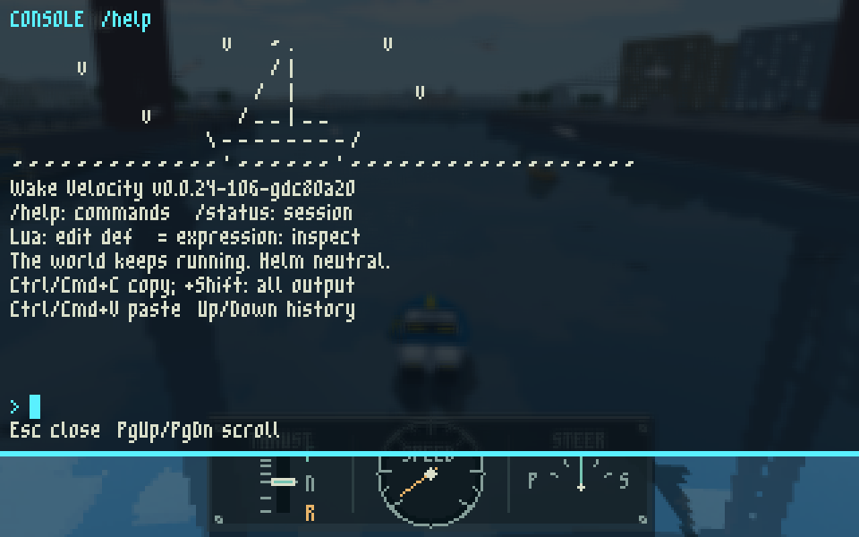
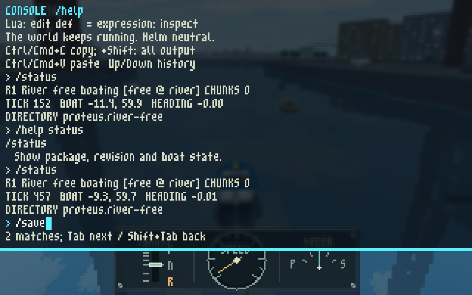
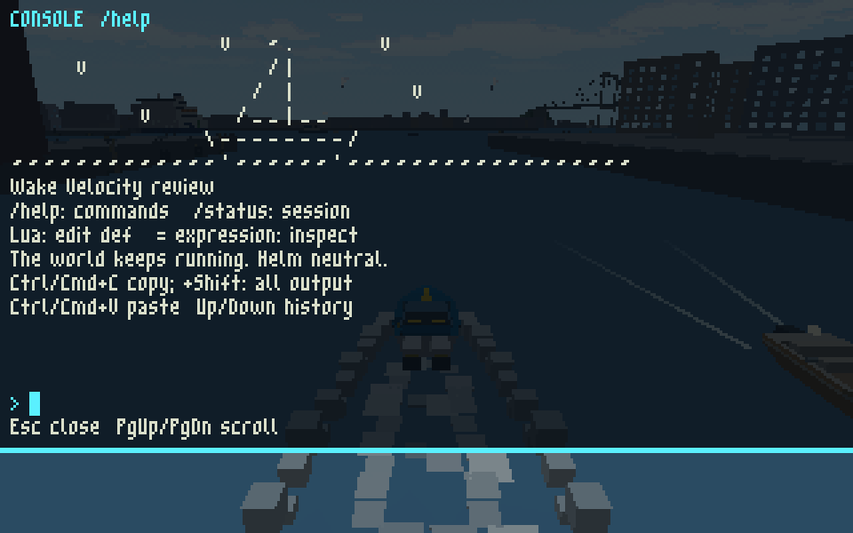

# Console comfort review, 2026-11-04

Apple Silicon/macOS. Native Debug, GPU CTests off; browser MinSizeRel with pinned Emscripten,
Chrome 156.0.8078.80 using SwiftShader at a 960×600 canvas (3× the 320×200 frame).
These are agent-inspected captures, not final user acceptance or cross-platform qualification.

The browser smoke exercised `/status`, topic help, real clipboard Copy/latest/all and macOS paste,
unique Tab completion, rapid Tab cycling and Shift+Tab reversal, full help, scrollback, a long
mixed-width input line, Home and closing/reopening with its draft intact. No page or shader errors
were reported. The clipboard was restored afterwards. All 358 enabled native CTests passed.

## First opening, small face and GPU backdrop

The m3x6 face uses natural advances with three-pixel spaces. Only the ASCII drawing uses fixed
cells. The panel has 195/255 opacity; the scene is blurred before the text is drawn.

## Command completion

`/s`, Tab, Tab reaches `/save`; Shift+Tab returns to `/status`. The footer explains cycling.

## CPU fallback

A temporary native OpenGL review harness used a deterministic CPU river frame as its background,
then captured the panel with and without its backdrop shader. The native shader compiled and its
blur was inspected; this retained frame shows the unblurred CPU fallback. The banner says `review`
because the harness supplies that version string. The browser captures above use the game's build
version and live GPU scene.

[Owning console status and limits](../../../PLUGIN_DEFAULT_PLAN.md#pc-console-comfort-2026-11-04)
