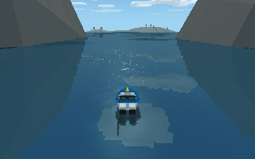
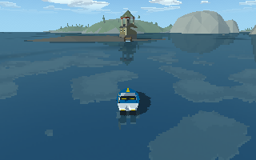
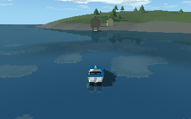

# Skerry Reach native review

Recipe 2, seed 41717, captured on Apple Silicon/macOS on 2026-11-25. These are game frames,
not concept art. Destination views use the default GPU camera, Day lighting and a 320×200
scene. Departure is a native window capture with HUD after a 180-frame scripted run.
All runs use `--no-audio`. The user found recipe 1 bland; these images show the subsequent
native character revision, which has no user acceptance yet.


| Needle Pass | Net Sheds |
| --- | --- |
|  |  |

| Bell Rock | Hidden Lagoon |
| --- | --- |
|  |  |


Reproduce a destination view using its `capture.start` and `capture.heading_degrees` in
[`manifest.json`](../../assets/geometry/archipelago/manifest.json):

```sh
./build/wake_velocity --no-audio --location archipelago --start 410,-2520,-75 \
  --demo-idle --screenshot build/skerry-light.png --time 0
./build/wake_velocity --no-audio --location archipelago --demo --frames 180 \
  --frame-capture build/skerry-window.png
```

Use `--renderer cpu` for display-free reference captures. The
[world guide](../PROCEDURAL_WORLD.md) describes generation and limitations; the
[owning plan](../PROCEDURAL_WORLD_PLAN.md) records verification and the next review.
