# Skerry Reach native review

The [additional art direction](../PROCEDURAL_WORLD_PLAN.md#additional-art-direction--2026-11-25)
records the user’s fishing-boat, sea, sunset and marina photographs for future iterations.

## Jetty water and clocked windows — 2026-11-27

The current house panes use Outer's glass palette, residential occupancy and day/night blend.
These Home Harbour captures use `--no-audio --location archipelago --start -28,-24,-55
--demo-idle --time 0`, CPU at hours 12/21/3 and GPU at 21. Water now continues below the
solid jetty decks. The [plan](../PROCEDURAL_WORLD_PLAN.md#jetty-water-and-outer-style-house-windows--2026-11-27)
records the geometry, checks and remaining user review.

| CPU, noon | CPU, 21:00 | CPU, 03:00 |
| --- | --- | --- |
| 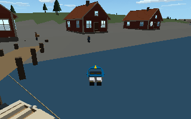 | 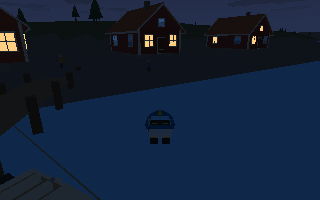 | 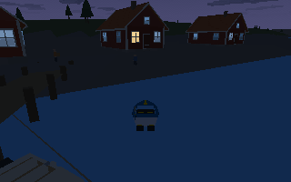 |

| GPU, 21:00 | GPU with waves, 21:00 at two seconds |
| --- | --- |
| 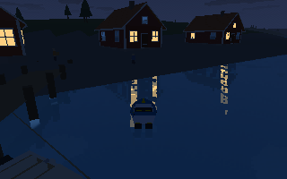 | 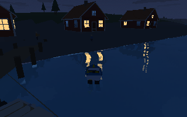 |

## Red-house rebuild — 2026-11-27

Reference-led replacement of the red box houses. Current CPU/GPU captures appear above;
user review remains open.
These earlier captures include the extended overhangs and the superseded static room colours;
the captures above show the current clocked glass.
These isolated flat-ground fixtures were rendered by the actual CPU renderer at 320×200
on macOS; they are geometry reviews, not game-camera captures or concept art.

| House | Small hut |
| --- | --- |
| 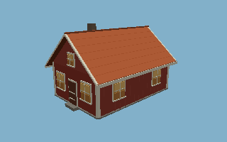 | 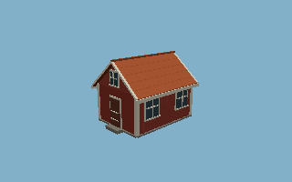 |

The [plan](../PROCEDURAL_WORLD_PLAN.md#red-house-rebuild--2026-11-27) records the
user's references, revised roof construction, home rock shelf, checks and remaining review.
CPU game-camera captures at Home Harbour (1 s, start `-28,-24,-55`) and Net Sheds
(0 s, start `-683.287,-650.992,-90`) use `--no-audio --renderer cpu --demo-idle`:

| Home Harbour | Net Sheds |
| --- | --- |
| 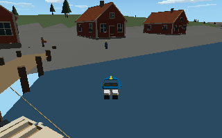 | 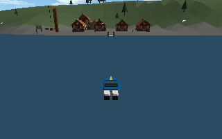 |

Lighthouse CPU captures from `--start -70,-260,90`, at fixed hours 12 and 23.
Night times 0 and 2 show the rotating lens brightness; see the
[lamp checks and open jetty issue](../PROCEDURAL_WORLD_PLAN.md#lighthouse-lamps--2026-11-27).

| Day | Night | Night, two seconds later |
| --- | --- | --- |
| 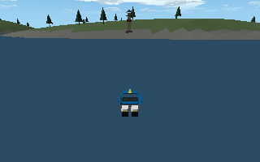 | 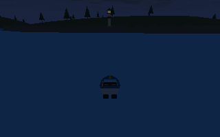 | 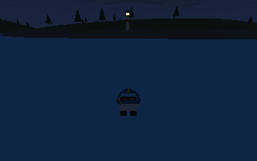 |

Earlier screenshots below retain the previous house recipe as history.

## Recipe 4 — fishing boat, marina and day/night

Native reference-led follow-up, Apple Silicon/macOS, 2026-11-25–26. These are game captures
at the default 320×200 scene resolution with audio disabled. The boat is a local generated
wooden fishing recipe; four moored craft and eight lines populate the home jetties.

| Fishing circuit | Home marina |
| --- | --- |
| 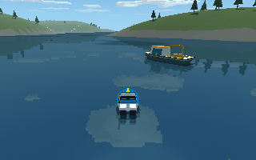 | 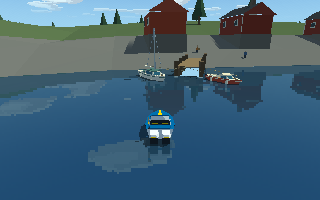 |

| Cycle at 225 simulated seconds (18:00) | Cycle at 450 simulated seconds (midnight) |
| --- | --- |
| 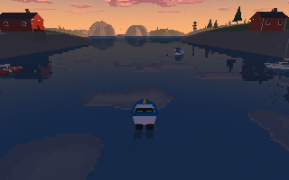 | 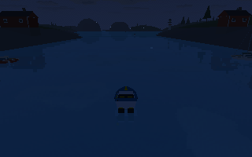 |

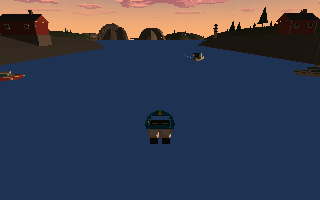

The cycle starts at noon and takes 900 simulated seconds. Explicit lighting holds a fixed
phase. The user accepted this visual pass on 2026-11-26. There are no new marina night lamps;
broader night/readability qualification remains open. Breaking surf, spray and interactive
marina services remain deferred.

```sh
./build/wake_velocity --no-audio --location archipelago --demo-idle \
  --start -610,-540,0 --screenshot build/fishing-boat.png --time 0
./build/wake_velocity --no-audio --location archipelago --demo-idle \
  --start -10,-5,-80 --screenshot build/home-marina.png --time 0
./build/wake_velocity --no-audio --location archipelago --demo-idle \
  --screenshot build/home-sunset.png --time 225
./build/wake_velocity --no-audio --location archipelago --demo-idle \
  --screenshot build/home-night.png --time 450
```

## Recipe 3 — finer shores and local life (history)

Native captures on Apple Silicon/macOS, 2026-11-25, Day lighting, audio disabled. Terrain and
shore spacing is 16 m; clear offshore water stays at 32 m. These show the follow-up to the
user's positive response to recipe 2 and request for finer shores and archipelago life.


| Launch waiting at time 0 | Launch moving at time 15 |
| --- | --- |
| 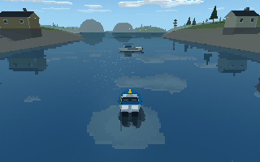 | 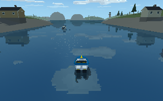 |

| Needle Pass, recipe 2 | Needle Pass, finer recipe 3 |
| --- | --- |
|  | 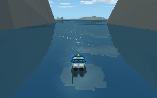 |

The moving craft, gulls and small shore residents are evaluated from simulation time. Boats
have solid hulls; their trails are cosmetic and they do not yield. Recipe 3 has not yet had
human acceptance. The frames above use the default 320×200 scene, integer scaled in the
window capture; people and birds remain small at this resolution.

```sh
./build/wake_velocity --no-audio --location archipelago --demo-idle \
  --screenshot build/life-home.png --time 15
./build/wake_velocity --no-audio --location archipelago --demo-idle --demo --frames 1200 \
  --frame-capture build/life-window.png
```

## Recipe 2 — native character pass (history)

Recipe 2, seed 41717, captured on Apple Silicon/macOS on 2026-11-25. These are game frames,
not concept art. Destination views use the default GPU camera, Day lighting and a 320×200
scene. Departure is a native window capture with HUD after a 180-frame scripted run.
All runs use `--no-audio`. The user found recipe 1 bland; these images show the subsequent
native character revision, which has no user acceptance yet.

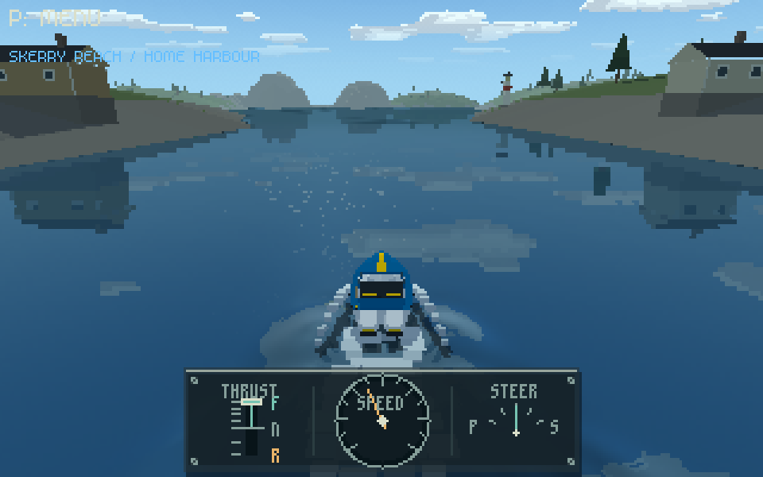

| Needle Pass | Net Sheds |
| --- | --- |
|  | 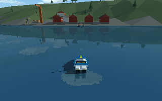 |

| Bell Rock | Hidden Lagoon |
| --- | --- |
|  |  |


Reproduce a destination view using its `capture.start` and `capture.heading_degrees` in
[`manifest.json`](../../assets/geometry/archipelago/manifest.json):

```sh
./build/wake_velocity --no-audio --location archipelago --start 410,-2520,-75 \
  --demo-idle --screenshot build/skerry-light.png --time 0
./build/wake_velocity --no-audio --location archipelago --demo --frames 180 \
  --frame-capture build/skerry-window.png
```

Use `--renderer cpu` for display-free reference captures. The
[world guide](../PROCEDURAL_WORLD.md) describes generation and limitations; the
[owning plan](../PROCEDURAL_WORLD_PLAN.md) records verification and the next review.
