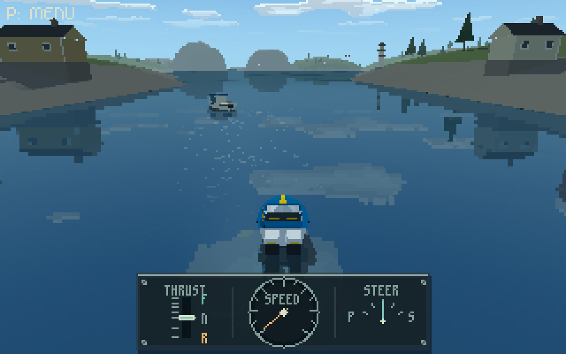
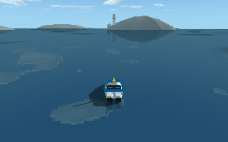

# Skerry Reach native review

The [additional art direction](../PROCEDURAL_WORLD_PLAN.md#additional-art-direction--2026-11-25)
records the user’s fishing-boat, sea, sunset and marina photographs for future iterations.

## Recipe 3 — finer shores and local life

Native captures on Apple Silicon/macOS, 2026-11-25, Day lighting, audio disabled. Terrain and
shore spacing is 16 m; clear offshore water stays at 32 m. These show the follow-up to the
user's positive response to recipe 2 and request for finer shores and archipelago life.



| Launch waiting at time 0 | Launch moving at time 15 |
| --- | --- |
|  |  |

| Needle Pass, recipe 2 | Needle Pass, finer recipe 3 |
| --- | --- |
|  |  |

The moving craft, gulls and small shore residents are evaluated from simulation time. Boats
have solid hulls; their trails are cosmetic and they do not yield. Recipe 3 has not yet had
human acceptance. The frames above use the default 320×200 scene, integer scaled in the
window capture; people and birds remain small at this resolution.

```sh
./build/wake_velocity --no-audio --location archipelago --demo-idle \
  --screenshot build/life-home.png --time 15
./build/wake_velocity --no-audio --location archipelago --demo-idle --demo --frames 1200 \
  --frame-capture build/life-window.png
```

## Recipe 2 — native character pass (history)

Recipe 2, seed 41717, captured on Apple Silicon/macOS on 2026-11-25. These are game frames,
not concept art. Destination views use the default GPU camera, Day lighting and a 320×200
scene. Departure is a native window capture with HUD after a 180-frame scripted run.
All runs use `--no-audio`. The user found recipe 1 bland; these images show the subsequent
native character revision, which has no user acceptance yet.


| Needle Pass | Net Sheds |
| --- | --- |
|  |  |

| Bell Rock | Hidden Lagoon |
| --- | --- |
|  |  |



Reproduce a destination view using its `capture.start` and `capture.heading_degrees` in
[`manifest.json`](../../assets/geometry/archipelago/manifest.json):

```sh
./build/wake_velocity --no-audio --location archipelago --start 410,-2520,-75 \
  --demo-idle --screenshot build/skerry-light.png --time 0
./build/wake_velocity --no-audio --location archipelago --demo --frames 180 \
  --frame-capture build/skerry-window.png
```

Use `--renderer cpu` for display-free reference captures. The
[world guide](../PROCEDURAL_WORLD.md) describes generation and limitations; the
[owning plan](../PROCEDURAL_WORLD_PLAN.md) records verification and the next review.
