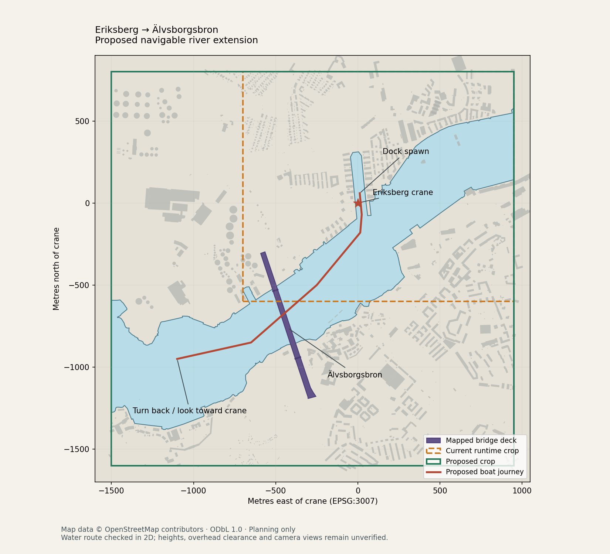

# Älvsborgsbron river expansion

Status, 2026-10-18: opt-in river location implemented, with a shared CPU/GPU bridge
blockout and grounded road approaches. Both deterministic river traversal presets pass.
Bridge/shoreline/building detail and a human handling/camera playthrough remain open;
see [implementation status](#implementation-status-and-remaining-work).
The separate Eriksberg location, its smaller crop and the main demo were removed on 2026-10-25;
the river is now the only mapped location.
Further expansion toward the river mouth and Vinga is proposed in the
[free-riding adventure plan](../FREE_RIDING_ADVENTURE_PLAN.md); this record continues to describe
the implemented crop. The [Sol first-steps handoff](../FREE_RIDING_ADVENTURE_FIRST_STEPS.md)
starts with current-map reference evidence before the offline route/data survey and baseline.
The A0.1 [dated reference](../adventure/baseline.md) now records the crop's cache/copy
inventory, physical route, CPU/GPU captures and checksums.
[All plans](../README.md).

```sh
./build/wake_velocity --location river --gpu-aa
./build/wake_velocity --location river --gpu-aa --waves
```

Leave the dock and follow the river southwest to the bridge. The river view defaults
to 32 m back / 6 m high to show the bridge above the water; C resets that view.
The map boundary and four tower legs block the hull. The deck, cables, and crossbeams
are elevated scenery; overhead structure collisions are not implemented.



[Vector map](coverage.svg) · [Machine-readable findings](summary.json)

The retained survey map and JSON use the original “current”/“proposed” labels.
They mean the former Eriksberg crop (retired 2026-10-25) and the river crop respectively.

## Implemented coverage and original survey

Keep the crane origin and EPSG:3007 metre frame. Coordinates here are east/north;
boat simulation X points west, so negate it when converting to map coordinates.

| Coverage | West, south, east, north relative to crane | Size |
| --- | --- | --- |
| Former Eriksberg crop (retired) | −700, −600, +950, +800 m | 1,650 × 1,400 m |
| River crop | −1,500, −1,600, +950, +800 m | 2,450 × 2,400 m |
| Download envelope | Approximately −1,900, −2,200, +1,250, +1,100 m | Source margin around proposal |

The river crop extends 800 m west and 1,000 m south of the former Eriksberg crop.
The mapped bridge outline occupies approximately east −592…−255 m, north −1,191…−297 m.
The former Eriksberg boundary cut through that area; the river location contains the
entire mapped deck and space to sail beyond it.

The route drawn on the map starts at the existing dock spawn and travels about
1,649 m to a turnaround point. It crosses the mapped bridge deck around (−454, −678) m
and continues to (−1,100, −950) m. The survey polyline is inside the river water polygon
with at least 27.6 m of mapped shore/crop clearance. Those original geometric checks
are separate from the subsequently implemented simulated voyage documented below;
neither establishes real-world overhead clearance.

## Source and reproducibility

Map data © [OpenStreetMap contributors](https://www.openstreetmap.org/copyright),
[ODbL 1.0](https://opendatacommons.org/licenses/odbl/1-0/).

`osm-survey.json.gz` is a separate planning extract retrieved on 2026-10-17 from the
[OSM map API](https://api.openstreetmap.org/api/0.6/map.json?bbox=11.8770534,57.6776116,11.8946856,57.6875018).
It replaced the original Eriksberg snapshot, removed with that crop on 2026-10-25, and is now
the source `tools/prepare_waterfront.py` pins. The source
envelope is longitude 11.8770534…11.9299499, latitude 57.6776116…57.7072822.

The envelope was divided into a 3 × 3 grid at longitude 11.8946856, 11.9123177
and latitude 57.6875018, 57.6973920. The southeast tile exceeded the API's 50,000-node
limit and was subdivided into four, at longitude 11.9211338 and latitude 57.6825567.
Each tile used `https://api.openstreetmap.org/api/0.6/map.json?bbox=west,south,east,north`.
Tiles were downloaded sequentially in time across several requests, not as an atomic
historical snapshot. Embedded tile bounds and raw-response SHA-256 hashes record provenance.

Responses were merged by element type/ID, preferring the highest version and requiring
equal contents for duplicate versions. Nodes were expanded into way geometry. The
retained subset includes buildings/parts, roads/paths, waterways, water/coastline,
bridges/supports, and cranes. Relation members include available way geometry; missing
members remain explicit. User identities and changeset IDs were omitted. The compressed
extract contains 16,895 features; its decompressed SHA-256 is pinned by `survey.py`.

Recreate all survey artifacts offline using Python with pyproj 3.8.0, shapely 2.1.2,
and matplotlib 3.10.8:

```sh
python docs/river/survey.py
```

The script draws the former Eriksberg crop for comparison, checks the source
hash, assembles the two main outer banks of river relation 3329487, and verifies:

- Artificial closing edges and omitted bank fragments lie outside the proposed crop.
- Any polygon repair preserves all mapped bank segments inside the proposed crop.
- The bridge outline lies inside the crop.
- The entire route has at least 8 m of water clearance and crosses the mapped bridge deck.

The map shows building way outlines for context. They are not a deduplicated building
inventory; relation-only buildings, courtyards, terrain, and detailed vegetation need
the runtime importer's handling. The playable mesh preserves mapped courtyards and
building parts. Outside the authored approach embankments, terrain remains an assumed flat quay.

Generate the separate runtime assets offline with the existing pyproj/shapely dependencies:

```sh
python tools/prepare_waterfront.py --area river
```

Output is `assets/geometry/river/geometry.h` and `manifest.json`. Normal builds do not
run Python. Incomplete building relations are omitted and listed in the manifest;
`height=0` is treated as missing and its fallback is recorded. Bridge support parents
are excluded from normal building extrusion. Only the four mapped legs cut the water;
the open towers, deck, main cables, and hangers are authored by `tools/prepare_bridge.py`.
The blockout assumes a constant 45 m deck underside, a 3 m deck slab, and 107.6 m
tower tops. Cable sag, beam sizes, flat ground, and deck height remain modeling assumptions.

Both ends now connect to the existing inland road network. The north approach follows
Västerleden/Hisingsleden for approximately 529 m; the south approach follows the mapped
Västerleden carriageway for approximately 363 m, landing before the current crop boundary.
The shared road is offset toward the centre of the mapped carriageway pair and descends
from the 48 m deck top to the scene's 3.5 m ground. The short south descent is deliberately
steeper than the north descent; neither grade claims to reproduce the real terrain.
Grassy embankments support the slabs throughout their descent, concrete abutments meet
the suspended deck underside, and asphalt plus road markings continue across the joins.

The generator checks road-chain continuity, exact deck/ground endpoint heights, and that
the full reserved grading corridors remain on mapped dry land inside the crop. Ground road
paint inside those corridors is replaced by the elevated roadway. Five building footprints
overlapping the reserved grading are omitted and listed in the river manifest. River water
and navigation boundaries are unchanged. Authored bridge/approach triangles are explicitly
marked so abutments and ramps receive no generated apartment windows or roof textures.

## Repeatable route verification

The boat water review drives the real 120 Hz boat
simulation from the dock, through the bridge, and beyond it. It checks the enclosing
hull rectangle stays in water throughout the voyage, the four leg centres are blocked,
water below the deck is open, and the outer crop remains closed.

```sh
./build/boat_water_review --check
./build/boat_water_review --check --waves
./build/boat_water_review --renderer cpu --output build/river-cpu
./build/boat_water_review --renderer gpu --output build/river-gpu
./build/boat_water_review --renderer gpu --waves --output build/river-wave-gpu
```

GPU checks require desktop graphics access. Each capture run exports named dock,
river, approach, under-bridge, past-bridge, beyond, and final look-back images plus a
CSV of actual boat poses. GPU runs also sample rendering throughout the journey.
Additional `north-landfall.png` and `south-landfall.png` captures inspect the connections from
fixed water positions. `connections-overview.png` uses an elevated inspection camera to show
the road-to-deck and road-to-ground joins; these views are separate from the recorded voyage.
Use `--visible` for live GPU playback, and `--sequence` to export every sampled frame.
The river's default review view matches the playable 32/6 camera; close captures retain
the existing 12/6 water-detail view.

Both water presets reach the end in approximately 101 seconds without a hull-clearance
failure. Inspected CPU and GPU captures show the suspension silhouette on approach,
the deck shadow during passage, and the bridge behind the boat at the end. Flat-water
CPU rendering averaged about 35 ms per sampled frame; GPU with 4×4 AA averaged about
9.1 ms per frame submission on the development machine (9.9 ms with waves). Submission timings are not
complete display-frame timings. The CPU wave reference tessellates the entire expanded
water footprint (about 2.24 million triangles), so GPU is recommended for interactive waves.

## Landmark findings

Use [bridge relation 5776295](https://www.openstreetmap.org/relation/5776295) for the
landmark and [way 387711139](https://www.openstreetmap.org/way/387711139) for its mapped
outline. The relation includes road/path alignments and pylon members. Avoid importing
the tagged bridge supports as ordinary solid building extrusions: the tall pylons
need open, authored geometry.

The relation tags say suspension, height 107.6 m, length 900.6 m, and marine clearance
45 m. The outline instead says cable-stayed. These tags are unverified and partly
contradictory; use the supplied photograph for the suspension silhouette and verify
structural dimensions before treating them as modeling measurements. Nearby tower
node 2495322719 also has a 331 m aviation-related height tag; do not use it as the
bridge's structural height. Path `ele=50` is not a deck profile or clearance survey.

## Implementation status and remaining work

1. Implemented: separately pinned source/crop, at first beside the Eriksberg output as an opt-in
   scene. Since 2026-10-25 it is the only mapped crop and the generator's only output.
2. Implemented: water/land and coarse buildings preserve the water-first triangle ordering
   required by `src/boat_map.c`. Incomplete building relations are explicitly omitted.
3. Implemented: shared CPU/GPU bridge blockout with open towers and separate solid leg footprints.
4. Implemented: deterministic captures and actual boat traversal, including shoreline checks,
   reflections, shadows, and rendering timings. The existing 2,200 m camera far plane
   covers the bridge and crane from the turnaround point without an increase.
5. Implemented: grounded approach roads, embankments, and abutments on both banks, following
   retained mapped road alignments with authored vertical profiles.
6. Next: refine cables, hangers, road interchanges, quays, shoreline rocks, and nearby waterfront
   buildings. Surveyed terrain and detailed approach gradients remain future work. Freehand handling
   and camera occlusion beside buildings still need a human playthrough.
